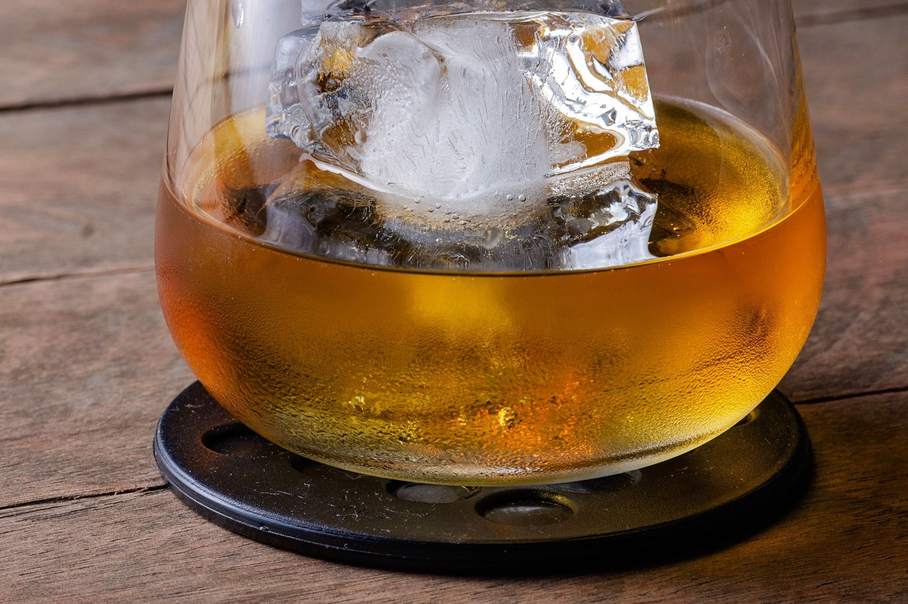
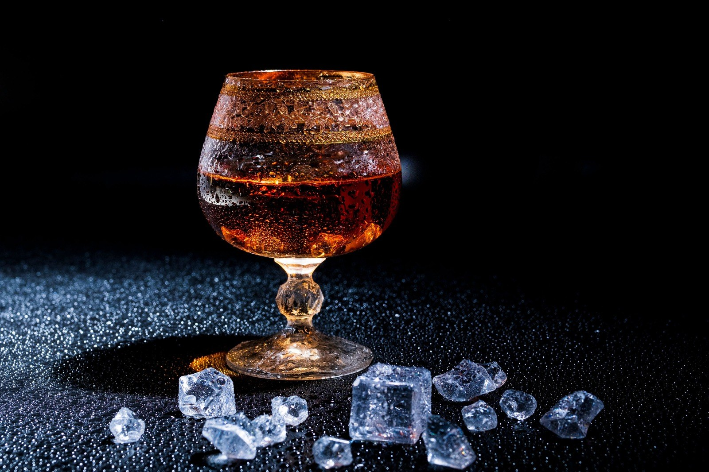
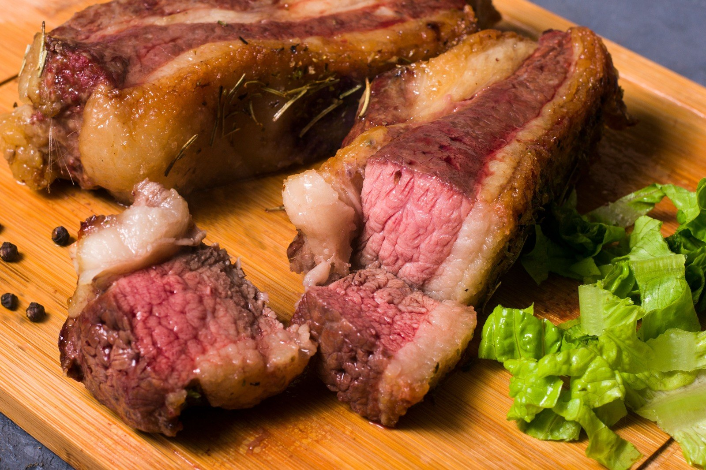
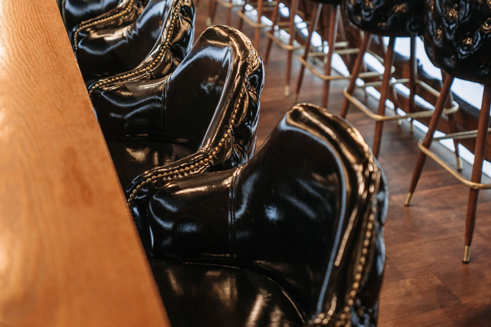

A gentleman does not drink whisky to impress the room. He drinks it to understand the glass in front of him: the grain, the cask, the region and the quiet ceremony of a well-made pour. In the United States that ceremony is now broader than ever. Scotch still sets the vocabulary, Kentucky bourbon remains the American classic, Japanese blended whisky has a firm place on serious back bars, and as of 2025 American single malt has a legal definition of its own.

This guide is for the man who wants to order, taste and keep whisky with some knowledge and no fuss. Prices appear only where a producer or an official state list has published them, and they vary by store and by state. Whisky is a pleasure, not a prescription; drinking less is better for health than drinking more, and nothing below is medical advice.

> **Key takeaways**
> - **Order by name and by serve:** the bottle, then neat, with a water back, or with one large piece of ice — and a please.
> - **Single malt is not automatically “better” than a fine blend.** The Scotch Whisky Association defines both clearly; each belongs in a serious cabinet.
> - **Taste first at 15–18°C, neat, in a tulip glass such as a Glencairn.** Add a few drops of still water if you wish; ice cools and then dilutes.
> - **Nose gently, sip slowly, notice the finish.** Most of what people call taste is aroma.
> - **Match weight with food and, if you already smoke, with a cigar:** sherried malts with cheddar, peated Islay with Stilton or dark chocolate, bourbon with a well-marbled steak.
> - **Build a short, premium shelf, not a crowd of bottles.** Five well-chosen whiskies will serve for years. Drink in moderation.

## How to Order Whisky Like a Gentleman

The bar is a conversation, not an examination. Stand or sit where the bartender can see you, read the list if there is one, and order in a complete sentence.

Name the whisky, then the serve. “A Lagavulin 16, neat, with a water back, please” tells the bartender everything required: the bottle, no ice in the glass, and a small glass of still water on the side so that you can add a few drops yourself. “Neat” means the spirit as bottled, at room temperature. “A splash of water” means the water is already in the glass. “On the rocks” means ice; if you want it cold without a glass full of small cubes, ask for one large cube or one sphere.

If you do not know the name, describe the style: a fruity Speyside, a smoky Islay, a sweeter bourbon, a soft Japanese blend. Do not snap your fingers, and do not treat a well-aged single malt as a shot. Thank the person who poured it.

Original article: [GQ](https://www.gq.com/story/beginners-guide-to-scotch)

## Single Malt, Blended Scotch, Bourbon and American Single Malt

The language on a label is law, and it tells you how the whisky was made.

### Single malt and blended Scotch

The Scotch Whisky Association, following the Scotch Whisky Regulations 2009, is exact. Scotch must be distilled and matured in Scotland for at least three years, in oak, and bottled at a minimum of 40% alcohol by volume. A single malt is mashed, fermented and distilled at one distillery from water and malted barley only, in copper pot stills, and it must be bottled in Scotland. A blended Scotch is a blend of one or more single malts with one or more single grain whiskies. There are also single grain, blended malt and blended grain categories, but these two are the ones a gentleman meets most often.

A fine blend is not a compromise. In 2024, bottled blends still accounted for the greater share of Scotch exports by value. A blender can balance several characters into one composed glass. Drink a blend when you want harmony; drink a single malt when you want the fingerprint of one place.

Original article: [Scotch Whisky Association](https://www.scotch-whisky.org.uk/discover-scotch/enjoying-scotch/scotch-whisky-categories/)

### Bourbon

Bourbon is America’s own whisky. Federal standards require a mash of at least 51% corn, distillation at no more than 160 U.S. proof (80% ABV), entry into new charred oak barrels at no more than 125 proof (62.5% ABV), production in the United States, and bottling at no less than 80 proof (40% ABV). Coloring and flavoring are not permitted in bourbon. The result is typically sweeter and more vanilla-and-caramel in character than a sherried malt, with the char of new oak very much in the glass. “Straight” bourbon has been aged at least two years.

### American single malt

In December 2024 the Alcohol and Tobacco Tax and Trade Bureau added American single malt whisky to the federal standards of identity, effective 19 January 2025. The spirit must be mashed, distilled and aged in the United States, distilled entirely at one U.S. distillery from a fermented mash of 100% malted barley, distilled at 160 proof (80% ABV) or less, matured in oak barrels of no more than 700 litres, and bottled at no less than 80 proof (40% ABV). Caramel coloring is allowed only if it is disclosed on the label. “Straight” may be used when the whisky has been aged at least two years. It is the first new type of American whisky in more than half a century.

Original article: [TTB](https://www.ttb.gov/public-information/featured-stories/ttb-establishes-american-single-malt-whisky-standard-identity)

## The Five Scotch Regions

Scotland’s official map names five regions: Speyside, Highland, Lowland, Islay and Campbeltown. They are a useful way to begin, not a prison. A Speyside malt from sherry casks will not taste like one from refill bourbon wood. Still, the map is how most serious lists are organized.

**Speyside**, along the River Spey, is the most densely populated whisky region in the world. The Scotch Whisky Association describes its malts as frugal with peat and full of fruit: apple, pear, honey, vanilla and spice, often from sherry casks. The Macallan, The Glenlivet and Glenfiddich are the names most Americans meet first.

**The Highlands** are the largest region and the most varied, taking in, officially, the islands other than Islay. You will find lighter, floral malts and saltier coastal ones under the same heading.

**The Lowlands**, south of a line between Dundee and Greenock, have historically been associated with gentler, grassier malts and with the grain whisky that feeds blends. A Lowland malt can be a graceful first pour of the evening.

**Islay**, pronounced “eye-luh,” is the island of peat smoke, seaweed and a maritime intensity. Lagavulin, Laphroaig and Ardbeg are the famous peated voices; Bunnahabhain and Bruichladdich also make unpeated malt, a reminder that the island is not a single note.

**Campbeltown**, once a forest of stills, is now a small region of salty, slightly oily, sometimes lightly peated malts with a character of their own.

Original article: [Scotch Whisky Association](https://www.scotch-whisky.org.uk/discover-scotch/enjoying-scotch/scotch-whisky-regions/)

## Glassware: The Glencairn and the Tumbler

The glass changes what you can smell, and therefore what you can taste.

A tulip-shaped nosing glass, of which the Glencairn is the modern standard, has a wide bowl and a narrower mouth. The bowl gives the whisky room to open; the chimney concentrates the aromas toward the nose. Hold it by the base or the short stem so that your hand does not warm the spirit. Whisky Advocate recommends this shape for tasting. It is the glass to reach for when the point of the evening is the whisky itself.

A tumbler, or rocks glass, is wider and heavier. It will accept a large cube or a sphere, it sits comfortably in the hand, and it is the right glass for a relaxed pour or a simple whisky cocktail. It will not concentrate aroma as a Glencairn does, and that is fine. Keep both. Use the tulip to learn a bottle; use the tumbler when the conversation has taken over.

Whatever you pour into, the glass should be clean and clear. Rinse with still water and let it dry. Perfume, smoke and a strongly scented soap will do more damage to a nosing than a slightly ordinary glass.

*Photo: Marcelo Verfe / Pexels, [Pexels License](https://www.pexels.com/license/)*

Original article: [Whisky Advocate](https://whiskyadvocate.com/how-to-enjoy-whisky)

## Neat, a Few Drops of Water, or Ice

There is no single correct serve. There is a sensible order in which to meet a whisky, and then there is the way you actually enjoy it.

Start neat. Pour about 25 to 30 ml for a tasting, or a more generous 45 ml if this is the evening’s glass, and give the spirit a few minutes in the air. Neat, at a cool room temperature, is how the distillery bottled it.

Then consider water. A few drops of still, neutral water can lower the alcoholic “prickle,” release aroma and, in cask-strength bottlings especially, make the glass more readable. Master blenders routinely dilute when they work. Add the water slowly; you can always add more, and you cannot take it out. A pipette is more precise than a careless splash. Avoid strongly mineral or chlorinated water.

Ice is a different decision. It chills the drink and, as it melts, dilutes it. That can make a high-strength whisky more approachable on a warm night, and it will also mute some of the finer aromas. Whisky Advocate suggests trying the whisky neat first and, if you want it colder, using one large, hard cube or sphere that melts slowly, rather than a handful of small cubes. The Glenlivet, in its drinking guide, recommends 15°C to 18°C if you want the full complexity of flavor, with a few drops of room-temperature water as a gentler alternative to a very cold glass.

In a heated American living room, “room temperature” can sit well above that 15–18°C range. If the bottle has been near a radiator, a brief rest or a single large cube is common sense, not a failure of taste.

*Photo: Саша Алалыкин / Pexels, [Pexels License](https://www.pexels.com/license/)*

Original article: [The Glenlivet](https://www.theglenlivet.com/en/our-community/articles/how-to-drink-whisky/)

## How to Nose and Taste a Dram

Tasting is a slow, repeatable sequence. You need a clean tulip glass, a little time and the humility to say what you actually smell.

Pour the whisky and look at it against the light. A deep amber often suggests sherry wood, a paler gold a former bourbon barrel, though age and, in some categories, declared coloring also play a part. Swirl the glass once, gently, and bring it toward your nose. Do not bury your face in the glass and inhale hard; the alcohol will sting and you will smell nothing else. Hold the glass slightly below the nose, keep the mouth a little open, and breathe softly. If the nose tires, rest and return: the aromas change as the spirit takes in air.

Ask what the smell reminds you of, not what you think you are supposed to find. Honey, citrus peel, vanilla, fresh oak, raisins, peat smoke, sea air, leather, milk chocolate: any of these may be honest. Then take a small sip, let it move across the mouth, and notice the texture — oily, silky, thin, warming. Swallow, and breathe out through the nose. That last breath is the finish. Is it short or long? Does it stay sweet, dry, smoky or spicy?

Now add two or three drops of water, swirl, and nose again. Peated malts and cask-strength bottlings often change the most. If the glass becomes thin and vague, you have added too much.

Original article: [Whisky Advocate](https://whiskyadvocate.com/how-to-enjoy-whisky)

## Food and, If You Smoke, Cigar Pairings

Whisky sits as naturally beside food as wine does, because the fat in cheese or a well-marbled steak softens the alcohol and lets aroma come forward.

Whisky Advocate’s tasting-table guidance is a solid place to begin. Aged cheddar draws out the nutty, fruity side of a sherried Speyside or Highland malt. Stilton, with its bold, creamy salt, can stand up to a peated Islay. Dark chocolate at 70% cocoa or more has the depth for those same smoky malts; a slightly milder chocolate, around 50 to 65%, is often happier with a gentler blend. For steak, match weight: a leaner tenderloin can take a lighter, maltier whisky, while a richer, dry-aged rib eye wants a more robust single malt or a high-rye bourbon.

*Photo: Maxi Gagliano / Pexels, [Pexels License](https://www.pexels.com/license/)*

Cigars are a traditional companion, not an obligation. Whisky Advocate’s pairing rule is to match body with body: a full cigar with a full whisky, a milder smoke with a lighter malt or a softer bourbon. Bourbon, the magazine notes, is a forgiving partner because its caramel, vanilla, honey and charred oak sit so comfortably with tobacco. If you already smoke, keep the whisky in a tumbler and remember that smoke in the room will change how the next glass smells. If you do not smoke, there is no reason to start for the sake of a pairing.

Original article: [Whisky Advocate](https://whiskyadvocate.com/whisky-tasting-club-food-pairings)

## Building a Premium Home Bar

A gentleman’s home bar is a small, deliberate shelf, not a display of trophies. Five bottles will cover most evenings: a fruity or sherried Speyside or Highland malt, a peated Islay, one excellent blended Scotch or Japanese blend, a well-made bourbon, and either a second bourbon in a different style or an American single malt as the category grows. Buy what you will actually finish. An opened bottle, stored upright, tightly closed, in a cool cupboard away from sunlight, keeps its character for a long time; a half-empty bottle oxidizes faster than a full one. The Glenlivet’s own advice is to keep whisky upright, out of direct light, and to decant the last measures into a smaller vessel if the bottle is nearly done.

The tools are few. Two Glencairn glasses and two heavy tumblers are enough for a household. A small pipette, a carafe of still water, and a tray of large cubes in the freezer will serve almost every serve described above. A simple notebook is more useful than a decanter you never finish. Write the name, the date you opened the bottle, and two lines about what you tasted. In a year you will have a palate, not just a cabinet.

*Photo: Pavel Danilyuk / Pexels, [Pexels License](https://www.pexels.com/license/)*

Original article: [The Glenlivet](https://www.theglenlivet.com/en/our-community/articles/how-to-drink-whisky/)

## Five Bottles Worth Knowing

The bottles below are widely recognized reference points, not a shopping mandate. Prices appear only as they are listed on the pages linked, and they will not be the same in every state. The Macallan figure is from the distillery’s own U.S. shop. The other four are the most recent retail prices published by the North Carolina Alcoholic Beverage Control Commission, an official state list; your local shelf may be higher or lower.

### The Macallan Double Cask 12 Years Old

A Speyside single malt matured in sherry-seasoned American and European oak. The U.S. shop describes a nose of creamy butterscotch, toffee apple, candied orange and vanilla, a honeyed palate with wood spice and citrus, and a warm, sweet oak finish, bottled at 43% ABV in 750 ml. The Macallan U.S. shop lists it at $82.00.

[The Macallan Double Cask 12 Years Old](https://usshop.themacallan.com/products/double-cask-12-years-old-legacy-design)

### Lagavulin 16 Year Old

The classic Islay malt: peat smoke, seaweed, a salty edge and a sweetness from sherry-influenced maturation, typically at 43% ABV. It is the bottle many American bartenders reach for when a guest asks for something frankly smoky. The North Carolina ABC Commission lists Lagavulin 16, 0.75 litre, at a retail price of $94.95, effective 1 February 2025.

[Lagavulin 16, NC ABC price list](https://abc2.nc.gov/Pricing/ViewItemDetails/151091)

### Hibiki Japanese Harmony

Suntory’s flagship blended Japanese whisky, built for balance rather than a single regional punch: honey, citrus, white flowers and soft oak. It is the bottle to pour when the table wants elegance rather than peat. The North Carolina ABC Commission lists Hibiki Japanese Harmony, 0.75 litre, at a retail price of $99.95, effective 1 February 2026.

[Hibiki Japanese Harmony](https://house.suntory.com/hibiki-whisky/hibiki-japanese-harmony)

### Blanton’s Single Barrel

The original single-barrel bourbon, bottled at 93 proof (about 46.5% ABV) from Buffalo Trace. Each bottle comes from one barrel, so the exact accent shifts slightly from one to the next, within a recognizable profile of sweet oak, vanilla and spice. The North Carolina ABC Commission lists Blanton’s Single Barrel, 0.75 litre, at a retail price of $82.95, effective 1 August 2026. Availability is often tight; the listed price is not a promise that a given store has stock.

[Blanton’s Original Single Barrel](https://www.buffalotracedistillery.com/our-brands/blantons-single-barrel/blantons-original-single-barrel/)

### Michter’s US*1 Small Batch Bourbon

A refined Kentucky straight bourbon, small batch, with corn sweetness, wood and a little rye spice. The North Carolina ABC Commission lists Michter’s US*1 Small Batch Bourbon, 0.75 litre, at a retail price of $45.95, effective 1 August 2026.

[Michter’s US*1 Kentucky Straight Bourbon](https://michters.com/kentucky-straight-bourbon/)

## Drinking in Moderation

None of the ritual above is an argument for drinking more. The Dietary Guidelines for Americans, as summarized by the Centers for Disease Control and Prevention, say that adults of legal drinking age may choose not to drink, or to drink in moderation: two drinks or less in a day for men, on days when alcohol is consumed. Drinking less is better for health than drinking more. People who do not drink should not start for any reason. A U.S. standard drink is 14 grams of pure alcohol, which is about 45 ml of a 40% spirit. A larger pour, or a cask-strength whisky at 55 or 60% alcohol by volume, is more than one standard drink.

You should not drink at all if you are under 21, if you are driving or operating machinery, if you are taking medication that interacts with alcohol, if you have a medical condition that alcohol makes worse, or if you cannot control the amount you drink. Even moderate drinking can raise the risk of certain cancers and other harms compared with not drinking. This article is not medical advice. If alcohol is becoming a problem, speak to a physician; the CDC and the NIAAA’s Rethinking Drinking pages are a sober place to start.

Original article: [CDC](https://www.cdc.gov/alcohol/about-alcohol-use/moderate-alcohol-use.html)

## FAQ: Whisky for the Gentleman

### Should I drink whisky neat or with water?
Try it neat first, at about 15–18°C, then add a few drops of still water if you want the aromas to open or the alcohol to soften. Both serves are correct; ice is a separate, personal choice.

### What is the difference between single malt and blended Scotch?
A single malt comes from one distillery and is made only from malted barley in pot stills. A blended Scotch combines one or more single malts with one or more single grain whiskies. A fine blend can be as serious as a malt.

### What glass should I use at home?
A Glencairn or another tulip-shaped nosing glass for tasting; a heavy tumbler when you want a large cube or a more relaxed pour. Keep both, and keep them clean.

### Is American single malt a real category now?
Yes. The TTB’s standard of identity took effect on 19 January 2025. It requires 100% malted barley, one U.S. distillery, and maturation in oak, among other rules.

### How many drinks is a generous whisky pour?
A U.S. standard drink is about 45 ml of 40% spirit. A deeper pour, or a cask-strength whisky, counts as more. Two drinks or less in a day is the federal moderate-drinking limit for men, on days when you drink at all.

### Does whisky go with food?
Yes. Aged cheddar with a sherried malt, Stilton or dark chocolate with a peated Islay, and a well-marbled steak with a robust bourbon or malt are classic starting points.

---

*This article summarizes publicly available information from the sources linked above. It is not medical advice and is not an invitation to drink. Alcohol is for adults of legal drinking age who choose to drink, in moderation.*
