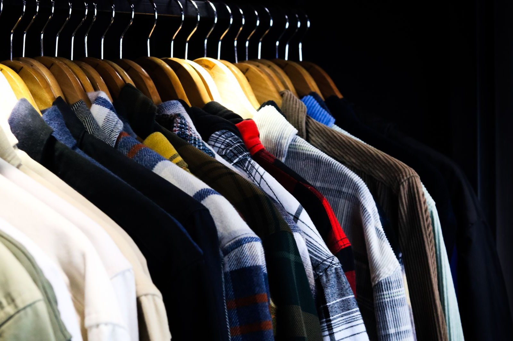
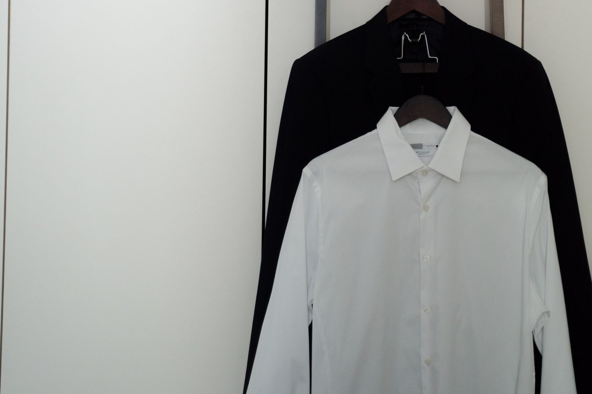
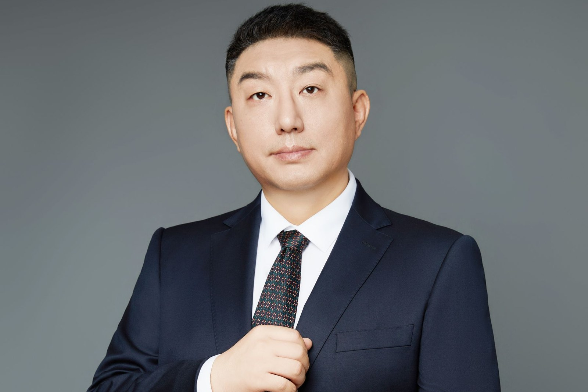

The dress shirt is the most-worn piece of tailoring a man owns, and the one he thinks about least. A suit gets a fitting, shoes get a cobbler, a watch gets a service. The shirt, meanwhile, is bought in a hurry, washed too hot, ironed with the collar stays still inside and replaced when the collar frays. That is a waste, because nothing frames the face, the beard and the tie knot as closely as the collar of a well-made shirt.

In 2026 the dress shirt is having a quiet return. GQ's latest office guide calls a fully suited-up look, with a sharp shirt and a taut tie, the biggest flex in a world where few jobs still demand it. This men's dress shirt guide covers what actually matters: the collar, the cloth, the fit, the craftsmanship behind a luxury shirt, and the care routine that keeps it looking new for years. Every section is built on a current, named source, and prices appear only where the maker's page showed them.

## Key takeaways

- **Start with two shirts:** a white or pale blue spread-collar shirt in poplin or twill for suits, and an oxford-cloth button-down for everything else. Esquire calls this pair the foundation of the wardrobe.
- **The flatter and smoother the cloth, the dressier the shirt.** Poplin and broadcloth are the most formal, twill and pinpoint sit in the middle, and oxford cloth is the relaxed end.
- **The collar has to be strong.** GQ's 2026 office rules name a "wimpy collar" as the worst suiting sin; choose collars with enough height and point length to sit under the lapels.
- **Fit is a checklist, not a feeling:** one finger in the buttoned collar, no pulling between buttons, shoulder seam at the shoulder edge, and roughly 1 cm of cuff showing below the jacket sleeve.
- **Luxury is in the cloth and the construction:** long-staple cotton such as Sea Island, two-fold yarns, single-needle stitching and real mother-of-pearl buttons.
- **Care decides lifespan:** remove collar stays, wash at moderate temperatures, skip the tumble dryer and iron while slightly damp, collar first.

## The two-shirt foundation: the spread collar and the oxford button-down

Esquire's style editors make the case for starting simple. Their advice for the first serious white dress shirt is a spread collar, a shape that sweeps out from the chin and roughly follows the line of the collarbones, cut in a finer fabric such as poplin. The second shirt is a distinctly American one: the oxford-cloth button-down, with a heavier fabric and collar points that button onto the shirt front. With those two in the wardrobe, Esquire argues, a man is "pretty well covered."

The logic is sound. The spread collar handles the suit, the tie and the formal meeting. The button-down handles the blazer, the weekend, the dinner without a tie and the long-haul flight. Esquire is also specific about the spread collar itself: the points should be long enough to stay hidden beneath the jacket lapels, which gives the collar enough body to hold a proper tie knot. Point collars, in their view, can look "dinky," and an extreme cutaway too flamboyant for a first shirt.

On details, the advice is restraint. Skip the chest pocket on a dress shirt. A French placket, the clean front without a folded strip of fabric, works well. French cuffs are usually unnecessary for the everyday shirt. A monogram is best avoided, and if you insist, it belongs on the rib cage, where the jacket hides it, rather than on the cuff.

For bearded men, the spread collar has a practical bonus. It opens the neckline and gives a full beard room to sit without crowding the collar points, while a narrow point collar can be pushed outward by the beard and look untidy by midday.

Original article: [Esquire](https://www.esquire.com/style/mens-fashion/a62896526/buying-a-white-dress-shirt/)

## The 2026 office: power dressing returns, and the collar matters more than ever

GQ's March 2026 guide to office dressing is a useful signal of where things stand. The magazine accepts that few jobs still require a suit every day, but argues that this is exactly why suiting up completely, with a sharp shirt, a taut tie and shined shoes, is now the strongest statement in the room. Its rules for this "Power Dressing 2.0" look are blunt: move on from the starter two-button suit toward wider peak lapels and double-breasted cuts, look for suits that simply fit rather than skinny or oversized ones, and accept pleats and trouser cuffs as signs of a good tailor.

On shirts, GQ is direct: "There's no greater suiting sin than a wimpy collar." The recommendation is to stock up on dress shirts with a strong, substantial point, illustrated by a crisp striped shirt from the young London tailor Speciale, listed in the feature at $300. The same story shows how relaxed shirts fit into the broader picture, with roomier, boxy button-ups from Copenhagen's Mfpen styled as office wear for creative jobs.

What this means in practice is simple. If the suit is getting broader in the lapel and fuller in the trouser, the collar has to keep pace. A collar with a low band and short points disappears under a wide lapel and makes the head look small. A taller band, longer points and a firm but not stiff interlining keep the proportions balanced, especially on broader-shouldered men and men with a full beard.

Original article: [GQ](https://www.gq.com/story/what-wear-now-march-2026)

## Poplin, twill, pinpoint or oxford: how to read shirt fabric

Fabric is where most men stop paying attention and where luxury shirts quietly pull ahead. Esquire's rule borrows from suiting: the flatter and shinier the surface, the dressier the cloth. Traditional oxford cloth is heavier, with a visible basket texture, and sits at the casual end. Poplin is lightweight, smooth, slightly lustrous and the most formal everyday choice, though fine poplin can tend toward sheerness. Twill and pinpoint sit in between, with a finer, more even texture than oxford and more durability than delicate poplin.

*Photo: Nazmul Alam Badhon / Pexels, [Pexels License](https://www.pexels.com/license/)*

How to choose between them:

- **Poplin** (also called broadcloth in the US): the classic suit shirt. Crisp, cool and smooth. Best for meetings, weddings and evenings with a tie. It creases more readily, so it rewards proper ironing.
- **Twill:** a diagonal weave with a soft sheen and good drape. It holds a press longer and creases less obviously, which makes it the smart choice for long days and travel.
- **Pinpoint oxford:** a finer, smoother cousin of oxford cloth. Dressier than a regular oxford, sturdier than poplin, and a good bridge for business-casual offices.
- **Oxford cloth:** the button-down fabric. Textured, breathable and hard-wearing, it softens beautifully with every wash. Wonderful with a blazer, less convincing under a sharp worsted suit.
- **Royal oxford and herringbone:** textured but refined weaves with more sheen, ideal for a winter shirt worn with flannel.

Under a white shirt, opacity matters. Try a fine white poplin without a jacket before buying, and if a vest shows through, choose a denser twill or wear a skin-tone undershirt instead of white.

Original article: [Esquire](https://www.esquire.com/style/mens-fashion/a62896526/buying-a-white-dress-shirt/)

## How a dress shirt should fit: the checklist

Fit is where a $575 shirt and a mall shirt look identical if both are the wrong size. Esquire's fit test starts with movement: buttoned, standing or seated, the shirt should not pull. If gaps open between the buttons at the chest or stomach, the answer is a new size or a different cut, not a deep breath.

The rest of the checklist:

1. **Collar:** snug but not tight. Esquire's test is one finger between the shirt and your neck, and only one. A loose collar collapses under a tie; a tight one pushes the beard line and the neck forward.
2. **Body:** a tailored fit should skim the body without bunching or pulling; a traditional fit should not balloon out above the belt.
3. **Shoulders:** the seam should sit at the edge of the shoulder bone. This is the one area a tailor cannot easily fix, so judge it first.
4. **Sleeves:** long enough that a small flash of cuff shows under the jacket sleeve. Esquire's guideline works out to roughly 0.5 to 1.3 cm, and the sleeve should not ride up when you reach forward.
5. **Length:** the tails should stay tucked when you raise your arms. Modern trousers are slimmer than they were in the 1950s, so very long tails bunch, but a shirt that comes untucked whenever you reach for something is too short.

Two practical habits help. Measure the neck with a soft tape just below the Adam's apple and add a finger's width; US makers size collars in their own steps, so always check the maker's size chart in centimetres. And always sit down in a shirt before buying it, because that is when gaps between buttons appear.

*Photo: Cameron Gawn / Pexels, [Pexels License](https://www.pexels.com/license/)*

Original article: [Esquire](https://www.esquire.com/style/mens-fashion/a62896526/buying-a-white-dress-shirt/)

## Charvet, Turnbull & Asser and the luxury shirtmakers: what you are paying for

At the top of the market, three names come up again and again. A recent comparison by Trillionaire Daily sets out the differences clearly. Charvet, on Place Vendôme in Paris, is described as the last great luxury shirtmaker on that square. Its strength is cloth: hundreds of bolts, most exclusive to the house, and staff, members of the Colban family among them, who can guide a client through shades of blue and casts of white that no standard shirting book offers. Charvet is also unusual in requiring no minimum order for bespoke, where many houses ask for three to six shirts to cover the cost of cutting a pattern.

Turnbull & Asser has held its Jermyn Street flagship at 71–72 since 1903 and carries the royal warrant as shirtmakers to His Majesty The King. The same comparison notes its long association with James Bond on screen and puts its ready-to-wear dress shirts at roughly $575 to $715, with full bespoke above that. Its advantage is recognition and access, with stores in London and New York and a deep ready-to-wear range. Budd, the third name, is framed as the purist's choice, with unshowy English craft.

The verdict is neat: Charvet for the fabric obsessive, Turnbull & Asser for the name and convenience, Budd for the man who wants the shirt rather than the story. For a first luxury shirt, the advice is to buy one, wear it and wash it several times, and only then commission more, because a fit should be tested in real life.

Original article: [Trillionaire Daily](https://www.trillionairedaily.com/guides/fashion/charvet-vs-turnbull-asser-vs-budd)

## Sea Island cotton, two-fold yarns and mother-of-pearl: the details of craftsmanship

What separates a luxury dress shirt from a well-marketed one? Young Cotton's audit of luxury shirt brands is useful because it scores makers on what their own pages actually publish. For Turnbull & Asser, it records shirts handmade in England at the Gloucester workrooms, sewn with fine single-needle stitching, finished with real mother-of-pearl buttons and assembled from 33 hand-cut pieces. It also notes the transatlantic price gap, with the Mayfair shirt listed at $575 at the maker's US store at the time of its check.

The same audit gives Brooks Brothers credit at a very different price point. The Original Polo button-down, the collar the category is measured against since 1900, is listed there at $140, with the maker's pages naming American-grown Supima cotton, genuine mother-of-pearl buttons and single-needle tailoring. Its unlined collar roll is still treated as the reference for a proper button-down.

When you shop, look for these markers on the label and the product page:

- **Long-staple cotton:** Sea Island, Egyptian and Supima cottons have longer fibers, which produce smoother, stronger and more lustrous yarns.
- **Two-fold yarns:** two fine yarns twisted together, as in Turnbull & Asser's two-fold 140s Sea Island cloth. They feel denser and last longer than single-ply yarns of the same fineness.
- **Single-needle stitching:** the side seams are sewn one side at a time, giving a flatter, cleaner seam that puckers less after washing.
- **Real mother-of-pearl buttons:** cool to the touch, thicker than plastic and with a natural shimmer.
- **Split yoke and pattern matching:** on striped shirts, look for stripes that line up at the yoke, pocket and sleeves.

*Photo: Ron Lach / Pexels, [Pexels License](https://www.pexels.com/license/)*

Original article: [Young Cotton](https://youngcotton.com/luxury-shirt-brands-for-men/)

## How to wash and iron a dress shirt like a Jermyn Street shirtmaker

Turnbull & Asser publishes a detailed care guide for its shirts, and it is the best free lesson a shirt owner can get. Before washing, undo every button to reduce strain on the stitching, and remove the collar stiffeners, also called collar stays. They wear the collar points unevenly in the machine and, if you send shirts out, they are easily lost at the dry cleaner.

The maker's washing temperature is 40 °C unless the label says otherwise. Line dry, or dry in an airing cupboard, and avoid tumble drying, because the motion of the steel drum wears the collar and cuff points and damages stitching over time. If you use a dry cleaner, the brand recommends choosing hand laundering where available, since repeated harsh dry cleaning can accelerate wear.

Ironing is where most collars die. Turnbull & Asser's rules:

1. Iron a pure cotton shirt while it is still slightly damp from the wash; it is far easier than re-wetting a dry shirt.
2. Use a dry iron on the cotton setting, with the shirt unbuttoned.
3. Follow the order: collar, cuffs, sleeves, yoke, front panels and finally the back.
4. For the collar, dampen both sides, press the back of the collar and band first, then turn it over and iron from the collar point toward the centre, which avoids creases at the edge.
5. Do not press hard on the collar tips, and never iron the collar with the stays inside.

Original article: [Turnbull & Asser](https://turnbullandasser.com/pages/garment-care-shirts)

## Skip the dry cleaner: washing dress shirts at home

Esquire adds a home-laundry routine that complements the shirtmaker's guidance. Pretreat stains before washing, including the ring around the collar and cuffs. Wash in cold water, which prevents the placket stitching from shrinking and creating that puckered look along the buttons and buttonholes. Consider a whitening booster or enzyme cleaner with your usual detergent to fight underarm stains. When the shirts come out of the machine, take each by the shoulders and give it a sharp shake, then hang it or press it straight away.

Non-iron shirts and casual oxfords may look fine simply air-dried on a hanger. For formal shirts, Esquire suggests copying the dry cleaner: press the shirts immediately after washing, because the heat of the iron dries the fabric and damp cotton presses far more crisply than dry cotton.

A few extra habits from shirt-loving men:

- Use broad wooden or padded hangers so the shoulders keep their shape.
- Give shirts space in the wardrobe; crowding creates creases.
- Rotate shirts so each rests between wears.
- Keep collar stays in one dish by the laundry basket so they never go through the wash.
- Beard oil and balm can mark a collar over a day. Apply them before dressing, let them absorb, and wipe the jawline before buttoning the top button.

Original article: [Esquire](https://www.esquire.com/style/mens-fashion/news/a52671/wash-dress-shirts-at-home/)

## Collar, cuff and tie: styling the dress shirt this winter

Winter is the best season for a good shirt because it is worn under more layers and judged more closely at the neck. A few pairings that always work:

- **White spread-collar poplin, navy suit, dark tie:** the boardroom classic. With a broad peak lapel, choose a taller collar.
- **Pale blue twill, grey flannel suit, burgundy or brown knit tie:** the warmest-looking winter combination, and very flattering on salt-and-pepper beards.
- **Oxford button-down under a cashmere crewneck:** let the collar points sit outside the knit; the buttoned points keep the collar neat without a tie.
- **Double cuffs for evenings:** with a dark suit, simple cufflinks and a dark tie. Keep the cufflinks small; the shirt should still be the star.

The look below shows how far a white shirt, dark tie and navy suit go when the fit is right.

*Photo: Jasper 李 / Pexels, [Pexels License](https://www.pexels.com/license/)*

## Product picks: luxury dress shirts worth buying

- **Turnbull & Asser White Sea Island Quality Cotton Shirt with T&A Collar and Double Cuffs.** Made in England from two-fold Sea Island quality cotton with the house collar and double cuffs, listed at $575 on the maker's US site at the time of writing. The definitive evening and suit shirt. [Turnbull & Asser](https://turnbullandasser.com/products/white-sea-island-quality-cotton-shirt-with-t-a-collar-and-double-cuffs)
- **Brooks Brothers Original Polo Button-Down Oxford Regent Regular-Fit Dress Shirt, Windowpane.** The original American button-down, in American-grown Supima cotton, sewn in the brand's North Carolina workrooms, with mother-of-pearl buttons and the famous collar roll. [Brooks Brothers](https://www.brooksbrothers.com/original-polo%C2%AE-button-down-oxford-regent-regular-fit-dress-shirt--windowpane/ME04206.html)
- **Brooks Brothers Stretch Supima Cotton Non-Iron Oxford Polo Button-Down Windowpane Shirt.** For travel and long days, a non-iron Supima oxford that keeps the button-down collar shape out of a suitcase. [Brooks Brothers](https://www.brooksbrothers.com/stretch-supima%C2%AE-cotton-non-iron-oxford-polo-button-down-collar-windowpane-shirt/MG04294.html)

## FAQ

### What is the best collar for a men's dress shirt?

For most men, a spread collar with points long enough to sit under the jacket lapels. It holds a tie knot well, works open-necked and flatters a beard. Button-down collars are best for business casual.

### What is the difference between poplin, twill and oxford?

Poplin is smooth, light and the most formal. Twill has a diagonal weave, drapes well and resists creasing. Oxford is a heavier basket weave that looks relaxed and is ideal for button-down shirts.

### How tight should a dress shirt collar be?

Snug but comfortable: you should fit one finger between the buttoned collar and your neck. More space makes the collar collapse under a tie; less makes it uncomfortable.

### How much shirt cuff should show under a suit jacket?

About 0.5 to 1.3 cm. The cuff should end at the wrist bone and stay put when you reach forward.

### What temperature should I wash a dress shirt at?

Follow the label. Turnbull & Asser recommends 40 °C for its cotton shirts, while Esquire suggests cold water to protect placket stitching. Avoid the tumble dryer in both cases.

### Are luxury dress shirts worth the money?

If you wear them often, yes. Long-staple cotton, two-fold yarns, single-needle stitching and mother-of-pearl buttons last longer and look better, especially when the shirt is washed and ironed carefully.
