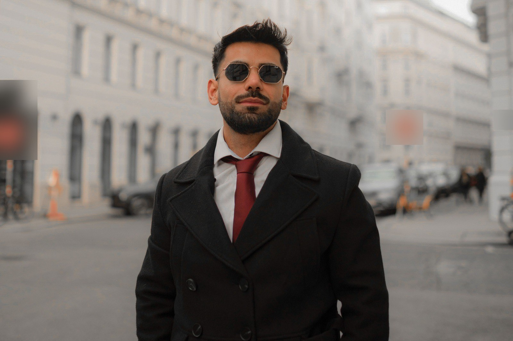
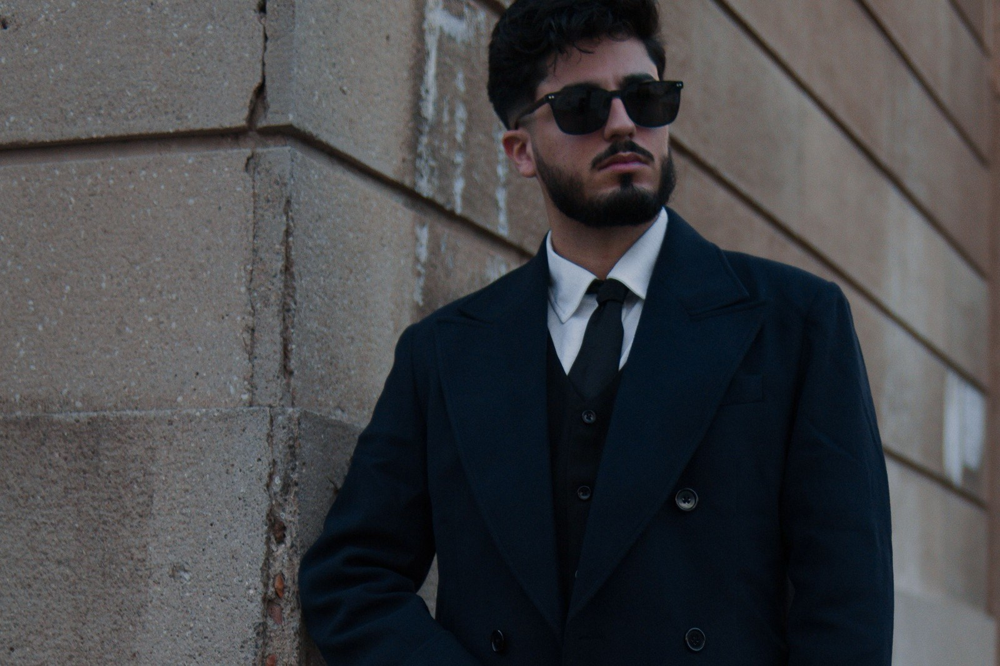

A winter overcoat is the garment the room sees first and the one that has to work the hardest. It goes over a navy suit on a Monday in midtown and over flannel and a cashmere crew-neck at the weekend, and it has to do both without looking borrowed. In 2026 the American gentleman is not hunting for a trend coat. He wants a cut with a name, a cloth with a weight, and a colour that will still look right in ten winters.

The classic vocabulary is smaller than the rack suggests. A Chesterfield, a Crombie-style single-breasted topcoat, a polo coat, a British Warm, an Ulster, a camel-hair coat and a peacoat cover almost every serious need. What changes is the cloth — cashmere, camel hair, a dense wool from a mill such as Loro Piana or Vitale Barberis Canonico — and whether the coat is cut long enough, and full enough, to sit over a jacket. Prices below appear only as they were shown on the pages cited.

## Key takeaways

- **Start with a navy or charcoal coat that covers the suit.** Permanent Style still treats plain navy as the first colour, because an overcoat has to go with more clothes than anything else you own. Esquire, in December 2025, is equally firm on length: at or below the knee, not above it.
- **Learn the cuts by their details, not only by their names.** A Chesterfield is a city coat, often with a fly front and sometimes a velvet collar. A polo coat is double-breasted, usually in camel hair, with patch pockets and a half-belt. A British Warm is a heavy military greatcoat; an Ulster is a long, storm-collared country coat; a peacoat is shorter and more casual.
- **Weight matters as much as fibre.** Permanent Style's rule for a first serious coat in a temperate climate is about 600–700 grams. Lighter cloths have their place, but they will not do the work of a New York January on their own.
- **Cashmere is softer and warmer; camel hair is the traditional polo-coat fibre and wears harder.** A wool–cashmere blend is worth buying for the hand of the cloth. Permanent Style suggests the cashmere usually needs to be around 20 percent or more before you feel it.
- **The peacoat is not a substitute for a proper overcoat over a suit.** It is a hip-to-thigh coat, excellent in heavy navy melton, and the wrong length if you need to cover a jacket completely.
- **Buy the house, then confirm the price on the page.** In the current season, a Brooks Brothers camel-hair polo coat, a Private White V.C. Commander's Overcoat, and cashmere coats from Loro Piana, Kiton and Brunello Cucinelli are all listed at the figures given below.

## The Classic Cuts: Chesterfield to Peacoat

Simon Crompton, writing for Permanent Style, offers the most useful caution before any of the names: do not assume that a tailor, or a salesman, uses the same word you found online. Ask for the details — single or double-breasted, peak or notch, length, belt, pockets, cloth — and the style will follow.

Original article: [Permanent Style](https://www.permanentstyle.com/2020/11/the-styles-of-overcoat-and-how-to-design-one.html)

### The Chesterfield

The Chesterfield is the city coat, named for a nineteenth-century Earl of Chesterfield. What was new around 1840, style histories record, was a coat without a waist seam, easier to wear over the tightly shaped tailoring of the day. The classic single-breasted version has a slightly shaped body, notch lapels, flap or jetted pockets, and often a concealed fly front. The most formal examples still carry a velvet collar, which Gentleman's Gazette and Esquire both treat as the dressiest option, including for evening clothes. Navy, charcoal and black are the proper colours; the hem should fall at or just below the knee, so the suit jacket disappears. A clean navy or charcoal coat in the same family, without the velvet, is the one most men will actually wear to the office.

### The Crombie and the Single-Breasted Topcoat

Crombie began as a maker, not a silhouette. J. & J. Crombie was founded in Aberdeen in 1805; the Oxford English Dictionary later defined a "Crombie" as a type of overcoat made by the firm. On the street, the word now also describes a shorter, heavier, dark single-breasted wool coat that finishes at or just above the knee: plainer than a Chesterfield, without the velvet collar, in a sturdy melton. The house itself is still operating. Crombie's official site states that Crombie Bespoke is open to invited guests only, with garments made by hand in London. Ready-to-wear prices were not listed on the official shop at the time of writing, so none are quoted here.

A topcoat, in Permanent Style's distinction, is simply the shorter, often slightly lighter member of the family. Esquire notes that the modern topcoat derives from the Chesterfield and is the dressiest coat most men need, in camel, navy, gray or black, in wool rather than synthetics, and again at or below the knee.

Original article: [Esquire](https://www.esquire.com/style/mens-fashion/a69712895/types-of-coats/)

### The Polo Coat

The polo coat is the American classic in this group: double-breasted, usually with patch pockets, turn-back cuffs and a half-belt at the back, and in its proper form cut in camel hair, not merely in a camel colour. The Museum at FIT describes it as a "wait" coat that polo players wore between chukkas; it became an American campus and city coat after British teams visited in the 1920s, and it has been tied to Brooks Brothers ever since. Permanent Style is clear that it should be in a camel-hair or tan colour, loosely fitted, with patch pockets. It is smart, but less formal than a dark Chesterfield, and camel sits easily over navy, grey and brown.

Brooks Brothers still makes the garment. On the current product page, [The Camel Hair Polo Coat](https://www.brooksbrothers.com/the-camel-hair-polo-coat/ML00746.html) is listed at $1,048.60, reduced from $1,498. The cloth is 100 percent camel hair, woven by Italy's Lanificio di Tollegno, with peak lapels, a double-breasted front and an adjustable back belt. GQ, in its December 2025 topcoat survey, also singled out Polo Ralph Lauren's camel-hair polo coat, priced at $2,498 on the page they reviewed, in 100 percent camel hair from the British mill Joshua Ellis, with double-breasted peak lapels and a belted back.

Original article: [GQ](https://www.gq.com/story/best-mens-topcoats)

### The British Warm

The British Warm is a military greatcoat that crossed into civilian life in the early twentieth century. It is double-breasted and often high-buttoning, with leather buttons, sometimes epaulettes, and a straight pocket line. The cloth is the point: a heavy melton, traditionally in a putty, camel or greyish shade, though navy is now common. Accounts of the traditional cloth put it around 800 to 900 grams, a genuinely heavy coat, built for bitter weather rather than a short walk between a car and a lobby. Permanent Style, in the overcoating-cloth guide, points to a British Warm in a heavy Holland & Sherry cloth as among the warmest coats in a serious wardrobe. It is the right coat for a long, cold East Coast winter; it is more coat than most men need for a mild December.

Original article: [Permanent Style](https://www.permanentstyle.com/2018/12/the-guide-to-overcoating-cloths.html)

### The Ulster

The Ulster is the long country cousin. Permanent Style describes the best-known feature as a more horizontal peak lapel, originally so the coat could be fastened across the chest, and a collar that can be worn up against the wind without the peaks digging into the neck. The coat is typically double-breasted, often belted, sometimes with turn-back cuffs, and historically it carried a short cape. The usual cloth is a heavy tweed. Worn over a suit it can look fine if the length is generous and the cloth is dark enough, but its character is rural. If you already own a navy city coat and want a second that can take wind and a weekend in the country, this is the silhouette to discuss with a tailor.

### The Camel-Hair Coat

Camel hair is both a fibre and, loosely, a colour, and the two should not be confused. A true camel-hair coat uses the underfleece of the Bactrian camel; it has a softness that approaches cashmere, with a reputation for wearing harder, and it is usually offered in its natural range, from a pale sandy tone to a deeper caramel, and sometimes in navy. It is the correct cloth for a polo coat, and it is equally handsome as a single-breasted city coat in the same shade. Permanent Style notes that camel hair "feels similar to cashmere but is harder wearing," while also warning that the colour range is limited. If you want one coat that is not navy, a mid camel in a proper camel-hair cloth is the most useful departure.

### The Peacoat

The peacoat is the shortest coat in this guide, and it should be chosen with that in mind. Esquire traces the form to European and later American navies: double-breasted, hip-length, in a heavy wool, with a broad collar you can turn up against the wind. The editors recommend a heavyweight melton, with enough room to layer and with lapels large enough to close out the weather. It is a handsome, masculine coat, and the wrong tool if you need to cover a suit jacket to the hem. Keep it for knitwear, flannels and weekends, in navy first. A cashmere peacoat from a house such as Kiton is a luxury version of the same idea, not a substitute for a knee-length overcoat.

*Photo: Mustafa Saati / Pexels, [Pexels License](https://www.pexels.com/license/)*

## Cloth, Fibre and Weight

Warmth in a coat comes from fibre, weave and, above all, weight. Permanent Style puts that last point first. Some mills open their overcoating range at about 370 grams, which is jacket weight, not coat weight. Many start nearer 500 grams. For a first good coat, the advice is 600–700 grams, which will cover most weather in most temperate countries. The same piece is honest about geography: that weight can be too heavy in a mild city, and too light on the US East Coast in a real winter.

Original article: [Permanent Style](https://www.permanentstyle.com/2018/12/the-guide-to-overcoating-cloths.html)

Cashmere is warmer and softer, weight for weight, than ordinary sheep's wool, and it drapes with a quiet luxury that is hard to imitate. It also needs more careful wear. Camel hair is the practical alternative when you want a similar hand and a tougher cloth. Pure wool, especially a dense melton or a compact twill, remains the workhorse of a British Warm or a navy city coat. A small percentage of cashmere in a blend will not transform the warmth; if the mix feels clearly softer in the hand, it can be worth buying. A figure of about 20 percent cashmere is the threshold Permanent Style has used when the blend is meant to be felt, not merely declared.

Two mills set the standard for the cloth itself. Loro Piana's Overcoats collections, as described in current bunch notes, use pure cashmere, wool–cashmere, merino and baby camel hair, often with the house's Rain System finish, a water-repellent treatment designed to leave the hand of the cloth unchanged. Published weights in one recent bunch run from about 480 grams per linear metre for cashmere twills and plains, through 530 grams for a raw cashmere herringbone, up to 620 grams for a double-face cashmere, with wool–cashmere double-face cloths around 590–600 grams. Vitale Barberis Canonico, in Biella, is the other name in serious tailoring rooms. In the current shop, a pure-cashmere beaver overcoat cloth in the Puro Cashmere bunch is listed at 480 grams per metre, 148 centimetres wide; a classic wool covert cloth for coats is listed at 440 grams per metre. If you commission a coat, ask to see the weight in grams and to handle the cloth in person.

## Fit and Length Over a Suit

A coat that is meant to go over a suit must cover the jacket completely, leave you room to move, and still have a shoulder and a chest that look like tailoring. Length is the decision most men get wrong. Esquire is direct: some will tell you that a hem above the knee looks more modern; the editors "just think it looks off." The hem should sit at or below the knee. A longer coat is also warmer, and it keeps the trouser from taking the first splash of a wet pavement. A coat that stops mid-thigh will never look like an overcoat.

The shoulder should be calm and slightly larger than the jacket underneath. There must be room in the chest and the upper sleeve for a suit, or for a heavy knit, without pulling at the buttons. Sleeves should be long enough that neither the shirt cuff nor the jacket sleeve appears below the coat; a modest additional length, on the order of a centimetre or two beyond the jacket sleeve, is the usual aim. A deep enough vent keeps the coat from riding up when you walk or sit. Try the coat on over the jacket you actually wear, not over a shirt. Walk, sit, raise an arm, and fasten the front. If the lapel collapses or the back tightens across the blades, the coat is too small.

*Photo: GlassesShop GS / Pexels, [Pexels License](https://www.pexels.com/license/)*

## Navy, Charcoal and Camel

Three colours will do the work of a lifetime. Navy is the first, for the reason Permanent Style gives: an overcoat has to accompany more outfits than a suit does, and a plain navy double-breasted cashmere coat is close to a perfect garment. It sits over grey and navy suiting, over brown shoes and black, and it does not announce itself. Charcoal is the slightly more formal neighbour, excellent with a dark suit and in a single-breasted city cut. Black can look severe in daylight and is more useful in the evening; it is not the most versatile first coat. Camel is the one departure that still behaves like a classic. It lightens a winter wardrobe, it flatters grey flannel, and it is the colour the polo coat was born in. Mid camel, rather than a loud yellow, is the shade that lasts. Brown, olive and heavy tweed belong in a second or third coat, once the quiet ones are in the cupboard.

## Houses and Coats, With the Prices as Shown

The figures below are the ones on the pages at the time of writing.

[Brooks Brothers' Camel Hair Polo Coat](https://www.brooksbrothers.com/the-camel-hair-polo-coat/ML00746.html) remains the American reference for the style, in 100 percent camel hair by Lanificio di Tollegno, currently $1,048.60, reduced from $1,498. GQ's December 2025 review listed Polo Ralph Lauren's camel-hair polo coat, in Joshua Ellis camel hair, at $2,498.

[Private White V.C.'s Commander's Overcoat in black](https://www.privatewhitevc.com/products/the-commanders-overcoat-black) is a single-breasted, three-button gentleman's coat made in the company's Manchester factory, in a 10 percent cashmere and 90 percent merino cloth woven by Marling & Evans in Huddersfield, with a floating horsehair chest and real-horn buttons. The price shown on the official site is $2,200.

At the Italian end of the scale, [Loro Piana's Grey Coat](https://us.loropiana.com/en/man/coats-and-outerwear/grey-coat-FRM0506_H1GN.html) is listed at $8,700. It is a single-breasted cashmere coat in the house's two-layered Cash Double cloth, with the Rain System finish, notched lapels and suede-trimmed patch pockets, made in Italy. The [Maremma Coat](https://us.loropiana.com/en/man/coats-and-outerwear/maremma-coat-FRM0828_W000.html) in navy cashmere with Storm System is listed at $6,900. [Brunello Cucinelli's wool-and-cashmere coat in grey](https://shop.brunellocucinelli.com/en-us/men/ready-to-wear/coats-jackets/wool-and-cashmere-coat-262MV4586014CAC75.html) is listed at $12,800 on the official US shop. [Kiton's blue pure-cashmere double-breasted peacoat](https://us.kiton.com/products/coat-cashmere-d60610k0113c01) is listed at $11,410: a shorter, shirt-collared, six-button coat in compact cashmere, lined in silk — a luxury reading of the naval cut, not a knee-length city coat.

Ralph Lauren Purple Label remains the house for a hand-finished American interpretation. The [Plaid Wool-Blend Peacoat](https://www.ralphlauren.com/men-clothing-jackets-coats-vests/plaid-wool-blend-peacoat-/655076.html), made in Italy in a double-faced cloth, is listed at $3,995. A Kent Handmade Camel-Hair Topcoat has been listed at $7,995 on Ralph Lauren's men's coats pages; confirm the current product page when you buy, as listings move with the season. Brioni, in Rome, is still one of the names a man should try on in person, in a navy or charcoal cashmere city coat. A current official US list price was not clearly stated on the product pages reviewed for this guide, so no figure is given. Crombie, as noted, is offering invitation-only bespoke in London, without a public ready-to-wear price list at the time of writing.

*Photo: Leszek Czyzewski / Pexels, [Pexels License](https://www.pexels.com/license/)*

## Care and Storage

A good coat is ruined more often by the way it is treated than by the way it is worn. Permanent Style's simplest advice is still the best: keep it out of a soaking rain when you can. Carry an umbrella, wear a hat, and do not treat a cashmere coat as if it were a waxed jacket. After a day's wear, hang the coat on a wide, shaped wooden hanger, never a thin wire, and give it a light brush from the collar down with a soft garment brush, following the nap. Let it rest a day between wears if you can. Spot-clean what you can reach; dry-clean only when the coat actually needs it, and use a cleaner who is used to cashmere and heavy woollens. A wet coat should be dried on its hanger, away from a radiator and out of direct sun, until it is fully dry.

At the end of the season, have it cleaned if it is soiled, then put it away in a breathable cotton cover, not in plastic, with cedar against moths, in a cool, dry cupboard. Cashmere and camel hair both pill where a bag strap or a seatbelt rubs; a gentle cashmere comb will lift the pills, a razor will cut the cloth. Kiton, on its own care note, asks for professional cleaning and pressing, and for the coat to be kept out of prolonged sunlight. Treated this way, a navy cashmere Chesterfield or a camel-hair polo coat is not a single-season purchase. It is the outer layer of a wardrobe, and it should be allowed to last.

## FAQ: Men's Winter Overcoats

### What is the difference between an overcoat and a topcoat?

In the older language, a topcoat is shorter and often lighter, usually on or just above the knee, and an overcoat is longer and built for colder weather. In a shop, the two words are often used loosely. Judge the hem, the weight and whether the coat covers your jacket, not the label on the rail.

### How long should a man's overcoat be?

At or just below the knee is the standard for a coat worn over a suit. Esquire argues against anything shorter. A mid-thigh coat may look contemporary in a photograph and will almost always look unfinished in person, especially over a jacket.

### Is camel hair warmer than wool?

Camel hair is a fine underfleece and can feel as warm as, or warmer than, a sheep's wool of similar weight, with a softness closer to cashmere and a reputation for harder wear. A heavy wool melton can still be the warmer coat if the weight is much higher, as in a traditional British Warm. Handle both.

### Can I wear a peacoat over a suit?

You can, in a pinch, if the peacoat is generous in the chest and the jacket is short. It will not cover the jacket hem, and the proportions are awkward. For a suit, buy a knee-length Chesterfield, Crombie-style topcoat or polo coat, and keep the peacoat for less formal clothes.

### How much should a serious overcoat cost?

It depends on the cloth and the house. In the current listings cited above, a Brooks Brothers camel-hair polo coat is shown at $1,048.60, reduced from $1,498; Private White V.C.'s Commander's Overcoat is shown at $2,200; Loro Piana cashmere coats are shown at $6,900 and $8,700; a Brunello Cucinelli wool-and-cashmere coat is shown at $12,800; and a Kiton cashmere peacoat is shown at $11,410. Those figures will move. Confirm them on the page before you order.

### How do I store a cashmere or camel-hair coat in summer?

Clean it if it needs it, then store it on a wide hanger or, for the most delicate cashmere, folded in a breathable cotton bag, with cedar, in the dark, away from heat and damp. Do not leave it in a dry-cleaner's plastic for the season.
