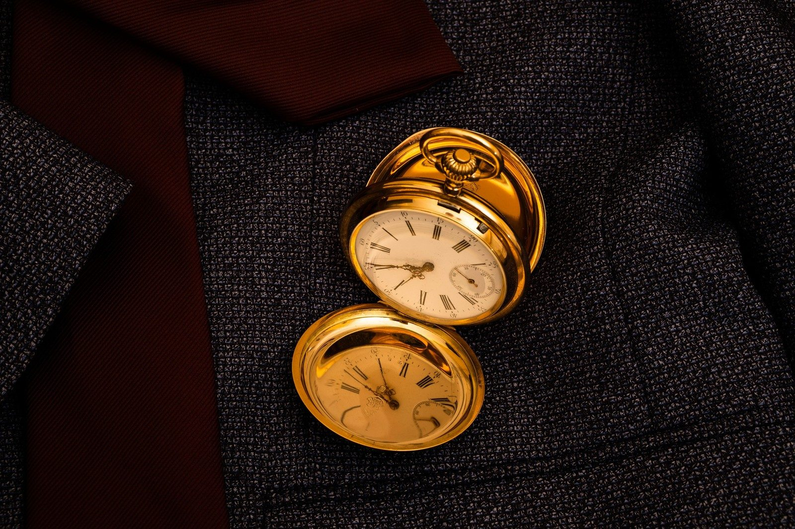
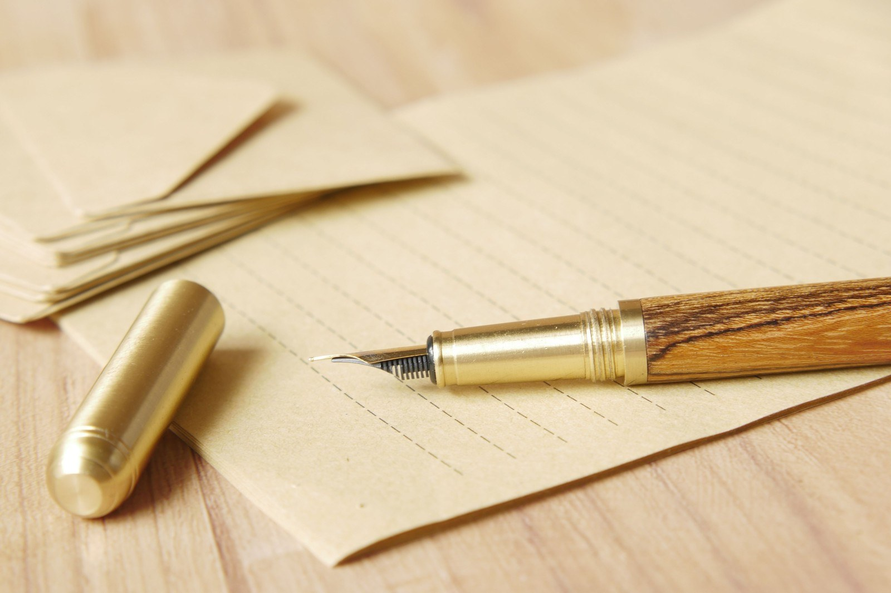

Modern gentleman etiquette is not a set of traps designed to catch a man out. It is a quiet way of putting other people at ease: in a Midtown lobby, at a Thanksgiving dinner, at a December cocktail party in New York, or in a first meeting where a name will be remembered or forgotten within a minute. The rules have been updated for smartphones and social media, but the standard has not changed. A man is still judged first by how he arrives, how he greets people, and how he behaves when no one of importance is watching.

This guide is about general conduct, not the table. Cutlery, wine service and who pays belong in a different conversation. What follows is the rest of the work: first impressions, introductions and the handshake, remembering names, conversation, punctuality, the telephone in company, how to be a host and a guest, holiday-season parties, respect toward staff, composure, and manners online.

## Key takeaways

- **A first impression is mostly care and attention.** Clean shoes, a composed arrival, and the habit of standing to greet someone do more than a rehearsed line.
- **Introduce people clearly, and give them something to talk about.** The Emily Post Institute still asks you to name the person you wish to honor first, to speak distinctly, and to start the conversation yourself.
- **A handshake is firm, brief and offered on your feet.** Eye contact, web of the thumb to web of the thumb, two or three shakes, then let go.
- **Use a name, then protect it.** Say it once as you meet, and if you forget it, ask again without theatre.
- **Listen more than you perform.** Debrett's advice remains the standard: take turns, do not look over a shoulder for better company, and leave money, weight, age and other people's secrets alone.
- **Arrive on time, never early, and never unexplained.** If you will be late, say so once, with a clear arrival time.
- **The telephone stays away in company.** GQ's 2025 rules put it simply: keep the phone out of sight, with one exception for a single photograph, and assume any message may be forwarded.
- **A guest brings a small gift, greets the host, and writes a note.** A host is ready before the first doorbell and looks after the person standing alone.

## First Impressions: What a Man Signals Before He Speaks

People form a view of you before you have finished crossing the room. The work is not charm. It is order. Shoes that have been polished, a jacket that sits on the shoulder, a shirt that is clean at the collar, and hands that are dry and presentable are still the beginning of good manners in American professional and social life. A man who arrives flustered, checking a telephone on the threshold, has already asked the room to wait for him.

Stand when you are introduced, and when someone joins your table or your group. Gentleman's Gazette calls this one of the little things only a gentleman still does, and Debrett's makes the same point in its pillars of politeness: remaining seated and offering a hand from the chair looks lazy. The exceptions are age, injury, or a setting so cramped that standing would be a performance. Otherwise, you get to your feet, you face the person, and you give them your attention.

Composure is part of the impression. Do not rush the doorway. Greet the host or the receptionist properly, put away the telephone, and enter as if you intended to be there. In a business setting, that also means knowing why you have come and how to say it in one clean sentence. In a social setting, it means looking as if you are glad to see the people in front of you, not the ones you hope to meet later in the evening.

Original article: [20 Little Things Only A Gentleman Does – Gentleman's Gazette](https://www.gentlemansgazette.com/little-things-gentleman-does/)

Original article: [Pillars of Politeness – Debrett's](https://debretts.com/pillars-of-politeness/)

## Introductions and the Handshake

A proper introduction is a kindness. The person who knows both parties is responsible for making it promptly, not for hoping they will sort themselves out. The Emily Post Institute is still the American reference: look first at the person you wish to honor, then turn to the other as you finish the names. Speak clearly. Courteous language is enough — "I'd like to introduce," "May I introduce," or, in a more formal room, "May I present." Use the names people actually use, and in a formal or mixed-age setting, start with courtesy titles and surnames until you are invited to do otherwise.

Give the two people a way into a conversation. A bare exchange of first names leaves a silence. A single shared detail — a city, a profession, a host they both know — does the rest of the work. If you are the guest who has been left standing, you need not wait. The Art of Manliness still endorses the simple approach: "We haven't met, have we? I'm…" Goodbyes matter as much as hellos. "I've enjoyed meeting you" is enough; a careless "likewise" is not.

*Photo: Kaboompics / Pexels, [Pexels License](https://www.pexels.com/license/)*

The handshake that accompanies the introduction should be unremarkable in the best sense. The Emily Post Institute's current guidance is precise: stand and make eye contact, smile, meet web of the thumb to web of the thumb, use about the pressure you would use to turn a doorknob, shake two or three times, and let go. A bone-crushing grip and a limp hand are equally poor. Do not cover the other person's hand with your left, and do not hold on for a conversation. Gentleman's Gazette adds the practical points that matter in a crowded room: rise if you are seated, stop walking, face the person directly, and never approach from behind with an already extended hand.

If someone offers a hand, take it. Leaving a hand hanging is a small humiliation. If you cannot shake — an injury, or a reason of health or faith — say so plainly and offer another greeting. In the United States a handshake remains the standard in business. A hug is for people who already have that familiarity, not for a first professional meeting.

Original article: [How to Introduce Someone – Emily Post Institute](https://emilypost.com/advice/making-introductions)

Original article: [Etiquette Today: Great Greetings – Emily Post Institute](https://emilypost.substack.com/p/etiquette-today-great-greetings)

Original article: [How To Shake Hands Like A Gentleman – Gentleman's Gazette](https://www.gentlemansgazette.com/shake-hands-like-gentleman/)

Original article: [How to Shake Hands: The Complete Guide – The Art of Manliness](https://www.artofmanliness.com/social/social-skills/the-complete-guide-to-giving-a-great-handshake/)

## Remembering Names

Remembering a name is one of the cheapest forms of respect, and one of the most noticeable when it is missing. The method is simple: listen for the name, say it back once as you meet, and use it again only sparingly — at the start, and later if you need to catch the person's attention. Gentleman's Gazette warns against dropping the name into every other sentence, which begins to sound like a technique.

If you forget, do not invent a performance. Ask again, take the fault yourself, and move on. The Emily Post Institute's advice on corrections is the right tone: "I'm sorry; thank you for the correction," then say the name as it was given. If you have been mispronouncing a colleague's name for weeks, the polite thing is to learn it properly — write it down phonetically, practice it, and stop improvising. A host can help everyone by presenting a newcomer to a small group, not to a dozen people at once, and by adding a detail that starts a conversation.

Original article: [Etiquette Today: To Correct Someone or Not – Emily Post Institute](https://emilypost.substack.com/p/etiquette-today-to-correct-someone)

## Conversation: Listening, and What to Leave Alone

A good conversationalist is not the most interesting man in the room. He is the one who makes the other person feel interesting. Debrett's still puts this better than most style magazines: strike a balance between talking and listening, follow up an introduction promptly, and do not leave a silence to curdle. Opening remarks can be ordinary. How you know the hosts, a word about the evening, a recent match, even the weather, will do. The priority is to give the other person an easy way to answer.

Then you listen. Your eyes stay with the person, not on the door and not on your telephone. Debrett's is blunt about the glance over the shoulder: it is rude, and if you are trapped by a bore it is more polite to excuse yourself than to hunt for better company while still nodding. In a group, a gentleman brings quieter people in with a question and gives a late arrival a sentence of context.

What you avoid matters as much as what you say. Debrett's notes that few subjects are absolutely forbidden now, but that death, illness and religion are unwise with people you do not know well, and that questions about age, weight, salary or marital status still feel like an interrogation. American small talk is more direct than British small talk — "What do you do?" is ordinary in the United States — but you still do not press for a salary, a divorce, or a diagnosis. Gossip about people who are not present, name-dropping, and the habit of oversharing with a stranger are all forms of poor discretion. A party, as Gentleman's Gazette reminds its readers, is not the place to stake out a position and defend it at all costs. If a conversation turns aggressive, change the subject in one firm sentence, or refill your glass and leave the circle.

Original article: [Social Graces – Debrett's](https://debretts.com/etiquette-category/social-graces/)

Original article: [Party Guest Etiquette – Gentleman's Gazette](https://www.gentlemansgazette.com/party-guest-etiquette/)

## Punctuality

Punctuality is a form of honesty. It says that other people's time has the same weight as yours. In the United States, the Emily Post Institute's rule for a private party is still the one to follow: arrive at the time stated, or shortly after it, and never early. Arriving early forces a host to start the evening before the room is ready. For a dinner, most guests come within the first fifteen to twenty minutes; for a cocktail party, within the first half hour. An open house, with a start and a finish on the invitation, allows you to arrive at any point inside that window.

*Photo: Sasha Alalykin / Pexels, [Pexels License](https://www.pexels.com/license/)*

If you will be late, say so once, with a realistic time of arrival, and give the host permission to begin without you. Lizzie Post, quoted in Vanity Fair, advises against a stream of updates, and says that if you will be more than an hour late you should ask whether it is better not to come. A business appointment is stricter. You are not "fashionably late" to a meeting, a lunch booked in someone else's name, or a theatre curtain. You are either on time, or you have explained yourself.

Original article: [Party Etiquette Tips for Party Hosts and Guests – Emily Post Institute](https://emilypost.com/advice/party-etiquette-tips-for-hosts-and-guests)

Original article: [Etiquette Today: Holiday Gatherings – Emily Post Institute](https://emilypost.substack.com/p/etiquette-today-holiday-gatherings)

## Smartphone Etiquette in Company

The telephone is the most common way a man now fails in company, and the rule is simpler than the technology. When you are with people, the telephone is away: in a pocket, in a coat, or in a bag, silenced or on do not disturb. Anna Post, writing for the Emily Post Institute, has been consistent on this for years. Manage other people's expectations instead of answering at once. Return a call later. Excuse yourself if you must take one. Do not keep the device on the table as a second guest.

GQ's 125 rules for modern gentlemen, published in 2025, tighten the same standard for a social evening: keep the phone out of sight, with a single exception for one photograph that records a phoneless hour. There is no reason to have a telephone out in a cinema. In a restaurant, Debrett's tells a guest to put the phone away before entering, unless an important call has been announced at the outset. Speakerphone in a public room is almost always a failure of awareness. If a genuine emergency may arrive — a child, a parent, a call that cannot wait — say so once, then step out to take it. Looking down at a screen while someone is speaking is a way of leaving the conversation without standing up. If you must check the time, use a watch.

Original article: [Anna Post on Managing Mobile Manners – Emily Post Institute](https://emilypost.com/advice/anna-post-on-managing-mobile-manners)

Original article: [GQ's 125 Rules for Modern Gentlemen](https://www.gq.com/story/gq-125-rules-for-modern-gentlemen-manners-etiquette-guide)

Original article: [Etiquette Today: Tablets & Phones – Emily Post Institute](https://emilypost.substack.com/p/etiquette-today-tablets-and-phones)

## How to Be a Good Host, and a Good Guest

Hospitality is the other half of manners. The Emily Post Institute's advice to a host is still a complete brief: invite clearly, with the time, the place, the occasion and a way to reply; have the room, the food and yourself ready before the first guest; greet people as they arrive; watch for the empty glass and the person standing alone; introduce newcomers; and thank people as they leave, including anyone who brought a gift. GQ adds two modern points worth keeping. Do not charge friends for a dinner in your own house. And have a serious non-alcoholic drink ready to toast with, so that a guest who is not drinking is not left holding a glass of water as an afterthought.

A guest has a shorter list, and no excuse for missing it. Reply to the invitation at once, in the manner requested. Do not bring an extra person unless you have asked. Arrive on time, never early. Greet the host on the way in and on the way out. Participate in the evening that was actually offered. Bring a small gift.

On the gift, the better American sources agree. Esquire has long advised a modest bottle of wine, a good whisky, chocolates, or flowers sent ahead so that the host is not asked to find a vase at the door. GQ's 2025 list names wine, flowers or a bottle of olive oil as safe. Do not expect your bottle to be opened that night. It is a present, not a contribution to the menu. If you have a medical allergy, say so when you reply. Do not arrive with a speech about your preferences.

*Photo: Pavel Danilyuk / Pexels, [Pexels License](https://www.pexels.com/license/)*

Thank the host twice: once, specifically, as you leave, and again the next day. The Art of Manliness and Esquire both still prefer a handwritten note for a dinner or a formal evening, sent through the post, naming one thing you actually enjoyed. A text is acceptable after a casual drink with close friends. It is not a substitute for a note after a carefully given dinner, a weekend in someone's house, or a party held in your honor. Write within a week or two. "Thank you for last night" is a start; a remembered detail of the evening is a letter.

Original article: [How to Write a Thank You Note – The Art of Manliness](https://www.artofmanliness.com/social/etiquette/the-art-of-thank-you-note-writing/)

Original article: [Modern Manners for Guests at Holiday Parties – Esquire](https://www.esquire.com/food-drink/food/recipes/a5312/modern-manners-for-guests-1184/)

## Holiday-Season Party Conduct

From Thanksgiving through New Year's, American social life multiplies the occasions on which these habits are tested: office parties, client dinners, Christmas cocktails, a family house in the late afternoon. The Emily Post Institute's holiday advice is practical. The invitation should say who is included. The reply should mention any real dietary or mobility need. You arrive dressed as requested, you greet the host even if a child opened the door, and you join in. You do not spend the evening only with the three people you already know.

Two modern failures are now almost as common as a late RSVP. The first is the telephone. The second is the camera. A private house is not a backdrop. Ask before you photograph people or rooms, and do not post a guest list or someone else's children. Leave when the evening has clearly turned: when the host is tired, when the last drinks have been poured, when people begin to gather by the door. Say goodbye to the host. You need not interrupt every conversation in the room, but you do not disappear. Drink less than you think you can. Holiday parties are where a man's self-command is most publicly on show.

Original article: [Etiquette Today: Holiday Gatherings – Emily Post Institute](https://emilypost.substack.com/p/etiquette-today-holiday-gatherings)

## Respect Toward Staff

A gentleman is most clearly himself with people who are serving him. The waiter, the bartender, the coat-check attendant, the driver, the doorman, the hotel housekeeper and the assistant who shows you to a meeting are not scenery. You look at them, you say please and thank you, you use their names if they have offered them, and you do not snap your fingers, whistle, or speak about them as if they were not there. If something is wrong, you address it quietly, to the person who can fix it, not as a performance for your table.

This is not a small point of polish. It is the difference between manners and a costume. The man who is charming to a client and short with a waiter has not hidden his character; he has announced it. Tip as the house and the city expect, and do it without a speech. The rest of dining etiquette is another subject. The principle here is simpler: no one who works in your presence should have to absorb your impatience.

## Composure and Discretion

Composure is the habit of not making your inner weather into other people's problem. You do not correct a man in public if it can wait. You do not recount a humiliation for effect. You do not raise your voice in a lobby, a train, or a restaurant. Debrett's, in its account of thoroughly modern manners, returns to a principle that has not aged: well-mannered people put other people's comfort ahead of their own, and they notice the room they are in.

Discretion is composure applied to information. You do not repeat a private story, even a good one. You do not discuss a host's marriage, a colleague's salary, or a friend's illness with a third person. You do not use a party to advance a deal so obviously that the other guests become a backdrop. Some gossip, Debrett's admits, can be lightly done among friends. Giving away a real secret, or talking about people the rest of the circle do not know, is only a way of sounding untrustworthy.

## Digital and Social Media Manners

Online manners are now part of general conduct, because a private evening can be made public in a minute. GQ's 2025 rules are the right starting point for a man who lives on his telephone. Assume any email will be forwarded and any direct message will be screenshotted, and write accordingly. Do not treat a thoughtful message with a bare reaction. Pick up the telephone sometimes. And when you are in company, the device stays put away.

Social media has its own small code. Do not post photographs of other people, or of someone's house, without asking. Do not tag colleagues in a Saturday photograph they did not choose. Do not use a party as content. Debrett's A–Z of Modern Manners was already dealing with humblebragging, oversharing, group chats and the curated self; the details change, the standard does not. You are not obliged to live quietly, but you are obliged not to make other people into extras in your presentation of yourself. If a host asks that an evening stay off Instagram, that request is as binding as a dress code.

Original article: [Thoroughly Modern Manners – Debrett's](https://debretts.com/thoroughly-modern-manners/)

## Product Picks: Correspondence Cards and a Pen Worth Keeping

A thank-you note still has to be written by hand. The paper and the pen are not the point, but they make the habit easier to keep, and they set the tone of the letter.

**[Smythson Plain Correspondence Cards in White Wove](https://www.smythson.com/en-us/products/white-wove-plain-correspondence-cards)** — Watermarked white wove cards, made in England, 350 gsm, 16 by 10 centimetres, in a box of 50. They are the right size for a short dinner note or a word of thanks after a weekend, and they need no monogram to look finished. Listed at $20.00 on Smythson's United States site.

*Photo: Towfiqu Barbhuiya / Pexels, [Pexels License](https://www.pexels.com/license/)*

**[Montblanc Meisterstück Gold-Coated Classique Rollerball](https://www.montblanc.com/en-us/meisterstuck-gold-coated-classique-rollerball-MB132457.html)** — The Classique rollerball in black precious resin, with gold-coated trim, from the line Montblanc has made since 1924. It is a serious instrument for a man who writes notes often enough to want a pen that will last. Listed at $650.00 on Montblanc's United States site.

## FAQ: Modern Gentleman Etiquette

### What is the proper way to shake hands?

Stand, look the person in the face, and offer a dry hand, web of the thumb to web of the thumb. Use a firm, unshowy pressure, shake two or three times, and let go. Do not clamp the other person's hand with your left, and do not keep walking while you do it.

### What should I do if I forget someone's name?

Ask again, briefly, and take the fault yourself. "I'm sorry, would you tell me your name once more?" is enough. Then use the name once, correctly, and leave it alone. If you have been getting a name wrong for some time, learn the pronunciation properly and stop guessing.

### Should I bring a gift to a dinner party?

Yes, unless the invitation has said otherwise. A bottle of wine, flowers sent ahead, chocolates, or a bottle of olive oil are all acceptable. Do not expect the host to open your wine that evening, and do not arrive with a dish unless you have been asked to bring one.

### Is a text message enough as a thank you?

After a casual drink with a close friend, a text the next day is fine. After a dinner, a weekend as a houseguest, or a party given in your honor, a handwritten note is still the correct thing. Name one specific pleasure of the evening, and put it in the post within a week or two.

### When may I take out my phone at a party?

When you must, and then only after you have said why, and preferably in another room. Otherwise the telephone stays out of sight. One photograph, taken quickly and with permission if people are in it, is the most the evening should have to absorb.

### What should I avoid talking about with people I have just met?

Do not open with money, weight, age, politics as a test, illness, or other people's private lives. Ask questions that give the other person room to answer, listen to the reply, and leave controversy for a later friendship, if it belongs there at all.
