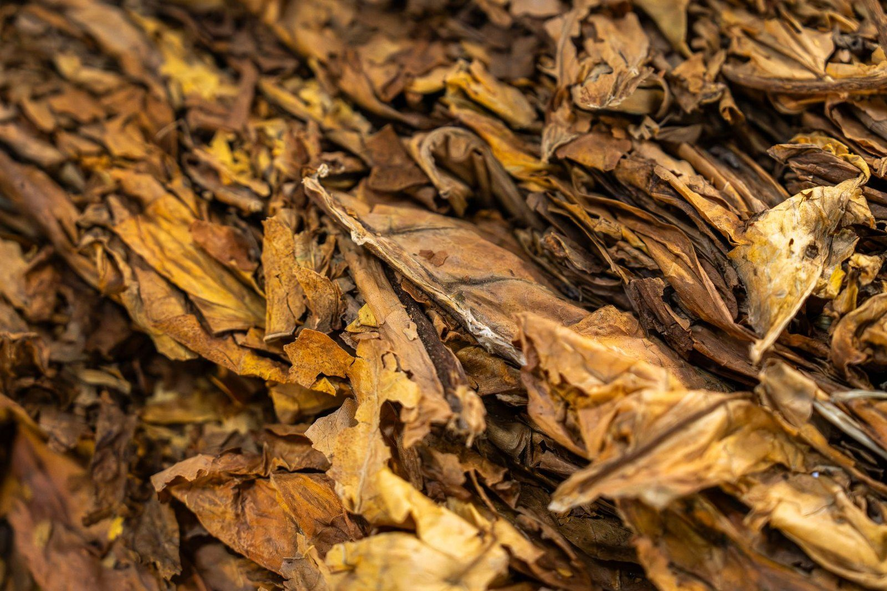
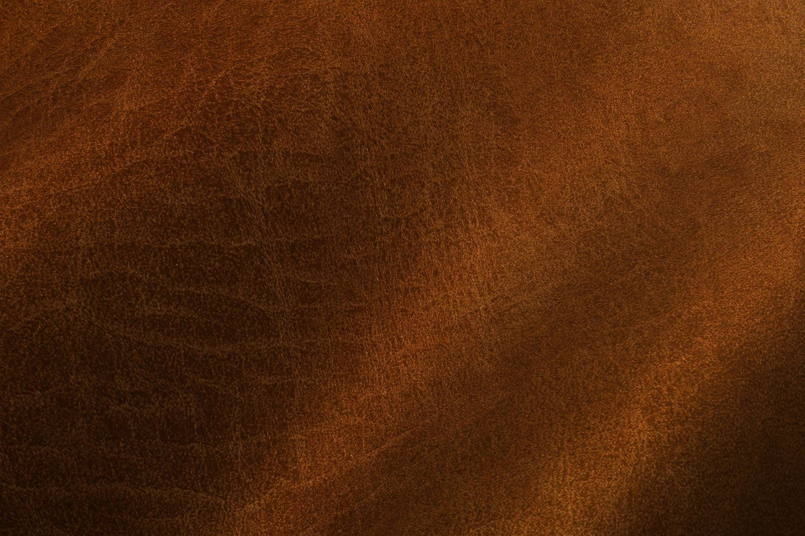
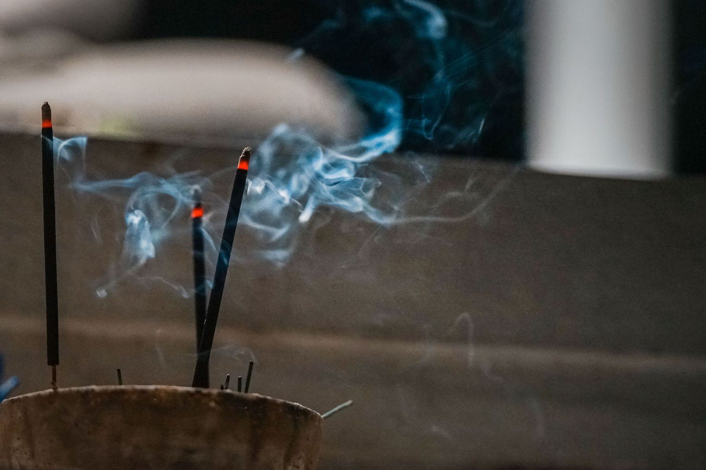

Cold air changes everything about the way a fragrance behaves. The bright citrus cologne that felt effortless in July disappears before you reach the car in December, while a dense amber that would have been suffocating in August suddenly feels exactly right with a wool overcoat and a cashmere scarf. Winter is the season when a man's fragrance wardrobe either works hard or quietly fails.

This men's winter fragrance guide for 2026 is built for men with standards. It covers the scent families that come alive in the cold (amber, oud, leather, tobacco, woods, vanilla and incense), what eau de toilette, eau de parfum and extrait actually mean for longevity, where and how to apply cologne in winter, how to layer, how to store an expensive bottle so it stays true, and how to wear a powerful winter scent in the office without overwhelming the room. Every section is anchored in a current, named source.

## Key takeaways

- **Cold slows evaporation**, so winter colognes unfold more gradually; build your rotation around woods, amber, oud, leather, incense, tobacco and refined vanilla.
- **Concentration is not the same as quality**: eau de toilette is roughly 5 to 10 % perfume oil, eau de parfum roughly 10 to 20 %, and extraits sit above 20 %, sometimes far above.
- **Apply to clean, moisturized skin** on the pulse points (neck and wrists), hold the bottle about 15 cm away and do not rub your wrists together.
- **Winter allows one extra spray**, because coats and scarves mute projection, but the office still calls for a scent that is noticed only at close range.
- **Store fragrance cool, dark and dry**, ideally around 15 to 20 °C, never in a steamy bathroom or a parked car.
- **Our picks**: Parfums de Marly Haltane, Dior Homme Parfum and Trudon Mortel.

## Why winter colognes smell different: the science of cold air

The reason your summer fragrance feels thin in winter is not your imagination. GQ's 2026 guide to the best winter colognes puts it plainly: colder temperatures slow evaporation, so the top notes soften gradually while the heart and base notes emerge with greater depth and presence. In practical terms, a fragrance spends more of its life in its richest phase. That is why heavier materials (deep woods, incense, oud, amber, spice and leather) feel balanced in December rather than overpowering.

GQ's editors build their winter list around exactly those families. The Maker's Stag, a winner at the Fragrance Foundation's indie awards, combines palo santo, agarwood and leather into a smoky, resinous scent the magazine compares to a moody winter mystery novel. Trudon Mortel is the spicy pick, with frankincense and myrrh. Parfums de Marly Haltane is singled out as the elegant oud: bergamot and clary sage at the opening, a praline warmth, then patchouli, vetiver, leather and a generous dose of agarwood. And Terre d'Hermès, a woody citrus classic, proves that a winter wardrobe does not need to be all smoke and resin; GQ notes that cold air lets its crisp, mineral character breathe.

*Photo: Mark Stebnicki / Pexels, [Pexels License](https://www.pexels.com/license/)*

### The winter fragrance families, explained

- **Amber**: not a single material but a warm, resinous accord, often built from labdanum, benzoin and vanilla. It reads as glowing and enveloping.
- **Oud (agarwood)**: dense, woody, slightly animalic and smoky. Modern luxury houses polish it with saffron, rose or praline so it feels refined rather than raw.
- **Leather**: smoky, dry and tactile, often built with birch tar or suede accords. The most tailored of the winter families.
- **Tobacco**: honeyed, hay-like and sweet, frequently paired with vanilla, spice or dried fruit.
- **Woods**: cedar, sandalwood, vetiver and guaiac wood give structure and pair well with everything from flannel to cashmere.
- **Vanilla**: in men's fragrance, best when dry and smoky rather than sugary.
- **Incense**: frankincense and myrrh add a cool, mineral smoke that suits grey skies and stone cities.

Original article: [GQ](https://www.gq.com/story/best-winter-colognes)

## The award winners: what grooming editors are wearing this winter

The 2026 Men's Health grooming coverage adds a second, more personal layer. Its editors name Dior Homme Parfum as the best amber cologne, a dark designer scent of woodsy amber and iris, and Maison Margiela Replica Under the Stars as the best woody pick. Bleu de Chanel L'Exclusif, a 2026 Men's Health Grooming Award winner, is described as darker and denser than the original Bleu de Chanel, with sandalwood, leathery cistus labdanum and woody amber taking over from the citrus, more a windy, layered evening than a crisp morning.

Two more names recur in the coverage. Horace Vintage Vanilla, another award winner, is praised precisely because the vanilla is not the loudest note: a leathery suede base with labdanum and amber makes it cozy and masculine, and an editor reports that a couple of sprays on the neck last him about ten hours. Imaginary Authors A City on Fire is the bold option for smoke lovers, opening with black pepper and dark berries before cardamom, labdanum, cade oil and a burnt-match accord take over. The editors are frank that it is strong and only for men who genuinely enjoy smoky fragrance.

The lesson for a refined winter wardrobe: you do not need ten bottles. One polished amber or woody scent for daytime, one deeper leather, oud or smoke for evenings, and perhaps a refined vanilla for weekends will cover the season with distinction.

Original article: [Men's Health](https://www.menshealth.com/grooming/g34789245/best-cologne-for-men/)

## Eau de toilette, eau de parfum or extrait? Concentrations decoded

The label on a bottle tells you more than most men realize. Robb Report's guide to long-lasting fragrances lays out the typical perfume-oil ranges: eau de cologne at roughly 3 to 5 %, eau de toilette at about 5 to 10 %, and eau de parfum at roughly 10 to 20 %. Above that sit parfums and extraits (also sold as extrait de parfum, pure parfum or perfume oil), which start above 20 % and often reach 30 or 40 %. Because a little goes a long way, Robb Report argues, an extrait's higher price is partly offset by needing fewer sprays and fewer touch-ups.

The magazine's standout example is Amouage Interlude 53, the extrait version of Interlude, whose name refers to a striking 53 % concentration and whose notes run through leather, smoke, resin, amber, oud, patchouli and frankincense. Roja Dove Enigma Pour Homme, with cognac, pepper, ginger, vanilla and tobacco, is recommended for winter evenings.

But stronger is not automatically better. Carlos Huber, founder of Arquiste Parfumeur, tells Robb Report that eaux de cologne and eaux de toilette are designed for "the beauty of a moment," light and effervescent by nature. In winter, that distinction is useful: an extrait or rich eau de parfum for a long day or a black-tie evening, a lighter eau de toilette for the gym bag or a short lunch.

### How to choose the right concentration for winter

- **Eau de toilette**: fine for brighter woody scents and daytime, but expect to refresh in the afternoon.
- **Eau de parfum**: the sweet spot for most men; enough depth for cold weather, still office-friendly.
- **Parfum or extrait**: the luxury choice for evenings and long days; it often sits closer to the skin rather than projecting across the room, so apply sparingly.

Original article: [Robb Report](https://robbreport.com/style/grooming/lists/best-long-lasting-colognes-men-1236741749/)

## How to apply cologne in winter: pulse points, distance and the extra spray

Men's Health's grooming editor offers the clearest rules for applying cologne. Spray onto pulse points, where an artery sits close to the skin and body warmth helps diffuse the scent; for most men that means the wrists and the neck. Hold the bottle about 15 cm from your skin: too close and the fragrance pools, too far and it dissipates before it lands. Always apply to clean skin, so the fragrance bonds properly instead of mixing with sweat or oil, and avoid heavily scented deodorants or body washes that compete with your cologne.

The classic strategy is one spray on the wrist, pressed onto the other wrist, then a quick spray on each side of the neck. In winter the editor allows what he calls the "Euro spray," a sneaky third spray to the neck, because cold weather and open spaces make scent fade faster. The caveat matters: that extra spray is a cold-weather privilege, not something to carry into warm, crowded rooms.

Skin type plays a role too. Dry skin, common in heating season, needs more frequent application, while oily skin holds scent longer. And seasonal rotation is part of the method: light and citrusy when it is hot, rich and bold when it is cold, because the right fragrance should match the weather rather than fight it.

*Photo: Robert Grant / Pexels, [Pexels License](https://www.pexels.com/license/)*

### Where not to spray: the beard and hair

Men with beards should be careful. Most colognes are alcohol-based, and perfumers interviewed by Byrdie note that many fragrances were not created with hair in mind, so the alcohol can be drying if overused. Spray the skin of the neck below the beard line rather than the beard itself, and if you want scent in the beard, use a beard oil or balm designed for that purpose. In the dry, heated air of winter, this matters even more.

Original article: [Men's Health](https://www.menshealth.com/grooming/a69290165/how-to-properly-apply-cologne/)

## Moisturized skin and the "don't rub" rule: making fragrance last

If your fragrance vanishes by mid-morning in January, your skin may be the culprit. Experts quoted by InStyle recommend applying an unscented, hydrating body lotion straight after the shower, while the skin is still slightly damp, because moisturized skin holds fragrance better. Dry skin has a rougher texture with microscopic fissures that prevent fragrance from adhering well. The fragrance itself should then go onto dry-but-hydrated skin, since excess water dilutes the scent.

Pulse points, the experts say, use the body's own warmth to activate the fragrance molecules, and spraying several of them (wrists, inside the elbows, the neck) gives a balanced diffusion throughout the day. Behind the knees is an option for a subtler, more personal effect.

The most common mistake is rubbing the wrists together. Friction heats the skin and accelerates evaporation, which throws off the scent profile, particularly the top notes. Spray, then let it dry on its own. Walking through a "perfume cloud" is equally wasteful: much of the fragrance ends up on the floor and furniture rather than on you.

For the winter routine, the order is simple: shower, pat dry, unscented moisturizer, wait a minute, then fragrance on the neck and wrists. Your scent will last noticeably longer, and you will need fewer sprays to get there.

*This section summarizes published grooming advice and is not medical advice. If you have sensitive skin, eczema or a fragrance allergy, patch-test new products and speak with a dermatologist.*

Original article: [InStyle](https://www.instyle.com/how-to-apply-fragrance-for-long-lasting-results-11733075)

## Layering, collars and scarves: winter techniques from perfumers

Winter is the best season to experiment with fragrance layering. Perfumers interviewed by Byrdie describe layering, combining more than one fragrance, as a way to build a signature blend of your own. A matching body lotion or shower gel can also extend the life of a scent, and spraying clothes helps, because scent often lasts longer on fabric than on skin.

Robb Report's interview with Carlos Huber adds a sensible caution: if your fragrance is clear and your clothes are not too delicate, one or two sprays over the fabric are fine, but only a little, to avoid stains or damage. In winter, the inside of a wool scarf or the lining of a coat collar is the classic spot, and it releases a gentle trail each time you move.

### Smart layering pairs for winter

- **Woods + amber**: a clean cedar or vetiver base under an amber scent adds structure and keeps sweetness in check.
- **Citrus + leather**: a bright bergamot opening layered under a dry leather makes the leather feel more tailored.
- **Incense + vanilla**: a touch of frankincense keeps a vanilla scent dry and grown-up.
- **Fragrance oil + spray**: a perfume oil underneath, then the matching spray, extends wear without increasing projection.

Apply the lighter, fresher fragrance first and the richer one on top, and keep the total to two or three sprays. The goal is a scent that feels deliberate, not a collision of notes.

*Photo: Atlantic Ambience / Pexels, [Pexels License](https://www.pexels.com/license/)*

Original article: [Byrdie](https://www.byrdie.com/how-to-apply-cologne-8612455)

## How to store expensive fragrance: heat, light and the bathroom problem

A luxury fragrance is an investment, and storage decides how long it stays true. Experts interviewed by Real Simple are blunt: the bathroom is practically a graveyard for fragrance, because the temperature swings of the shower and the high humidity degrade it. A sunny windowsill or a shelf near a radiator does similar damage. The three enemies are heat, light and humidity, and oxygen is the fourth, so cap the bottle after every use.

The original box is more useful than it looks: it shields the bottle from light, slows oxygen exposure and keeps the temperature stable. Once a bottle is opened, the experts compare it to an uncorked wine; it is best enjoyed and kept properly until empty. Both experts consulted even endorse the refrigerator for its stable, dark environment, and note that the alcohol in perfume keeps it from freezing, although that extreme is not necessary for most men.

For a concrete target, fragrance experts quoted by Woman & Home suggest storing bottles at around 15 to 20 °C, somewhere consistently cool, dry and dark, such as a bedroom drawer, a wardrobe shelf or a closed cabinet, and never in a parked car. In winter, the risk is the radiator: a dresser right next to the heating can quietly cook a bottle for months.

### A gentleman's storage checklist

- Keep bottles in a closed drawer or cabinet at about 15 to 20 °C.
- Keep the original box and store bottles upright.
- Never store fragrance in the bathroom, on a windowsill or next to a radiator.
- Do not leave bottles in the car, especially in summer.
- Decant a small travel atomizer for the office rather than carrying the full bottle.

Original article: [Real Simple](https://www.realsimple.com/how-to-store-perfume-11692621)

## Office vs. evening: winter fragrance etiquette

A powerful winter scent is a pleasure, but etiquette is part of luxury. Men's Health's guidance is a good rule of thumb: if you are constantly smelling your own fragrance, you have applied too much, and people should have to come close to you to notice that you smell good. A couple of sprays are enough. Do not wear every version of a fragrance at once (cologne, aftershave, body wash, deodorant); one is sufficient, as long as the other products do not clash.

The magazine also suggests a midday refresh as a psychological pick-me-up, and that is where a small travel atomizer earns its place in a briefcase. Heat intensifies any fragrance, which is why heavier scents belong to the colder months, but overheated offices and meeting rooms behave like summer, so keep daytime application light.

### A simple winter rotation

- **Office**: a polished woody or soft amber eau de parfum, two sprays, applied at home. Think of Terre d'Hermès or Dior Homme Parfum.
- **Dinner and evenings**: an oud, leather or incense extrait, two or three sprays, including one on the scarf.
- **Weekends**: a refined vanilla or tobacco scent, worn closer to the skin with knitwear and a fire.

Original article: [Men's Health](https://www.menshealth.com/grooming/g34789245/best-cologne-for-men/)

## Product picks: luxury winter colognes worth wearing

- **[Parfums de Marly Haltane Eau de Parfum](https://us.parfums-de-marly.com/products/haltane)**: GQ's elegant oud choice, a woody-gourmand oud with bergamot, clary sage, praline, saffron, patchouli, vetiver and leather. The brand offers it in about 75 ml and about 125 ml; GQ listed it at $370.
- **[Dior Homme Parfum](https://www.dior.com/en_us/beauty/products/dior-homme-parfum-Y0997193.html)**: Men's Health's best amber cologne, an ambery, woody, floral parfum built around iris. A refined choice that works from the boardroom to dinner.
- **[Trudon Mortel Eau de Parfum](https://trudon.com/us_en/mortel-perfume-100ml.html)**: GQ's best spicy winter cologne, with black pepper, frankincense and myrrh, from the historic Parisian candle house, about 100 ml.

## FAQ

### What is the best winter fragrance for men in 2026?
There is no single winner, but GQ's and Men's Health's 2026 lists point to woody, amber, oud, leather and incense scents, such as Parfums de Marly Haltane, Dior Homme Parfum, Trudon Mortel, The Maker Stag and Bleu de Chanel L'Exclusif.

### Why do colognes last differently in winter?
Cold air slows evaporation, so top notes fade more gradually and the heart and base notes take over. Dry winter skin, however, holds fragrance less well, so moisturize before you spray.

### Is eau de parfum or extrait better for winter?
Eau de parfum is the most versatile choice for daily wear. An extrait (above 20 % perfume oil) lasts longer and suits evenings, but it often sits closer to the skin, so apply it sparingly.

### Where should a man spray cologne in winter?
On clean, moisturized pulse points: both sides of the neck and the wrists, from about 15 cm away. One extra spray is acceptable in cold weather, and one spray inside a wool scarf extends the trail.

### Can I spray cologne on my beard?
It is better not to. Most colognes are alcohol-based and can dry out hair. Spray the neck below the beard line and use a beard oil or balm if you want scent in the beard itself.

### How should I store an expensive fragrance?
In its original box, upright, in a cool, dark, dry place at about 15 to 20 °C, such as a bedroom drawer or closed cabinet. Never store it in the bathroom, on a windowsill or next to a radiator.
