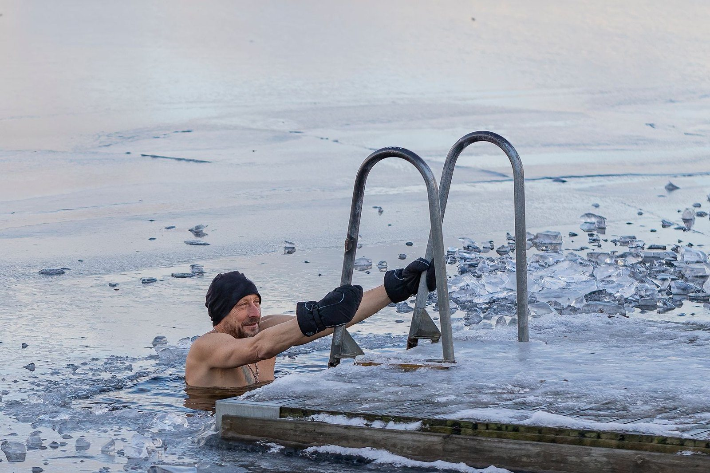
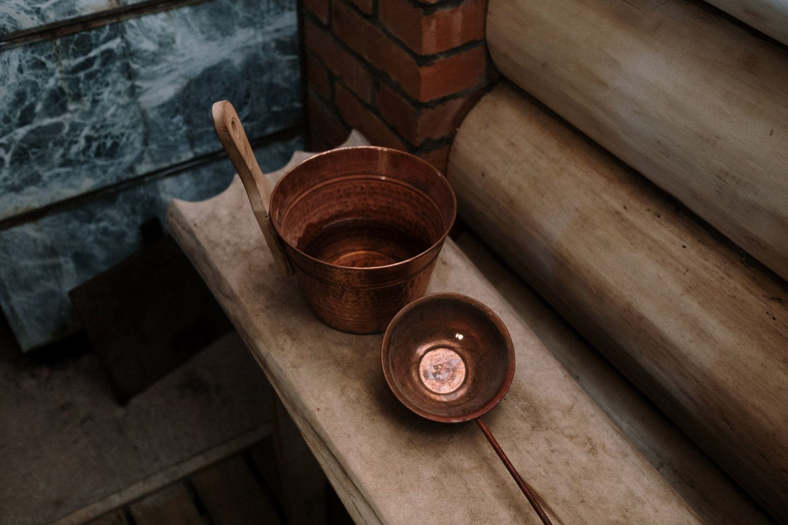

November is when the sauna stops being a vacation habit and becomes a weekly ritual. The mornings are dark, training leaves the legs heavy, and a long day at the desk settles in the shoulders. Twenty minutes of dry heat fixes more of that than most gadgets on the market. But the sauna for men is often done badly: too long, too hot, straight after drinks, and followed by a beard that feels like straw the next morning.

This guide covers what the research behind sauna health benefits actually says, how long you should stay in a sauna, how to pair it with a cold plunge, the etiquette that marks you as a seasoned bather, what a luxury home sauna looks like in 2026, and the post-sauna skin and beard care routine that keeps the glow without the dryness.

> **Key takeaways**
> - The best-known evidence comes from a Finnish study of 2,315 middle-aged men: those who used a sauna 4 to 7 times a week had markedly lower rates of fatal heart events than once-a-week bathers. It shows an association, not proof of cause.
> - Keep sessions to about 15 to 20 minutes. Beginners start at around 5 minutes. A traditional sauna runs at about 65 to 90 °C, an infrared sauna at about 43 to 57 °C.
> - No alcohol before or during. If you have heart disease, uncontrolled blood pressure, a recent heart attack or stroke, or you are on medication, ask your doctor first.
> - Cold plunges: start with 10 to 30 seconds and build up slowly. People with heart rhythm or circulation problems should skip them.
> - Afterwards: rinse off the sweat, cleanse your face, moisturize while skin is still damp, and give your beard a few drops of oil.

*This article summarizes published sources for general information and is not medical advice. Talk to your physician before starting a sauna or cold plunge routine, especially if you have a heart condition or take medication.*

## 1. The Finnish Sauna Study Every Man Should Know

When people say a sauna is "good for your heart," they almost always mean one study. In 2015, *JAMA Internal Medicine* published results from the Kuopio Ischemic Heart Disease Risk Factor Study (KIHD), which followed 2,315 middle-aged men from eastern Finland for about 20 years. The researchers compared how often the men used a sauna with their later rates of death.

The numbers are why the study made headlines. Compared with men who used a sauna once a week, men who went 4 to 7 times a week had a 63 percent lower risk of sudden cardiac death, a 50 percent lower risk of fatal cardiovascular disease and a 40 percent lower risk of death from any cause. Longer sessions, of more than 19 minutes, were also linked to lower risk than short ones. A later paper from the same group of Finnish men, published in *Age and Ageing*, linked frequent sauna use to a lower risk of dementia and Alzheimer's disease.

### What the Finnish sauna study does and does not prove

Read it as a strong signal, not a prescription. These were observational data from Finnish men, and frequent sauna bathers may differ from others in fitness, income and overall lifestyle. Even so, the study changed how doctors in the US talk about heat. The sauna used to be seen as a pleasant luxury. Now it is treated as a habit worth studying.

Original article: [JAMA Internal Medicine](https://jamanetwork.com/journals/jamainternalmedicine/fullarticle/2130724)

## 2. What Happens to Your Body in the Heat

Harvard Health describes in plain terms what happens when you sit down on the top bench. In a dry sauna the air can reach about 85 °C. Your skin temperature climbs to about 40 °C within minutes, and the average person sweats out about half a liter during a short session. Your pulse can rise by 30 percent or more, and your heart nearly doubles the amount of blood it pumps each minute. Most of that extra blood goes to the skin. Blood pressure is unpredictable: it rises in some people and falls in others.

That last point is why a sauna counts as gentle cardiovascular stress rather than pure rest. For most healthy men the effect is pleasant and passes quickly. For someone with uncontrolled high blood pressure or heart disease, it is a reason to talk to a doctor first, as Harvard notes.

*Photo: HUUM / Pexels, [Pexels License](https://www.pexels.com/license/)*

### Harvard's sauna safety rules in short

- Avoid alcohol before and after your sauna, along with any medication that impairs sweating.
- Stay in for no more than 15 to 20 minutes.
- Cool down gradually afterwards.
- Drink two to four glasses of cool water after each session.
- Skip the sauna when you are ill, and leave as soon as you feel unwell.

Original article: [Harvard Health](https://www.harvardhealth.org/healthy-aging-and-longevity/saunas-and-your-health)

## 3. How Long Should You Stay in a Sauna, and How Hot Should It Be?

Cleveland Clinic family medicine physician Amy Zack, MD, gives the most practical answer to the question men ask most often: aim for roughly 15 to 20 minutes. If you are new to saunas, start with about five minutes and add time with each session. She adds a rule that beats any stopwatch: if you feel dizzy, weak, short of breath or simply unwell, get out.

### Traditional sauna vs infrared sauna

Temperature depends on the type. A traditional sauna, heated by wood or electricity, typically runs at about 65 to 90 °C with low humidity, usually under 20 percent. An infrared sauna heats your body more directly with infrared lamps and runs cooler, at about 43 to 57 °C. A steam room is a separate experience built on humidity. According to Cleveland Clinic, there is no clear evidence that dry heat is better than wet heat or the other way around. Choose the one you will actually use often.

### Sauna benefits men can expect, and the myth to drop

The Clinic lists potential benefits including stress relief, better sleep, support for cardiovascular health, relief of muscle soreness and some chronic pain, plus early research on lung function and immunity. Dr. Zack stresses that several of these still need more research. One claim she rejects outright: the sauna is not a fat-loss tool. The weight you lose is water, and it comes back once you rehydrate.

### Who should not use a sauna (per Cleveland Clinic)

Avoid it after a recent heart attack or stroke and after drinking alcohol. Check with your doctor first if you are over 65, have heart disease, severe aortic stenosis, heart failure, or high or low blood pressure, have epilepsy, take medication, or are concerned about male fertility. Under-16s and anyone who is pregnant or trying to conceive should also get medical clearance.

Original article: [Cleveland Clinic](https://health.clevelandclinic.org/sauna-benefits)

## 4. Sauna and Cold Plunge: The Contrast Ritual, Done Sensibly

Fire and ice is the defining wellness ritual of 2026. Upscale gyms and wellness clubs across the US now pair a hot room with an ice tub as standard, and contrast therapy is the new post-work ritual. Harvard Health takes a measured view. Cold water immersion may ease muscle soreness and may help some people feel calmer or sleep better, but the evidence for bigger claims is thin.

The cardiovascular warning matters more. Sudden cold triggers a gasp reflex, a spike in heart rate and a sharp rise in blood pressure. For a healthy man this is a bracing jolt. For someone with heart rhythm problems or circulation issues, it is a real risk, and Harvard advises such people to avoid cold plunges.

*Photo: Olavi Anttila / Pexels, [Pexels License](https://www.pexels.com/license/)*

### How to start a sauna cold plunge routine

- Start short: about 10 to 30 seconds in cold but not freezing water.
- Build up gradually over weeks, rather than chasing the five-minute plunge you saw online.
- Breathe slowly through the first shock and never hold your breath.
- Never plunge alone, and never after alcohol.
- Leave the water at once if you feel lightheaded or your chest feels wrong.

A classic round is 15 minutes of heat, a short cold dip, then a few minutes of rest at room temperature. Two or three rounds is plenty. The rest phase is the part most men skip and the part that makes the ritual feel restorative rather than punishing.

Original article: [Harvard Health](https://www.harvardhealth.org/heart-health/cold-plunges-healthy-or-harmful-for-your-heart)

## 5. Sauna Etiquette: How to Sauna Like a Finn

GQ asked Jasper Pääkkönen, the Finnish actor who co-founded Helsinki's celebrated Löyly public sauna, how to bathe like a local. His first rule is simple: go in clean. Rinse off before you enter a shared sauna. What you wear depends on the company. Mixed saunas mean swimwear. In men-only rooms, the Finnish tradition is far more relaxed.

### Löyly, stamina and the sauna beer

The second rule is a matter of class: **there is no need to flex your stamina.** There is no minimum or maximum time. Stay as long as it feels good, then go and cool off. Finnish saunas such as Löyly usually offer easy access to cold water for a plunge between rounds. Löyly is also the Finnish word for the wave of steam that rises when water hits the hot stones. In a shared room, it is good manners to ask before you throw a ladle of water, because it sharply raises the heat for everyone.

GQ ends with the Finnish "sauna beer" after the final round. Harvard and Cleveland Clinic both warn against alcohol around sauna use, so the well-advised man saves any drink for well after he has cooled down and rehydrated, or replaces it with sparkling water and citrus.

### The gentleman's short list

- Shower before you enter and sit on a towel.
- Keep conversation low and leave your phone outside.
- Ask before adding löyly.
- Leave when you want to. Nobody is keeping score.

Original article: [GQ](https://www.gq.com/story/sauna-like-a-nordic-god)

## 6. The Luxury Home Sauna Comes to America

The other big trend: the sauna has moved home. Robb Report covered the US debut of Klafs, the German sauna maker founded in 1928 and acquired by Kohler. Its launch models show how far home wellness design has come.

### Klafs Ariso and Valora

The **Ariso** starts at $12,500. It is built from Scandinavian spruce inside and out, with a dark walnut veneer available for the exterior. It has warm "sunset" lighting behind the backrests, four preset temperature and humidity combinations, a touchscreen and the compact Fero freestanding heater behind protective wooden rails. The **Valora** starts at $25,500. It has full-length glass panels for edge-to-edge views, an under-bench Bonatherm heater, and climate modes from warm air to gentle steam and aromatherapy, finished in Canadian hemlock or dark waxed walnut. Klafs also offers a bucket and ladle for the German *aufguss* steam infusion.

*Photo: cottonbro studio / Pexels, [Pexels License](https://www.pexels.com/license/)*

### Choosing a home sauna: traditional or infrared?

If you love intense heat and steam from the stones, a traditional cabin like the Ariso is the purist's choice. If you want lower temperatures, quicker warm-up and app-controlled programs, infrared options such as Sunlighten's mPulse line are popular in the US. Either way, plan for ventilation, a dedicated electrical circuit and a cool-down spot, ideally a rain shower or a terrace.

Original article: [Robb Report](https://robbreport.com/lifestyle/news/klafs-saunas-american-debut-1235983178/)

## 7. Post-Sauna Skin and Beard Care

Is a sauna good for your skin? Board-certified dermatologist Ashley Magovern, MD, told Dermstore that it can be, depending on how you use it and on your skin type. Heat improves circulation and gives a healthy glow, and sweating loosens dirt and oil in the pores. But overuse or poor aftercare can lead to dehydration and irritation.

### Advice by skin type

- **Dry or sensitive skin:** limit your sessions and follow up with a hydrating routine.
- **Oily or acne-prone skin:** cleanse thoroughly afterwards. Sweat mixed with sebum can clog pores once it cools.
- **Rosacea:** Dr. Magovern advises avoiding saunas, because heat can trigger flare-ups and redness.
- **Everyone:** use a good moisturizer after the sauna to replace lost moisture.

### The bearded man's post-sauna routine

A beard behaves like the skin beneath it. Heat and sweat lift the natural oils, so the hair feels soft in the cabin and coarse an hour later. The routine is short:

1. Rinse in lukewarm, not hot, water and wash your face and beard with a gentle cleanser.
2. Pat dry. Never rub a heat-softened beard with a rough towel.
3. While the skin is still slightly damp, apply moisturizer to the cheeks and neck.
4. Work 3 to 5 drops of beard oil from the roots to the tips, then comb through.
5. Drink water before you reach for anything else.

Original article: [Dermstore](https://www.dermstore.com/blog/how-to/are-saunas-good-for-your-skin/)

## Our Picks: Premium Post-Sauna Essentials

- **[Aesop Geranium Leaf Body Balm](https://www.aesop.com/hand-body/body-balms-oils/geranium-leaf-body-balm/BM08.html)**: an Aesop classic since 1998 with a green, citrus-tinged scent. A medium-weight body moisturizer with macadamia and coconut oils that sinks in quickly on warm, freshly rinsed skin. Available in 100 ml and 500 ml.
- **[Baxter of California Beard Grooming Oil](https://baxterofcalifornia.com/products/beard-grooming-oil)**: squalane and avocado oil condition the beard and the skin beneath it, which is exactly what heat has drawn out. $29 on the brand's site.
- **[Kiehl's Facial Fuel Daily Invigorating Moisture Treatment for Men](https://www.kiehls.com/mens/mens-moisturizers/facial-fuel-daily-invigorating-moisture-treatment-for-men/555.html)**: a light, non-greasy daily moisturizer for men that suits the post-sauna moment, when skin should feel fresh rather than coated.
- **[Klafs Ariso Sauna](https://klafsusa.com/)**: for the man ready to bring the ritual home. Scandinavian spruce, touchscreen climate presets and a protected freestanding heater, from $12,500 as reported by Robb Report.

## Sauna for Men: FAQ

### How long should a man stay in a sauna?

About 15 to 20 minutes per session is the common guidance from Cleveland Clinic and Harvard Health. Beginners should start with about 5 minutes and add time gradually. Leave immediately if you feel dizzy or unwell.

### How hot is a sauna?

A traditional dry sauna typically runs at about 65 to 90 °C with low humidity. An infrared sauna is cooler, at about 43 to 57 °C, because it warms the body more directly.

### How often should you use a sauna for health benefits?

In the Finnish KIHD study, men who used a sauna 4 to 7 times a week had the lowest rates of fatal cardiovascular events. It is an association, not proof, but 2 to 4 relaxed sessions a week is a realistic, well-tolerated rhythm for most healthy men.

### Should you do a cold plunge after a sauna?

You can, if you are healthy. Start with 10 to 30 seconds in cold water and build up slowly. People with heart rhythm or circulation problems should avoid cold plunges, according to Harvard Health.

### Who should not use a sauna?

Avoid the sauna after a recent heart attack or stroke and after drinking alcohol. Get medical advice first if you have heart disease, high or low blood pressure, epilepsy, are pregnant, are on medication or are concerned about fertility.

### How do I care for my beard after a sauna?

Rinse with lukewarm water, cleanse gently, pat dry, moisturize the skin while it is still slightly damp and work in a few drops of beard oil. That puts back the oils heat and sweat have stripped and keeps the beard soft.
