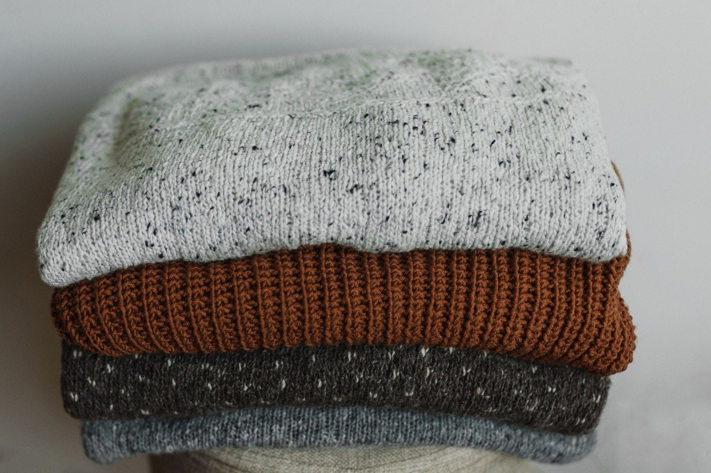
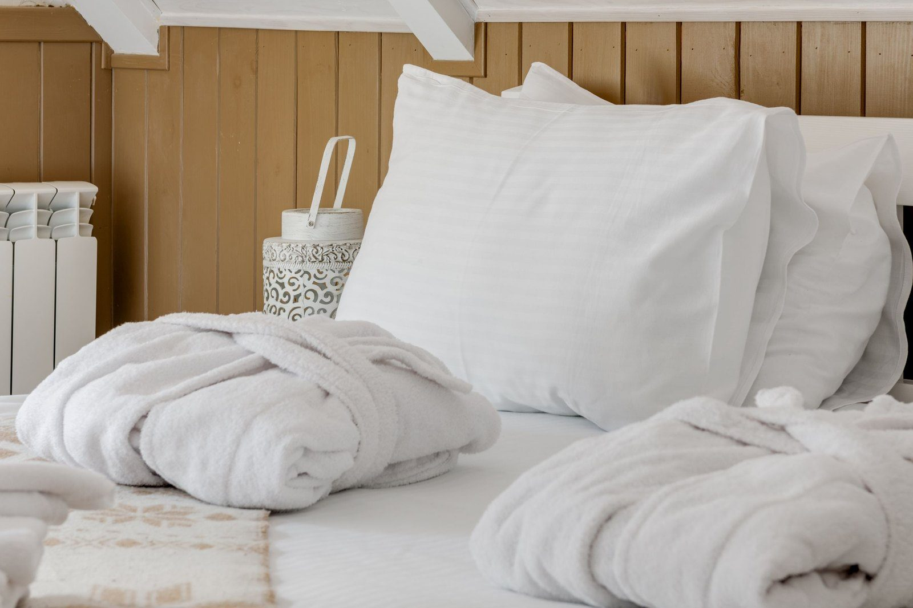
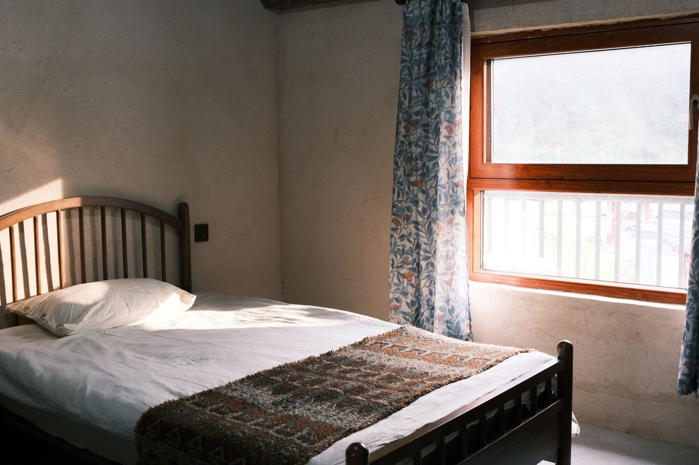

There is a moment on a dark November evening when the tailoring comes off, the shoes go back on their trees and the question becomes: what does a well-dressed man actually wear at home? For too many men the answer is a faded college sweatshirt and gym shorts. Yet the hours between the front door and the pillow are the hours you spend with the people who matter most, and the hours you spend alone with a book, a glass and your own thoughts. They deserve better.

Men's luxury loungewear has quietly become one of the most interesting categories in menswear. The robe is back, the matching pajama set has returned from the costume box, cashmere lounge sets are replacing sweatpants, and the velvet house slipper is having a moment. This guide brings together what US editors at GQ, Town & Country, Travel + Leisure, Robb Report, Esquire and the Sleep Foundation are reporting this season, and turns it into a practical plan: which robe to buy, which pajama fabric suits winter, which slippers are worth the money, how warm your bedroom should be and how to keep it all looking new for years.

> **Key takeaways**
> - Choose the robe by job: plush terry for drying off, waffle weave for quick-drying lightness, and smooth cotton or cashmere for lounging over pajamas.
> - Supima and Egyptian cotton feel the softest; Turkish cotton is prized for drying quickly. A cashmere robe is the ultimate indulgence but usually needs dry cleaning.
> - Proper pajama sets from heritage makers such as Derek Rose, Turnbull & Asser and Budd are back. Brushed cotton is the classic winter cloth from November to March.
> - A single pair of black velvet Albert slippers covers every evening at home, from flannel trousers to a dinner jacket.
> - Keep the bedroom cool, around 16 to 20 °C, with about 18 °C as the sweet spot, and let your sleepwear do the warming.
> - Wash cotton robes at about 40 °C, skip fabric softener and tumble dry on low heat to keep them absorbent and soft.

## 1. The Robe Is Back, and the Fabric Decides Everything

GQ's updated robe guide, published on November 9, 2026, makes the point that a robe is no longer just something you grab on the way out of the shower. It is a piece of clothing you live in on a Sunday morning, and the right one depends on what you want it to do. The magazine's editors break the decision down into fabric first, cut second.

### Terry, waffle or smooth cotton?

**Terry cloth** is the classic towelling robe, made of thousands of small cotton loops that pull water off the skin. It is the best choice if your robe's main job is drying you after a shower or a sauna. **Waffle weave** is the honeycomb texture you know from good spas. GQ singles it out because it is extremely absorbent for its weight, dries quickly and feels lighter, which makes it wearable in any season. **Smooth woven cotton**, often with a satin-like finish, is the robe you wear over pajamas, not the one you dry off in.

### Egyptian, Turkish or Supima cotton?

GQ's short fabric lesson is worth memorizing. Egyptian cotton is the softest and plushest. Turkish cotton is known for drying quickly. Supima, the American-grown long-staple cotton, is as soft as Egyptian cotton and dries almost as fast as Turkish. That is why the magazine's best waffle robe pick, the Onsen Hooded Waffle Robe, is made from Supima cotton grown in the US. The editors praise its quick-drying fabric and deep, sturdy pockets, with one caveat: the relaxed fit can feel generous.

### The luxury lounging robe

At the top of GQ's list sits a different kind of robe: a satin-finish cotton robe from Derek Rose with white piping and three patch pockets. GQ is honest that it is a robe above $400 and not as absorbent as a towelling robe, but that is the point. It is the robe for an evening with a cigar and a dram of Scotch, not for the bathroom floor. A serious wardrobe has both: a working robe for drying and a dressing gown for lounging.

Original article: [GQ](https://www.gq.com/gallery/best-mens-robes)

## 2. Cashmere Robes: The Ultimate Indulgence

If the robe is an extension of the pajama family, the cashmere robe is its crown. Town & Country names the Sferra Uomo Cashmere Robe its most indulgent pick and calls it one of the most luxurious things you could drape over your body. Sferra, the Italian linens house better known for world-class sheets, makes it in 100 percent cashmere, and it is listed at $842 on Sferra's own site.

### What owning cashmere at home really means

Travel + Leisure's testers come to the same conclusion about cashmere from another angle. Their favorite cashmere spa robe was described by an editor who owns more than ten robes as "by far" her most luxurious, warm without being heavy and double-ply so it neither feels flimsy nor pills easily. The trade-off is maintenance: unlike almost every other robe they tested, it is dry clean only. The editors also advise against wearing it straight out of the shower. Cashmere is not a towel.

### How to wear a cashmere robe like a gentleman

- Put it on dry, after you have towelled off, or over pajamas.
- Keep heavy items out of the pockets so they do not stretch and sag.
- Hang it on a broad, padded hanger, never on a single hook that pulls the collar out of shape.
- Let it air for a day between wears, and fold it into a breathable cotton bag in the off-season with cedar blocks to protect it from moths.

*Photo: Arina Krasnikova / Pexels, [Pexels License](https://www.pexels.com/license/)*

Original article: [Town & Country](https://www.townandcountrymag.com/style/mens-fashion/g45854322/best-mens-robes/)

## 3. The Return of the Proper Pajama Set

For years, men slept in T-shirts and old shorts. Robb Report's buying guide to men's pajama sets argues that the matching set is back, and that the best makers are still the English heritage houses. It is a category built on the same craftsmanship as fine shirtmaking: real buttons, piped edges, turnback cuffs and fabrics chosen for how they feel after hours against the skin.

### The heritage makers worth knowing

- **Derek Rose**: a family-owned business since 1926, built entirely on loungewear and sleepwear. Its classic-fit striped cotton pajamas can be personalized with a monogram, motifs and even a "secret message" of up to 98 letters sewn inside the jacket. Robb Report lists the set at $370.
- **Turnbull & Asser**: the royal warrant holder best known for bespoke shirts applies the same precision to pajamas sewn in its Gloucester factory, with mother-of-pearl buttons, turnback cuffs and a distinctly shaped collar. Listed at $625.
- **Budd**: the bespoke shirtmaker in London's Piccadilly Arcade since 1910 makes plain silk pajamas that are washed at its Andover workshop before being sewn in London. Listed at $904.

Robb Report also notes a newer wave of smarter sleepwear from younger brands, which shows how wide the revival has become. The common thread is that pajamas are being treated as clothing again, not as an afterthought.

### Why a set beats a T-shirt

A collared pajama jacket looks presentable when a delivery arrives or when family gathers for a holiday breakfast. Woven cotton also breathes better than a heavy jersey T-shirt, and a set gives you the option to wear the trousers alone on a warmer night.

Original article: [Robb Report](https://robbreport.com/style/menswear/lists/best-pajama-sets-1237415185/)

## 4. Brushed Cotton for Winter and the "Door Test"

Young Cotton's detailed ranking of men's pajamas, last updated on November 10, 2026, adds a useful rule: comfortable must not look sloppy. Every set is judged by what the editors call the door test, which asks whether you could answer the front door in it without apologizing. Cloth is graded first, because the cloth touches you for eight hours and decides whether you sleep cool, clammy or warm.

### The best-made winter set

The ranking calls the Derek Rose Kelburn brushed cotton pajamas the best-made set on its page. It is a classic-fit pajama in winter-weight brushed cotton, with a three-pocket jacket, an adjustable two-button waistband with an open fly, elasticated sides so the front and back lie flat, and piping throughout. Its construction score is the highest in the ranking. The one honest deduction is the calendar: Kelburn is a superb cloth from November to March and the wrong set for the rest of the year.

### How to choose your pajama cloth

- **Brushed cotton or flannel**: soft, warm, ideal for a cool bedroom in winter.
- **Fine woven cotton (poplin or long-staple pima)**: crisp and breathable, the year-round choice.
- **Modal**: very soft and fluid, good for men who sleep warm.
- **Silk**: light, smooth and elegant, but it needs gentle care.
- **Polyester**: the floor of the market, because it holds heat and does not handle moisture well.

Young Cotton also prints a boundary worth repeating: a pajama is a garment, not a treatment. Buy it for the cloth, the cut and how it looks at breakfast, not for medical promises.

Original article: [Young Cotton](https://youngcotton.com/best-pajamas-for-men/)

## 5. The Cashmere Lounge Set Replaces the Sweatpants

Between the pajama and the street sits the lounge set, and in 2026 the most luxurious version is knitted in cashmere. Esquire's editors call the Sunspel Cashmere Lounge Set about as good as it gets: Grade A cashmere so soft it makes everything else in the drawer feel scratchy, a hoodie with a two-way zip for temperature control and trousers with a ribbed waistband and knitted drawcord. It costs $1,185 and comes in navy or grey, and Esquire describes it as "the rare set that feels like a treat but works like a staple."

### Styling a lounge set without looking sloppy

- Stay in dark, quiet colors: navy, charcoal, camel and grey look polished; loud prints do not.
- Match the top and bottom, or pair cashmere trousers with a fine merino crewneck in a tonal shade.
- Finish with leather or velvet slippers, never with worn-out running shoes.
- Keep a clean T-shirt in fine cotton underneath so you can take the hoodie off without losing the look.

### Caring for cashmere loungewear

Cashmere lasts for decades if you treat it gently. Wash by hand or on a wool cycle in cool water with a wool detergent, press out water in a towel instead of wringing, and dry flat. Remove pills with a cashmere comb rather than scissors, and store folded, not hung, so the knit does not stretch.

Original article: [Esquire](https://www.esquire.com/style/mens-fashion/g69821204/best-pajamas-for-men/)

## 6. Velvet Albert Slippers and the Art of the House Shoe

The Gentleman's Journal's guide to slippers draws a clear line between the shearling slipper you shuffle around in and the velvet house shoe you wear when guests are coming. For the second category, its verdict is precise: if you own one pair of proper house shoes, make it the Crockett & Jones Plain Albert. Black velvet, quilted satin lining, made in England and clean enough to work with everything from a dinner jacket at home to flannel trousers and a cashmere sweater.

### Albert, shearling or suede?

- **Velvet Albert slippers**: the formal house shoe. Bowhill & Elliott of Norwich has been making them since the 19th century, with leather soles, quilted linings and optional embroidery. Ideal for hosting dinner at home.
- **Shearling-lined suede slippers**: the daily comfort choice. Derek Rose makes suede and sheepskin styles in the UK designed to be worn with matching pajamas and robe.
- **Minimal suede and shearling house shoes**: Inabo from Sweden makes them in Portugal for men whose homes lean more toward Scandinavian calm than mahogany.

### Slipper etiquette

Velvet slippers with a leather sole belong indoors. If you take the trash out at night or step into the garden, choose a pair with a rubber sole or switch to proper shoes. And a good slipper should keep your toes warm without making feet clammy, so choose breathable linings if you run hot.

*Photo: Max Vakhtbovych / Pexels, [Pexels License](https://www.pexels.com/license/)*

Original article: [The Gentleman's Journal](https://www.thegentlemansjournal.com/article/best-slippers-for-men/)

## 7. Dress for a Cool Bedroom: What the Sleep Foundation Recommends

Great sleepwear works best in the right room. The Sleep Foundation explains that body temperature naturally drops during sleep, so a cooler room makes it easier to fall asleep and stay asleep. The best bedroom temperature for most adults is about 18 °C, with a comfortable range of roughly 16 to 20 °C. A bedroom that is too warm interferes with the body's thermoregulation and can leave you tired yet unable to drop off.

### How to pair sleepwear with the temperature

- **About 16 to 18 °C**: brushed cotton or flannel pajamas, a light duvet, and a robe on the chair for the morning.
- **About 18 to 20 °C**: fine woven cotton, modal or silk pajamas, and a lighter duvet.
- **If you wake up sweating**: switch to breathable natural fibers and avoid thick polyester, which traps heat.

The Sleep Foundation also lists some simple habits for a better night: turn the thermostat down in the evening, ventilate the room, control humidity and take a warm bath an hour or two before bed, which encourages the body's natural cool-down.

*Photo: Zhiqiang LI / Pexels, [Pexels License](https://www.pexels.com/license/)*

*This section summarizes published sources for general information and is not medical advice. If you have persistent sleep problems, talk to your physician.*

Original article: [Sleep Foundation](https://www.sleepfoundation.org/bedroom-environment/best-temperature-for-sleep)

## 8. How to Wash a Robe So It Stays Soft for Years

An expensive robe can be ruined in a few months by the wrong wash. The Towel Shop's care guide sets out the rules that keep cotton terry and waffle robes soft and absorbent.

### The washing rules

- **Temperature**: about 40 °C is right for most cotton robes. Washing at 60 °C every week shortens their life.
- **Spin speed**: medium, around 800 to 1,000 rpm, so the cotton loops are not crushed.
- **Fabric softener**: avoid it completely. Softener coats the fibers with a waxy layer and, over time, makes a robe repel water instead of absorbing it.
- **Bleach**: never, even on white robes, because it weakens cotton fibers.
- **Belt**: remove it or wash it in a mesh bag so it does not tangle and pull the loops.

### Drying and frequency

Tumble dry on low heat to restore the loft; high heat shrinks cotton and flattens the loops. Shake the robe firmly before drying. Waffle robes need even gentler treatment, with a lower spin and low heat, because the honeycomb weave can distort. For personal use, washing every three to four wears is enough. One useful warning: benzoyl peroxide in some acne washes bleaches cotton on contact, so let it dry fully before putting on a dark robe.

Original article: [The Towel Shop](https://www.thetowelshop.co.uk/blog/how-to-wash-and-care-for-a-bathrobe-or-dressing-gown/)

## Our Picks: Premium Loungewear Worth Owning

- **[Sferra Uomo Cashmere Robe](https://www.sferra.com/products/uomo-robe)**: 100 percent cashmere from the Italian linens house, in black or grey, the robe Town & Country calls one of the most luxurious things you can wear. $842 on Sferra's site.
- **[Derek Rose Kelburn Brushed Cotton Pajamas](https://www.derek-rose.com/en-us/products/mens-kelburn-brushed-cotton-pyjamas-blue-check)**: winter-weight brushed cotton, three-pocket jacket, piping and an adjustable waistband from the London house that has made nightwear since 1926. $440 on the brand's US site.
- **[Crockett & Jones Plain Albert Black Velvet](https://us.crockettandjones.com/products/velvet-slipper-black)**: black velvet, quilted satin lining and a leather sole, made in England. The one house shoe to own. $450 on the brand's US site.
- **[Onsen Hooded Waffle Robe](https://onsen.co/products/waffle-robe)**: GQ's best waffle robe, in American-grown Supima cotton that dries quickly, with deep pockets. The working robe for after the shower or sauna.

## Men's Luxury Loungewear: FAQ

### What is the best fabric for a men's robe?

For drying off, plush cotton terry or waffle weave is best; Supima and Egyptian cotton feel softest, and Turkish cotton dries fastest. For lounging over pajamas, choose smooth woven cotton, silk or cashmere.

### Is a waffle robe or a terry robe better?

A terry robe absorbs more water and feels plusher, so it is better for drying. A waffle robe is lighter, dries faster and is easier to wear year-round. Many men own one of each.

### Are luxury pajamas worth it?

Yes, if you value fabric and construction. Heritage makers such as Derek Rose and Turnbull & Asser use fine cotton, real buttons and piping that last for years, and a proper set looks presentable at the door and at breakfast.

### What should men wear to bed in winter?

Brushed cotton or flannel pajamas work best in a cool bedroom of about 16 to 18 °C. If you sleep warm, choose fine woven cotton or modal and avoid heavy polyester.

### What is the best bedroom temperature for sleep?

The Sleep Foundation puts the ideal at about 18 °C, with a comfortable range of roughly 16 to 20 °C for most adults.

### How often should you wash a bathrobe?

About every three to four wears if you put it on after showering. Wash cotton robes at about 40 °C, skip fabric softener and tumble dry on low heat.
