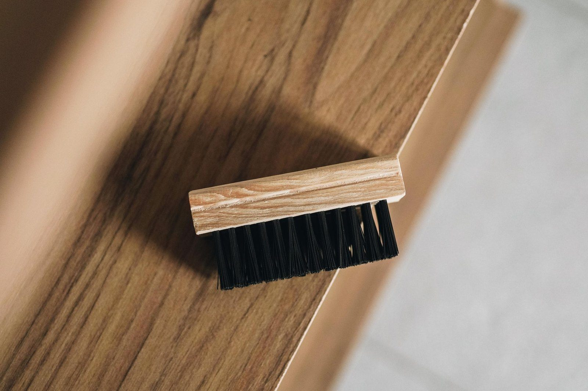
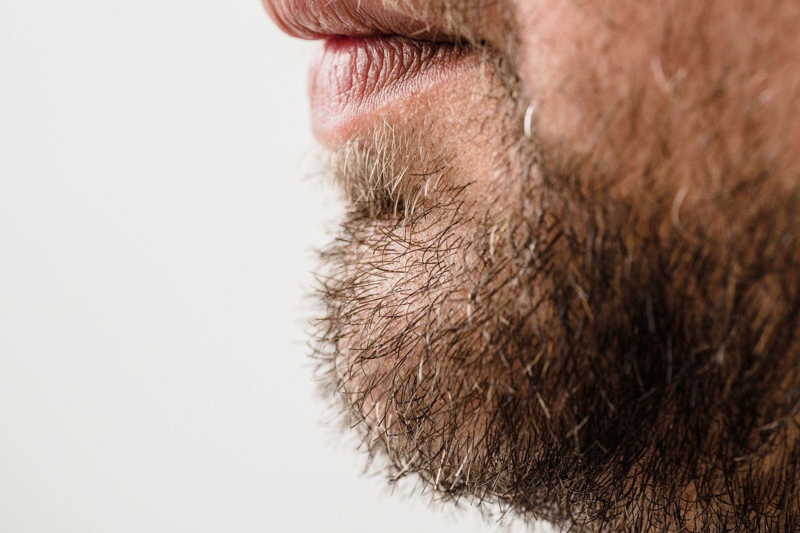

A great beard is rarely an accident. Behind most beards that look effortless sits a small, unglamorous habit: a minute or two each morning with the right brush or the right comb. The question every bearded man eventually asks is simple, and it is the one this guide answers in detail: **beard brush vs beard comb, which one do you actually need?** The short answer is that they do different jobs. The longer answer, covering boar bristle, saw-cut teeth, beard length, winter routines and the heritage brushmakers worth paying for, is below.

**Key takeaways**

- A **beard brush** trains direction, smooths the surface, lifts flakes and spreads beard oil; a **beard comb** detangles, separates and shapes the outline.
- **Short beards** (stubble to a few weeks) mostly need a brush; **medium and long beards** need a comb daily and a brush as the finishing step.
- **100 percent boar bristle** is the expert standard for beard brushes; a boar and nylon mix can help very thick, coarse beards.
- Choose a **saw-cut comb** in wood or cellulose acetate; cheap moulded combs have seams that snag and snap hairs.
- Always **comb from the tips toward the roots** on longer beards, and never force a brush through knots.
- Premium picks: **Kent BRD2** wooden beard brush (handmade in the UK) and the **Mason Pearson Military Junior BN2M** (hand-finished in England).

## Beard Brush vs Beard Comb: What Each Tool Actually Does

The most useful way to think about the beard brush vs beard comb debate is to stop treating the two tools as rivals. They work on the beard in fundamentally different ways.

A **comb** uses a single row of solid teeth. As it moves through facial hair, the teeth isolate individual strands and slide knots loose. That is why a comb is the tool for detangling, for working product evenly through a dense beard, and for checking the outline before trimming. The grooming testers at Shaving School put it plainly: most beards past a few centimetres do best with a comb every day and a brush as the finishing step. They also note that running a comb through the beard distributes oil far more evenly than fingers, and that the teeth lift the beard so it dries with shape rather than lying flat.

A **brush** uses clusters of bristles mounted on a base. Instead of separating strands, the bristles sweep the outer surface and apply gentle, distributed tension. That tension smooths the beard and, over weeks, trains hairs to lie in the direction you brush them. This is why a brush is the go-to for short beards, unruly sideburns and those stubborn cheek hairs that insist on growing sideways.

### The quick comparison

- **Primary job:** brush = direction and smoothing; comb = detangling and shaping.
- **Knots:** brush sweeps over them; comb separates them when worked from tip to root.
- **Beard oil and balm:** brush is excellent on shorter growth; comb carries thicker balms through dense, longer beards.
- **Short beards:** brush wins. **Long or coiled beards:** comb is required, brush is the finisher.

The practical conclusion for most men with anything more than stubble: own both, and use them in the right order.

Original article: [Shaving School](https://www.shavingschool.com/beard/beard-brush-vs-comb/)

## Why Boar Bristle Is the Gold Standard for Beard Brushes

Walk into any serious barbershop and the beard brush on the counter almost certainly has boar bristles. There is a reason for that, and it is not tradition alone.

In Men's Health's 2026 beard brush review, barber Sam Chulpayev of Made Man Barbershop in New York explains that boar bristles are the closest natural fibre to human hair. They grip strands without damaging them and distribute oils more thoroughly than synthetic bristles, which he describes as too stiff and too smooth. Chulpayev also summarises the case for brushing in one quotable line: "A brushed beard looks intentional. An unbrushed one looks like you gave up."

According to the same report, a good beard brush does three things at once:

1. **Shapes the beard**, coaxing hairs to sit in one direction.
2. **Exfoliates the skin underneath**, which helps prevent the flakes many men call beard dandruff.
3. **Spreads the skin's natural oils from root to tip**, so the ends of the beard are not left dry and wiry, especially important when indoor heating dries the air in winter.

Emmy-nominated hairstylist Dean Banowetz adds a nuance worth knowing: a **mix of boar and nylon bristles** can be effective for especially thick beards because of the extra stiffness, but 100 percent boar remains the standard. For men who prefer to avoid animal products, the review notes that a few plant-fibre brushes exist, though softer vegan bristles can struggle to shape longer beards.

### Oval brush or paddle brush?

Men's Health's experts distinguish two handle styles. **Oval, palm-held brushes** suit short to medium beards and travel well in a dopp kit. **Paddle brushes with a handle** cover more area and are more effective on long, thick beards. Neither is objectively better; it comes down to beard length and how much control you want around the mustache and jawline.

Original article: [Men's Health](https://www.menshealth.com/grooming/a70953026/best-beard-brush/)

*Photo: Yan Krukau / Pexels, [Pexels License](https://www.pexels.com/license/)*

## The Comb That Does Not Damage Your Beard: Saw-Cut vs Moulded

If boar bristle is the mark of a quality brush, the mark of a quality comb is how its teeth were made. This is where the difference between a premium beard comb and a disposable one becomes physical, and visible in the mirror.

Grooming retailer The Brotique highlights the problem with cheap **moulded combs**: the manufacturing process leaves a tiny seam along each tooth. You will rarely notice it by looking, but your beard does. That seam snags hairs, splits ends and, over months, contributes to the frizzy, broken texture many men blame on their genetics.

A **saw-cut comb** is different. Each tooth is cut individually and then hand-finished, leaving smooth, rounded surfaces that glide through facial hair. The Brotique recommends cellulose acetate or wood, and makes a practical point that is easy to overlook: a **folding pocket comb** is the one you will actually carry, which matters because a quick pass after a windy commute or a scarf-heavy winter day keeps the beard looking deliberate.

### Wood or cellulose acetate?

- **Wood** (pear, sandalwood, walnut) is naturally anti-static, which helps in dry winter air, and feels warm in the hand. It needs to dry fully after contact with water.
- **Cellulose acetate**, the material used by heritage combmakers, is hygienic, easy to wash and holds a fine, polished finish for years.

Either way, look for wide-set teeth for coarse or curly beards and finer teeth for detailing the mustache. The Brotique's rule of thumb is simple: comb to detangle a longer beard and to style, brush to finish, spread oil and lie everything down.

Original article: [The Brotique](https://www.thebrotique.co.uk/guides/choose-beard-brush-comb)

## Matching the Tool to Your Beard Length

The most common mistake in beard grooming is using the right tool at the wrong stage of growth. The Shaving School team, which updated its tested beard brush guide in October 2026, recommends matching bristle stiffness to both beard length and hair texture.

### Stubble to short beard (up to roughly 1 to 2 cm)

At this length a comb has very little to separate. A **firm boar bristle brush** reaches the skin, lifts dead cells and trains the short hairs downward before they develop a mind of their own. This is also the stage when itch and flaking are most common, so the gentle exfoliation of brushing is particularly welcome.

### Medium beard (roughly 2 to 5 cm)

Here texture decides. A straight, fine beard may still be managed with a brush alone. A denser, wavier or coarser beard benefits from a **wide-tooth comb first**, followed by a few brush strokes to smooth the surface.

### Long beard (5 cm and beyond)

At this point it is no longer either-or. The comb becomes the primary daily tool, and the brush is the finisher. Shaving School's guidance is explicit: on long or coiled beards the brush should come only after a comb has cleared the knots, otherwise the bristles create friction and break hairs.

### Bristle stiffness by hair type

- **Coarse, thick or curly beards:** firmer bristles or a boar and nylon mix.
- **Fine hair or sensitive skin:** softer, longer bristles that flex rather than scratch.
- **New boar brushes:** expect them to feel stiff at first. Repeated wetting and drying makes the natural bristle tips split into finer ends, so the brush softens with use.

Original article: [Shaving School](https://www.shavingschool.com/beard/best-beard-brush/)

*Photo: Azka Nandya / Pexels, [Pexels License](https://www.pexels.com/license/)*

## How to Brush and Comb a Beard: The Two-Minute Morning Routine

Technique matters as much as the tools. Barbers and testers across these sources converge on a sequence that takes about two minutes and works for nearly every beard.

1. **Start with a clean, towel-dried or fully dry beard.** Combing a soaking-wet long beard stretches hairs and makes them more prone to breakage.
2. **Comb from the tips toward the roots.** On medium and long beards, Shaving School advises starting at the ends and working inward, so knots are released gradually instead of being dragged down the hair shaft.
3. **Apply beard oil or balm.** Warm a few drops of oil or a small amount of balm between your palms and work it into the beard and the skin beneath.
4. **Distribute with the comb, then the brush.** The comb carries product through the bulk of the beard; the brush spreads it across the surface and down to the skin.
5. **Brush in the direction of growth**, usually down and slightly forward on the cheeks, then shape the chin and mustache.
6. **Finish with the outline.** Use the comb to lift hairs along the cheek line and neckline so you can see what needs a trim later in the week.

### Winter adjustments

Cold air outdoors and heated air indoors both pull moisture from facial hair. In heating season, let the brush do more of the work of spreading oil to the skin, and keep a pocket comb in your coat for a quick pass after taking off a scarf or a knit hat. Avoid brushing aggressively over dry, irritated skin; gentle strokes exfoliate, heavy pressure inflames.

### Common mistakes

- Forcing a brush through a tangled long beard.
- Using a fine-tooth plastic comb on a coarse beard.
- Brushing against the grain every day, which makes the beard look puffy rather than full.
- Skipping the skin: the point of brushing is as much the skin beneath as the hair above.

Original article: [Shaving School](https://www.shavingschool.com/beard/beard-brush-vs-comb/)

## Heritage Craftsmanship: Kent and the 45-Degree Beard Brush

For men who appreciate objects that last, the beard brush is one of the rare grooming purchases where heritage brands are genuinely better made. Kent, the English brushmaker whose company logo dates back to the 1700s, is the name barbers mention most often.

Kent's **BRD2 Wooden Beard Brush** is handmade in the UK with specially cut and shaped boar bristles. According to the product page, it won "Best Beard Brush for Short Beards" in the Men's Journal Grooming Awards in both 2025 and 2026. It comes in right-handed and left-handed versions, a small but telling detail of a brand that thinks about how a brush actually sits in the hand.

Men's Health's reviewer and both of its experts single out the design: the boar bristles are set at a **45-degree angle** that follows the contour of the face, with **dual-length bristles**, softer long ones for deeper reach and firmer short ones for shaping and control. Each brush ships with a hand-stitched cotton bag, which Kent notes also keeps residual beard oil away from a suit pocket or the lining of a bag. Barber Sam Chulpayev's verdict in the review: "Best build quality, and lasts for years, worth every penny."

The overall length is about 16 cm with a handle of about 9.5 cm, slim enough for a travel kit.

### A note for US buyers

Kent's own store currently states that shipping to the USA is paused due to tariff changes, so American customers will find the BRD2 through established US grooming retailers such as New England Shaving Company.

Original article: [Kent Brushes](https://kentbrushes.com/products/wooden-right-handed-beard-brush-brd2)

*Photo: Mizuno K / Pexels, [Pexels License](https://www.pexels.com/license/)*

## Keeping Your Tools Clean: Care That Protects Your Beard and Skin

A beard brush collects shed hair, oil, balm residue and dead skin. Left alone, that buildup transfers back to your face. Shaving School's comparison lists the maintenance needs clearly: a brush requires clearing trapped hair, washing with soap and air-drying, while a comb needs hair lifted out and periodic washing with mild soap.

### How to clean a beard brush

1. **Remove trapped hair weekly** with your fingers or the tail of a comb.
2. **Wash every two to four weeks**, more often if you use heavy balms: lukewarm water and a mild shampoo or soap, worked into the bristles without soaking the wooden base.
3. **Rinse and shake out** excess water.
4. **Dry bristles-down** on a towel in an airy spot. Natural boar bristle and wooden handles do not like hot water, hair dryers or closed, humid cabinets.

### How to clean a beard comb

Wipe it after use, lift out hairs between the teeth, and wash it in warm soapy water every week or two. Dry wooden combs immediately; cellulose acetate can simply be rinsed and left to air-dry. A well-kept premium comb and brush, cared for this way, will easily outlast many cheaper replacements.

Original article: [Shaving School](https://www.shavingschool.com/beard/beard-brush-vs-comb/)

## Premium Picks: The Beard Brush and Grooming Tools Worth Owning

These picks favour craftsmanship, longevity and the kind of quiet quality that suits a well-kept beard.

### Kent BRD2 Wooden Beard Brush

Handmade in the UK with angled, dual-length boar bristles, a contoured wooden handle and a cotton travel bag. Ideal for short to medium beards and for finishing longer beards after combing. Listed at £23 on Kent's own site; US customers can find it at [New England Shaving Company](https://newenglandshaving.com/products/kent-wooden-beard-brush-brd2-natural-wood-handle-with-boar-bristles), where it is listed at $47.

Product page: [Kent BRD2 Wooden Right Handed Beard Brush](https://kentbrushes.com/products/wooden-right-handed-beard-brush-brd2)

### Mason Pearson Military Junior Bristle & Nylon Hairbrush BN2M

The London house of Mason Pearson is the reference for hand-finished brushes. The handle-free Military Junior sits in the palm for full control, with seven rings of pure boar bristle and nylon tufts, the kind of boar and nylon mix Men's Health's expert recommends for especially thick hair. Designed for short men's styles, it doubles beautifully as a palm brush for a dense, short beard. It measures about 12.4 by 7.3 cm and comes with a cleaning brush.

Product page: [Mason Pearson Military Junior BN2M](https://masonpearson.com/product/military-junior-bristle-nylon-hairbrush-bn2m)

### How to build the set

- **Short beard:** one premium boar bristle brush is enough.
- **Medium beard:** brush plus a wide-tooth, saw-cut comb.
- **Long beard:** a larger wide-tooth comb for home, a folding pocket comb for the coat, and a brush for finishing.

## FAQ: Beard Brush vs Beard Comb

### Do I need a beard brush or a beard comb?

If your beard is short, a boar bristle brush usually covers everything. If your beard is longer than a few centimetres, use a comb daily to detangle and shape, then a brush to finish and spread oil.

### Is a boar bristle beard brush better than synthetic?

Barbers interviewed by Men's Health say yes: boar bristles are closest to human hair, grip strands without damaging them and spread oil more evenly. A boar and nylon mix can help very thick, coarse beards.

### Should I brush my beard wet or dry?

Brush a dry or towel-dried beard. Comb a long beard when it is damp but not soaking, starting at the tips, and avoid dragging a brush through wet knots.

### Can a beard brush help with beard dandruff?

Regular, gentle brushing exfoliates the skin under the beard and spreads natural oils, which experts say helps prevent the flakes often called beard dandruff. Persistent flaking or itching is worth discussing with a dermatologist.

### How often should I clean my beard brush?

Remove trapped hair weekly and wash the bristles with lukewarm water and mild soap every two to four weeks, then dry bristles-down in an airy place.

### What kind of beard comb is best?

A saw-cut comb in wood or cellulose acetate. Its smooth, hand-finished teeth glide through hair, while moulded combs have seams that snag and break beard hairs.

*This article summarises published grooming advice and is not medical advice. For persistent skin irritation, itching or flaking under the beard, consult a board-certified dermatologist.*
