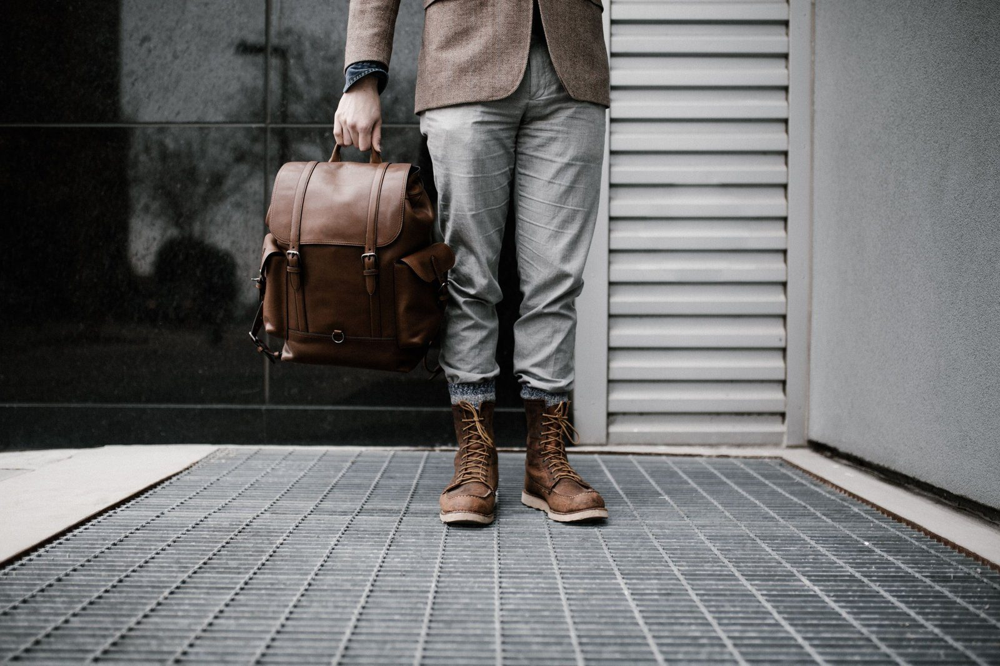
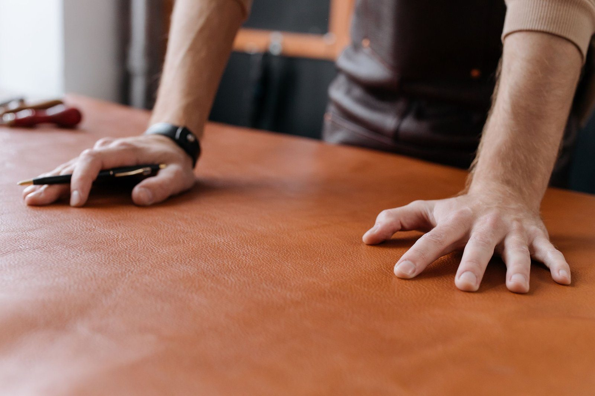
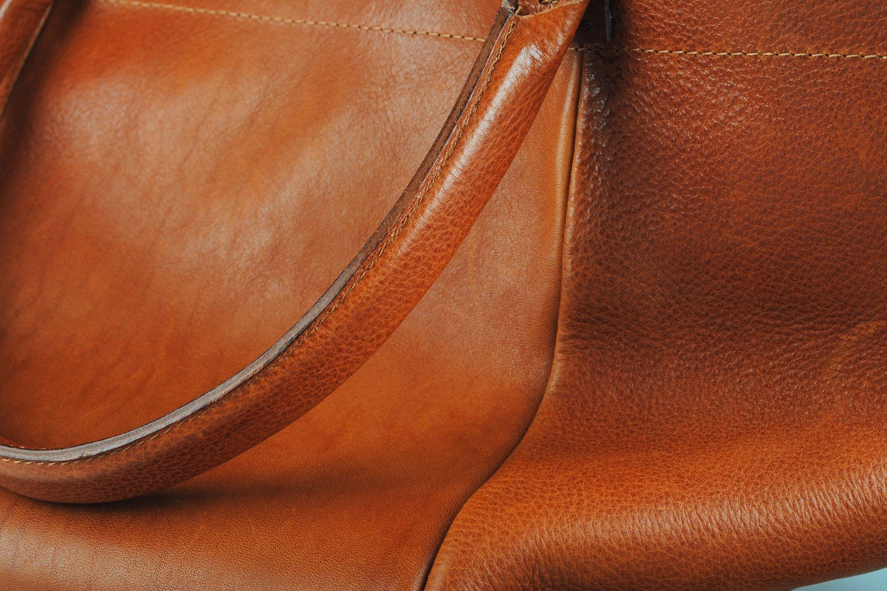

A luxury weekender bag is the most honest piece of luggage a man can own. It has no wheels to hide behind and no telescoping handle to disguise poor proportions. It is carried by hand or over the shoulder, it sits beside you in the lounge, and it goes into the overhead bin or the trunk of the car looking exactly as good, or as tired, as the leather it was cut from. That is why the leather weekender bag has become the quiet signature of the well-traveled man: a carry-on duffel that ages with him, collects a patina from every trip and, if chosen well, outlasts several generations of hard-shell rollers.

This guide covers everything that matters before you buy and long after: what size weekender bag you actually need, why full-grain and vegetable-tanned leather are worth the premium, which construction details separate an heirloom from a fashion piece, how to pack a weekender bag so your shirts arrive crisp, how the TSA 3-1-1 liquids rule shapes your grooming kit, and how to clean and condition leather so the bag improves with every year.

> **Key takeaways**
> - For two or three nights, a weekender of about 35 to 45 liters is the sweet spot; four to seven days calls for about 50 to 60 liters.
> - Full-grain, vegetable-tanned leather develops the richest patina and lasts longest; top-grain looks more uniform but ages less beautifully.
> - Look for solid brass hardware, metal feet on the base, reinforced handles and a light-colored lining.
> - Pack heavy items at the bottom and the ends, roll knitwear, fold woven shirts on top and keep the toiletry pouch last.
> - In US carry-on luggage, liquids must be in containers of 100 ml or less, all in one clear bag of about 1 liter.
> - Dust leather regularly, wipe with a barely damp cloth, condition when it feels dry and never dry it with direct heat.

## Choosing the Right Size: How Many Liters for a Weekend?

The first question is not brand or color but capacity. A weekender bag that is too small forces you to overstuff it, which strains seams and creases clothes. One that is too large turns into a checked bag the moment the gate agent sees it. The best weekender bags for men are sized around the trip you take most often, not the once-a-year expedition.

### The liter rule of thumb

Leather goods maker Buffalo Jackson puts it simply: for a trip of two to three days, a duffel of about 35 to 45 liters is plenty; for four to seven days, about 50 to 60 liters is the right range. Beyond a week, the brand argues, you are either checking a bag or overestimating how much variety your wardrobe needs. That 50 to 60 liter range is also roughly the upper edge of what most US airlines accept as carry-on, typically around 56 x 36 x 23 cm, and a soft leather duffel compresses in a way a hard-sided roller never will.

### Edit before you pack

The same guide recommends laying out the whole trip's clothing on the bed before anything goes in, then removing three items. A typical seven-day list fits comfortably in about 55 liters: seven tees or henleys, two pairs of trousers, one sweater, one packable jacket, two button-downs, underwear and socks, two pairs of shoes (one worn, one packed), a dopp kit, a belt and sleepwear. Anything extra, such as a sport coat for dinner, should replace an item rather than add to the pile.

*Photo: Andrew Neel / Pexels, [Pexels License](https://www.pexels.com/license/)*

For most men who travel for long weekends, client visits or a few nights at a country hotel, a mid-size weekender of about 40 to 45 liters is the most versatile choice in a collection.

Original article: [Buffalo Jackson](https://buffalojackson.com/blogs/insight/how-to-pack-a-leather-duffle-bag-for-a-7-day-trip-without-checking-a-baghow-to-pack-leather-duffle-bag-7-day-trip)

## Full-Grain vs Top-Grain vs Vegetable-Tanned Leather

Once the size is clear, the leather decides everything else: how the bag feels in the hand, how it ages and how long it lasts. Luxury leather duffel bags are rarely cheap, and the price difference is mostly explained by the hide and the tannage.

### Full-grain leather

Full-grain leather keeps the outer surface of the hide intact. Because nothing is sanded away, the fibers are denser and more durable, and the surface shows natural marks that many collectors prize. Most importantly, full-grain leather develops a patina: the color deepens, the surface softens and the bag begins to look like it has a story.

### Top-grain leather

Top-grain leather is sanded and refinished to remove imperfections. It looks smoother and more uniform and resists stains better when new, but it ages less richly, and its finish can wear or crack over time. It is a respectable material for a city bag; for an heirloom weekender it is a compromise.

### Vegetable tanning

Tannage is a separate question from the grain. Vegetable-tanned leather is tanned with plant-based tannins rather than chromium salts. It is firmer, holds its shape well and darkens beautifully with use, but it is more sensitive to water and needs occasional conditioning. For a structured travel bag you plan to keep for decades, full-grain, vegetable-tanned leather is the benchmark.

Original article: [Brown Bear Leatherworks](https://www.brownbearleatherworks.com/en/journal/craft/full-grain-vegetable-tanned-leather-guide)

## The Construction Details That Make an Heirloom Weekender

Two bags can share the same leather and still age very differently. Craftsmanship shows in the small things: the hardware, the base, the handles and even the color of the lining.

### Hardware and feet

In its 2026 roundup of the best leather duffel bags, GQ singles out solid brass hardware for durability and brass feet on the base that protect the leather from airport floors and car trunks. The feet are not decoration. The base is the part of the bag that meets the ground most often, and a bag without feet scuffs and absorbs moisture far faster.

### The lining

GQ also praises a light plaid interior because it makes finding a charger or earbuds on a late-night flight much easier than digging through a dark lining. It is a small, practical detail that reveals whether a maker has actually traveled with the product.

### Weave, logos and quiet luxury

GQ's grail pick, the Bottega Veneta Intrecciato Duffle, shows another way to signal quality: no logo at all, only the hand-woven diagonal leather weave the house introduced in the 1970s, originally developed to make leather more fluid and supple without sacrificing durability. For the man who prefers understatement, a logo-free weekender in a beautiful leather is the most refined choice.

*Photo: cottonbro studio / Pexels, [Pexels License](https://www.pexels.com/license/)*

When you inspect a bag in a store, check the stitching density where the handles meet the body, the weight and finish of the zipper pull, whether the shoulder strap attachment is reinforced and whether the edges are burnished rather than painted.

Original article: [GQ](https://www.gq.com/story/best-leather-duffel-bags)

## How to Pack a Weekender Bag, Step by Step

A beautiful bag is wasted if your trousers arrive creased. Packing a duffel is different from packing a suitcase, because a soft bag has no flat walls and no compression straps. The order matters more than the contents.

### Before you start

Layoverbag recommends checking the forecast and choosing one color palette of two or three tones so that every top works with every bottom and one pair of shoes covers the weekend. Button shirts and jackets and close trouser zips so they keep their shape. Wear the bulkiest pieces, such as boots, a heavy coat or a thick sweater, rather than packing them.

### The packing order

1. **Heavy things at the bottom.** Shoes go along one end or side, soles against the wall of the bag, each in a shoe bag, filled with socks or a charger so they keep their shape.
2. **Rolled clothes next.** T-shirts, knitwear, sleepwear and jeans, rolled tight, fill the gaps around the shoes.
3. **Folded pieces on top.** Dress trousers and shirts lie flat on the rolled layer, where nothing presses on them.
4. **Toiletry pouch last.** Keep it on top or at one end so you can lift it out at security without unpacking.
5. **Small things in pockets.** Chargers, tie and belt inside; phone, keys and boarding pass in the exterior pocket.

### Avoiding creases

The same guide warns against placing shoes or a full toiletry pouch on top of garments, overfilling the bag and leaving clothes loose enough to slide. On arrival, unzip the bag, hang the outfit first and, if something has creased, hang it in the bathroom during a hot shower so the steam relaxes the fibers.

Original article: [Layoverbag](https://layoverbag.com/guides/how-to-pack-a-weekender-bag/)

## The Business-Trip Method: Use the Ends, Protect the Shirts

For a business trip, where a jacket and dress shirt must look presentable straight out of the bag, the London leather house NEGOTIA adds two refinements worth adopting.

### Hard objects into the ends

A weekender is long, roughly half a meter, and its two ends are dead space that clothing does not naturally reach. Anything placed there adds nothing to the bag's width, while anything placed in the middle pushes both sides out. Chargers, cables, a shoe, a book and other objects with corners belong in the ends and side pockets. This is also the step that decides whether a soft bag passes the airline sizer.

### Shirts and jackets last, nothing on top

Woven garments go in last, on the flat surface the rest of the packing has created, and nothing goes on top of them. NEGOTIA suggests folding a shirt only along the seams it already has, across the back once with sleeves folded along the shoulder seams, because creases that follow the construction read as part of the shirt rather than as packing damage. Knitwear, by contrast, should be rolled and laid lengthwise along the base, where it forms a flat foundation and keeps the bag upright when set down.

Original article: [NEGOTIA](https://negotialeather.com/blogs/the-journal/how-to-pack-weekender-business-trip)

## The Gentleman's Dopp Kit and the TSA 3-1-1 Liquids Rule

Your weekender is only a true carry-on if your grooming kit complies with airport security. For a man who travels with beard oil, cologne, moisturizer and shaving cream, this deserves a little planning.

### What the rule says

According to the Transportation Security Administration, liquids, aerosols, gels, creams and pastes in carry-on bags must be in travel-size containers of 100 ml or less each, and all of them must fit in one clear, quart-size zip-top bag, which is about 1 liter. Each passenger may carry one such bag, and it should be placed in the screening bin. Everyday items covered by the rule include toothpaste, shampoo, conditioner, mouthwash and lotion, which in practice means beard wash, beard balm, aftershave balm and face cream too.

### Medications and duty-free

The TSA allows medically necessary liquids, medications and creams above 100 ml in carry-on bags, but they must be removed for separate screening. Duty-free liquids bought abroad may travel in sealed, tamper-evident bags on a connecting flight within 48 hours of purchase, with the receipt. Anything over 100 ml that does not fit these exemptions must go in checked baggage.

### Building a premium travel kit

Decant your daily fragrance into a refillable travel atomizer of about 10 ml, choose solid products where you can, such as a beard balm, a shaving soap or a solid cologne, and keep your liquids bag at the top of the weekender or in an exterior pocket, as the TSA's own travel checklist suggests. A leather dopp kit can stay inside the duffel; the clear liquids bag simply rides on top.

Original article: [Transportation Security Administration](https://www.tsa.gov/travel/security-screening/liquids-aerosols-gels-rule)

## How to Clean and Condition a Leather Weekender Bag

A full-grain leather bag needs only a few minutes of care a season, yet those minutes decide whether it develops a rich patina or dry, cracked handles.

### Know your leather first

Avanzar Leather notes that the most common mistake is using one product on every bag. Smooth full-grain cowhide tolerates a damp cloth and cream conditioner; pebbled leather needs a soft brush to lift dirt from the texture; suede and nubuck should only be brushed dry, never creamed. Always test on a hidden spot, such as the underside of a flap.

### The cleaning routine

Empty the bag completely and shake out grit, which acts like sandpaper on seams and lining. Brush or wipe the exterior with a dry cloth, paying attention to the base, the handles and the areas around the hardware. Wipe with a cloth that is barely damp, then use a dedicated leather cleaner on the cloth, not directly on the bag, for heavier grime. Let the bag dry naturally at room temperature, lightly stuffed with paper so it keeps its shape.

### Conditioning

Once fully dry, apply a pea-sized amount of conditioner to a clean cloth, work it in small circles section by section, and give extra attention to handles, strap edges and corners, which dry out first. Let it absorb for about 15 to 30 minutes, then buff. The brand warns against household cleaners, baby wipes, alcohol sanitizers and anything containing ammonia or bleach, which strip oils and finishes.

*Photo: Kristian Bøgh / Pexels, [Pexels License](https://www.pexels.com/license/)*

### Rain, heat and storage

If the bag gets wet, blot it with a soft cloth and let it air-dry; never use a radiator or hair dryer. Between trips, store it loosely stuffed with paper in a breathable cotton dust bag, away from sunlight, heat and humidity, at an ordinary room temperature of about 18 to 22 °C. For deep stains such as ink, oil or wine, or for torn leather and broken hardware, take the bag to a professional leather specialist.

Original article: [Avanzar Leather](https://avanzarleather.com/blogs/leather-guide/how-to-care-for-leather-bag)

## Investment Value: Why a Great Weekender Pays for Itself

Luxury luggage is often discussed as an indulgence, but a well-made weekender is closer to a long-term investment. The Observer's 2026 guide to the best weekender bags for men captures it neatly with Ghurka: your father-in-law's bag looks better than yours because it carries twenty years of patina, while yours is still stiff enough to creak. That is the whole proposition of heritage leather.

The same guide notes that each Ghurka bag is handcrafted in Norwalk, Connecticut, from full-grain vegetable-tanned leather, individually numbered and backed by a 45-day guarantee that lets you take it on a real trip before committing. For the man who prefers a lighter bag, the Observer highlights the Carl Friedrik Large Weekender, which pairs fabric woven from recycled pre-consumer waste with Italian vachetta leather trim and weighs only about 1.1 kg.

The cost-per-use logic is straightforward. A weekender carried on twenty trips a year for twenty years is used around four hundred times. Spread across that life, even an heirloom price becomes reasonable, and unlike most luggage, the bag looks better at trip four hundred than at trip one.

Original article: [Observer](https://observer.com/list/best-weekender-bags-for-men/)

## Premium Weekender Picks Worth Knowing

These three bags represent different expressions of the same idea: exceptional leather, honest construction and a design that will still look right in twenty years.

### Ghurka Cavalier II No. 97

The American heritage choice. The mid-size Cavalier II is made from Italian full-grain, vegetable-tanned, tumbled leather with brass hardware, a Ghurka Check cotton twill lining, a detachable adjustable shoulder strap, an interior zip pocket and a unique registration number, handcrafted in the USA. At about 51 x 30 x 27 cm and about 2.3 kg, it is listed as an approved cabin size. Price on the product page: $1,995 in Vintage Chestnut leather. [View the Ghurka Cavalier II No. 97](https://ghurka.com/products/cavalier-ii-no-97-vintage-chestnut-leather)

### Archibald London Phileas Weekender v3

The Florentine craftsman's choice. Handcrafted by artisans in Florence from Badalassi Carlo Minerva vegetable-tanned leather from Santa Croce, with palladium-plated brass hardware from Madrid, finger-stitched handles, Swiss-made zippers, a hidden zipped side pocket, metal feet and a detachable shoulder strap. It measures about 27 x 26 x 54 cm. [View the Phileas Weekender v3 in Black](https://www.archibaldlondon.com/us/collection/product/the-phileas-weekender-v3--black)

### Leonardo Amerigo Intreccio Weekender

The connoisseur's woven choice. A weekender in hand-woven, vegetable-tanned full-grain black calfskin, made in Florence, with a zip running along the top and down both ends, semi-rigid rolled leather handles, five metal feet, a tartan lining and a capacity of about 38 liters at 55 x 28 x 25 cm. [View the Leonardo Amerigo Weekender](https://www.leonardoshoes.com/en-us/products/amerigo-intreccio-woven-leather-weekender-black)

## Frequently Asked Questions

### What size weekender bag do I need for a weekend trip?
For two or three nights, a weekender of about 35 to 45 liters is ideal. For four to seven days, choose about 50 to 60 liters, which is close to the upper limit for most US carry-on allowances.

### Is a leather weekender bag allowed as a carry-on?
Usually yes, if it fits your airline's size limit, commonly around 56 x 36 x 23 cm in the US. Limits vary by airline and fare, so check before you fly and avoid overfilling a soft bag.

### Is full-grain leather better than top-grain for a travel bag?
For an heirloom bag, yes. Full-grain leather keeps the natural surface of the hide, is denser and develops a rich patina, while top-grain is sanded for uniformity and ages less beautifully.

### How do I pack a weekender bag without wrinkling shirts?
Put shoes and heavy items at the bottom and ends, roll knitwear and casual items, then lay folded dress shirts and trousers flat on top with nothing pressing on them.

### How much liquid can I bring in a carry-on weekender?
Under the TSA 3-1-1 rule, each container must be 100 ml or less, and all containers must fit in one clear bag of about 1 liter per passenger. Medications are exempt but screened separately.

### How often should I condition a leather weekender?
Condition whenever the leather feels dry or stiff, typically every few months with regular travel, after cleaning and fully drying the bag. Use a thin layer and buff off the excess.
