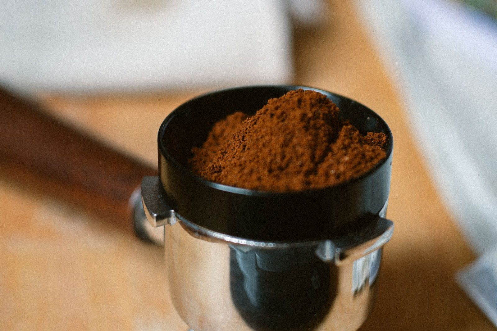
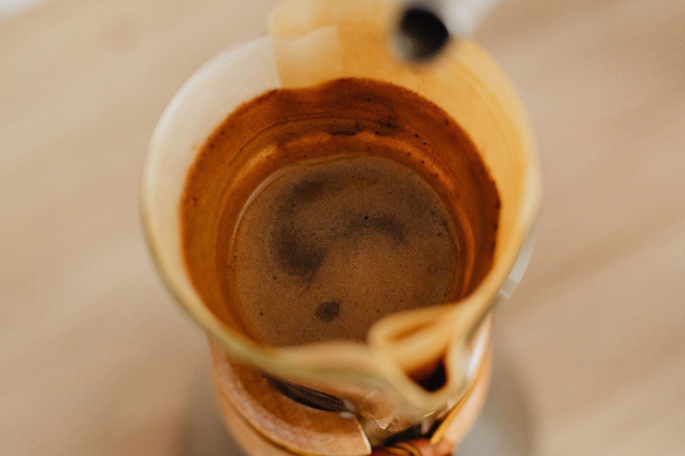
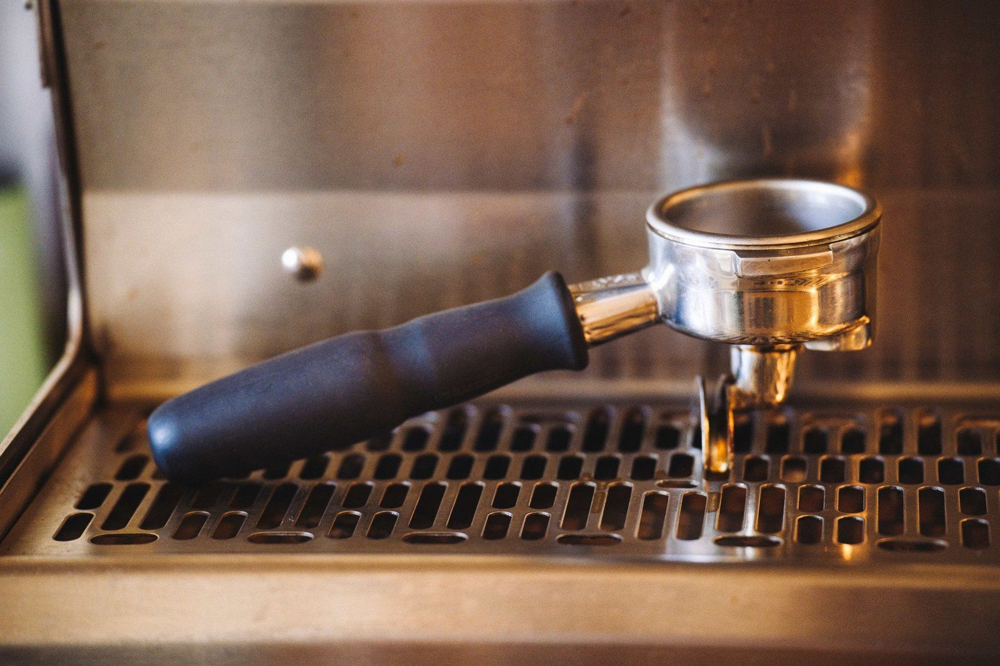

Every man of standards has a few rituals that set the tone for the day. A close shave, a well-pressed shirt, a watch wound before breakfast. For a growing number of men, the most rewarding of these rituals is the first cup of coffee, made at home, by hand, with the same care a good tailor gives to a buttonhole. A gentleman's coffee ritual is not about chasing the latest café trend. It is about understanding a handful of variables, investing in a few tools that will last for years and turning ten quiet minutes into the best part of the morning.

This guide covers the essentials of how to make better coffee at home: the coffee-to-water ratio the Specialty Coffee Association uses as its benchmark, the right water temperature, why a burr grinder matters more than almost anything else on the counter, how to match grind size and brew time to your method, a step-by-step pour-over ritual, how to dial in espresso on a home machine, how to store coffee beans so they stay fresh, and how much caffeine is sensible for a healthy adult. We close with a short list of premium coffee equipment worth owning and a quick FAQ.

> **Key takeaways**
> - The SCA's Golden Cup benchmark is about 55 g of coffee per liter of water, roughly a 1:18 ratio, brewed at 92 to 96 °C.
> - A burr grinder is the single most important upgrade; blade grinders produce uneven particles and muddy flavor.
> - Match grind size to brew time: coarse for a French press of about four minutes, medium for pour-over of three to four minutes, fine for espresso of about 20 to 30 seconds.
> - Sour and weak means grind finer; bitter and harsh means grind coarser.
> - For espresso, a 1:2 ratio, for example 18 g in and about 36 g out in 25 to 30 seconds, is a reliable starting point.
> - Buy beans in small batches, keep them airtight, dark and cool, and grind just before brewing.
> - The FDA cites about 400 mg of caffeine a day as an amount not generally associated with negative effects for most adults.

## The Golden Cup: Coffee-to-Water Ratio and Brewing Temperature

Before buying a single piece of luxury coffee equipment, a man should know the two numbers that govern almost every brewed cup: the ratio and the temperature. Get these right and even a simple brewer produces something remarkable. Get them wrong and the most beautiful machine on the market will disappoint.

### The 55 grams per liter benchmark

The Specialty Coffee Association, the trade body behind the specialty coffee movement, defines its Gold Cup ratio as about 55 g of coffee per liter of water. In everyday terms, that is roughly a 1:18 coffee-to-water ratio. For a single generous mug of about 350 ml, it means around 19 to 20 g of coffee. For a carafe of 1 liter, about 55 g. The SCA uses this ratio as the starting point when it certifies home brewers, then adjusts grind and contact time until the brew lands in its target zone for strength and extraction.

The practical lesson is simple: weigh your coffee. A small digital scale reading to a tenth of a gram costs far less than a good grinder and removes most of the guesswork. Scoops and spoons vary with roast level and bean density; grams do not.

### Water between 92 and 96 °C

The same SCA requirements specify that brewing water should reach 92 °C at the point where it meets the coffee, stay at least that hot for the brew cycle and never exceed 96 °C. Water that is too cool under-extracts and tastes thin and sour. Water at a rolling boil can push delicate coffees toward bitterness. This is why a temperature-controlled gooseneck kettle is a genuinely useful tool rather than a gadget: it lets you set 93 or 94 °C and pour at exactly that temperature every morning.

### Contact time and water quality

For automatic drip machines, the SCA certification requires a total contact time of more than four minutes and less than eight minutes. Its test protocol also uses fresh, cold water of about 15 °C with a baseline mineral content of about 150 ppm. Very soft or distilled water tends to taste flat, while very hard water can mute flavor and scale your equipment. A good filter jug or quality bottled water is often the cheapest improvement a home brewer can make.

Original article: [Specialty Coffee Association](https://links.imagerelay.com/cdn/2615/ql/4bf57b3a901046b492d45b7015455c76/2017-SCA-CHB-Program-Requirements.pdf)

## Why a Burr Grinder Is the Most Important Coffee Tool You Will Buy

Ask any serious barista where to spend money first and the answer is almost always the grinder, not the brewer. A premium coffee grinder decides how evenly the water can extract flavor from every particle, and evenness is what separates a clear, sweet cup from a muddy one.

### Burr vs blade grinders

Serious Eats explains that blade grinders, essentially spice mills, pulverize coffee beans into uneven bits that lead to poor extraction. Burr grinders cut the beans between two burrs set a precise distance apart, and particles can only leave the grinding chamber once they are small enough to pass through that gap. High-quality burrs have precision-cut teeth that create far fewer ultra-fine particles, called fines, which over-extract quickly and can clog filters.

### Grind size changes flavor in two ways

The publication points out that grind size affects extraction twice. Finer coffee has more surface area, so the water extracts it faster. And for methods such as pour-over, the particle size also controls how quickly the water flows through the bed of coffee: smaller particles slow the water down, larger ones let it rush through.

### A reference chart in microns

In its grinder testing, Serious Eats quotes Steve Rhinehart of the scale maker Acaia with approximate ideal particle sizes: about 1,000 microns and larger for a French press, 600 to 800 microns for drip or pour-over, 400 to 600 microns for AeroPress and moka pot, and 300 to 400 microns for espresso. You will never measure microns at home, but the chart is a useful mental map when you change methods.

### Conical or flat burrs

Most grinders use conical burrs, which are easier to calibrate. Flat burrs, used in grinders such as the Fellow Ode Gen 2, can be trickier to align but, according to Serious Eats, high-end flat-burr grinders tend to offer slightly better flavor clarity and more consistent particle size. For a man who drinks mainly filter coffee, a well-built flat-burr brew grinder is a lifetime purchase.

*Photo: Raymond Petrik / Pexels, [Pexels License](https://www.pexels.com/license/)*

Original article: [Serious Eats](https://www.seriouseats.com/the-best-coffee-grinders)

## Matching Grind Size and Brew Time to Your Method

Once you have a good grinder, the next skill is reading the cup and adjusting. The coffee grind size chart only gets you close; taste and time do the rest.

### Immersion vs pressure

Serious Eats contrasts two methods at opposite ends of the spectrum. A French press is a steeping method in which water and coffee sit together for about four minutes, so it needs a coarse grind. Espresso forces water through the coffee under pressure for only about 20 to 30 seconds, so it needs a very fine grind to dissolve enough flavor in such a short time.

### Use the clock as a check

The same article suggests using time as a diagnostic. Most drip-style brews should take about three to four minutes to fully extract. If yours finishes much faster, grind a little finer; if it drags on, grind coarser. The writer's analogy is memorable: coarse grounds behave like rocks and fine grounds like sand, and water passes more slowly through sand.

### Let taste have the final word

Grassy or pencil-like flavors can be a sign of under-extraction, often caused by a grind that is too coarse. A bitter, astringent aftertaste suggests the grind may be too fine. Change one variable at a time, ideally only the grind, and note the result. Within a week, most men can dial in a new bag of beans in two or three brews.

Original article: [Serious Eats](https://www.seriouseats.com/coffee-techniques-best-grind-for-espresso-french-press-fine-vs-coarse)

## The Pour-Over Ritual, Step by Step

If one method embodies the gentleman's coffee ritual, it is pour-over coffee. It is quiet, tactile and precise, and it rewards attention with remarkable clarity of flavor. A glass Chemex or a ceramic dripper, a gooseneck kettle, a scale and a burr grinder are all you need.

### Start in the middle of the grinder

Serious Eats calls grind size perhaps the biggest influence on the flavor and strength of pour-over coffee. Too coarse and the water cannot extract enough from inside the larger particles, so the brew tastes weak and lightly sour. Too fine and the result is astringent, bitter and strong. Their advice: start in the medium range of your grinder, with grounds that look like raw sugar crystals, and adjust from there.

### Keep everything else consistent

The key to improving pour-over is to set the other variables into a repeatable pattern, so that grind becomes the one dial you turn. In practice that means the same dose, the same water temperature, the same pouring rhythm and the same total brew time every morning.

*Photo: Kaboompics / Pexels, [Pexels License](https://www.pexels.com/license/)*

### A simple morning routine

A widely used home routine that stays within the SCA benchmarks looks like this:

1. Heat water to about 93 to 94 °C.
2. Rinse the paper filter with hot water to remove paper taste and warm the brewer, then discard the rinse water.
3. Add about 30 g of medium-ground coffee for roughly 500 ml of water, close to a 1:17 ratio.
4. Pour just enough water to wet all the grounds, about twice the coffee's weight, and wait 30 to 45 seconds while the coffee "blooms" and releases gas.
5. Pour the rest in slow, steady spirals, keeping the water level consistent.
6. Aim to finish draining in about three and a half to four minutes, then swirl and serve.

Original article: [Serious Eats](https://www.seriouseats.com/make-better-pourover-coffee-how-pourover-works-temperature-timing)

## How to Dial In Espresso on a Home Machine

Home espresso is where the coffee ritual becomes a craft. A premium espresso machine will produce café-quality shots, but only if you understand the three variables that every barista tracks: dose, yield and time.

### Start with a 1:2 ratio

The specialists at La Marzocco, the Florentine espresso machine maker, recommend having a target brew ratio in mind whenever you put a new coffee in the hopper. A good starting point is a 1:2 ratio in 25 to 30 seconds: one part ground coffee to two parts liquid espresso by weight. They typically start with 18 g of coffee in a 17 g basket and adjust from there, and suggest a target of about 28 to 36 g of espresso in that time window.

### Weigh the dose and the shot

La Marzocco's step-by-step method puts the portafilter on a scale and tares it, doses the coffee, distributes and tamps it evenly, then places the cup on a scale under the portafilter to weigh the output. Because different coffees have different densities, weighing removes the guesswork and keeps your grinder dialed in.

*Photo: yun zhu / Pexels, [Pexels License](https://www.pexels.com/license/)*

### Read the shot

Watch how the espresso flows. Does it gush suddenly or start slowly and build? What color is it, and when do the first drops appear? La Marzocco notes that these visual cues are useful but do not by themselves mean a shot tastes good or bad. Taste is the judge. If the shot runs fast and tastes sour, grind finer. If it crawls and tastes bitter, grind coarser. Change the grind, not your tamping pressure.

Original article: [Los Angeles Coffee Festival with La Marzocco](https://www.la-coffeefestival.com/Blog/September-2019/How-to-Make-Espresso-The-Basics)

## How to Store Coffee Beans So They Stay Fresh

Even the finest single-origin beans from an exceptional roaster lose their character quickly if they are stored badly. The National Coffee Association calls air, moisture, heat and light the four greatest enemies of roasted coffee.

### Five rules from the National Coffee Association

1. Buy smaller batches of freshly roasted coffee, enough for one or two weeks.
2. Take the coffee out of retail packaging that is not designed for long-term storage and use an airtight container.
3. Choose opaque containers; clear canisters let in light. Glass jars of beans are best kept as décor.
4. Keep coffee in a dark, cool place, away from the oven, the dishwasher and strong afternoon sun.
5. Grind only what you need, immediately before brewing.

### How long coffee stays fresh

According to the NCA, opened roasted beans stored in an airtight container keep their freshness for about one to three weeks at room temperature, about two weeks refrigerated and about three to four months frozen. Ground coffee lasts only about one to two weeks at room temperature. After that, coffee does not become unsafe unless it gets damp and moldy, but it loses aroma and tastes stale.

### Should you freeze coffee beans?

Coffee is hygroscopic: it absorbs moisture, odors and tastes from the air. If you freeze or refrigerate beans, the NCA recommends a truly airtight container, taking out no more than a week's supply at a time and returning the rest before condensation forms. For daily use, a well-sealed canister in a cool cupboard is the better choice.

Original article: [National Coffee Association](https://www.aboutcoffee.org/beans/storage-and-shelf-life/)

## Caffeine, Timing and Health: How Much Coffee Is Too Much?

A ritual should leave you sharper, not jittery. Understanding caffeine helps a man enjoy coffee without letting it disrupt sleep, training or concentration.

### The 400 milligram reference point

The US Food and Drug Administration cites about 400 mg of caffeine a day as an amount not generally associated with negative effects for most adults. That is roughly two to three large mugs of about 355 ml of brewed coffee. The FDA stresses, however, that sensitivity varies widely and depends on body weight, medications, certain medical conditions and how fast each person eliminates caffeine.

### Coffee strength varies a lot

The FDA's own table shows that a regular brewed, non-specialty coffee of about 355 ml can contain anywhere from about 113 to 247 mg of caffeine. A strong specialty brew may sit at the top of that range, so counting cups is less reliable than knowing your coffee and your own response to it.

### Decaf is not caffeine-free

The agency also notes that decaffeinated coffee and tea contain less caffeine than their regular versions but still contain some. Men who enjoy an evening espresso after dinner may still want to keep an eye on how it affects their sleep. Anyone with a heart condition, high blood pressure or concerns about medication interactions should discuss caffeine with a doctor.

Original article: [U.S. Food and Drug Administration](https://www.fda.gov/consumers/consumer-updates/spilling-beans-how-much-caffeine-too-much)

## Premium Coffee Equipment Worth Owning

These three pieces represent the core of a serious home coffee bar: a grinder that sets the foundation, a kettle that controls the pour and an espresso machine built to commercial standards.

### Fellow Ode Brew Grinder Gen 2

The connoisseur's filter grinder. Fellow describes the Ode Gen 2 as quiet, clean and precise, with anti-static technology, a magnetically aligned catch cup, a built-in knocker and an automatic stop that shuts the grinder off when grinding is complete. It uses flat burrs, which Serious Eats singles out for flavor clarity. It is designed for brewed coffee rather than espresso. [View the Fellow Ode Brew Grinder Gen 2](https://fellowproducts.com/products/ode-brew-grinder-gen-2)

### Fellow Stagg EKG Pro Electric Kettle

The pour-over specialist's kettle. The Stagg EKG Pro is a gooseneck electric kettle in 304 stainless steel with a capacity of about 0.9 liters and precise temperature control, so you can set the SCA's 92 to 96 °C window exactly. Regular price on the product page: $199.95. [View the Fellow Stagg EKG Electric Kettle](https://fellowproducts.com/products/stagg-ekg-electric-pour-over-kettle)

### La Marzocco Linea Micra

The heirloom espresso machine. From the Florence-based maker whose specialists shaped the dialing-in method above, the Linea Micra is a compact home espresso machine that, in La Marzocco's words, elevates any kitchen to café status. Price on the US product page: $4,500, grinder sold separately. [View the La Marzocco Linea Micra](https://home.lamarzoccousa.com/product/linea-micra/)

## Frequently Asked Questions

### What is the best coffee-to-water ratio?
The Specialty Coffee Association's Golden Cup benchmark is about 55 g of coffee per liter of water, roughly 1:18. Many home brewers prefer slightly stronger ratios of about 1:16 to 1:17 for pour-over.

### What water temperature is best for brewing coffee?
Between 92 and 96 °C at the point the water meets the coffee. Boiling water can taste harsh; water below about 90 °C tends to under-extract and taste sour.

### Is a burr grinder really worth it?
Yes. Burr grinders cut beans into evenly sized particles, while blade grinders smash them into uneven pieces and fine dust, which leads to bitter and sour flavors in the same cup.

### Why does my coffee taste sour or bitter?
Sour and weak usually means under-extraction: grind finer or brew slightly longer. Bitter and harsh usually means over-extraction: grind coarser or shorten the brew.

### Should I store coffee beans in the fridge or freezer?
Not for daily use. Keep beans in an opaque, airtight container in a cool, dark cupboard. Freezing in airtight portions can work for longer storage of about three to four months.

### How much caffeine per day is safe?
For most healthy adults, the FDA cites about 400 mg a day as an amount not generally associated with negative effects. Individual sensitivity varies, so adjust to how you feel and sleep.

*This article summarizes publicly available information from the linked sources and is not medical advice. If you have a heart condition, high blood pressure, anxiety, sleep problems or take medication, ask your doctor about caffeine.*
