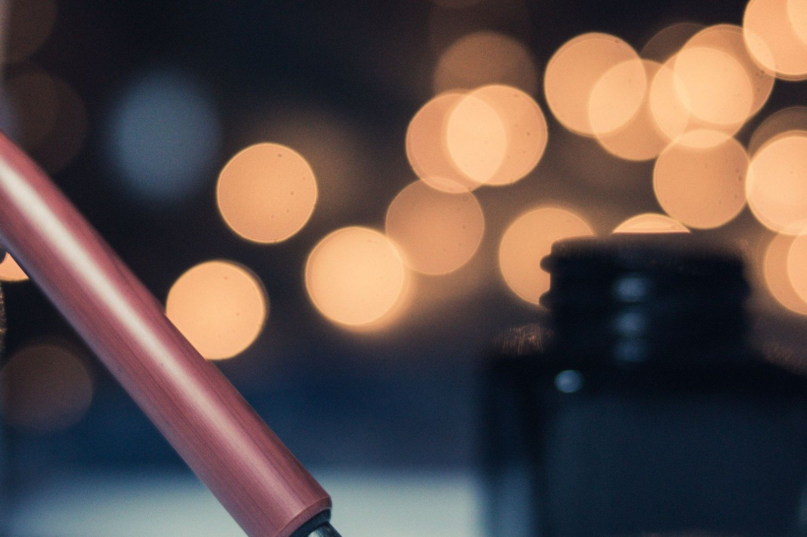
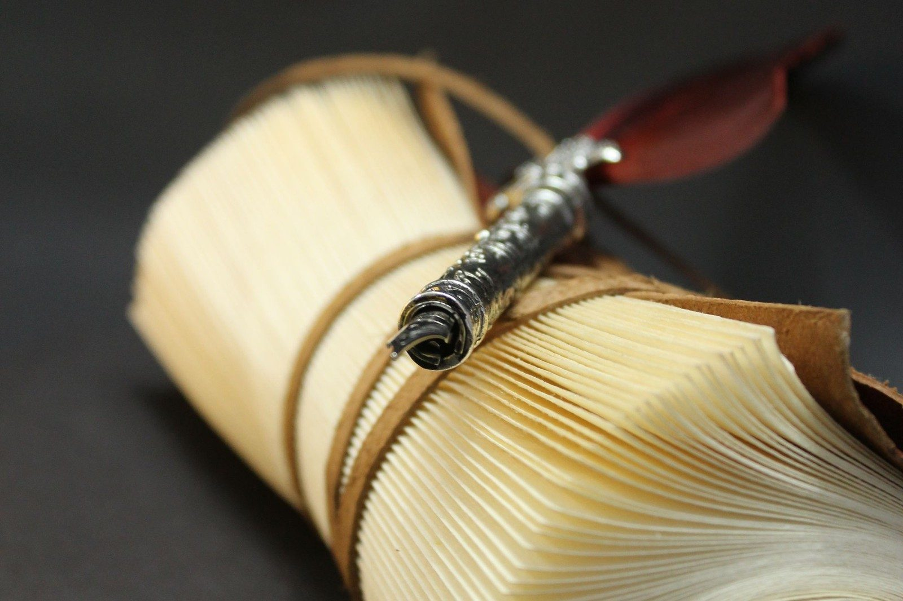
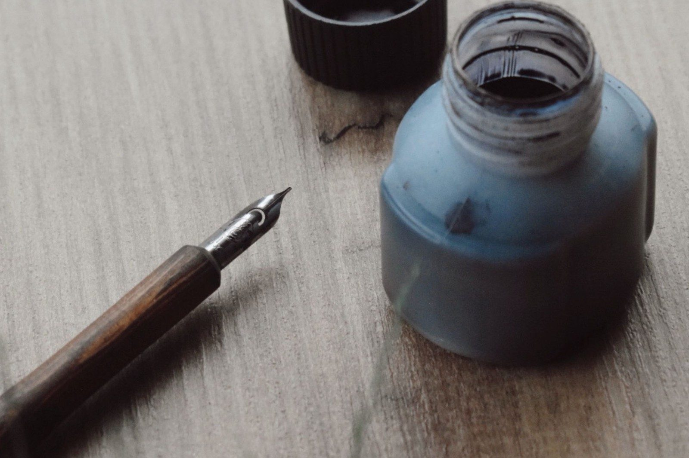
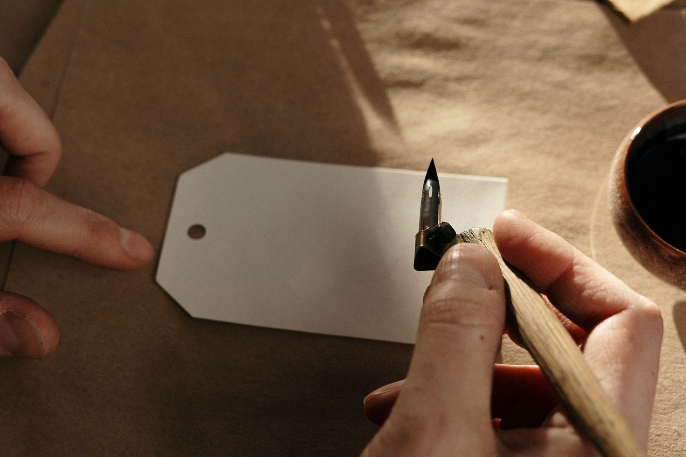
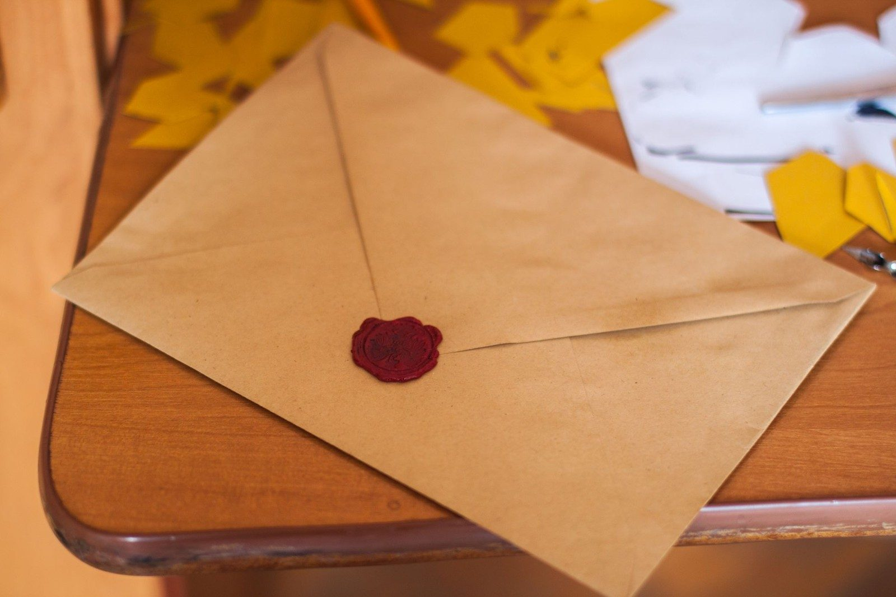

A fountain pen is a writing instrument that feeds liquid ink through a metal nib, rather than a ball or a fibre tip. It is not a dip pen, and it is not a souvenir that lives in a drawer. For a man who still signs a letter, a card or a document with his own hand, it is one of the few tools that can be both practical and quietly ceremonial. This guide explains what a fountain pen is, how nibs and filling systems actually work, what to look for in a first serious pen, how to care for it, which paper and ink belong with it, how to write and send a letter in 2026, and three pens listed on U.S. pages at the time of writing: the Lamy 2000, the Pelikan M800 and the Montblanc Meisterstück Gold-Coated 149.

> **Key takeaways**
> - A fountain pen is defined by its nib and its ink feed, not by a logo. Liquid ink is stored in a cartridge, a converter, a piston or another reservoir and is drawn to the page by capillary action.
> - Nib width is a choice, not a rank. Fine and extra-fine suit smaller handwriting and ordinary American copy paper; medium and broad show more of the ink and prefer a smoother sheet.
> - Gold and steel nibs can both write well. Gold is often springier; steel is often crisper and less expensive. The grind, the slit and the tipping matter more than the marketing line.
> - Use ink made for fountain pens. India ink, drawing ink, calligraphy dip ink and most marker refills can clog or corrode a feed. When in doubt, choose a named fountain-pen ink and flush the pen with lukewarm water.
> - Paper is half the instrument. A coated or hard-sized sheet — the kind sold for fountain pens or as good writing paper — shows the line cleanly and keeps the ink from feathering.
> - A letter is still the most complete personal message a man can send. Date it, address the person by name, write in complete sentences, close cleanly, and put a return address on the envelope.
> - Three current U.S. listings, each confirmed on the seller's page: the Lamy 2000 fountain pen at $279, the Pelikan M800 Black-Green at $740, and the Montblanc Meisterstück Gold-Coated 149 at $1,380.

## What Is a Fountain Pen, and Why Does It Still Matter?

A fountain pen is a pen that stores liquid ink and delivers it to the page through a nib. The ink sits in a reservoir — a cartridge, a converter, a piston chamber or, in some designs, the barrel itself — and travels through a feed by capillary action. You do not dip it for every line, as you would a dip pen or a quill. You do not roll a ball through a paste, as you do with a ballpoint. The mark is a wet line, and the hand feels the paper.

That definition is enough. For a gentleman the pen is mainly a way to write his own name, a short letter and the occasional note without borrowing a plastic stick from a hotel desk. It is slower than a phone, which is part of the point. A message that had to be written, folded and posted still carries a weight that a typing thumb does not.

It rewards a little knowledge. The wrong ink can clog it, the wrong paper can make a fine nib look ragged, and a pen left inked in a drawer can dry hard. None of this is mysterious. It requires the same attention you would give a decent watch or a pair of shoes: use it, clean it, and do not leave it in the box.

A first pen does not have to be a family heirloom or a limited edition. It has to start, write a clean line and sit comfortably in the hand for a page or two. Everything else — gold, piston, a famous clip — can come later. The man who writes with a well-chosen mid-range pen is already ahead of the man who owns a famous one and is afraid to fill it.

## How Do Nibs, Filling Systems and Ink Work?

The nib is the part that touches the paper. It is usually steel or gold, slit down the middle, and finished with a small tip of hard alloy so that the metal does not wear out in a month. Ink flows down the slit. The width of the line depends mainly on the size of that tip and on the angle and pressure of the hand. Common Western widths are extra-fine (EF), fine (F), medium (M) and broad (B). Japanese widths from makers such as Pilot, Platinum and Sailor often run a little finer than their European namesakes, which is useful to know if you write small or if most of your paper is ordinary copier stock.

There is no morally correct width. Fine and extra-fine are practical for everyday American paper, forms, and a compact hand. Medium is the classic all-rounder on good stationery. Broad and stub nibs show more of the ink and need paper that can take it. A first pen is usually happiest in fine or medium.

Gold and steel are not a quality scale. A well-cut steel nib can be excellent; a poorly adjusted gold nib can be a nuisance. Gold, in 14-carat or 18-carat, is often a little more springy; steel is often firmer and less expensive. The Lamy 2000 uses a 14-carat gold nib in an understated body: the point is the writing, not a billboard of yellow metal.

The filling system is how ink gets into the pen. A cartridge is the simplest: you push in a plastic ink capsule made for that brand, or you use a converter — a small reusable pump that lets you fill from a bottle while still using a cartridge-style pen. A piston filler, as on the Lamy 2000 and the Pelikan M800, has a knob or shaft that draws ink straight into the barrel. Piston pens often hold more ink and look cleaner, because there is no cartridge to see or to throw away. Other systems exist, but cartridge-converter and piston will cover almost every pen a gentleman actually needs.

Fountain-pen ink is a water-based dye — and, in some cases, a carefully made pigment — designed to flow through a feed. India ink, calligraphy dip ink, drawing ink and most stamp inks are a different family and can clog a feed or attack metal. If the bottle does not present itself as fountain-pen ink, do not put it in the pen. Inside that family, start with a classic blue-black, a reserved black or a quiet blue. Shimmering and highly saturated inks are for later, and for pens you are willing to clean more often.

*Photo: Iago Gleison / Pexels, [Pexels License](https://www.pexels.com/license/)*

## What Should You Look For in a First Serious Fountain Pen?

A first serious pen should do three things: start when you pick it up, sit comfortably in the hand, and accept a filling method you will actually use. Everything else is secondary. Brand prestige is not a substitute for a nib that catches on the paper. A heavy cased pen that looks important in a photograph can be tiring after a page. A very slim pen can feel precise or it can feel mean, depending on your hand. If you can try before you buy, write two or three lines, not one signature. If you cannot, choose a maker with a clear nib-exchange or service path, and start with a common width.

Weight and balance matter. A cap posted on the back can turn a well-balanced pen into a lever; some pens are designed for it, some are happier closed beside the page. A very narrow section can tire a large hand; a very wide one can feel clumsy in a small hand. If you already have a pen you like, notice where it sits against the thumb and first finger, and buy toward that.

Materials are mostly taste and toughness: resin, lacquered brass, steel, wood, or a composite such as the Lamy 2000's body. A high polish shows fingerprints and desk marks; a matte body is often the more peaceful daily companion. Avoid a clip, nib or cap ring that already looks poorly fitted in the photographs. Fit is visible.

Budget is clearer if you separate jobs. An everyday pen for a bag can be a sturdy cartridge-converter model, often well under the prices listed later in this guide. A desk pen for letters can be a piston filler you fill from a bottle. A ceremonial pen for a contract or a wedding card can be the same desk pen, or something you mean to keep for decades. Start with one pen you will actually use, one bottle of reliable ink, and a pad of paper that does not feather.

In the United States you will meet official brand shops and specialist retailers. Official pages are useful for current list prices and exact specifications; specialists are useful for nib work and ink. A price sharply below a maker's own figure may be a sale, an older finish, or a pen with no U.S. warranty. Read the listing. If a seller will not say whether the nib is new and original, wait.

*Photo: seymasungr / Pexels, [Pexels License](https://www.pexels.com/license/)*

## How Do You Care for a Fountain Pen?

Daily care is almost nothing. Cap the pen when you pause, and do not throw it loose into a bag with keys. Write with a light hand: pressing harder does not make a better line and can unbalance a nib. If the pen skips, check the obvious first — ink, a dried nib, unsuitable paper. A dirty feed is usually solved by a flush, not by a workshop.

Cleaning is water and patience. For a cartridge-converter pen, remove the cartridge or converter and run lukewarm water through the section until it runs clear. A piston pen is flushed by drawing in clean water and expelling it until the water comes out without colour. Do not start with hot water, household cleaners or alcohol; they can cloud resin or loosen parts. If ink has dried hard, soak the nib section in cool or lukewarm water — do not pick at the feed. Let the pen dry, or refill it and write a few lines.

A pen written every day with a standard dye ink may only need a flush when you change colours or when the flow turns reluctant. A pen that will sit for weeks should be emptied and flushed before it goes into a drawer. If you have several pens, keep one inked for daily use and store the rest clean and dry, away from a hot window.

Travel asks for a little care. Pens can burp ink in a cabin when trapped air expands. Many men travel with the pen empty, or freshly capped in a bag rather than a hot pocket, inside a small pouch. Do not pack a fountain pen loose with an ink bottle unless both are sealed, and do not open a bottle over a hotel bedspread.

A nib that writes too dry, too wet, or to one side can often be adjusted by a specialist; that is normal, not a sign you bought badly. Do not bend a gold nib at home or heat a cracked section. If a piston stiffens, a cap no longer seals, or a dropped nib looks bent, stop and have it seen to.

*Photo: Yashasvi Nagda / Pexels, [Pexels License](https://www.pexels.com/license/)*

## What Paper and Ink Belong With a Good Pen?

Paper is the other half of the line. Fountain-pen ink sits on and in the sheet; if the fibres are loose or the sizing is poor, the line feathers, shows through the back, or both. Ordinary American copy paper varies wildly. Some of it is perfectly serviceable with a fine nib and a well-behaved ink. Some of it is not. If you write letters, notes or a journal, it is worth buying paper that is actually made for writing: a hard-sized pad, a laid or wove writing sheet, or a notebook sold as fountain-pen friendly. Weight in grams per square metre is a clue, not a guarantee; a well-sized 80 or 90 g/m² sheet can outperform a thicker, thirsty paper. The test is a single written line, left to dry, then checked on the back and at the edges of the stroke.

Colour and texture are taste. A cream or ivory sheet is kinder than a hard optical white. A very rough handmade sheet can struggle with a fine nib; a very smooth sheet can dry slowly. Keep a practical pad for drafts and a better sheet for letters. Envelopes should roughly match the paper: a heavy letter in a flimsy envelope looks unfinished.

Start with one reliable blue-black or a quiet blue, and one black if you sign documents. Buy ink made for fountain pens. Waterproof and pigmented fountain-pen inks are useful for envelopes, but they usually ask for more frequent cleaning. Modern iron-gall fountain-pen inks can be excellent for correspondence; they are not the same as older, highly acidic recipes, and they are not a casual first bottle.

Keep the bottle closed, upright, and away from strong sun and hard frost. Do not dilute ink to make it last, and do not pour unused ink back into the bottle from a dirty pen. A blotter or a cloth on the desk is more useful than a theatrical inkstand. You do not need fifty colours. You need one ink that dries in a reasonable time, one paper that holds a line, and the habit of using both.

*Photo: seymasungr / Pexels, [Pexels License](https://www.pexels.com/license/)*

## How Do You Write and Send a Letter Well in 2026?

A letter is still the most complete personal message a man can send. It has a date, a person, a beginning and an end, and it arrives in the other man's hand, not in a notification. Email and a short text have their place. They do not replace a letter of thanks, a letter of condolence, a letter of congratulations, or a note that had to be thought through at a desk. The fountain pen is simply the right tool for that work. The manners are older than the pen, and they are not complicated.

Write on a flat surface, with enough light, on paper that will survive the post. Put the date at the top. Address the person as you would in speech, with a name: "Dear James," or "Dear Mr Walker," not a floating "Hi." If you have never met, use the more formal form until invited to do otherwise. The first sentence should say why you are writing. The rest should be complete sentences, in a hand the other person can actually read. If your handwriting is hurried, slow down. If a word is a mess, start the page again; a letter is short enough to rewrite.

Keep the tone to the occasion. A thank-you letter names the gift or the evening and is sent promptly. A condolence letter is short, specific and free of advice. A congratulations letter is warm and not sly. A letter of apology is direct. A business letter, even on good letterhead, should still be clear: who you are, what you want, what you will do next. Keep a copy of anything that matters commercially.

The close should match the opening. "Yours sincerely" is the standard close when you have used a formal name; "Yours" or "With kind regards" is enough for a peer you already know. Sign as you usually sign, and if the signature is a scrawl, print your name beneath it. A postscript is for a genuine afterthought, not for the real point of the letter.

The envelope is part of the letter. Write the address clearly, in the same ink or in a more water-resistant one if rain is likely, and put a return address on it. A wax seal is optional and handsome on a personal letter; it is out of place on a bill or a job application. Let the wax cool enough to travel, and pay the correct postage. A beautiful letter that arrives postage-due has made the wrong first impression.

A note of thanks is better within a few days than after a month of perfect phrasing. A condolence letter is better late than never. And a letter, once written, should be posted. An unsent draft in a drawer is not correspondence.

*Photo: cottonbro studio / Pexels, [Pexels License](https://www.pexels.com/license/)*

## Which Fountain Pens Are Worth Buying in 2026?

The right pen is the one you will write with. The three below are not a ranking of all fountain pens; they are three current U.S. listings, at different prices and for slightly different jobs, each confirmed on the seller's or maker's page at the time of writing. Prices move. Read the page before you buy, and buy the exact model named, not a cousin with a similar photograph.

The [Lamy 2000 fountain pen](https://www.lamy.com/en-us/p/lamy-2000-fountain-pen) is listed at $279 on Lamy's official U.S. site. It is a piston filler with a fibreglass-type body and a 14-carat gold nib, a Bauhaus-leaning design that has been in production, with revisions, since 1966. It is the rare "serious" pen that does not announce itself across a table. For a man who wants a daily writer with a proper filling system and no need for a cartridge, it is a complete answer. Choose a fine or medium nib unless you already know you want more line. It is a pen to use, not a pen to leave in a display case.

The [Pelikan M800 Black-Green fountain pen](https://www.gouletpens.com/products/pelikan-m800-fountain-pen-black-green) is listed at $740 at Goulet Pens, against an MSRP of $925 on the same page. It is a piston filler with an 18-carat gold nib and a stated ink capacity of 1.52 ml, which is generous for a pen of this size. The black-green striped body is a classic Pelikan look: visible, traditional, and immediately recognisable to anyone who knows the house. This is a desk and correspondence pen more than a subtle office companion. If you want a large, wet, confident writer and a piston you can see at work, the M800 is a standard to try.

The [Montblanc Meisterstück Gold-Coated 149 fountain pen](https://www.montblanc.com/en-us/meisterstuck-gold-coated-149-fountain-pen-%28f%29-MB132112.html) is listed at $1,380 on Montblanc's official U.S. site. The 149 is the full-size Meisterstück fountain pen, in precious resin, with an Au750 (18-carat) gold nib. It is the ceremonial instrument in this trio: the pen many men mean when they say "a Montblanc," and the one you would reach for to sign something that will be kept. It is also large. Try the girth and the weight before you assume it is your daily writer. The gold-coated trim is the classic dress of the model; buy it because you want that pen, not because the clip photographs well.

A man does not need all three. Many do not need any of them, if a simpler pen already writes well and is used. What he needs is a clear job for the pen he does buy, ink that belongs in it, paper that shows the line, and the habit of writing the letter instead of planning to.

*Photo: Marlon Arroyo / Pexels, [Pexels License](https://www.pexels.com/license/)*

## Frequently Asked Questions

### What is a fountain pen, in one sentence?

It is a pen that stores liquid ink and delivers it to the page through a metal nib by capillary action, rather than with a ball, a fibre tip or a fresh dip for every line.

### Which nib size should a beginner choose?

Fine or medium, in a Western width, will cover almost every first job. Fine is more forgiving on ordinary copy paper; medium looks richer on good writing paper. Choose extra-fine if your handwriting is very small, and wait on broad or stub nibs until you have paper that can take them.

### Can you put any ink in a fountain pen?

No. Use ink made for fountain pens. India ink, drawing ink, calligraphy dip ink and most marker or stamp inks can clog or damage a feed. If the bottle does not present itself as fountain-pen ink, keep it out of the pen.

### How do you clean a fountain pen at home?

Flush it with lukewarm water until the water runs clear: by emptying a converter or cartridge and rinsing the section, or by drawing water in and out of a piston filler. Do not start with heat, household cleaners or alcohol. Let the pen dry, or refill it and write a few lines.

### Is a gold nib better than a steel nib?

Not automatically. Gold is often a little springier and is common on higher-priced pens; steel can be excellent, firm and more affordable. The cut of the tip, the slit and the adjustment matter more than the metal named on the box.

### Do people still write letters by hand?

Yes, and the letters that matter most — thanks, condolence, congratulations, a personal note — are still better on paper. Date the page, use a name, write in a readable hand, close cleanly, and post the envelope. A fountain pen is simply the right instrument for that work.

A fountain pen will not make a man eloquent, and a famous clip will not make a short note kind. What the pen can do is slow the hand enough for a sentence to be finished, and put that sentence on a page that someone can keep. Buy one instrument you will actually fill, match it with honest ink and decent paper, and write the letter while the reason for it is still fresh. The rest of the craft — nib widths, piston knobs, wax and envelopes — is only there to serve that habit.
