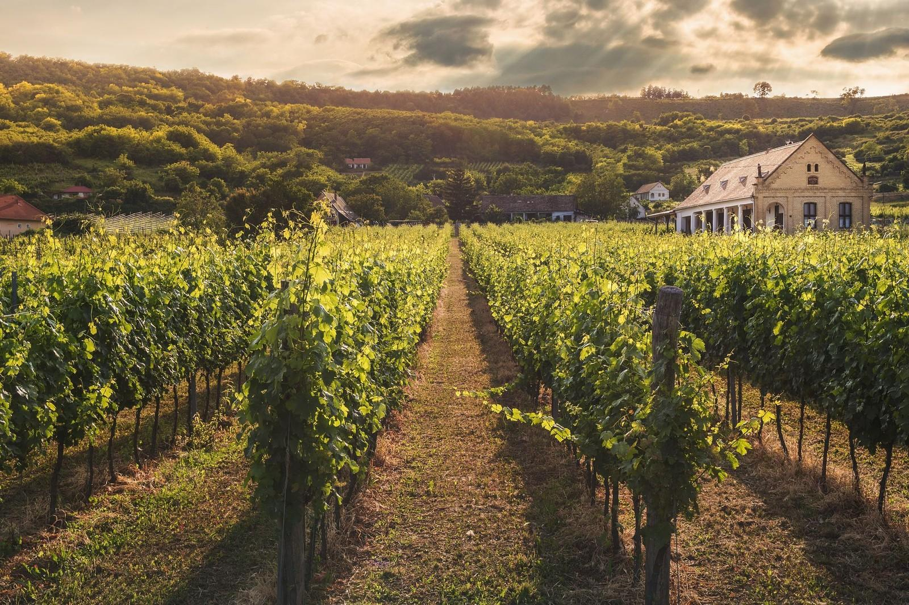
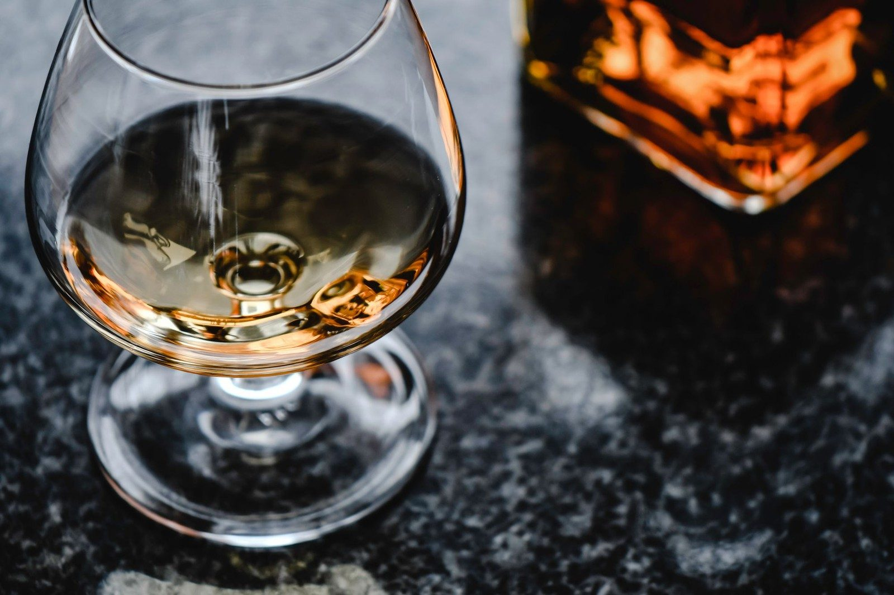
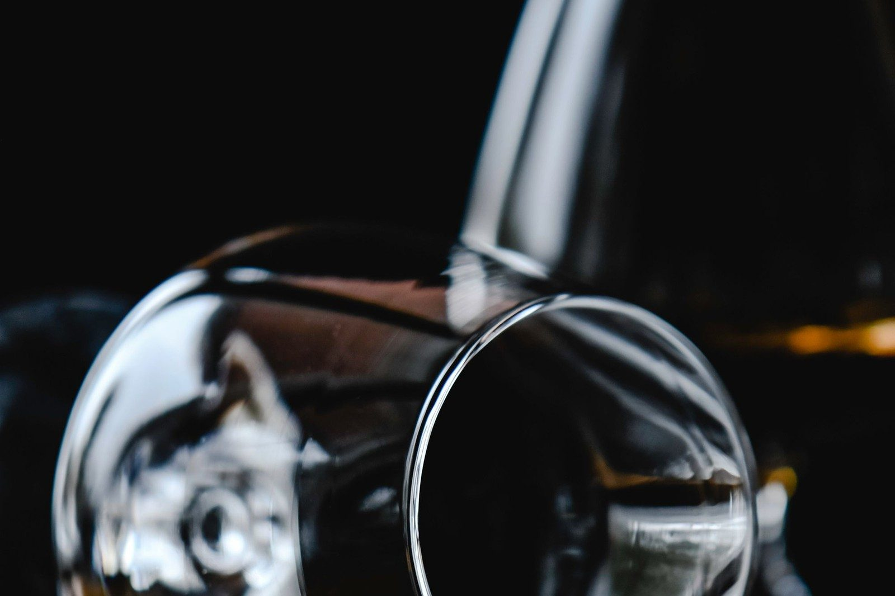
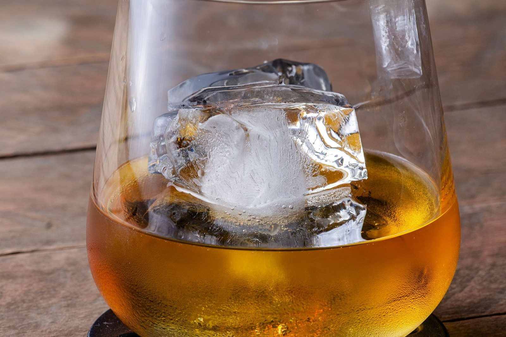
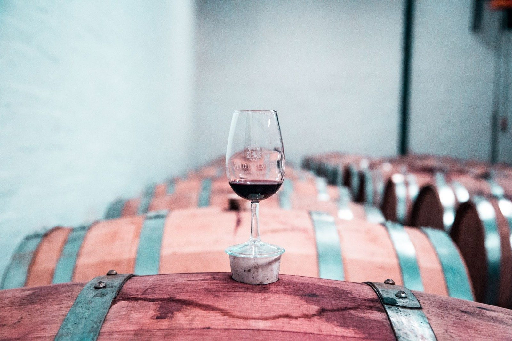
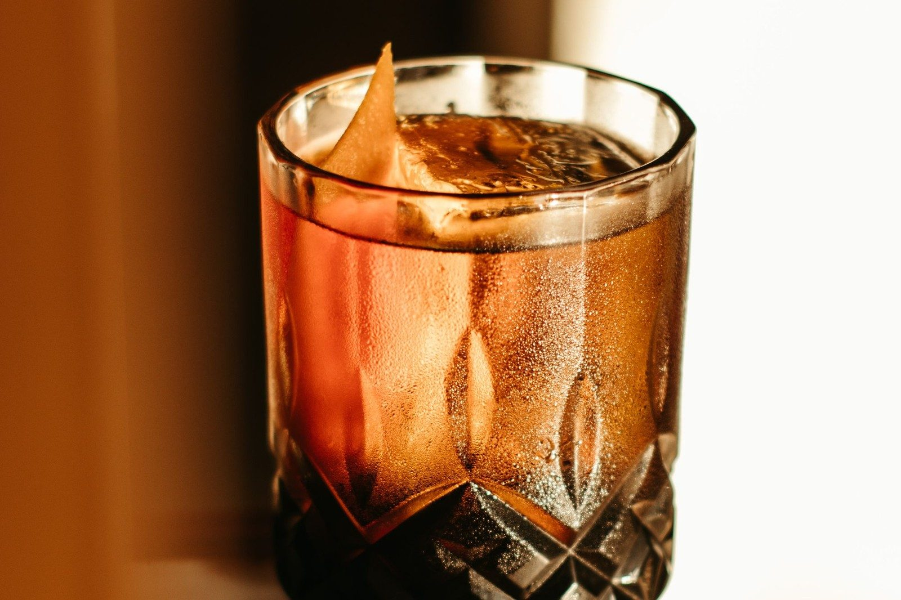

Cognac is a French oak-aged grape brandy, distilled in the Cognac region of western France and governed by the Bureau National Interprofessionnel du Cognac, the BNIC. It is not a generic "brown spirit," and it is not whisky. For a man who wants a serious digestif, a winter aperitif or a bottle worth opening when a guest sits down after dinner, it is one of the most complete drinks he can learn. This guide explains what cognac is, what the letters VS, VSOP, XO and XXO actually mean, how to taste it neat in a tulip glass, when ice or a mixer is appropriate, how the crus differ, how to store a bottle at home, and three bottles listed on U.S. retail pages at the time of writing.

> **Key takeaways**
> - Cognac is a protected eau-de-vie from the Cognac appellation, distilled mainly from Ugni Blanc and aged in oak. The letters on the label refer to the age of the youngest eau-de-vie in the blend, not a tasting score.
> - VS means the youngest spirit is at least two years old; VSOP at least four; XO at least ten; XXO, a category introduced in 2018, at least fourteen. These are legal minimums, and fine houses often age far longer.
> - The official tasting advice is simple: pour 2 to 4 cl into a tulip glass at room temperature, look, smell without swirling first, then sip slowly.
> - Ice is not a breach of manners. The BNIC itself presents a VSOP on the rocks as an aperitif. A few drops of water, a long drink or a cocktail are all accepted ways to drink it.
> - Room temperature is the usual starting point. Martell suggests around 18 to 20 °C for a neat pour and does not recommend heating the glass; the hand is enough.
> - A mid-shelf VSOP is the most useful first bottle. An XO is the bottle to sip slowly and, if you like, to open for a guest.

## What Is Cognac?

Cognac is a wine-based brandy from a delimited region north of Bordeaux, around the town of Cognac in the Charente and Charente-Maritime. To carry the name, it must be produced under the appellation rules watched over by the BNIC: the right grapes, a double distillation in a copper Charentais pot still, and ageing in oak. The spirit that comes off the still is an eau-de-vie. The art of the house is to age those eaux-de-vie and then blend them.

The vineyard is dominated by one grape. Ugni Blanc, also known as Trebbiano, accounts for about 98 percent of the plantings, with smaller roles for Colombard, Folle Blanche and a handful of other permitted varieties. It is a late, rather acidic grape that makes a tart, low-alcohol wine — exactly what a still wants if the later brandy is to be clean and age-worthy. The wine is distilled twice, then laid down in oak barrels, traditionally French oak, where color, tannin, vanilla, spice and the slower notes that tasters call rancio begin to appear.

The appellation is divided into crus, the vineyard zones that shape the spirit. Grande Champagne, confusingly not the sparkling-wine region, is the most celebrated: floral, fine, long-lived eaux-de-vie that repay long ageing. Petite Champagne is close in style. A blend of the two, with at least half Grande Champagne, may be labeled Fine Champagne, the designation Rémy Martin uses for its XO. Borderies is smaller and often described as rounder, with a violet note, and it matures a little faster. Fins Bois, Bons Bois and Bois Ordinaires complete the map, generally broader and earlier-maturing. A blend can draw from several crus; a single-cru bottle will say so on the label.

Cognac is almost always a blend, not a vintage, and that is a point of pride rather than a compromise. The cellar master is the person who keeps the house style consistent from year to year, using stocks that may be far older than the legal minimum on the label. When a bottle says XO, it is telling you the youngest component is at least ten years old, not that every drop in the glass is ten.

*Photo: David Bartus / Pexels, [Pexels License](https://www.pexels.com/license/)*

## What Do VS, VSOP, XO and XXO Mean on a Cognac Label?

The letters are an age grade, set out in French regulations at the request of the BNIC, and they refer to the youngest eau-de-vie in the blend. Martell's own explainer is a clear public statement of the current rules.

VS, Very Special, means every eau-de-vie in the blend has spent at least two years in oak. The same tier can appear as three stars, Sélection or some uses of the word Luxury. It is the usual grade for long drinks and cocktails: fruit-forward, fresher, less about the long oak finish.

VSOP, Very Superior Old Pale, requires at least four years. The category can also include the words Old or Reserve, depending on the house. This is the most useful everyday sipping grade for a man who wants one bottle on the sideboard: richer than VS, still versatile enough for an aperitif on ice.

XO, Extra Old, now requires at least ten years. That minimum was raised, which is why older books sometimes still say six. Houses treat XO as the gold standard of the regular range: a blend of many eaux-de-vie, darker, spicier, longer. Old Reserve is often an equivalent term.

XXO, Extra Extra Old, was introduced in 2018 for blends whose youngest component is at least fourteen years old. It is a relatively new official rung, and not every house uses the letters yet. Beyond these, you will see Borderies, Fine Champagne, Hors d'Age, Prestige and a forest of house names. Those are not substitutes for the legal grades; they are additional claims, and they should be read as the house's own language on top of the minimum age.

The practical lesson is not to treat the letters as a score. A serious VSOP from a careful house can outclass a careless XO. The letters tell you a floor, not a ceiling, and they tell you nothing about whether the blend will suit you until you pour a glass.

Original article: [Martell](https://www.martell.com/en-us/news/expertise-cognac/what-do-the-initials-vs-vsop-xo-and-xxo-mean/)

## How Do You Drink Cognac Neat?

The usual way, and the way to learn a bottle, is neat: no ice, no mixer, at room temperature, in a glass that narrows toward the rim. The BNIC's tasting guidance, published on the official cognac.fr site, is the method to follow.

Pour 2 to 4 cl into a tulip-shaped glass. Look at the color and at the "legs" or "tears" that run down the inside of the glass. Bring the glass to your nose without swirling; the first nose is easier to read if the alcohol is not thrown up at you. Then rotate the glass gently for a second nose, and take a small sip. Let it move around the mouth, breathe a little, and notice how long the flavor lasts. There is no prize for finishing the glass quickly.

Original article: [cognac.fr, Tasting Cognac](https://www.cognac.fr/en/tasting/drinking-cognac/tasting-cognac/)

The tulip glass is the official preference because the narrower rim concentrates the aromas. A balloon or snifter will also work, and some drinkers like the way a wider bowl sits in the hand. A tumbler is the glass for ice, not the first choice for a neat XO. Temperature should be ordinary room temperature. Martell suggests around 18 to 20 °C and does not recommend heating the glass over a flame or a lamp; your hand will warm it enough, and overheating throws off alcohol at the expense of fruit and flower.

A few drops of water are allowed and often useful. Hennessy and Martell both list a little water among the ways to serve their cognacs. Add it with a spoon or a pipette, then smell and sip again. You cannot take the water out, so start small. This is not a rule of purity. It is a way of opening a tight, alcoholic nose.

*Photo: Eva Bronzini / Pexels, [Pexels License](https://www.pexels.com/license/)*

## Can You Drink Cognac with Ice, Water or in a Cocktail?

Yes. The idea that ice is an insult is a purist's habit, not the official position. Cognac.fr is explicit: a cognac served on the rocks is "ideal as an aperitif regardless of the purists who consider it disrespectful to 'pollute' it." A VSOP, the site says, is particularly delicious this way. The cold reduces the impression of alcoholic power and brings forward candied and dried-fruit aromas. The official method is simple: 2 cl in a tumbler, several ice cubes, a gentle stir, then taste.

The same page is equally relaxed about the rest of the table. Cognac sits well with dessert — 2 cl of VSOP or XO with chocolate or almond sweets, or with an apricot or orange tart. It also sits well with coffee. The suggested pairing is not a muddled mixture but a sequence: a good coffee, 2 cl of cognac in a tulip glass, tasted one after the other, so that the two create a third impression rather than fighting.

Houses themselves recommend more than one serve. Hennessy presents its VSOP neat, on ice or in cocktails. Rémy Martin presents its XO neat, on the rocks or in an Old Fashioned. Martell leans toward its VS for long drinks and cocktails. A long drink, in this language, is simply a spirit stretched with a larger amount of mixer over ice. There is no rule that an XO may never be mixed, but most men will prefer to spend that bottle on a slow neat pour and keep a VS or a sturdy VSOP for a highball or a Sidecar.

If you mix, use a clean mixer and enough ice. Ginger ale, tonic and a simple highball are honest serves. A Sidecar — cognac, orange liqueur, lemon — is the classic cocktail. The point is not to hide the cognac, and it is not to perform for the table. It is to drink the bottle in the way that suits the hour: neat after dinner, on ice before dinner, in a long glass when the evening is loose.

*Photo: Eva Bronzini / Pexels, [Pexels License](https://www.pexels.com/license/)*

## How Do the Crus and the Major Houses Differ?

Once the grades are clear, the interesting differences are geographic and stylistic. Grande Champagne eaux-de-vie are the long-distance runners: floral when young, then increasingly spicy, nutty and rancio with time. They are the backbone of many prestige blends and of almost anything labeled Fine Champagne. Borderies, a much smaller cru, is often described as more perfumed, with violet, and it can give a blend a round mid-palate without needing quite as many years. Fins Bois tends to come forward earlier, with fruit, and is a workhorse in many VS and VSOP blends. A house that talks a great deal about Grande Champagne is telling you it values length and ageing. A house that leans on Borderies or Fins Bois is often telling you it values perfume, roundness or earlier drinkability. Neither is a moral position.

The four historic "big houses" — Hennessy, Rémy Martin, Martell and Courvoisier — dominate what an American man will actually see on a shelf. They are not interchangeable. Rémy Martin builds its prestige range on Fine Champagne, which is why its XO tastes so specifically of that floral, orange-peel, nut-and-spice register. Martell has a long association with Borderies and a drier, more spicy, sometimes more peppery profile; its own notes for the XO mention pink and black pepper, coriander, fig, walnut and sandalwood. Hennessy, the largest, is built for consistency and for a wide range of serves; its VSOP is the bottle many American bars pour, with ripe fruit, honey, sweet spice and a floral edge. Courvoisier, the fourth of the historic names, tends toward a smoother, more dessert-like richness. Around them sit smaller and more terroir-driven houses — Hine, Frapin, Pierre Ferrand, Delamain and others — which a man can explore once he knows what the letters mean and which of the big styles he actually likes.

The cellar master, not the vintage, is the signature. Two XO bottles from two houses can be legally the same age grade and still taste like different drinks. The only reliable test is a small pour, in a proper glass, without a meal shouting over it. If you are buying a first serious bottle, choose a house whose style you have already tasted in a bar, or buy a VSOP before you buy the XO of a house you have never sipped.

*Photo: Marcelo Verfe / Pexels, [Pexels License](https://www.pexels.com/license/)*

## How Should You Store and Serve Cognac at Home?

Cognac is more forgiving than wine and less casual than a mixed drink you forget on the counter. Store the bottle upright, not on its side. The spirit will not improve in the bottle the way a fine wine can, and a cork left wet with high-strength alcohol can deteriorate. A cupboard or a sideboard away from direct sun and away from the stove is enough. Room temperature is correct. There is no need for a wine fridge, and there is no benefit to a radiator.

Once opened, a bottle does not collapse in a week, but it will slowly fade as oxygen takes up more of the space in the glass. If you find yourself with a half-empty XO that you open only on rare evenings, a smaller decanter can reduce the air in contact with the spirit; keep it stoppered, and do not treat the decanter as a window-sill ornament in the sun. For everyday VSOP, simply putting the cork back in firmly is enough. Avoid the theatrical warming of a glass over a candle. It is an old gesture, not a good one.

Serving at home is a short ritual, not a performance. Bring out a tulip glass or a clean snifter, pour 2 to 4 cl, and give the guest the same glass you would want yourself. Offer ice separately, in a small bowl, so that the man who wants a neat XO is not forced to drink it cold, and the man who wants an aperitif is not made to feel he has broken a rule. A small plate of dark chocolate or toasted almonds is a better partner than a heavy pudding. Coffee can follow, or sit beside the glass, in the way the official tasting page suggests: one, then the other, not a single confused cup.

Keep a simpler bottle for mixing and a better bottle for sipping. That is the whole cellar a private house needs. A VS or a robust VSOP for highballs and for friends who want a long drink; an XO, stood upright in the dark, for the evenings that deserve it.

*Photo: Arthur Brognoli / Pexels, [Pexels License](https://www.pexels.com/license/)*

## Which Cognac Bottles Are Worth Buying in 2026?

Prices for spirits vary by state, by store and by the week. The three bottles below are listed on ReserveBar, a major U.S. retailer, at the time of writing, in the standard 750 ml size, at 40 percent alcohol where the pages give it. Confirm the figure on the page before you buy, and confirm that the bottle can be shipped to your state.

### Hennessy V.S.O.P

The useful first bottle, and the one you are most likely to meet in an American bar. ReserveBar lists Hennessy V.S.O.P at $52.79 for 750 ml, 40 percent ABV, from France. The page's tasting notes describe a bouquet of ripe fruits, honey and sweet spice, cinnamon and clove, with floral touches of rose, and a palate of ripe fruit, honeysuckle, citrus and mango. The same listing notes a make of 60 percent Petite Champagne. It is the bottle for learning the grade: neat, on ice, or in a cocktail, exactly as the house itself suggests for VSOP.

[View Hennessy V.S.O.P on ReserveBar](https://www.reservebar.com/products/hennessy-vsop/GROUPING-36099)

### Rémy Martin XO

The Fine Champagne icon, and the bottle many men mean when they say "a proper XO." ReserveBar lists Rémy Martin XO Cognac at $169.99 for 750 ml. The official house page describes it as a blend of hundreds of eaux-de-vie aged at least ten years in French oak, from Grande Champagne and Petite Champagne, at 40 percent ABV. ReserveBar's notes mention stone fruit and floral jasmine and iris on the nose, then plum, candied orange, hazelnut and cinnamon, with a velvety body and a long finish. This is a neat-pour bottle first, with ice or an Old Fashioned as a second serve, not a highball.

[View Rémy Martin XO on ReserveBar](https://www.reservebar.com/products/remy-martin-xo-cognac/GROUPING-215809)

Official house page: [Rémy Martin XO](https://www.remymartin.com/en-us/collection/xo/)

### Martell XO

A drier, spicier counterpoint to Rémy's orange-and-nut opulence. ReserveBar lists Martell XO at $215.25 for 750 ml, 40 percent ABV. The page describes a golden amber with dark copper and mahogany highlights; an aroma of black and pink pepper, coriander, fig, walnut and sandalwood; and a palate of red fruit and blackcurrant with a long, robust finish. If you already like Rémy Martin XO and want a second house style, this is a serious alternative, not a duplicate.

[View Martell XO on ReserveBar](https://www.reservebar.com/products/martell-xo/GROUPING-61206)

Start with the VSOP if you are building a habit. Step up to one XO when you know you will actually finish the bottle. A half-drunk prestige cognac gathering dust is a poorer piece of hospitality than a well-chosen VSOP that you are happy to open on a Wednesday.

*Photo: Jonathan Borba / Pexels, [Pexels License](https://www.pexels.com/license/)*

## Frequently Asked Questions

### What is the difference between VS, VSOP and XO cognac?

They are legal age grades based on the youngest eau-de-vie in the blend. VS is at least two years old, VSOP at least four, XO at least ten. XXO, added in 2018, is at least fourteen. The letters are a minimum, not a tasting score, and fine houses often age well beyond the floor.

### What is the best glass for cognac?

A tulip glass is the official choice for a neat pour, because the narrower rim gathers the aroma. A snifter or balloon also works. Use a tumbler if you are serving the cognac on ice.

### Should you warm a cognac glass?

No. Serve it at room temperature, around 18 to 20 °C. The hand will warm the glass enough. Heating it over a flame or a lamp pushes alcohol into the nose and dulls the more interesting aromas.

### Is it acceptable to drink cognac on the rocks?

Yes. The official cognac.fr tasting page presents a VSOP on the rocks as an aperitif and gives a simple method: 2 cl in a tumbler, ice, a gentle stir. Ice is a choice, not a breach of manners.

### What is Fine Champagne cognac?

It is not sparkling wine. Fine Champagne is a label for a blend of Grande Champagne and Petite Champagne eaux-de-vie, with at least half from Grande Champagne. Rémy Martin XO is a well-known example.

### How should you store an opened bottle of cognac?

Stand it upright, tightly corked, away from sun and heat. It will not spoil quickly, but a half-empty bottle will slowly fade. A smaller stoppered decanter can help if you open a rare XO only occasionally.

Cognac rewards a man who is willing to learn a short method and then leave it alone: the right glass, a modest pour, a moment to look and smell before the first sip. The letters on the label will tell you the legal floor. The house and the cru will tell you the style. The only thing that will tell you whether you like it is a quiet glass, poured without theatre, at the end of a day that deserves one.
