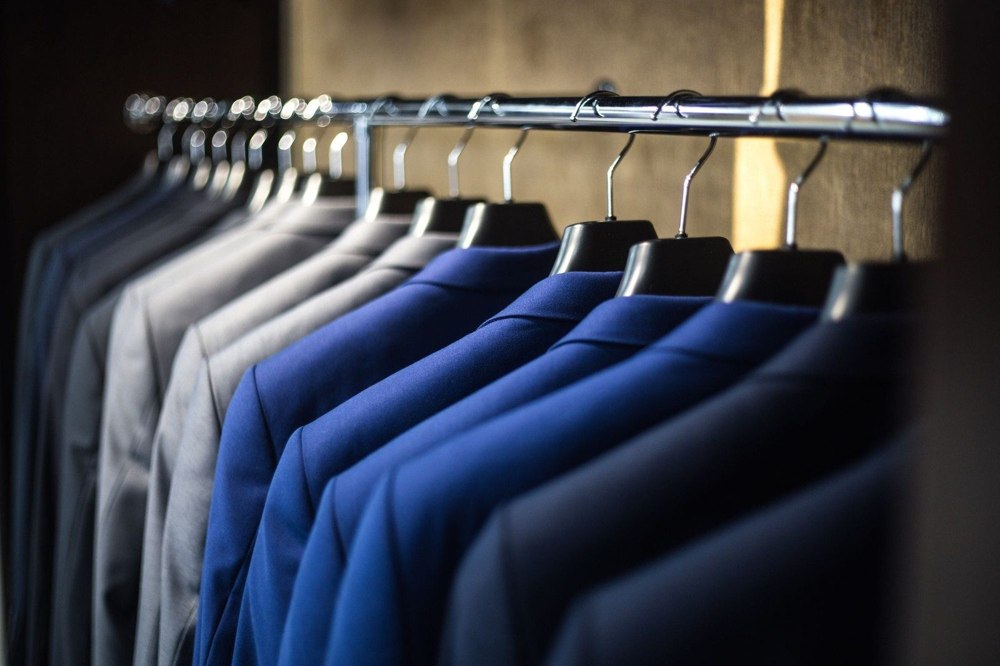
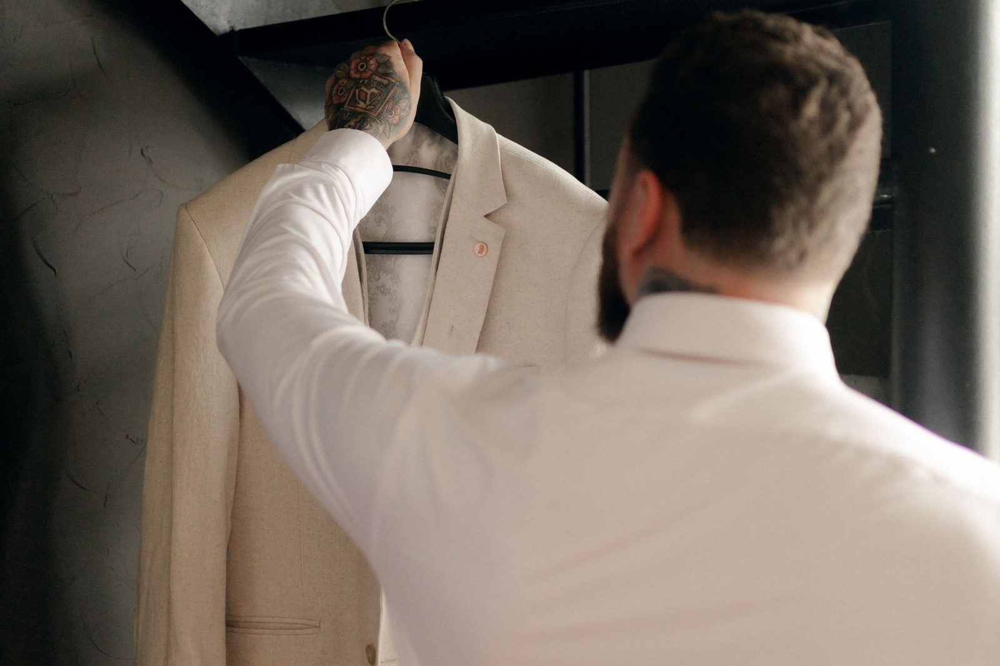

A navy blazer is a solid navy odd jacket, traditionally finished with metal or contrasting buttons, cut to be worn with trousers that do not match it. It is not a suit jacket, and it is not quite a sport coat. For a man who already owns a navy or charcoal suit and is building a wardrobe that works from Monday morning to Saturday dinner, it is the single most useful jacket he can add. This guide explains the difference between a blazer, a sport coat and a suit jacket, how a navy blazer should fit, what to wear with it, when a textured sport coat is the better choice, how to care for wool, and three jackets worth buying in 2026, with prices as they appear on the product pages.

> **Key takeaways**
> - A suit jacket is half of a matching suit. A navy blazer is a solid odd jacket, often with metal or contrasting buttons. A sport coat is usually textured or patterned, with quieter horn or leather buttons.
> - GQ places the blazer between the formality of a suit and the flair of a sport coat: navy, charcoal or camel rather than madras or loud plaid.
> - The first navy blazer should be a single-breasted, two-button jacket with notch lapels and side vents. It works with gray flannel, chinos and dark jeans.
> - Fit is judged at the shoulder first. The sleeve should show a sliver of shirt cuff. Button the top button of a two-button jacket when you stand; never button the bottom one.
> - Brass buttons make a blazer dressier and more nautical. Horn buttons make the same jacket easier to wear with an open collar and casual trousers.
> - A sport coat in tweed, herringbone or hopsack is the better winter and weekend jacket when a plain navy blazer feels too formal or too plain.
> - Wool blazers are dry-clean only in most cases. Brush them, rest them on a shaped hanger and have a tailor refresh the fit rather than replacing the jacket.

## What Is the Difference Between a Blazer, a Sport Coat and a Suit Jacket?

A suit jacket is the jacket that belongs to a suit. It is cut from the same cloth as the trousers, and it looks unfinished when you wear it as a separate. A blazer and a sport coat are both odd jackets, meaning they are designed from the start to be worn with mismatched trousers. The useful distinction is one of cloth, buttons and mood.

GQ's explainer on the three jackets is still the clearest public definition. A sport coat, the magazine notes, is "free to express its individuality in a wide range of funky colors and unusual fabrics": tweed with elbow patches, madras checks, windowpane, weatherproof cloth. Because it does not have to match a pair of trousers, it can be a little roomier, the better to sit over a turtleneck, a crewneck or a quilted vest. A blazer sits between that casual freedom and the formality of a suit. "Nowadays, while the line between sport coat and blazer has become increasingly blurred, the former is more likely to be patterned and colorful, while the latter is most often a neutral shade like navy, charcoal, or camel."

Original article: [GQ](https://www.gq.com/story/suit-jacket-sport-coat-blazer-explainer)

The traditional tells are still worth knowing. A classic navy blazer often has metal buttons, a cleaner chest and welt or flap pockets. A sport coat more often has horn or leather buttons, patch pockets and a visible weave. Patch pockets, elbow patches and a softer shoulder all pull a jacket toward the country and the weekend. Metal buttons, a slightly firmer canvas and a plain navy hopsack pull it toward the office and the restaurant. None of these details is a law. Many of the best modern navy jackets have dark horn buttons and a soft shoulder, and they are still correctly called blazers.

The word "blazer" itself has a mixed origin story. Brooks Brothers, which has made the jacket for generations, recounts the usual folklore on its 1818 blazer page: early boating clubs, the captain of HMS Blazer dressing his crew in a striking uniform, country-club "blazes" in bright stripes. What matters in a wardrobe is simpler. If the jacket is solid navy and meant to be worn with odd trousers, you own a navy blazer. If the cloth is a pattern or a heavy texture, you own a sport coat. If the trousers match, you own a suit, and you should wear them together.

*Photo: Pixabay / Pexels, [Pexels License](https://www.pexels.com/license/)*

## Why Is a Navy Blazer the First Odd Jacket a Man Should Own?

A navy blazer earns its reputation because it does more jobs than almost any other jacket. In a business-casual office it reads as intentional without the stiffness of a full suit. At a smart-casual dinner it lifts a shirt and chinos into something considered. On a Saturday it can sit over a fine merino crewneck and dark jeans without looking as if you forgot to take off your commuting clothes. No other single color and cloth combination covers that range as quietly.

Navy is also forgiving. It hides wear better than mid-gray, it photographs well, and it sits comfortably next to brown, tan, gray, cream and white. A first blazer should almost always be a single-breasted, two-button jacket with notch lapels. That is the most versatile silhouette. A double-breasted navy blazer, usually with six buttons and peak lapels, is a handsome second purchase. It looks most at home with gray flannel or cream trousers and with metal buttons, and it is dressier than the two-button jacket. It is not the jacket to buy first if you can only own one.

Button choice changes the whole mood of the same cloth. Brass or gilt metal buttons are the traditional navy-blazer button. They make the jacket dressier and more nautical, and they look especially at home on a double-breasted model worn with a tie. Horn buttons are quieter and more modern. They make the same navy jacket easier to wear with chinos, jeans and an open collar. Crested or engraved metal buttons historically belong to a club, a school or a regiment. Wear those only if you are entitled to them. Plain metal buttons carry no such meaning, and a tailor can swap a set in a short visit if you buy a blazer with brass buttons and later want horn.

Cloth matters as much as color. A mid-weight hopsack, that slightly open basket weave, is the workhorse of the navy blazer. It has enough texture to look like a separate rather than a suit jacket, it breathes, and it hangs cleanly. Superfine plain worsted can look too much like a suit when worn with odd trousers. In colder months a heavier wool, a cashmere blend or a 3/2-roll cashmere blazer takes over. In warmer months fresco, hopsack and tropical wool keep the same silhouette without the weight.

## How Should a Navy Blazer or Sport Coat Fit?

A blazer follows the same fit rules as a well-cut suit jacket, with one small allowance: a sport coat may be a touch roomier through the chest if you plan to wear knitwear underneath. Everything else starts at the shoulder. The shoulder seam should end where your own shoulder ends, just as the bone begins to slope into the arm. If the shoulder is too wide, the jacket will never look clean, and a tailor cannot easily fix it. If it is too tight, the sleeve will wrinkle and the chest will pull.

The collar should rest against your shirt collar and touch the back of your neck without a gap. A gap usually means the jacket is too tight across the upper back or the collar pitch is wrong. The sleeve should end so that a sliver of shirt cuff shows when your arms hang naturally, roughly half a centimetre. The hem should fall around mid-crotch, a little longer if you are tall, a little shorter if you are not. Side vents, two small slits at the back, are the most useful vent style. They let the jacket sit over a chair and over the hips without flaring. A ventless jacket is harder to wear well.

Button stance is the point where the top working button sits. On a two-button jacket that button should sit near the natural waist, close to the navel, not down on the stomach. Fasten that button when you stand and unfasten it when you sit. Never fasten the bottom button. On a three-button jacket the middle button is the one that closes; the top button is often rolled into the lapel on a 3/2-roll coat, which is the classic American soft-shoulder look. A double-breasted blazer stays buttoned while you are wearing it, including, with most cuts, when you sit.

Armholes should be high enough that you can raise your arms without lifting the whole skirt of the jacket, but not so tight that they cut into the armpit. A canvassed or half-canvassed chest will soften and shape itself to you over time. A fused chest is cheaper and can bubble if it is poorly made or overheated at the cleaners. For a jacket you intend to keep for a decade, canvas is worth the money.

*Photo: Dinielle De Veyra / Pexels, [Pexels License](https://www.pexels.com/license/)*

## What Should You Wear With a Navy Blazer?

The classic navy-blazer uniform is still the best starting point: mid-gray wool trousers, a white or light-blue shirt, and dark brown or black shoes. Gray flannel in winter and a finer tropical wool in spring will carry that combination through most of the year. From there the jacket becomes more interesting the more carefully you change the trousers and the cloth at the neck.

Chinos in stone, khaki or olive are the easy weekday alternative. They take the blazer out of the boardroom without dropping it into weekend territory. Dark jeans, preferably a clean, deep indigo with a tailored leg, work when the jacket has horn buttons and you skip the tie. Mid-wash or distressed jeans fight the cloth and usually lose. Cream or stone trousers, especially in warmer months, are the old summer combination with navy and look particularly good with a double-breasted jacket and brown loafers or buckskins.

At the neck, a white or pale-blue shirt is the default, open at the collar or with a conservative tie. A fine merino or cashmere crewneck under the jacket is the cold-weather move, and a turtleneck under a navy blazer is one of the cleanest winter looks a man can wear, provided the knit is slim and the jacket has enough room in the chest. A polo shirt can work in a relaxed office, but the collar should sit neatly under the lapel. A T-shirt is possible only with a very informal, unstructured blazer; with metal buttons and a formal cloth it looks unfinished.

Shoes should follow the formality of the trousers. Oxfords and derbies with gray flannel. Loafers, tassel or penny, with chinos. A clean suede chukka or a dark leather sneaker only with jeans and horn buttons, and only if the rest of the outfit is simple. Belt and shoes should be in the same color family. A white pocket square, linen or cotton, is always enough. Patterned squares are a pleasure once the rest of the outfit is under control.

*Photo: Chloe / Pexels, [Pexels License](https://www.pexels.com/license/)*

## When Should You Choose a Sport Coat Instead of a Navy Blazer?

Choose a sport coat when the occasion, the season or the setting makes a plain navy blazer feel either too formal or too plain. A herringbone, a fine check, a barleycorn tweed or a textured hopsack in brown, olive or rust is the jacket for a country weekend, a winter Saturday, a creative office or any room in which a solid navy jacket would look like office clothes that never came off.

The cloth does the talking. Tweed and heavy hopsack have weight and grip, so they sit naturally over a flannel shirt, a chunky knit or a waistcoat. Patch pockets and a soft, almost unpadded shoulder underline that ease. GQ is right that a sport coat can be cut a little more generously than a suit jacket for exactly this reason: you want room for a layer. In American and British country dressing, the sport coat is the jacket that went shooting, walking and to lunch, and that history still shows in the best examples.

A navy blazer remains the better choice for a job interview, a city dinner, a funeral reception, a business-casual pitch or any room full of suits in which you do not want to be the man in a checked jacket. The two jackets are complements, not rivals. If you can only own one odd jacket, buy the navy blazer. If you already own that blazer and need a second, buy a textured sport coat in a mid-to-dark earth tone, not a second navy jacket that will compete with the first.

In winter the sport coat also has a practical advantage. A tweed or heavy wool odd jacket is warmer than a mid-weight hopsack blazer and looks more at home under an overcoat when the collar and texture peek out. In summer the opposite is true: a navy fresco or hopsack blazer will always be easier than a heavy sport coat. Build the wardrobe in that order, and you will not be standing in front of the rail wondering which jacket is "too much."

*Photo: Gustavo Fring / Pexels, [Pexels License](https://www.pexels.com/license/)*

## How Do You Care for a Wool Blazer or Sport Coat?

Most wool and cashmere blazers are labeled dry-clean only, and that label should be taken seriously. Over-cleaning, though, is the usual way a good jacket dies. Clean a blazer when it is genuinely soiled or has taken on a smell you cannot hang out, not after every wear. Between visits, brush it with a soft clothes brush, especially at the collar, the cuffs and the front, and let it air on a shaped wooden hanger for a full day before it goes back in the cupboard.

Rest is part of the routine. Wool recovers its shape if you do not wear the same jacket two days in a row. Cedar in the wardrobe helps with moths; so does the occasional inspection in late summer, when larvae are most active. If a moth hole appears, a good invisible mender can often save the cloth. A steamer, used lightly and at a distance, will lift wrinkles without the shine that a heavy iron can leave on wool. Never press the lapel so flat that you crush the roll.

Rain is not a disaster if you act quickly. Shake the jacket out, hang it on a hanger, and let it dry naturally, away from a radiator. A felt or pony-hair brush will lift dried dirt once the cloth is dry. Salt and city grime are a reason for a careful clean at the end of winter. When you do take the jacket to the cleaner, choose one that knows how to handle canvassed tailoring. Cheap heat can blister a fused chest and flatten a carefully rolled lapel.

The last care step is a tailor, not a replacement. Sleeves can be shortened, a waist can be taken in, buttons can be changed from brass to horn, and a collar can sometimes be recut. A navy blazer that fits in the shoulders is almost always worth altering. One that does not is almost never worth keeping.

*Photo: Alexander Mass / Pexels, [Pexels License](https://www.pexels.com/license/)*

## Which Navy Blazers and Sport Coats Are Worth Owning in 2026?

A navy blazer is only as good as its cloth, its canvas and its fit. The three jackets below are current listings from makers with a serious reputation for tailoring, with prices as they appear on the product pages at the time of writing. Prices move, especially in sale periods, so confirm the figure on the page before you buy.

### Brooks Brothers Slim Fit Stretch Wool Hopsack Blazer

The American classic, cut in the slim fit formerly called Milano, with a two-button front, side vents and a full lining. The cloth is Super 110s wool woven by Italy's Reda mill, with a hint of stretch: the shell is 99 percent wool and 1 percent elastane, with a cotton body lining and a cupro sleeve lining. Finished sleeves, dry-clean only, imported. On the Brooks Brothers product page the navy jacket is listed at $488.60, marked down from $698.

[View the Brooks Brothers Slim Fit Stretch Wool Hopsack Blazer](https://www.brooksbrothers.com/slim-fit-stretch-wool-hopsack-blazer/MD00130.html)

### SuitSupply Tailored Fit Havana Blazer in Pure Wool

A contemporary navy blazer at a more accessible luxury price, cut in SuitSupply's tailored Havana fit, which is slim through the shoulders, chest, waist and hips. It has a natural shoulder, a wide notch lapel, jetted pockets and a half-canvas construction, in a medium-weight, tight, textured 100 percent wool from Reda in Italy. Dry-clean only. The Navy Tailored Fit Havana Blazer in pure wool is listed at $399 on the SuitSupply product page.

[View the SuitSupply Navy Tailored Fit Havana Blazer](https://suitsupply.com/en-us/men/jackets/navy-tailored-fit-havana-blazer/C25216.html)

### Brooks Brothers Slim Fit Cashmere 1818 Blazer

The long-term jacket. This 1818 blazer is made in Italy from 100 percent cashmere woven by Loro Piana, with a cupro lining, a three-button front and a 3/2-roll lapel, side vents and finished sleeves. Brooks Brothers notes the traditional gold- and silver-toned buttons that belong to the blazer story. Dry-clean only. On the product page the navy jacket is listed at $1,048.60, marked down from $1,498.

[View the Brooks Brothers Slim Fit Cashmere 1818 Blazer](https://www.brooksbrothers.com/slim-fit-cashmere-fit-1818-blazer/MD00136.html)

Buy the hopsack or the Havana blazer if you need a jacket you will wear three or four days a week. Buy the cashmere 1818 if you want a winter jacket that will soften and improve for years, and if you already have a tougher hopsack for harder use. In every case, spend money on the shoulder fit and on a tailor, not on a logo.

*Photo: Weijia MA / Pexels, [Pexels License](https://www.pexels.com/license/)*

## Frequently Asked Questions

### What is the difference between a blazer and a sport coat?

A blazer is usually a solid odd jacket in navy, charcoal or camel, often with metal or contrasting buttons. A sport coat is usually textured or patterned — tweed, herringbone, check — with quieter horn or leather buttons and, often, patch pockets. Both are worn with trousers that do not match the jacket.

### Can you wear a navy blazer with jeans?

Yes, if the jeans are dark, clean and tailored, and if the blazer has a slightly informal character: horn buttons, a soft shoulder, no club crest. Metal-buttoned, very formal hopsack looks stiff with denim. Leave the tie off and keep the rest of the outfit simple.

### Should a navy blazer have brass buttons or horn buttons?

Neither is wrong. Brass or gilt buttons are traditional and dressier, especially on a double-breasted blazer worn with gray flannel and a tie. Horn buttons are quieter and make the same jacket easier to wear with chinos, jeans and an open collar. A tailor can change the buttons later.

### How should a men's blazer fit in the shoulders and sleeves?

The shoulder seam should end at the end of your shoulder. The sleeve should show a sliver of shirt cuff, about half a centimetre, when your arms hang down. The collar should hug the shirt collar with no gap, and the hem should fall around mid-crotch.

### Is a double-breasted navy blazer a good first blazer?

It is a good second blazer. A single-breasted, two-button jacket with notch lapels is more versatile and should come first. A double-breasted navy blazer is dressier, looks best with flannel or cream trousers, and is usually worn with metal buttons.

### How often should you dry-clean a wool blazer?

Only when it is dirty or has a smell you cannot air out. Brush it after wearing, hang it on a shaped hanger, and give it a day of rest between wears. Over-cleaning wears the cloth and can damage the canvas or the fused chest.

A navy blazer will not do every job in a man's wardrobe, but it will do more of them than almost anything else hanging next to the suits. Buy it in a cloth you will actually wear, have the shoulders and sleeves set correctly, and then leave it alone long enough to become the jacket you reach for without thinking. That is the whole point of a classic: it should disappear into the way you dress, until the day you go out without it and notice the gap.
