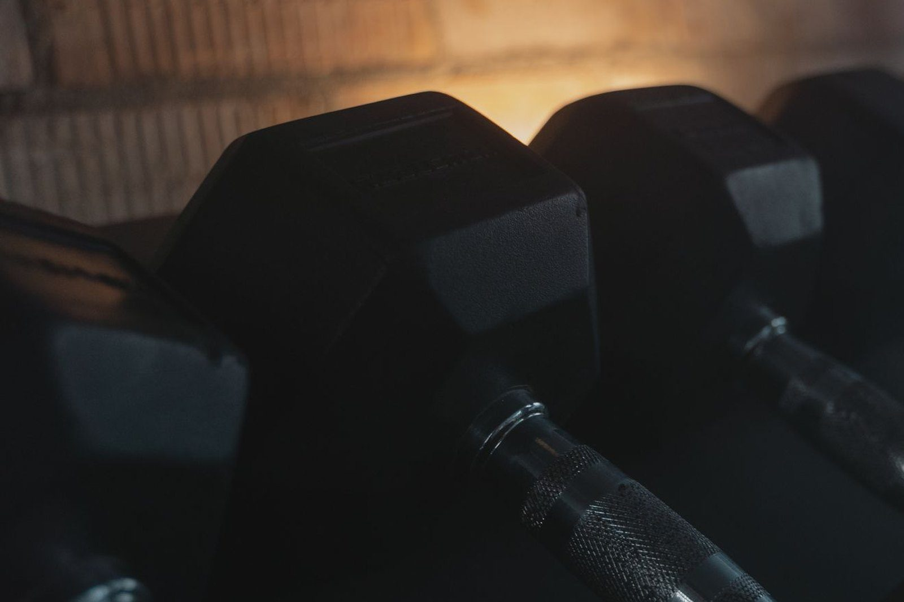

There is a moment, usually somewhere after a man's fortieth birthday, when the body sends its first quiet memo. The suitcase feels heavier on the stairs. The shoulder complains after a weekend of gardening. The shirts still button, but the shape inside them has softened. None of this is a verdict. It is information, and the most useful response to it is not a crash diet or a punishing boot camp but a well-designed strength training program for men over 40.

Strength training after 40 is the single most effective tool a man has against age-related muscle loss, the process doctors call sarcopenia. It protects bones and joints, supports a healthy body composition, sharpens physical confidence and, done properly, simply makes a man feel better in his own skin. This guide brings together the current advice from Harvard Health, Mayo Clinic, Cleveland Clinic and Men's Health: why muscle declines, how to start lifting weights at 40 or 50, how many sets and reps to do, how much protein men over 40 need, how to recover and sleep for muscle growth, which mobility drills to use as a warm-up, and when to speak to a doctor first. We close with premium home-gym equipment worth owning and a short FAQ.

> **Key takeaways**
> - Men can lose about 3 to 5 percent of their muscle mass per decade after 30, and about 30 percent over a lifetime, according to Harvard Health.
> - Progressive resistance training, gradually adding weight, reps or sets, is the best-supported way to rebuild and keep muscle at any age.
> - Train all major muscle groups at least two days a week, with special attention to the legs and hips.
> - Start with two sets of 8 to 12 reps (or one set of 12 to 15 reps) at a weight that makes the last reps genuinely challenging.
> - Aim for roughly 1 to 1.6 g of protein per kg of body weight per day, spread across meals, with 20 to 40 g after training.
> - Recovery is part of the program: at least 48 hours between hard sessions for the same muscles, one or two rest days a week and 7 to 9 hours of sleep.
> - Check with your doctor before starting, especially with a chronic condition, and stop any exercise that causes pain.

## Sarcopenia: What Really Happens to a Man's Muscle After 40

Before choosing a program, it helps to understand the opponent. Sarcopenia is not a rare disease reserved for the very old. It is a gradual, natural process that begins decades earlier than most men assume.

### The numbers behind age-related muscle loss

Harvard Health explains that after age 30, a man can begin to lose as much as 3 to 5 percent of his muscle mass per decade, and most men will lose about 30 percent of their muscle mass over their lifetimes. Less muscle means more weakness and less mobility, both of which raise the risk of falls and fractures. Harvard cites a 2015 report from the American Society for Bone and Mineral Research which found that people with sarcopenia had 2.3 times the risk of a low-trauma fracture from a fall, such as a broken hip, collarbone, leg, arm or wrist.

### Testosterone is only part of the story

One contributor is the natural decline of testosterone, the hormone that stimulates protein synthesis and muscle growth. Harvard notes that some research shows supplemental testosterone can add lean mass in older men, but there can be adverse effects, and the FDA has not approved these supplements specifically for increasing muscle mass. That is why the experts point to a different first-line strategy.

### Progressive resistance training is the real answer

According to Dr. Thomas W. Storer of Harvard-affiliated Brigham and Women's Hospital, older men can indeed regain muscle lost to aging: "It takes work, dedication, and a plan, but it is never too late to rebuild muscle and maintain it." The best means, he says, is progressive resistance training, in which you gradually raise your workout volume, meaning weight, reps and sets, as strength and endurance improve. A meta-analysis of 49 studies of men aged 50 to 83 found an average gain of about 1 kg of lean body mass. For a man over 40, that is a genuinely meaningful return on a few hours a week.

Original article: [Harvard Health](https://www.harvardhealth.org/healthy-aging-and-longevity/preserve-your-muscle-mass)

## How to Start Strength Training After 40: The Harvard Blueprint

Whether you have never touched a barbell or are returning after ten years behind a desk, the starting rules are refreshingly clear. Harvard Health's guide to starting a strength training program reads like a gentleman's checklist: get cleared, get coached, keep it simple and keep records.

### First a doctor, then a qualified trainer

Harvard advises always checking with your doctor before beginning any strength training routine. Once you have the green light, investing in a few sessions with a licensed, credentialed personal trainer is time well spent. A good trainer designs a personalized program and, above all, teaches proper form and technique, which helps prevent injuries. Look for coaches who have experience with older adults and accreditation from the National Strength and Conditioning Association (NSCA). Even a consultation and a handful of sessions can teach you enough to train confidently on your own.

### Train the whole body, but prioritize the legs

A basic plan covers chest, back, arms, shoulders, core and legs. Strong legs are especially important, because they power everyday movements such as squatting and climbing stairs. That means paying particular attention to the quadriceps and hamstrings, the glutes and the calves.

### Sets, reps and rest

Harvard's guidance: do 8 to 12 repetitions of an exercise at a level of difficulty that makes the final two reps challenging. If you can go beyond 12, use a heavier weight; if you cannot reach 8, go lighter. Begin with two sets per exercise and add a third as you progress, resting 30 seconds to two minutes between sets. Two days a week of full-body training can produce measurable strength changes, and most men notice results after four to six weeks of consistent work.

### Respect the 48-hour rule and keep a log

Rest at least 48 hours between sessions, and wait three to four days before training the same muscle group hard again. If you train legs on Monday, the next leg-focused session should be Thursday at the earliest. Keep a training log noting exercises, weights, sets and reps. It is the simplest way to apply progressive overload and to see, in black and white, that the program is working.

Original article: [Harvard Health](https://www.harvardhealth.org/healthy-aging-and-longevity/guide-to-starting-a-strength-training-program)

## The Minimum Effective Dose: Mayo Clinic on Guidelines, Reps and Safety

Busy men over 40 often assume they need hours in the gym. Mayo Clinic's updated strength training guide suggests otherwise, and it is reassuringly practical.

### What the official guidelines say

Mayo Clinic summarizes the U.S. Department of Health and Human Services guidelines for most healthy adults: at least 150 minutes of moderate aerobic activity or 75 minutes of vigorous activity a week, plus strength training for all major muscle groups at least two times a week. One set of each exercise, using a weight heavy enough to tire the muscles after about 12 to 15 repetitions, is enough for health and fitness benefits. You may notice stronger muscles with as little as 20 to 30 minutes of strength training twice a week.

### Why it matters beyond the mirror

Strength training, Mayo notes, helps keep and build muscle as you age, may protect against age-related loss of bone strength, supports weight management and body composition, improves balance and lowers the risk of falls. It may also help with joint pain and symptoms in conditions such as arthritis, heart disease, diabetes, depression and anxiety, and some research suggests benefits for thinking skills in older adults.

*Photo: Tima Miroshnichenko / Pexels, [Pexels License](https://www.pexels.com/license/)*

### Home or gym: choose your tools

You can train at home or in a club. Mayo lists body-weight exercises such as push-ups, pull-ups, planks, lunges and squats; resistance tubing; free weights such as barbells, dumbbells, kettlebells and medicine balls; weight machines; and cable suspension training. For a man building a private home gym, a set of quality dumbbells and a well-made barbell cover almost every movement pattern.

### When to talk to a doctor and when to stop

Mayo is clear: if you have a chronic condition or safety concerns, talk with your healthcare professional before beginning a strength or aerobic program. Warm up with a few minutes of brisk walking first, rest one full day between sessions for each muscle group, remember to breathe, and if an exercise causes pain, stop. Try a lower weight or attempt the movement again in a few days. Pain is not a badge of honor after 40; it is a signal.

Original article: [Mayo Clinic](https://www.mayoclinic.org/healthy-lifestyle/fitness/in-depth/strength-training/art-20046670)

## The Best Workout Plan for Men Over 40: Inside Men's Health "Muscle After 40 at Home"

Knowing the principles is one thing; following a structured program is another. In November 2026, Men's Health published a 12-week plan with strength coach Andrew Heffernan, C.S.C.S., built specifically for the body a man has after 40.

### Joint-friendly exercise selection

The plan deliberately sidelines heavy barbell squats and deadlifts, upright rows, behind-the-neck presses and Olympic lifts. Instead, it builds muscle with joint-friendly moves such as goblet squats, lunge variations, dumbbell Romanian deadlifts, push-up variations and core work. For many men with a few old injuries, this is the smarter way to build muscle after 40.

### Three phases, twelve weeks

- **Phase 1:** three full-body workouts a week, starting at about 60 percent effort.
- **Phase 2:** one full-body session, one arms-and-legs session and one chest, back and shoulders session each week.
- **Phase 3:** four weekly sessions, two lower body and two upper body, with increasing sets.

### Effort, not just numbers

Rather than mandating fixed reps, each set is assigned an effort level on a scale of 1 to 10, and the program needs only light, medium and heavy dumbbells. Every workout starts with a mobility warm-up and quick explosive moves such as skips and shuffle steps, because, as the editors note, speed fades with age and these drills help maintain agility for years to come.

Original article: [Men's Health](https://www.menshealth.com/fitness/a74334050/muscle-after-40-at-home-training-program/)

## Mobility for Men Over 40: The Eight-Minute Warm-Up That Protects Your Joints

The older a man gets, the less he can afford to walk into the weight room cold. A short, intelligent mobility routine prepares the hips, spine and shoulders for loading and makes squats and lunges feel noticeably smoother.

### A three-move mobility circuit

Men's Health fitness director Ebenezer Samuel, C.S.C.S., recommends a quick circuit that takes eight to ten minutes. Perform each exercise for the prescribed reps, then repeat the whole circuit a second time.

- **Spiderman lunge, 5 reps per side:** from a push-up position, step one foot outside the hand, sink the hips forward and hold for five seconds. It frees the hip flexors and loosens the lower back.
- **Child's pose, 6 reps:** from all fours, sink back until your hips approach your calves, arms extended, and take three deep breaths. It opens the lower back, shoulders and upper back.
- **Couch stretch, 20 seconds per leg:** place one foot on a bench behind you, lower the back knee to the floor and raise your arms overhead. Few movements stretch the quads and hip flexors so effectively.

### How to use it

Use this circuit before every strength session, and on rest days as gentle movement. Pair it with a few lighter practice sets of your first exercise. It is the difference between forcing a joint into position and inviting it there.

Original article: [Men's Health](https://www.menshealth.com/fitness/a61242586/full-body-mobility-routine/)

## How Much Protein Do Men Over 40 Need?

Training provides the signal; protein provides the building material. Harvard Health makes the point plainly: men need adequate protein to increase and maintain muscle mass, yet many aging men do not get enough.

### From the RDA to an athletic target

The Recommended Dietary Allowance is 0.8 g of protein per kg of body weight per day, or roughly 65 g for a man of about 82 kg. A 2023 review in *The Journals of Gerontology* suggested older adults may benefit from about 1 to 1.6 g per kg per day to help increase muscle strength, roughly 82 to 130 g for that same man. Harvard's separate strength training guide uses a target of 1 to 1.2 g per kg, about 80 to 95 g a day for a man of 80 kg. Dr. Frank Hu of the Harvard T.H. Chan School of Public Health cautions against very high intakes of 2 g per kg or more, noting that some studies link excessive protein with a higher risk of chronic disease and mortality.

*Photo: Iwan Wasyl / Pexels, [Pexels License](https://www.pexels.com/license/)*

### Timing matters: spread it out

Research suggests the body can use only about 20 to 40 g of dietary protein at one time, so there is no benefit to loading most of it into a single dinner. Distribute it across breakfast, lunch, dinner and snacks, and take a portion within 30 minutes to an hour after a strength workout, as a drink or a meal.

### The best protein sources

Dr. Hu recommends tracking your intake for a week to find a realistic average, then focusing on high-quality sources: lean poultry, fish, dairy and plant foods such as soy, legumes, nuts and whole grains. Approximate values from Harvard: about 100 g of lean chicken gives 31 g of protein, about 100 g of salmon 24 g, a bowl of cooked beans of about 250 ml roughly 18 g, about 170 g of plain yogurt 17 g, and one egg 6 g. Whey or plant-based powders are a practical option for men who struggle to reach their target through food alone.

Original article: [Harvard Health](https://www.harvardhealth.org/diet-and-nutrition/are-you-eating-enough-protein)

## Recovery, Rest Days and Sleep: Where Muscle Is Actually Built

Lifting creates the stimulus, but muscle is rebuilt between sessions. After 40, recovery is not a luxury; it is the part of the program that makes the next workout productive.

### Rest days and active recovery

Cleveland Clinic recommends at least one or two rest and recovery days per week. On those days you can avoid exercise entirely or choose active recovery: a swim, an easy session on a stationary bike or a walk of no more than about 20 minutes. Build a 10-minute warm-up and cool-down into each strength session and rest a minute or two between sets. Structure helps too: upper body twice a week and lower body twice a week, with rest between focus areas, or cross-training such as swimming or cycling, but not seven days of lifting.

*Photo: Dương Nhân / Pexels, [Pexels License](https://www.pexels.com/license/)*

### Sleep: the most underrated performance tool

Sleep is when your muscles have their largest opportunity to repair and heal. Cleveland Clinic suggests developing a consistent bedtime routine and allowing yourself a full night's sleep; elsewhere the clinic notes that most people need seven to nine hours. Its dietitian also suggests a slow-digesting protein before bed, such as a glass of milk, Greek yogurt or a casein shake, to support recovery overnight.

### Normal soreness versus warning signs

If you are doing exercises correctly, soreness should linger only for a few hours or days and then fade with rest. That is a sign of normal microtears that the body repairs with protein, producing stronger tissue. Soreness that does not settle, or sharp pain during a movement, deserves attention rather than another set.

Original article: [Cleveland Clinic](https://health.clevelandclinic.org/how-to-build-muscle)

## Premium Home-Gym Equipment Worth Owning

A man who trains at home trains more consistently. These three pieces represent different philosophies of the private gym: Scandinavian precision, American iron and intelligent digital resistance.

### Eleiko Evo Dumbbells

The connoisseur's dumbbell. Eleiko, the Swedish maker revered in competitive weightlifting, builds its Evo dumbbells in Halmstad, Sweden. The fixed versions range from about 1 to 60 kg, with chromed, knurled steel handles, a multi-sided head that will not roll away and a durable polyurethane surface, backed by a five-year warranty. Ideal for goblet squats, Romanian deadlifts and presses. [View Eleiko dumbbells](https://eleiko.com/en-us/equipment/dumbbells)

### Rogue Ohio Bar, Black Oxide

The heirloom barbell. Designed, manufactured and built in Columbus, Ohio, the 20 kg Ohio Bar uses precision-machined bronze bushings and high-tensile steel, and Rogue backs it with a lifetime warranty against construction defects and bending. The black oxide finish leaves the knurl exactly as machined. Price on the product page: $305. [View the Rogue Ohio Bar](https://www.roguefitness.com/rogue-ohio-bar)

### Tonal 2 Smart Home Gym

The executive's strength system. Tonal 2 mounts on the wall and provides up to about 113 kg of digital resistance, with a built-in spotter, a 4K display, articulating arms, expert coaching and Smart View form feedback. For a man short on time and space, it turns progressive overload into something the machine tracks for you. [View the Tonal 2](https://www.tonal.com/products/tonal-2/)

## Frequently Asked Questions

### Is it too late to start strength training at 40, 50 or 60?
No. Harvard Health's experts stress that it is never too late to rebuild and maintain muscle. Studies of men aged 50 to 83 show measurable gains in lean mass with progressive resistance training.

### How many days a week should a man over 40 lift weights?
At least two days a week, working all major muscle groups, according to U.S. guidelines summarized by Mayo Clinic. Many structured plans for men over 40 use three sessions a week with a rest day between them.

### How many sets and reps should I do after 40?
A reliable start is two sets of 8 to 12 reps, or one set of 12 to 15 reps, using a weight that makes the last repetitions challenging. Increase weight, reps or sets gradually as you get stronger.

### How much protein do men over 40 need to build muscle?
Roughly 1 to 1.6 g per kg of body weight per day, spread across meals in portions of about 20 to 40 g, according to research summarized by Harvard Health. Very high intakes of 2 g per kg or more are not recommended.

### How long should I rest between workouts?
Leave at least 48 hours before training the same muscle group hard again, take one or two rest or active recovery days per week, and aim for seven to nine hours of sleep a night.

### Should I see a doctor before lifting weights?
Yes, especially if you have heart disease, diabetes, high blood pressure, joint problems or another chronic condition, or if you are returning after a long break. Stop any exercise that causes pain.

*This article is not medical advice. It summarizes publicly available information from the linked sources. Talk to your doctor before starting a new exercise or nutrition program, particularly if you have a medical condition or take medication.*
