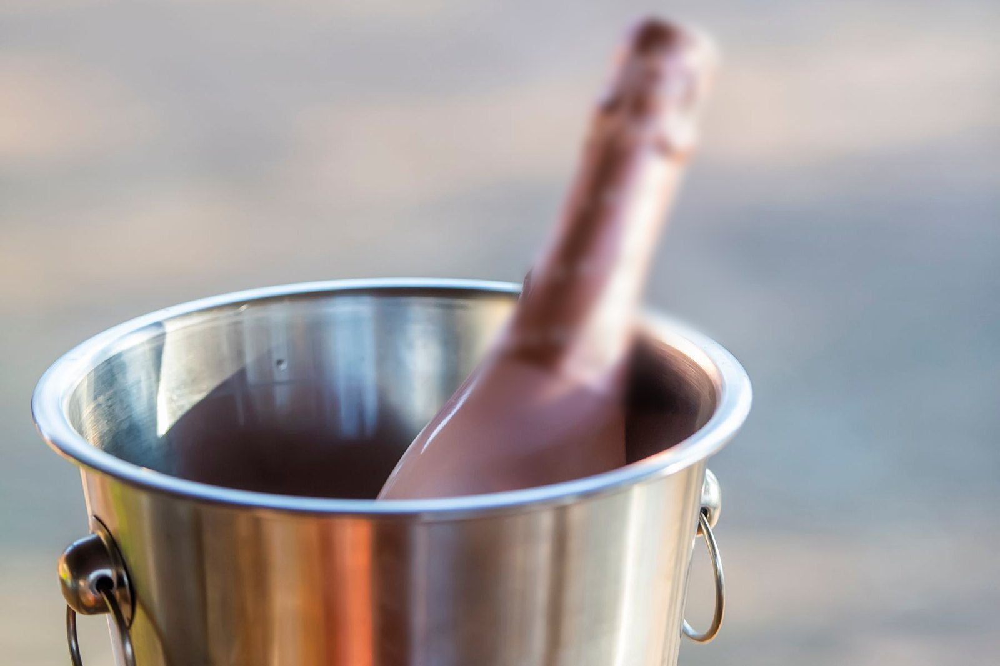
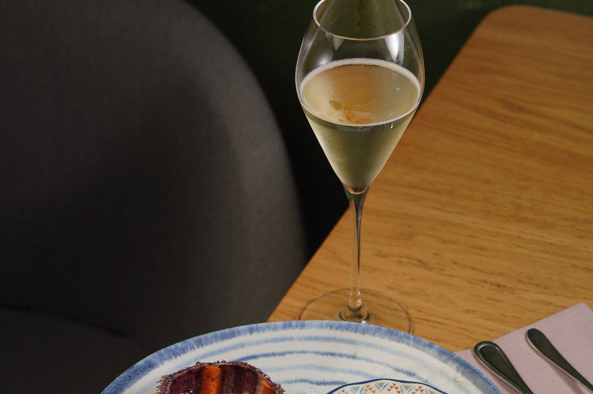
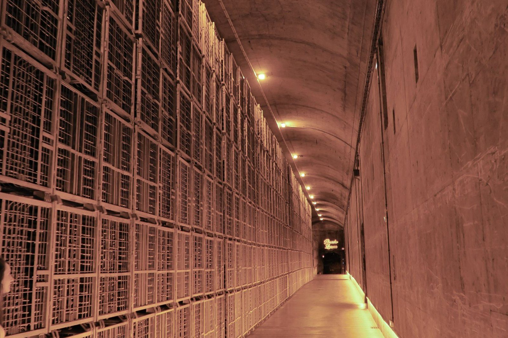

Every holiday season, a man reaches the same decision point: which Champagne to buy, how to serve it, and what to put on the table next to it. This Champagne guide for gentlemen answers those questions for 2026. It starts on the American Thanksgiving table and runs through Christmas and New Year's Eve. You don't need to memorize a wine atlas. You need to read a label in ten seconds, chill the bottle properly, open it without a gunshot pop, pour it into the right glass, and match the style to the food. These are the details that separate the host who simply buys an expensive bottle from the man who actually knows how to choose, serve and pair Champagne.

The category is also changing quickly. Lower-sugar styles are spreading, small grower estates are taking shelf space from the famous houses, and sommeliers are quietly retiring the flute. Below are the seven developments worth knowing this season, followed by three premium picks and a short FAQ.

## Key takeaways

- **Drier is the direction:** extra brut (0–6 g of sugar per liter) and brut nature (under 3 g, no added sugar) are the defining Champagne trend of the decade. Brut is still the most versatile all-rounder.
- **Read the small code on the label:** "RM" means a grower who makes Champagne from his own grapes; "NM" means a house that buys grapes. Neither is automatically better. They are different philosophies.
- **Serve at 8–10 °C** (up to 12 °C for vintage and prestige cuvées), and chill the bottle in an ice bucket with water for 20–30 minutes.
- **Use a tulip or white wine glass**, not a coupe. The flute is elegant but mutes the aroma.
- **Open quietly:** hold the cork, turn the bottle at about 45° and let the gas escape with a soft sigh.
- **For Thanksgiving turkey**, reach for rosé or blanc de noirs; for oysters and caviar, blanc de blancs or extra brut.
- **Enjoy in moderation** and only if you are of legal drinking age (21 in the United States).

## 1. Extra brut and brut nature: the decade of dry Champagne

The most important style shift in Champagne right now is the decline of sugar. After the second fermentation in the bottle and the removal of the yeast sediment, every Champagne receives a small *dosage*, a mixture of wine and sugar that sets its final sweetness. The term on the label tells you how much went in. Brut can contain up to 12 grams per liter. Extra brut contains 0 to 6 grams. Brut nature, also labeled *pas dosé* or *zero dosage*, contains under 3 grams, with no sugar added.

### Why extra brut matters for the holiday table

With less sugar, the wine shows itself as it really is: tighter, more saline, more mineral, and sometimes more austere. That is exactly why extra brut has become the sommelier's choice for oysters, crudo, caviar and the first glass of the evening. France's *Le Journal du Vin* points out in its 2026 Christmas guide that low-dosage cuvées are no longer a niche for collectors. They now appear at every price level, and four of the 24 Champagnes in its selection are extra brut or brut nature.

### The trap on the label

The French terminology is counterintuitive. "Extra dry" and "sec" are actually *sweeter* than brut, with 12–17 and 17–32 grams per liter respectively. Demi-sec (32–50 grams) belongs with dessert, where any brut would taste sharp and metallic. For the aperitif and the main course, stay with brut, extra brut or brut nature.

Original article: [How to Choose Champagne for the Holidays – Terroir Journal](https://www.terroirjournal.fr/en/wine-buying-guide/how-to-choose-champagne/)

Original article: [Champagne pour Noël 2026 – Le Journal du Vin](https://www.lejournalduvin.fr/guides/occasions/champagne-noel/)

## 2. Grower Champagne vs. the great houses

On every bottle of Champagne you will find a small code followed by a number, usually near the bottom of the label. It tells you who made the wine. **NM** (*négociant manipulant*) is a house that buys all or part of its grapes; this covers the grandes marques such as Krug, Dom Pérignon, Bollinger, Pol Roger, Taittinger and Ruinart. **RM** (*récoltant manipulant*) is a grower who makes Champagne exclusively from his own vineyards. **CM** is a cooperative.

### The "fizz farmers" movement

Grower Champagne has been the connoisseur's obsession in America for about two decades, and in 2026 it is going mainstream. British merchant Corney & Barrow notes in its Christmas trend report that grower Champagne, with its focus on individual vineyards and producers, is gaining ground among buyers looking beyond the house style. Serious Eats quotes a wine educator who calls these producers "fizz farmers": growers who stopped selling their grapes to the big houses and started bottling the character of their own villages.

### How to choose between them

The houses deliver consistency. A non-vintage Krug or Bollinger tastes reliably like itself year after year, because blending across many villages and vintages is their art. Growers deliver a sense of place. A grand cru blanc de blancs from Cramant or Le Mesnil-sur-Oger tastes of that specific slope of chalk. For a dinner party, the smart move is to serve one of each and let your guests taste the difference. San Francisco's Flatiron Wines, which runs a monthly Extra Brut Champagne Club, featured Bonnaire's Cramant Grand Cru Blanc de Blancs Extra Brut 2017 in November: more than seven years on the lees, with a dosage of only 2.5 grams per liter.

### The 2026 market reality

The numbers explain why this matters now. According to the Comité Champagne figures reported by *The Drinks Business*, the houses grew shipments by 5.1% in the first nine months of 2026, while growers, who sell roughly 80% of their volume in France, were down 4%. Their exports, however, rose 5.7%. In other words, more grower bottles than ever are heading to markets like the United States.

Original article: [Christmas Wine Trends for 2026 – Corney & Barrow](https://www.corneyandbarrow.com/blog/christmas-wine-trends-for-2026)

Original article: [Extra Brut Champagne Club, November 2026 – Flatiron Wines](https://sf.flatiron-wines.com/blogs/extra-brut-champagne-club/extra-brut-champagne-club-november-2026)

## 3. The serving temperature: 8–10 °C, not ice-cold

Most Champagne is served far too cold. Below about 6 °C the aromas shut down and the wine tastes of little more than bubbles and acidity. The Comité Champagne, the region's official trade body, recommends 8–10 °C for most cuvées and up to 12 °C for vintage Champagne. Laurent-Perrier gives the same guidance: 8–10 °C for fresh non-vintage cuvées and 10–12 °C for vintages.

### How to chill a bottle correctly

The fastest method is an ice bucket filled with ice *and* water, not ice alone. Water contacts the whole glass surface and chills the bottle in roughly 20 to 30 minutes. Alternatively, lay the bottle in the bottom of the refrigerator a few hours before serving; Perrier-Jouët calculates that a standard 75 cl bottle needs about two and a half hours to reach 8–10 °C there. Never put Champagne in the freezer. The sudden temperature shock damages the aromas, and a forgotten bottle can crack.

*Photo: Frans van Heerden / Pexels, [Pexels License](https://www.pexels.com/license/)*

### Keeping it at temperature during dinner

Between pours, return the bottle to the bucket. A bucket filled one third with ice and one third with water keeps it in the ideal range for the length of a dinner. If you are serving a prestige cuvée such as Krug or a Pol Roger Sir Winston Churchill, let it warm slightly in the glass. Those wines open up at 10–12 °C, and you will taste far more of what you paid for.

Original article: [What sort of glass should I enjoy my Champagne in? – Champagne.fr](https://www.champagne.fr/en/enjoying-champagne/prepare-to-enjoy-champagne/what-sort-of-glass-should-i-enjoy-my-champagne-in)

Original article: [How to serve champagne – Perrier-Jouët](https://www.perrier-jouet.com/en-ww/how-to-serve-champagne/)

## 4. Tulip glass vs. flute vs. coupe: the glassware verdict

The coupe looks glamorous in old films and on New Year's Eve pyramids, but it is the worst vessel for good Champagne. Its wide, shallow bowl lets the bubbles and the bouquet escape within minutes. The Union des Maisons de Champagne calls it "the bane of Champagne."

### Why the tulip wins

The official recommendation of the Comité Champagne is a tall glass that widens in the middle and narrows toward the rim: a tulip. The wider bowl gives the wine room to breathe, and the narrowing top concentrates the aromas at your nose. G.H. Mumm goes further and recommends a fine tulip-shaped white wine glass. Serious Eats put the theory to a practical test in 2026: the tulip glasses delivered clearly more aroma, while in the narrowest flutes the bouquet was "almost indiscernible."

### When the flute still makes sense

The flute is not wrong. It is just limited. It shows off the long trail of rising bubbles and keeps the mousse lively for a toast. For a crowded reception where people are standing, it remains practical. For a seated dinner and serious bottles, use tulips or your best white wine glasses. Pour in two stages: a small splash first, let the foam settle, then fill to about two thirds. Hold the glass by the stem so your hand doesn't warm the wine.

### One glass per cuvée

If you serve several Champagnes over the evening, Mumm advises a fresh glass for each cuvée so the styles don't blur into each other. It is a small luxury that shows you take your guests and your wine seriously.

Original article: [The 7 Best Champagne Glasses of 2026, Tested & Reviewed – Serious Eats](https://www.seriouseats.com/best-champagne-glasses-8779164)

Original article: [Choosing the right wine glass – Union des Maisons de Champagne](https://maisons-champagne.com/en/houses/the-art-of-tasting/before-opening-the-bottle/article/choosing-the-right-wine-glass)

## 5. Opening the bottle: the quiet sigh, and when to sabre

A loud pop and a fountain of foam is the mark of an amateur. It wastes wine, flattens the bubbles, and can turn the cork into a projectile. A Champagne bottle holds about five to six bar of pressure, roughly twice that of a car tire, so the cork deserves respect.

### The gentleman's method

The Comité Champagne's serving guide describes the professional technique step by step. Wipe the chilled bottle dry with a white napkin. Remove the foil, then loosen the wire cage while keeping your thumb firmly on the cork. Remove the cage, still holding the cork. Tilt the bottle at 30–45°, pointed away from anyone. Now hold the cork still and slowly turn the *bottle*, not the cork. The cork eases out and the gas escapes with a soft sigh. Perrier-Jouët's chef de service describes it as a gentle sound that pleases guests without startling them.

### Sabrage: theatre with risk

Sabrage, striking the neck of the bottle with a sabre along its seam, is a fine party trick and a Napoleonic tradition. It is also genuinely dangerous if done badly. Only attempt it with a well-chilled bottle, outdoors, with a proper Champagne sabre, never toward people, and only after instruction. Never sabre a rare bottle. For a vintage Krug or a prestige cuvée, the quiet method is the only correct method.

### Pouring like a sommelier

Hold the bottle by its base or body, never by the neck. For a magnum, Mumm recommends placing the thumb in the punt, the indentation in the bottom of the bottle, with the other hand supporting the neck. Tilt the glass slightly, pour slowly, and keep the label visible to your guests.

Original article: [Serving Champagne factsheet – Champagne Education (Comité Champagne)](https://www.champagne.education/sites/default/files/2026-08/Factsheet%20-%20Serving%20Champagne.pdf)

Original article: [Our recommendations for serving champagne – G.H. Mumm](https://www.mumm.com/en-ww/taste-explorer/our-recommendations-for-serving-champagne/)

## 6. Food pairing: Thanksgiving turkey, oysters and the dessert trap

Champagne is the most food-friendly wine in the world, and that is the best argument for keeping it on the table after the toast. Its high acidity and fine bubbles cut through butter, fat and salt, and its toasty, brioche-like notes from aging on the lees bridge roasted and fried flavors. Moët Hennessy Champagne specialist Alyse Mizia sums up the rule for Wine Traveler: any food with salt, butter, oil or fat will work.

### Champagne for Thanksgiving

Today is Thanksgiving, and the American feast is a pairing puzzle: turkey, stuffing, gravy, cranberry sauce and sweet potatoes all on one plate. Champagne solves it. K&L Wines' Champagne buyer Gary Westby argues that rosé Champagne is the ultimate wine for the Thanksgiving table. The red wine component handles gravy and stuffing, while the acidity and bubbles work with everything from sweet yams to Brussels sprouts. One of his two traditional bottles is Billecart-Salmon "Le Rosé." Wine Traveler's pairing table recommends rosé or a brut blanc de noirs for roast turkey, because Pinot Noir-driven body matches poultry and its trimmings. Bon Appétit's 2026 sommelier picks open the meal with Bérêche & Fils Brut Réserve, a top grower bottle.

### Blanc de blancs vs. blanc de noirs

Blanc de blancs, made entirely from Chardonnay, is lean, mineral and precise. It is ideal with oysters, sushi, crab and caviar. Blanc de noirs, made from Pinot Noir and/or Meunier, has more body and depth. Choose it with poultry, pork, mushrooms and aged cheeses. If you can only open one bottle for the whole evening, *Le Journal du Vin* recommends a blanc de noirs or a vinous blend over a blanc de blancs, because it will carry you from aperitif to main course.

*Photo: Nadin Sh / Pexels, [Pexels License](https://www.pexels.com/license/)*

### The dessert trap

A dry brut next to pecan pie or a chocolate yule log tastes sour and thin. Sugar in the food makes dry wine taste harsher. With dessert, switch to a demi-sec or a rich vintage rosé, or simply end the Champagne before the pie arrives.

Original article: [Rosé Champagne Is the Versatile Pairing for Turkey and All the Sides – K&L Wines](https://onthetrail.klwines.com/on-the-trail-blog/thanksgiving-rose-champagne)

Original article: [Champagne Food Pairing: Rules & Expert Picks – Wine Traveler](https://www.winetraveler.com/food-pairing/champagne-food-pairing-recommendations/)

Original article: [Sommelier-Approved Thanksgiving Wines – Bon Appétit](https://www.bonappetit.com/story/sommelier-approved-thanksgiving-wines)

## 7. Vintage vs. non-vintage, storage, and the 2026 Champagne market

Most Champagne is non-vintage (NV): a blend of several harvests, made to express a consistent house style. A vintage Champagne, or *millésime*, comes only from the harvest year printed on the label and is made only in good years. It is aged longer and usually shows more depth, more toast and more complexity, which is why it is served slightly warmer at up to 12 °C.

### How to store Champagne at home

Champagne is not built for the kitchen counter. Keep unopened bottles in a cool, dark place with a stable temperature, ideally around 10–15 °C, away from vibration and light. Bottles you plan to keep for months are best stored lying down, so the cork stays moist and elastic. Most non-vintage Champagne is released ready to drink, so open it within a year or two. Great vintages and prestige cuvées can age for a decade or more. If you don't finish a bottle, an airtight Champagne stopper keeps it lively in the refrigerator for a day or two.

*Photo: Wes Guild / Pexels, [Pexels License](https://www.pexels.com/license/)*

### What the 2026 numbers say

The Champagne business is in a moment of transition. Worldwide shipments fell 2% in 2025 to 266 million bottles, according to the Comité Champagne. That is the lowest level in 20 years outside the pandemic year 2020. In 2026, exports have driven a modest recovery: shipments were up 3.2% to 174.2 million bottles through September. After a weaker October, growth for the first ten months stood at 2%, with exports up 5.6% and the French home market down 3.5%. For the American buyer, this means a deep selection, more grower bottles arriving, and serious houses competing hard for the holiday table.

Original article: [Exports lift Champagne shipments 3.2%, but growers lose ground – The Drinks Business](https://www.thedrinksbusiness.com/2026/11/exports-lift-champagne-shipments-3-2-but-growers-lose-ground/)

Original article: [Champagne shipments fell 3.4% in October – Vinetur](https://www.vinetur.com/en/20261117111259/champagne-shipments-fell-34-in-october-casting-doubt-on-the-markets-recovery.html)

Original article: [How to store and open your bottle of champagne – Moët & Chandon](https://www.moet.com/en-us/how-to-store-champagne)

## The gentleman's picks: three premium Champagne essentials

### Krug Grande Cuvée 174ème Édition

Krug's Grande Cuvée is the prestige Champagne that a serious host keeps in reserve. Each *Édition* is a blend built from well over a hundred wines across many years, aged for years in Krug's cellars in Reims. It shows deep, toasty, nutty complexity with lifted freshness. Serve it at 10–12 °C in a tulip or white wine glass, never ice-cold, and pair it with roast poultry, aged Comté or simply a long conversation.

Product page: [Krug Grande Cuvée 174ème Édition – Krug](https://www.krug.com/en-us/champagne/krug-grande-cuvee-174eme-edition)

### Pol Roger Cuvée Sir Winston Churchill

Named for the house's most famous admirer, Pol Roger's prestige cuvée is a Pinot Noir-led vintage Champagne made only in exceptional years. It is powerful, structured and built to age: a true gentleman's Champagne, with the history to match. It belongs at the main course rather than the aperitif. Serve it with turkey, roast fowl or beef Wellington.

Product page: [Cuvée Sir Winston Churchill – Pol Roger](https://www.polroger.com/en/champagnes/sir-winston-churchill)

### Zalto Denk'Art Champagne glass

A great Champagne deserves a great glass. Zalto's mouth-blown Denk'Art Champagne glass is the tulip shape sommeliers recommend: a generous bowl for the aromas, a narrower rim to focus them, and a stem so fine that the glass feels almost weightless. It works equally well for vintage Champagne and white Burgundy.

Product page: [Champagne glass – Zalto Denk'Art](https://www.zalto.shop/en/shop/product/denkart-en/glasses/champagne)

## A note on responsible enjoyment

Champagne is a wine for celebration, and the best celebrations are remembered. Enjoy it in moderation and only if you are of legal drinking age, which is 21 in the United States. Alternate each glass with water, eat while you drink, and never drive after drinking. A true gentleman knows when to stop pouring.

## FAQ: Champagne questions men ask

### What is the best Champagne for Thanksgiving dinner?

Rosé Champagne or a brut blanc de noirs. Their Pinot Noir body matches turkey, gravy and stuffing, while the acidity keeps rich sides fresh. Billecart-Salmon Le Rosé is a classic choice among American Champagne buyers.

### What is the difference between extra brut and brut?

Brut contains up to 12 grams of sugar per liter; extra brut contains 0 to 6 grams. Extra brut tastes drier, more saline and more mineral, and is ideal with oysters and seafood.

### At what temperature should Champagne be served?

At 8–10 °C for non-vintage Champagne and up to 12 °C for vintage and prestige cuvées. Chill the bottle in an ice bucket with water for 20–30 minutes, never in the freezer.

### Is a flute or a tulip glass better for Champagne?

A tulip glass, or a fine white wine glass. Its wider bowl and narrower rim concentrate the aroma. The flute shows the bubbles well but mutes the bouquet; the coupe loses both bubbles and aroma quickly.

### How do you open Champagne without a loud pop?

Keep your thumb on the cork, remove the cage, tilt the bottle to about 45° and turn the bottle, not the cork. Ease the cork out slowly so the gas escapes with a soft sigh.

### What is grower Champagne?

Champagne made by a grower exclusively from his own vineyards, marked "RM" on the label. It tends to express a specific village and vineyard, while the large houses (NM) focus on a consistent blended style.
