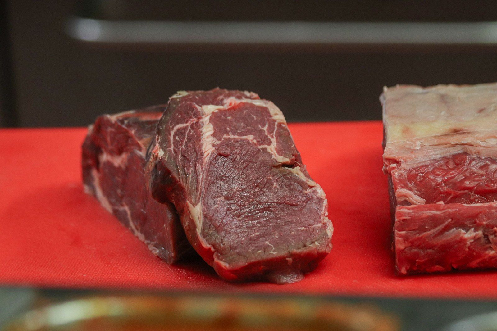
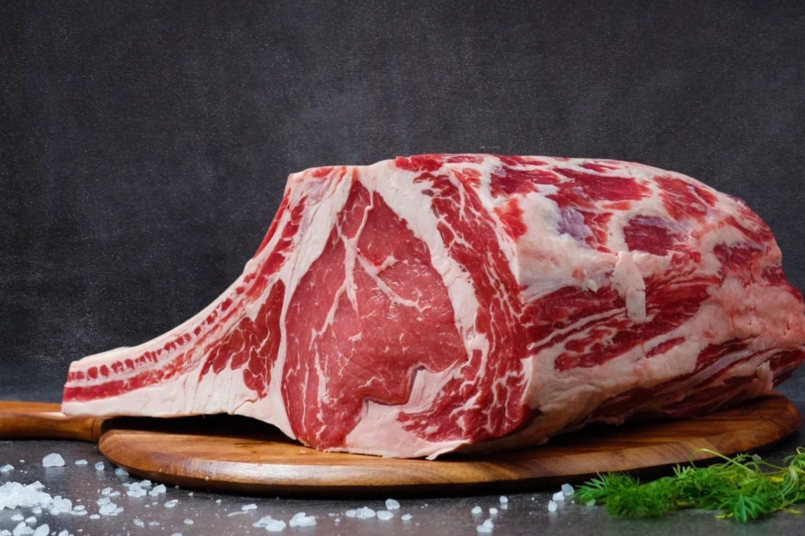
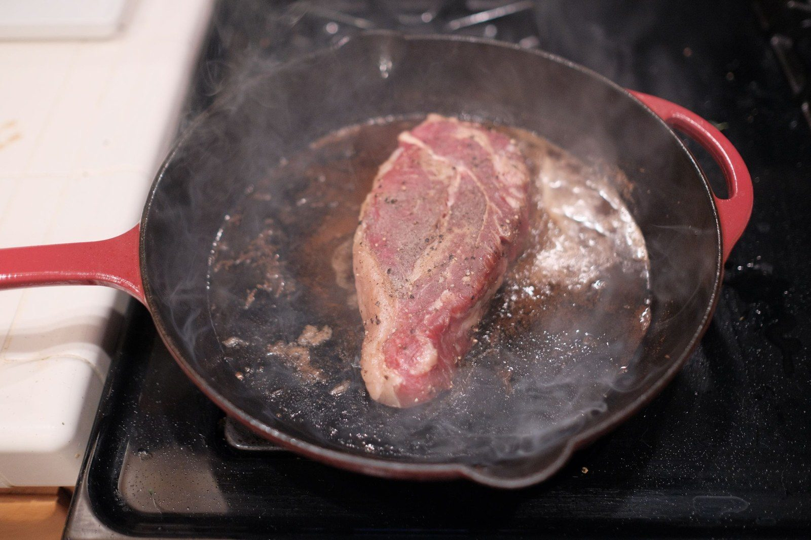
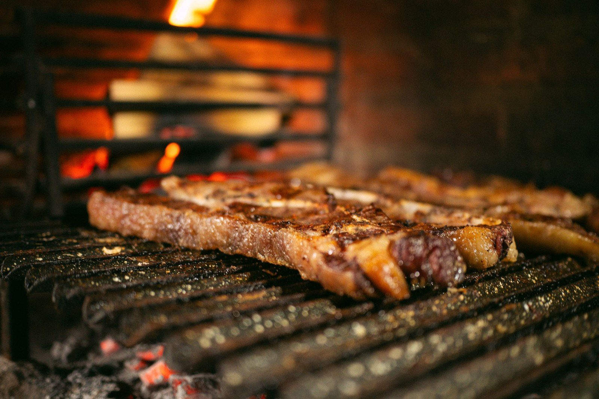
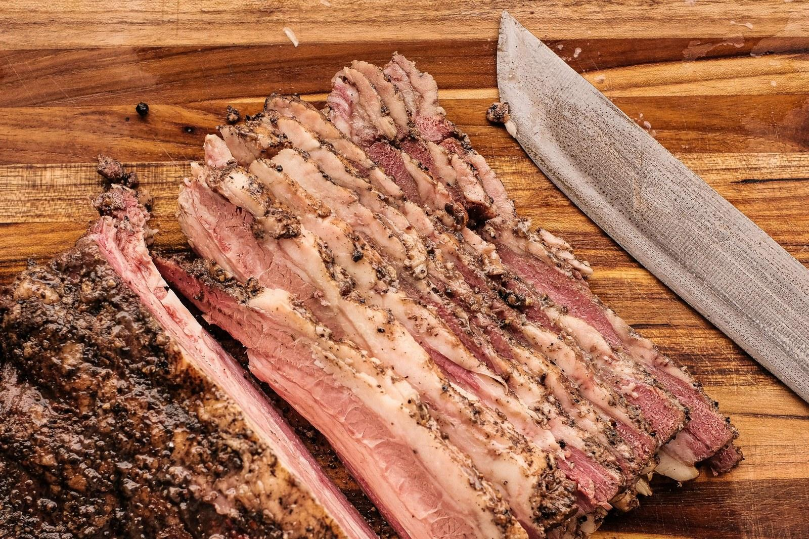
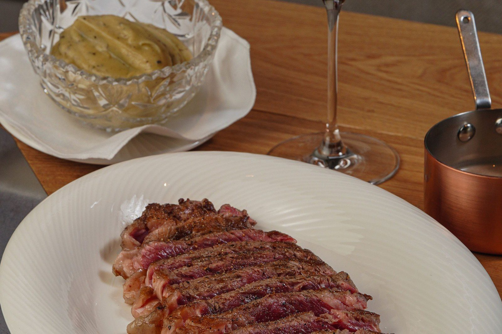
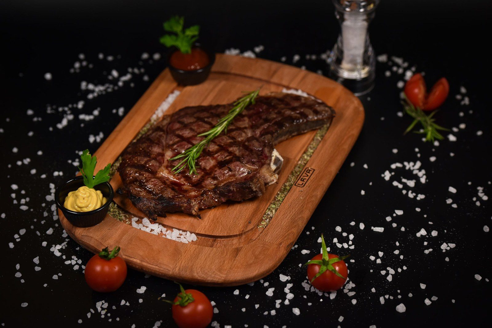

**A perfect steak at home comes down to four decisions: the right grade, the right aging, the right heat and the patience to rest it.** A thick USDA Prime or well-marbled dry-aged ribeye, seasoned with nothing more than salt and pepper, seared hard in cast iron or reverse-seared, pulled at about 52–54 °C and rested for a few minutes, will rival most steakhouses. This guide walks through each step with the sources that matter: the USDA's own beef-grade guidance, butchers and food scientists, and Wine Spectator's pairing advice.

The holiday season is steak season. Between Thanksgiving leftovers and the December dinner calendar, this is the time of year when a man is most likely to host a proper dinner, and few dishes carry the same quiet authority as a well-cooked steak carved at the table. Cooking it well is not about gadgets or theatre. It is about knowing what you are buying and respecting the meat.

**Key takeaways**

- **USDA Prime** is the most marbled of the three common grades; **Choice** makes up roughly 75% of graded US beef and is excellent for slow cooking.
- **Wagyu is a breed, not a USDA grade.** Ask about genetics (F1, purebred, fullblood) and marbling score before you pay a premium.
- **Dry aging** (about 3 to 10 weeks or longer in a controlled room) tenderizes beef and creates nutty, deeply savory flavor.
- **Thickness decides the method:** pan-sear and butter-baste steaks of about 2.5–3 cm; reverse-sear steaks of about 4 cm or more.
- **Use a thermometer:** pull at roughly 52 °C for rare, 54–57 °C for medium-rare and 60 °C for medium, then rest.
- **Wine:** Cabernet Sauvignon for plain grilled ribeye or steak au poivre, Malbec with chimichurri, Zinfandel with flavored butter.

## What makes a steak great? Grade, cut, aging and cooking

A great steak is the sum of four things: **marbling** (the fine threads of fat inside the muscle), **cut** (ribeye, strip, filet, porterhouse), **aging** (dry or wet) and **cooking technique**. Get the first three right at the butcher counter and the fourth becomes far more forgiving.

The **ribeye** is the steak most chefs and butchers recommend for home cooks because its generous marbling and central "eye" of fat keep it juicy even if timing is slightly off. The **New York strip** is leaner, firmer and more beef-forward. The **filet mignon** (tenderloin) is the most tender cut but also the mildest, which is why it is often wrapped, sauced or served au poivre. The **porterhouse** and **T-bone** combine strip and tenderloin on the bone and are best for sharing.

For a dinner for two or four, a single thick bone-in ribeye of about 900 g to 1 kg, carved at the table, is more impressive and easier to cook well than four thin individual steaks.

## What is the difference between USDA Prime, Choice and Select?

**USDA beef grades are marbling grades.** According to the US Department of Agriculture's Agricultural Marketing Service, **Prime** beef shows "slightly abundant to abundant" marbling and comes from young, well-fed cattle; it is "generally sold in hotels and restaurants" and is ideal for high-heat methods such as broiling, roasting and grilling because the marbling helps preserve moisture. **Choice** has "moderate" marbling and suits most high-heat methods, while **Select** has only "slight" marbling and benefits from marinades or slow, moist cooking.

### Why marbling matters

Marbling is flavor insurance. Intramuscular fat melts as the steak cooks, basting the muscle from within and carrying aroma. The USDA's own summary is blunt: more marbling means more flavor, moisture and tenderness.

### Is Choice ever the smarter buy?

Yes, for the right dish. Serious Eats notes that **Choice accounts for about 75% of graded US beef** and quotes Texas Tech meat scientist Jarrett Corliss, who chooses Choice for slow cooking because braises and gentle roasts do not depend on marbling for tenderness. For a seared steak that is the centerpiece of the evening, however, Prime is where the extra richness shows.

### How to read marbling at the counter

Corliss's rule is simple: fat **inside** the meat is good, fat **outside** the meat is not. Look for fine, evenly distributed white flecks across the whole face of the steak rather than a few thick seams or a lopsided fat cap. Ask your butcher to cut steaks to order at about 4 cm thick; thicker steaks are easier to cook to an even pink.

*Photo: Boys in Bristol Photography / Pexels, [Pexels License](https://www.pexels.com/license/)*

Original article: [USDA Agricultural Marketing Service – Understanding USDA Beef Grades](https://www.ams.usda.gov/sites/default/files/media/beefgradesinfog2026.pdf) · [Serious Eats – How to Buy Better Steak, According to Experts](https://www.seriouseats.com/steak-buying-guide-11990773)

## Is Wagyu worth it? American, Australian and Japanese A5 explained

**Wagyu is a family of Japanese cattle breeds genetically predisposed to intense marbling – it is not a USDA grade.** That distinction matters because the word "Wagyu" on a US menu or label can mean very different things.

### The USDA "Authentic Wagyu Beef" label

In an interview with The Kitchn, butcher Mortenson of Savenor's Market explains that **only in January 2025 did the USDA introduce an authentication program for American Wagyu producers.** Producers can choose to register and pay for their beef to carry the USDA "Authentic Wagyu Beef" label, which requires meeting specifications for genetics and marbling. The program is voluntary, and it is not a quality-grading system like Japan's, so "consumers still have to rely on research and reputation of the producer." Other markers to look for are **American Wagyu Association (AWA)** lineage certification and a **Beef Marbling Standard (BMS)** score.

### F1, purebred and fullblood

The Australian Wagyu Association's terms are a useful decoder: **F1** cattle carry 50% to under 75% Wagyu genetics, **purebred** means 93.75% or more, and **fullblood** is parent-verified to registered fullblood sire and dam. These are genetic labels, not quality labels: a fullblood steak tells you about ancestry, not how marbled that particular steak is.

### How much Wagyu to serve

Mortenson's advice is the most useful sentence in the whole Wagyu debate: **A5 Japanese Wagyu is a showstopper best served in small portions,** almost like a tasting course, because it is so rich. For an entrée-sized steak she prefers **Australian Wagyu ribeye at BMS 8 or 9** or **F1 American Wagyu**, which balance "melt-in-your-mouth fattiness and rich beefy flavor." In practice: serve A5 in slices of about 50–80 g per person as a first course, and let a Prime dry-aged ribeye or F1 Wagyu be the main event.

### How to cook Wagyu

Cook it hot and fast, season with salt only, and aim for medium-rare to medium so the fat has time to soften. A heavy cast iron pan is better than a grill for A5, because the rendering fat will cause flare-ups over open flames.

Original article: [The Kitchn – Everything You Need to Know About Wagyu, According to a Butcher](https://www.thekitchn.com/what-is-wagyu-butcher-23784522)

## What is dry-aged steak and is it worth the premium?

**Dry-aged beef is beef stored unwrapped in a temperature- and humidity-controlled room for anywhere from about one week to ten weeks or longer.** In his Food Lab guide for Serious Eats, J. Kenji López-Alt explains that two major things happen: **natural enzymes break down some of the tougher muscle fibers**, making the meat more tender, and the flavor changes through enzymatic and bacterial action, developing **"deep nutty, cheesy aromas"** while the fat oxidizes and adds depth.

### The moisture myth

Conventional wisdom says dry aging concentrates flavor by drying the meat. López-Alt's testing found otherwise: a whole dry-aged prime rib may be **about 30% lighter** than when it started, but that moisture loss is almost entirely in the exterior crust that is trimmed off before cooking. The steak you actually eat is no denser or drier than a fresh one. The difference is flavor and tenderness, not concentration. That trimmed crust is also why dry-aged beef costs more: you pay for the weight that is lost.

### How long should a steak be dry-aged?

A useful rule of thumb for buyers:

- **About 21–30 days:** noticeably more tender, with a clean, buttery beef flavor. The classic steakhouse profile.
- **About 45 days:** distinctly nutty and savory; the "dry-aged" character most enthusiasts look for.
- **60 days and beyond:** intense, almost blue-cheese notes. Wonderful for some, polarizing for others – try it at a steakhouse before buying it for guests.

### Can you dry-age steak at home?

Not safely in a standard refrigerator. Professional aging requires steady cold temperatures, controlled humidity and constant airflow. If you want dry-aged beef at home, buy it from a butcher with a dedicated aging room, or from a reputable mail-order producer who states the number of days on the label.

*Photo: Satmar Meats / Pexels, [Pexels License](https://www.pexels.com/license/)*

Original article: [Serious Eats – The Food Lab's Definitive Guide to Grilled Steak](https://www.seriouseats.com/food-lab-how-to-grill-steak-cuts-of-steak)

## How do you cook a dry-aged steak in a cast iron pan?

**For steaks about 2.5–3 cm thick, the classic pan-sear with butter basting is the gold standard.** Milo Locker Meats, an Iowa butcher, describes this "arrosé" method in its August 2026 guide to cooking dry-aged ribeye. It is fast, visual and gives a uniform, caramelized crust with a rich buttery finish.

### Step by step: pan-seared, butter-basted ribeye

1. **Temper and dry.** Take the steak out of the refrigerator about 45 minutes before cooking. Pat it completely dry with paper towels; dry-aged beef already has a firm, dry surface, which browns beautifully.
2. **Season simply.** Rub a little beef tallow or high-smoke-point oil over the steak, then season generously with coarse kosher salt and freshly cracked black pepper. Dry-aged fat is flavorful enough that marinades and heavy rubs only get in the way.
3. **Heat the pan until it is screaming hot.** A heavy cast iron or stainless skillet with a tablespoon of tallow or avocado oil, heated until the fat shimmers and just begins to smoke.
4. **Sear without touching.** About 2 minutes on the first side, flip, about 2 minutes on the second. Then hold the steak on its edge with tongs for about 30 seconds to render the fat cap.
5. **Baste.** Lower the heat to medium-low and add two tablespoons of cold unsalted butter, a few smashed garlic cloves and a sprig of thyme or rosemary. Tilt the pan and spoon the foaming butter over the steak continuously for 60–90 seconds.
6. **Pull and rest.** Milo recommends pulling at about **52 °C** on an instant-read thermometer for medium-rare (the temperature keeps rising as it rests) and resting the steak for a full **8 minutes** on a warm plate.

### Common mistakes

- **A wet steak:** surface moisture steams instead of browning. Dry it properly.
- **A crowded pan:** two thick steaks in a 25 cm pan will drop the temperature. Cook one at a time, or use a pan of about 30 cm.
- **Moving the steak:** let the crust form before you flip.
- **Guessing doneness:** the finger test is charming, a thermometer is accurate.

*Photo: Deane Bayas / Pexels, [Pexels License](https://www.pexels.com/license/)*

Original article: [Milo Locker Meats – The Definitive Guide to Cooking Dry-Aged Ribeye Steaks](https://www.milolockermeats.com/guides/definitive-guide-cooking-dry-aged-ribeye-steaks)

## What is the reverse sear and when should you use it?

**The reverse sear cooks a thick steak gently first and sears it last.** It is the best method for steaks of about 4 cm or thicker, because low heat brings the center up evenly – no grey band under the crust – and a dry surface browns almost instantly in the final sear.

### How to reverse-sear a steak

Seafood and meat purveyor Nordic Catch summarizes the sequence clearly in its August 2026 recipe: **gentle heat until the center is nearly done, a short pause while the pan becomes extremely hot, then a fast sear.**

1. **Salt ahead.** For the driest surface and deepest seasoning, salt the steak and refrigerate it uncovered on a wire rack overnight (a "dry brine"). If cooking the same day, salt 45–60 minutes ahead.
2. **Low oven.** Heat the oven to about **105–110 °C**. Set the steak on a wire rack over a sheet pan so hot air circulates underneath.
3. **Cook to about 43 °C.** That is the internal temperature for a medium-rare finish. Start checking after 20 minutes; Nordic Catch notes the oven stage can take 25–50 minutes depending on thickness. Insert the thermometer from the side into lean meat, not a fat seam.
4. **Pause and blot.** Let the steak stand uncovered for 5–10 minutes while the cast iron heats over high heat for 3–5 minutes. Blot away any moisture.
5. **Flash-sear.** About 60 seconds per side in a thin film of oil, plus a few seconds on the fat edge. A one-minute sear per side can add roughly 5–8 °C to the center.
6. **Short rest.** Because the steak was cooked gently, a rest of 3–4 minutes is enough.

### Why the reverse sear is forgiving

You can always give a steak another few minutes in a low oven. You cannot reverse an overcooked edge. That makes this the ideal technique for a dinner party, where you are also pouring wine and talking to guests.

### A note on food safety

Nordic Catch also points out that USDA guidance for whole beef steaks is **63 °C with a three-minute rest.** Steakhouse medium-rare sits below that, so serve rare and medium-rare steaks only from a butcher you trust, and cook to the USDA temperature for anyone pregnant, elderly or immunocompromised.

Original article: [Nordic Catch – Reverse-Seared Dry-Aged Ribeye](https://nordiccatch.com/blogs/recipes-1/reverse-seared-dry-aged-ribeye)

## Grill or pan? Cooking steak over live fire

**A charcoal or wood fire adds smoke and char a pan cannot, but it needs two zones.** Build a hot zone for searing and a cooler zone for gentle cooking – essentially a reverse sear outdoors. Start the steak on the cool side with the lid closed until it is about 8 °C below your target, then move it over the coals for a fast, hot finish.

### Live-fire rules

- **Hardwood lump charcoal** burns hotter and cleaner than briquettes.
- **Trim excess exterior fat** on very marbled cuts to limit flare-ups; move the steak to the cool zone if flames lick it.
- **Do not press the steak.** Every press pushes juice into the fire.
- **Season the same way:** salt, pepper, nothing else. Save herbs and garlic for a compound butter at the end.

Steak cooked over fire is also the most social way to host in late November and December: a covered terrace, a fire, good coats and a bottle opened while the steaks rest.

*Photo: Lucas Gramatica / Pexels, [Pexels License](https://www.pexels.com/license/)*

## What temperature should steak be cooked to?

**Pull the steak from the heat about 3–5 °C below your target, because the internal temperature keeps rising as it rests.** Wine Spectator's grilling guidance gives these finished temperatures for steaks of about 2.5–5 cm thick, measured with an instant-read thermometer:

| Doneness | Approx. internal temperature |
| --- | --- |
| Rare | about 52 °C |
| Medium-rare | about 54–57 °C |
| Medium | about 60 °C |
| Well-done | about 68 °C |

Wine Spectator recommends letting steaks **stand for 5 minutes** and, to keep portions reasonable, cutting larger steaks **across the grain into thick slices** – exactly how steakhouses serve a sharing ribeye or porterhouse.

### How long should you rest a steak?

Resting lets the outer layers relax and the juices settle. Typical guidance ranges from about 3–4 minutes for a reverse-seared steak to 5–8 minutes for a hard-seared one. Rest on a warm plate or a wire rack, not on a cold board, and do not wrap a crusted steak tightly in foil – the steam will soften the crust you worked for.

### How to slice a steak like a professional

Find the direction of the muscle fibers and cut **across** them, in slices of about 1–1.5 cm. For a bone-in ribeye, cut along the bone to remove it first, then slice the meat and lay the bone alongside for presentation. Finish with a few flakes of sea salt.

*Photo: Bezalens JGP / Pexels, [Pexels License](https://www.pexels.com/license/)*

Original article: [Wine Spectator – Our Expert Guide to Pairing Wine and Steak](https://www.winespectator.com/articles/our-expert-guide-to-pairing-wine-and-steak)

## What wine goes best with steak?

**Cabernet Sauvignon is the classic steak wine, for a reason.** Wine Spectator explains it in one paragraph: generous red wines with ripe flavors are a perfect fit for grilled steak; **the tannins cut through the fat in the beef**, the natural sweetness of the meat ties in with the fruit, and a hint of smoke from the grill counterbalances the toasty notes a wine picks up from oak barrels. That is why so many steakhouse wine lists are dominated by Cabernet.

### Match the wine to the sauce

The sauce gives you room to play, according to Wine Spectator:

- **Plain steak or steak au poivre → Cabernet Sauvignon.** Napa Cabernet leans toward plush blackberry and black currant; Bordeaux tends to be more savory, herbal and mineral. For a peppery au poivre, choose a red with ripe fruit and complementary spice. Wine Spectator's editors recommend, among others, **Faust Cabernet Sauvignon Napa Valley 2021** (94 points).
- **Chimichurri → Malbec.** Malbec's plush dark fruit and body stand up to the bright parsley, oregano and garlic of the Argentine sauce – "if it grows together, it goes together."
- **Compound butter → Zinfandel.** Bold, ripe fruit balanced by acidity, tannin and spice cuts through the extra fat. **Seghesio Zinfandel Dry Creek Valley Cortina 2022** (94 points) is one of the magazine's picks.

### How to serve red wine with steak

Open structured reds about an hour before dinner, or decant them. Serve them slightly cool, at about 16–18 °C, rather than at warm room temperature; a too-warm Cabernet tastes alcoholic and flat next to rich beef. Wine Spectator's own tip: drink white wine while you cook, "and then go big red."

### Beyond wine

A steak dinner in the colder months also pairs well with an aged rum or a Cognac after the meal, or a classic Manhattan before it. Keep cocktails stirred, not sweet, so they do not dull the palate before the main course.

*Photo: Nadin Sh / Pexels, [Pexels License](https://www.pexels.com/license/)*

Original article: [Wine Spectator – Our Expert Guide to Pairing Wine and Steak](https://www.winespectator.com/articles/our-expert-guide-to-pairing-wine-and-steak)

## Which tools does a serious home steak cook need?

**Three tools matter more than any gadget: a heavy pan, an accurate thermometer and sharp steak knives.** Everything else – sous vide circulators, smoking guns, infrared grills – is optional.

### 1. Smithey No. 12 Cast Iron Skillet

Made in Charleston, South Carolina, Smithey's skillets are machined to a smooth, polished cooking surface that releases food better than rough-cast pans, and they hold heat superbly for searing. The No. 12 (about 30 cm) is large enough to sear a thick bone-in ribeye without crowding. Listed at **$220** on Smithey's site at the time of writing.

[Smithey No. 12 Cast Iron Skillet](https://smithey.com/products/no-12-cast-iron-skillet)

### 2. ThermoWorks Thermapen ONE

The instant-read thermometer professionals reach for: a fast, accurate reading in about one second, an auto-rotating display and a waterproof body. It is the single tool that most improves steak at home, because it replaces guesswork with a number.

[ThermoWorks Thermapen ONE](https://www.thermoworks.com/products/thermapen-one)

### 3. WÜSTHOF Classic 4-Piece Steak Knife Set

Forged in Solingen, Germany, from a single piece of high-carbon stainless steel, with full tang and triple-riveted handles. A proper steak knife slices cleanly instead of tearing the meat, which keeps the juices in the slice and the presentation sharp at the table.

[WÜSTHOF Classic 4-Piece Steak Knife Set](https://wusthof.com/products/wusthof-classic-4-piece-steak-knife-set)

### Caring for cast iron

After cooking, wipe out excess fat, rinse with hot water and a brush, dry the pan completely over low heat and rub in a very thin film of oil. Avoid soaking it and avoid the dishwasher. A well-seasoned pan improves every year.

## How to host a steakhouse dinner at home

**The best steak dinners feel effortless because the host planned the timing, not the menu.** A few rules borrowed from great American steakhouses:

### Keep the sides classic

Creamed spinach, potato purée or crisp potatoes, roasted mushrooms and a sharp green salad. Sides should be ready and holding warm before the steak goes into the pan, so the last 15 minutes belong only to the meat.

### Carve at the table

A large bone-in ribeye or porterhouse, carved and fanned on a warm board, is more generous than individual steaks. It also lets each guest choose a slice from the edge or the center.

### Offer a sauce, never drown the steak

A compound butter, a peppercorn sauce or chimichurri served on the side. Good beef should never need to hide.

### Mind the details

Warm plates. Proper steak knives. Flaky salt on the table. Open the red before guests arrive. And as with any well-run dinner, the host serves others first and takes the end piece himself.

*Photo: Emre Vonal / Pexels, [Pexels License](https://www.pexels.com/license/)*

## FAQ: Steak questions men ask most

### What is the best steak cut for beginners?

A ribeye about 4 cm thick. Its marbling keeps it juicy even if your timing is slightly off, and its thickness makes it easy to reverse-sear to an even medium-rare.

### Is dry-aged steak better than wet-aged?

It is different. Dry aging develops nutty, savory, sometimes cheesy flavors and costs more because the outer crust is trimmed away. Wet-aged beef, aged in vacuum packs, is tender but tastes milder and more "fresh beef."

### What is the medium-rare temperature for steak in Celsius?

About 54–57 °C after resting. Pull the steak from the heat a few degrees earlier, around 52 °C, because it keeps cooking as it rests.

### Is A5 Wagyu worth it?

As an experience, yes – but in small portions. A5 is so rich that a few slices are ideal. For a full-size steak, butchers often prefer F1 American Wagyu or Australian Wagyu with a high marbling score.

### Should I salt steak before cooking?

Yes. Either salt generously right before cooking or "dry brine" by salting and refrigerating uncovered on a rack overnight. Avoid salting 10–30 minutes ahead, when surface moisture is drawn out but not yet reabsorbed.

### What wine goes with ribeye?

Cabernet Sauvignon is the classic choice because its tannins cut through the fat. Choose Malbec with chimichurri and Zinfandel with a flavored butter.

*This guide is for culinary information. Food-safety temperatures follow USDA guidance; people who are pregnant, elderly or immunocompromised should follow official food-safety recommendations.*
