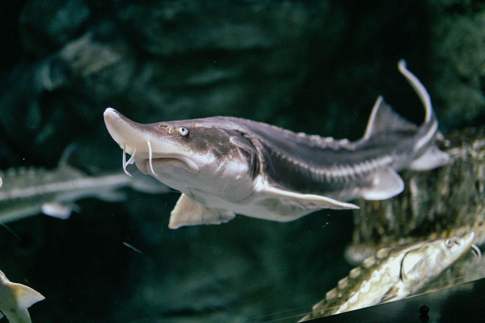
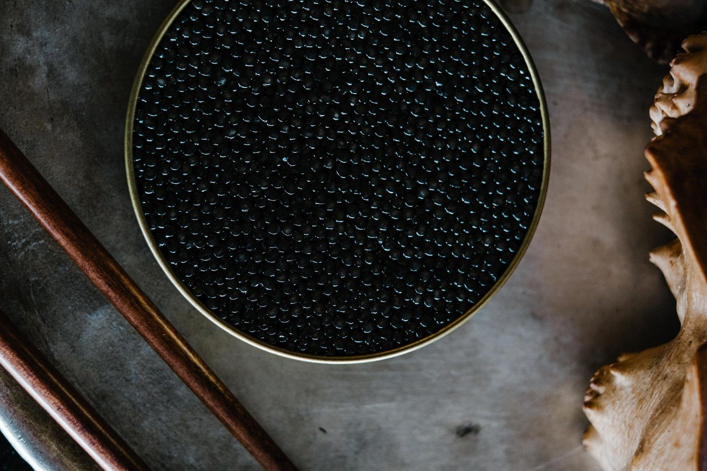
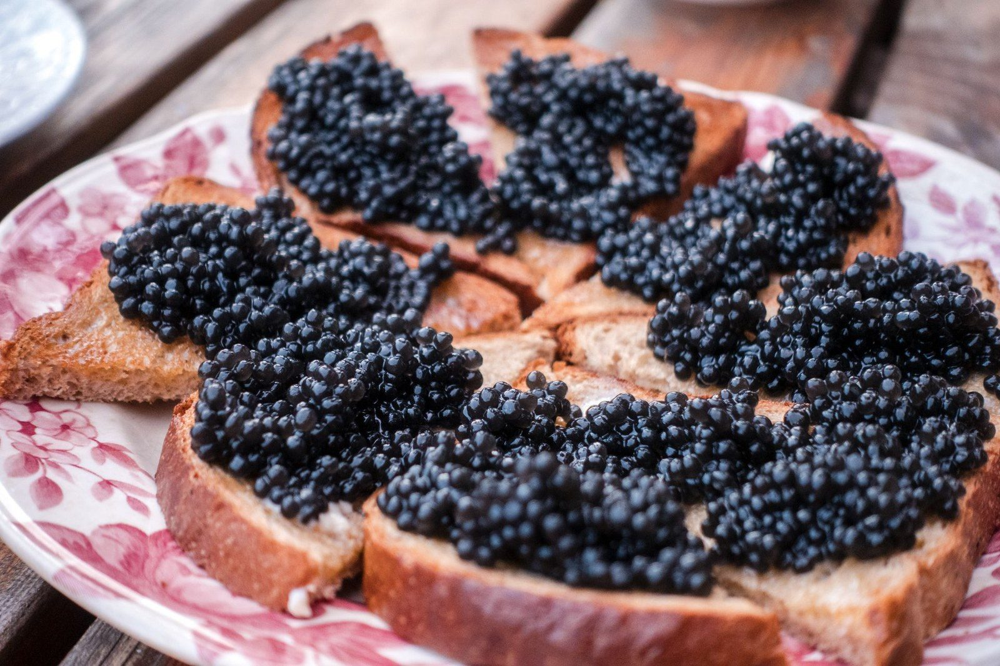
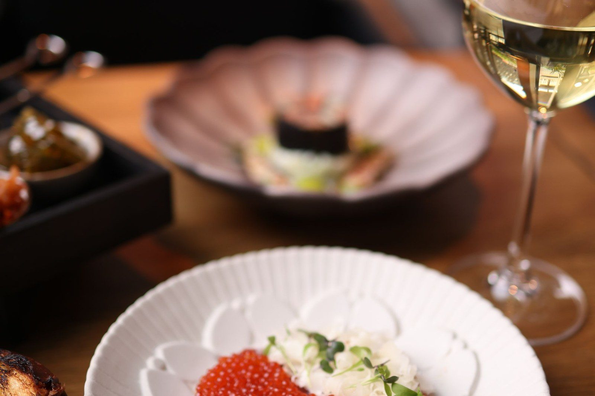
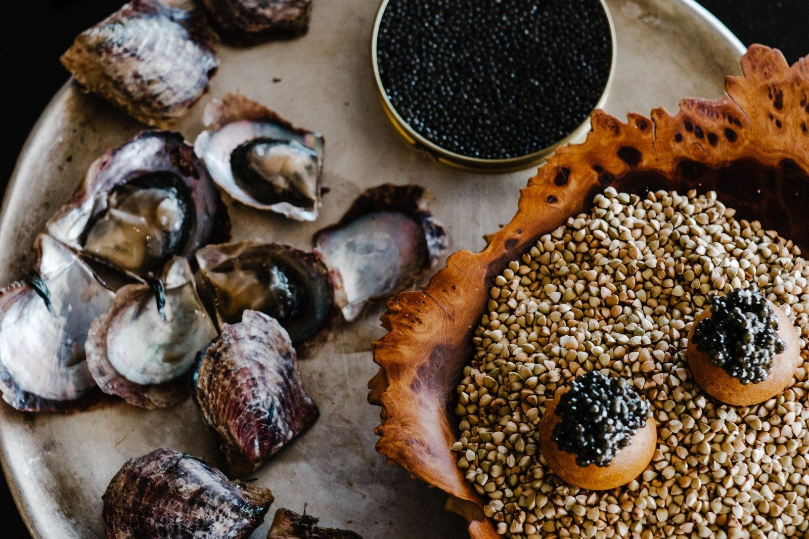

**Buying good caviar comes down to three questions: which sturgeon it comes from, how well the batch was handled and how cold you keep it until the moment it is served.** Read the scientific name on the tin, ignore most of the marketing words, choose malossol (lightly salted) roe with nothing in it but sturgeon eggs and salt, keep it at about −2 to +2 °C on crushed ice and serve it from a mother-of-pearl spoon with a glass of brut Champagne or ice-cold vodka. That is the whole art. This caviar guide explains each step with the sources that matter: specialist caviar houses, Serious Eats' 2026 caviar testing, the US Fish and Wildlife Service and Forbes' reporting on why caviar is suddenly everywhere again.

December is caviar season. Between the holiday dinner, the office party and New Year's Eve, this is the month when a man is most likely to open a tin, either as a host or as the friend who arrives with the one gift nobody else thought of. Knowing what you are buying, and serving it properly, turns an expensive ingredient into a memorable evening.

**Key takeaways**

- **Species first:** Osetra (*Acipenser gueldenstaedtii*) is nutty and complex, Kaluga hybrid is large-grained and buttery, true Beluga is *Huso huso* — and "river beluga" is not Beluga.
- **"Imperial", "Royal" and "Reserve" are not universal grades.** They only mean something inside one brand's range. Grade 1 vs. Grade 2 (intact, uniform pearls vs. less uniform ones) is the one distinction with consistent meaning.
- **Malossol means "little salt"** — roughly 3 to 5% salt. It is a cure, not a quality rank.
- **Beluga caviar from the Caspian and Black Sea cannot be imported into the US**; Osetra, Kaluga and domestic white sturgeon caviar are legal.
- **Serve it very cold** (about −2 to +2 °C), on ice, with a non-metal spoon; plan 15–30 g per person for a tasting and around 50 g for a true indulgence.
- **Pair with brut or extra brut Champagne, a blanc de blancs or neat, ice-cold vodka.** Skip big red wines.

## What is caviar, and which sturgeon species should you buy?

**Caviar is the salted roe of sturgeon — and only sturgeon.** Salmon roe, trout roe and lumpfish roe are pleasant products, but in the trade they are "roe", not caviar. Within real caviar, the species is the single most important choice you make, because it sets the size, color, texture and flavor of the eggs before any producer touches them.

### Osetra (Ossetra, Oscietra): the connoisseur's choice

The UK specialist Caviar.uk explains that Osetra commonly refers to *Acipenser gueldenstaedtii* (Russian sturgeon) or *Acipenser persicus* (Persian sturgeon). Osetra eggs are medium-sized and range from dark brown and olive to golden amber. The flavor is the reason connoisseurs love it: nutty, buttery, sometimes with notes of dried fruit and a long, clean finish. If you only ever buy one caviar, make it a good Osetra.

### Kaluga and Kaluga hybrids: the big, buttery pearls

Kaluga is *Huso dauricus*, the Amur river relative of the Beluga. Most Kaluga sold in the US today is a hybrid — typically a female Kaluga crossed with a male Amur sturgeon (*Acipenser schrenckii*). The beads are large, glossy and firm, the flavor rich and creamy. Caviar.uk notes that on a CITES label, such a hybrid appears as **SCHxDAU** — male parent first.

### True Beluga: rare, regulated and often mislabeled

**True Beluga is *Huso huso*,** the giant sturgeon of the Caspian and Black Sea. Its pale grey, very large eggs have been the stuff of legend for a century. Because the wild species is threatened, real Beluga is scarce and heavily regulated (more on the US rules below). The practical warning is this: "Kaluga Beluga" or "river Beluga" on a label is a nickname, not a species. Ask for the scientific name.

### Sevruga, Siberian, white sturgeon and hackleback

Sevruga (*Acipenser stellatus*) gives small, intensely flavored, briny eggs. Siberian sturgeon (*Acipenser baerii*) is one of the most widely farmed species and produces a clean, approachable caviar that is an excellent introduction. In the US, white sturgeon (*Acipenser transmontanus*), largely farmed in California, and hackleback (shovelnose sturgeon) are the domestic options.

### Why the species matters more than the price tag

Serious Eats' 2026 caviar testing makes a point every buyer should remember: scan the product page for the scientific name and check that it matches the variety you are paying for, because some brands deliberately use convenient nicknames, such as labeling Kaluga as "river beluga caviar", to capture Beluga shoppers. Think of species the way you think of grape varieties in wine: no single one is "best", but each has a character, and you should know which one is in your glass.

*Photo: Parviz Hajizada / Pexels, [Pexels License](https://www.pexels.com/license/)*

Original article: [Caviar.uk – How to Buy Caviar and Choose a Seller](https://caviar.uk/a-how-to-buy-caviar-the-complete-guide.html)

## What do caviar grades, "malossol" and "Imperial" really mean?

**Most words on a caviar tin are marketing; only a few describe the roe itself.** The US producer USA Black Caviar puts it plainly in its grades guide: four attributes are objective — pearl diameter in millimeters, salt percentage, intact versus damaged pearls, and species. Everything else is either a cure specification or a brand name.

### Grade 1 vs. Grade 2: the only grade with consistent meaning

**Grade 1 caviar has uniform, intact, firm pearls of consistent color; Grade 2 is less uniform and contains a proportion of damaged eggs.** According to USA Black Caviar, this is "the one grading distinction with consistent meaning across the trade." Grade 2 is not spoiled roe. It is roe that did not sort cleanly, usually because the eggs were taken slightly outside the ideal window, and it goes into jars, pressed caviar and kitchens where caviar is an ingredient rather than the centerpiece.

### Malossol: a cure, not a rank

**Malossol is Russian for "little salt" and describes a cure of roughly 3 to 5% salt.** The international Codex standard specifies 3 to 5 g of salt per 100 g of finished caviar. Serious Eats describes malossol as high-quality caviar made with less salt, around 3 to 4% by weight, so that the flavor nuances come through. Low salt is a quality signal in one narrow sense: salt preserves roe and masks flavor, so a producer who can cure at 3% is usually working with fresher, better-handled eggs than one that needs much more.

### Royal, Imperial, Reserve, Tsar: house names, not laws

"Royal", "Imperial", "Reserve", "Select" and "Supreme" are unregulated names that only mean something inside a single range. Petrossian, the Paris house founded in 1920, explains that its specialists test each batch and then assign a grade — Royal, Tsar Imperial and so on — to indicate the quality of that batch within a varietal. That is useful information when you buy from Petrossian, but a "Royal" from one company and a "Royal" from another are not comparable. Compare within one brand, not across brands.

### Pressed caviar (payusnaya)

Pressed caviar is made from damaged or very ripe eggs, salted more heavily and pressed into a dense, jam-like paste. It is a different product, not a lesser tier for the table, and chefs love its concentrated flavor on warm potatoes, in butter or folded into scrambled eggs.

### How to read the label like a professional

Caviar.uk recommends asking any seller for six things: the scientific name, the origin, the harvest and packing dates, the CITES code, the storage temperature during delivery and the remaining shelf life. Under international CITES rules, every primary container must carry a non-reusable label with a species code, a source code, the country of origin, the year of harvest and the processing plant's registration and lot number. Serious Eats adds a simple final test: do not buy caviar that lists preservatives or any ingredient other than sturgeon roe and salt.

*Photo: Rachel Claire / Pexels, [Pexels License](https://www.pexels.com/license/)*

Original article: [USA Black Caviar – Caviar Grades Explained: What's Real and What's Marketing](https://usablackcaviar.com/guides/caviar-grades/)

## Is Beluga caviar illegal in the US, and is farmed caviar better?

**Beluga caviar from the Caspian Sea and Black Sea cannot be imported into the United States.** The US Fish and Wildlife Service suspended imports of *Huso huso* caviar and meat from the Caspian states in September 2005 and from the Black Sea states, including Turkey, in October 2005. The agency's caviar fact sheet for travelers states that, under the moratorium, Beluga caviar cannot be imported into or exported from the US "in any quantity," even though it may be traded elsewhere with CITES permits.

### What is still allowed?

The suspension does not affect other species. In the agency's own words at the time, it "does not apply to caviar and meat from other sturgeon species such as osetra and sevruga and domestic white sturgeon caviar." Osetra, Kaluga hybrid, Siberian and domestic white sturgeon caviar can be bought legally from reputable American sellers.

### Can you bring caviar home from Europe?

All sturgeon species are protected under CITES, the international treaty on trade in endangered species. The Fish and Wildlife Service explains that CITES member nations, including the US, waive the permit requirement when a traveler imports **125 g or less for personal use** — with the important exception of Beluga, which is not allowed in any quantity. Above that amount, permits, declarations and inspection fees apply.

### Why almost all good caviar today is farmed

Wild sturgeon stocks collapsed in the late 20th century, and since 1998 CITES has regulated the international trade in all sturgeon species. Today the caviar on a fine-dining menu is overwhelmingly farmed, and that is good news for quality. Farms can monitor water, feed and the exact maturity of the eggs at harvest. Petrossian notes that its caviar now comes from farms in places as varied as Israel, Bulgaria, China, Madagascar, Uruguay and the United States. Serious Eats encourages buyers to seek out farm-raised caviar whenever possible and to favor sellers who state clearly where and how the fish were raised.

### Is American caviar any good?

Yes. California white sturgeon caviar is clean, mildly buttery and considerably more accessible than imported Osetra, which makes it a smart choice for blini platters or a large party. Serious Eats notes that jars from North American species — white sturgeon and hackleback — tend to be more affordable. For the centerpiece tin at a dinner for four, however, most connoisseurs still reach for Osetra or a Kaluga hybrid.

*Photo: Husain / Pexels, [Pexels License](https://www.pexels.com/license/)*

Original article: [U.S. Fish & Wildlife Service – Service Suspends Trade in Threatened Beluga Sturgeon](https://www.fws.gov/story/2005-10/service-suspends-trade-threatened-beluga-sturgeon)

## How do you serve caviar properly at home?

**Serve caviar very cold, directly from its tin set in a bowl of crushed ice, with a spoon made of mother-of-pearl, bone, horn or glass.** The London-based house La Caviare recommends an ideal serving temperature of about −2 to +2 °C: chilled, never frozen. Keep the unopened tin in the coldest part of the refrigerator, usually the back of the bottom shelf, until the very last moment.

### The right temperature, step by step

1. Keep the closed tin in the coldest part of the refrigerator until guests sit down.
2. Fill a small bowl with crushed ice and nest the tin in it.
3. Open the tin at the table with a caviar key or a blunt knife — never with force.
4. Lift caviar from the top with the spoon; never stir or mash it.
5. Serve small portions and refill as needed rather than piling everything onto a plate.

Freezing caviar bursts the eggs and turns them mushy; leaving it on the table without ice softens the texture within minutes.

### Why caviar spoons are not made of silver

Silver can react with caviar and leave a metallic taste, which is why caviar has its own spoons. Evening Taste notes that in a well-known kitchen test, caviar from stainless steel tasted fine and only silver tasted off — mother-of-pearl is "mostly tradition, and a beautiful one." Bone, horn, glass and even gold work just as well. A pair of mother-of-pearl spoons is an inexpensive detail that tells your guests you know what you are doing.

### How much caviar per person?

La Caviare recommends **10–30 g per person for a tasting** and about **50 g for a more indulgent service**. Evening Taste's guide is similar: 10–15 g for canapés, 15–30 g for a shared first taste, 30–50 g when caviar is the star. Tins are commonly sold in 30, 50, 125 and 250 g sizes, so a 125 g tin is generous for four people as a first course.

### How to taste caviar like a connoisseur

Take a little from the spoon first, before any blini or garnish. Roll a few eggs on your tongue and press them gently against the roof of your mouth rather than chewing. Notice the pop, the salt and the finish. Good caviar tastes clean, of butter, nuts or the sea, and never fishy. The traditional "caviar bump" from the back of the hand follows the same idea: the skin is neutral and slightly warm, which releases aroma without cooking the eggs.

### How long does caviar keep once opened?

Treat an opened tin as perishable. The serving guide Caviarbase advises pressing film onto any leftover caviar, closing the tin and eating it within about four days; many producers recommend even less. Never return caviar that has sat on the table back into the tin. The best rule is the simplest: buy a size you will finish in one evening.

*Photo: Hert Niks / Pexels, [Pexels License](https://www.pexels.com/license/)*

Original article: [La Caviare – How to Serve & Enjoy Caviar](https://lacaviare.com/pages/the-ritual)

## What should you drink and eat with caviar?

**The two classic partners for caviar are dry Champagne and neat, ice-cold vodka.** La Caviare sums up the difference neatly: Champagne highlights the salinity, vodka the purity and a dry white wine the creaminess. What you should avoid is anything sweet, oaky or tannic. Big red wines clash with the brine.

### Champagne: brut, extra brut and blanc de blancs

For Champagne, choose brut or, even better, extra brut. Lower sugar lets the wine's acidity and minerality cut through the richness of the eggs and clean the palate between bites. A blanc de blancs — Champagne made entirely from Chardonnay — is the sommelier's classic match because it is lean, chalky and precise. If you want to go further, the beard-knight.com Champagne guide explains dosage levels and styles in detail.

### Vodka: very cold, neat, small glasses

The Russian way is vodka straight from the freezer, poured into small chilled glasses and sipped between spoonfuls. It should be clean and unflavored. The cold alcohol resets the palate so that each spoonful tastes like the first.

### Blinis and crème fraîche: the classic carrier

Blinis — small, soft pancakes traditionally made with buckwheat — are the most traditional base. The Good Food Network's step-by-step guide gives three rules worth memorizing: serve the blinis warm but never hot, build each one just before eating, and add a thin layer of crème fraîche first, which both adds a tangy counterpoint and protects the eggs from the blini's warmth. About half a teaspoon of caviar per blini is plenty. Eat it in one bite.

### Toast, potatoes, eggs — and what to leave out

Thin, plain buttered toast points, small boiled new potatoes and soft scrambled eggs are equally classic. Restaurants often add chopped egg white and yolk, minced shallot and chives. These garnishes are pleasant with saltier or less expensive roe, but with a fine Osetra they cover more than they add. Lemon squeezed directly onto the pearls is a common mistake; acid "cooks" the eggs and flattens their flavor.

### A simple caviar service for four

For a holiday dinner, set the tin on ice in the middle of the table with a mother-of-pearl spoon for each guest, a basket of warm blinis wrapped in a napkin, a small bowl of crème fraîche, a plate of buttered toast points and two bottles: an extra brut or blanc de blancs Champagne in an ice bucket and a bottle of vodka from the freezer. That is the whole party.

*Photo: Valeria Boltneva / Pexels, [Pexels License](https://www.pexels.com/license/)*

Original article: [The Good Food Network – How To Eat Caviar: A Step-By-Step Guide](https://www.thegoodfoodnetwork.com/steps-for-eating-caviar/)

## Why is caviar trending in 2026, from caviar bumps to fried chicken?

**Caviar is everywhere again because a new generation is enjoying it with less ceremony but just as much pleasure.** Forbes reported in April 2026 that caviar's resurgence is being driven by younger consumers, hospitality and a broader luxury culture. Christian Savaglia of Caviar Kaspia at The Mark in New York told the magazine that caviar's new momentum lies "not in abandoning luxury, but in changing how it is experienced."

### High-low pairings: potato chips, fries and fried chicken

The most visible trend in American restaurants is the high-low pairing. Siro's in Saratoga Springs lists fried chicken nuggets with caviar, hot honey and rémoulade, and a caviar service with potato chips, crème fraîche and chives. Husk Savannah's brunch menu pairs three-piece fried chicken with caviar, biscuits, soft scrambled eggs and a half bottle of Champagne. Marky's caviar restaurant serves caviar fries with smoked trout roe and Osetra, fried chicken with crème-fraîche ranch and caviar, and caviar flights from domestic species to Beluga. The logic is sound: salt, fat and crunch make the clean brine of caviar taste even brighter.

### The caviar bump at private parties

Event caterers have picked up the theme too. The Caribou Club's 2026 catering menu offers "caviar cowboys" who serve guests Osetra on potato chips with crème fraîche or as caviar bumps, alongside caviar tacos, caviar tots and a traditional iced caviar bar. For a gentleman hosting at home, the lesson is not to copy the theatre but to relax the format: a tin on ice at a cocktail party, a bag of very good plain kettle chips and a spoon is a perfectly elegant opening.

### Oysters and caviar: the classic upgrade

The other direction is the classic raw bar. A small spoonful of caviar on a freshly shucked oyster combines two kinds of sea salt and texture, and with a glass of blanc de blancs it is one of the great luxuries of the table. It is also an economical way to make 30 g of caviar feel like a feast.

### How a man should approach the trend

The new caviar culture is not a reason to stop doing things properly. Serve it cold, buy a real species from a seller who tells you exactly what you are getting and let the caviar be the main character. Then, if the evening calls for it, put a spoonful on a hot, salty French fry. Knowing the rules is what gives you the freedom to break them well.

*Photo: Rachel Claire / Pexels, [Pexels License](https://www.pexels.com/license/)*

Original article: [Forbes – How Caviar Moved From Old Luxury To New Demand](https://www.forbes.com/sites/katehardcastle/2026/04/10/how-caviar-moved-from-old-luxury-to-new-demand/)

## Our caviar picks for the 2026 holiday season

These are premium choices from long-established American caviar sellers. Prices are as listed on the sellers' sites at the time of writing and can change.

### Petrossian Tsar Imperial Ossetra Caviar

Petrossian's most popular caviar and a benchmark Osetra: firm texture, a perfume-like aroma, notes of dried fruit and nuts and a long, buttery finish. Available in 30 g, 50 g, 125 g, 250 g, 500 g and 1 kg tins. Petrossian ships overnight in insulated cold totes and recommends about 28 g per person for a generous tasting.
[Petrossian Tsar Imperial Ossetra Caviar](https://petrossian.com/products/ossetra-caviar)

### Regiis Ova Ossetra Caviar

Thomas Keller's caviar label from Napa Valley, with its own RO Restaurant & Lounge in Yountville, California. The Ossetra is listed from $135; the range also includes Golden Ossetra and Kaluga hybrid.
[Regiis Ova Caviar store](https://www.regiisova.com/store)

### Regiis Ova Mother of Pearl Spoon and Buckwheat Blini Mix

The small details that complete a proper caviar service: a mother-of-pearl spoon (listed from $6, with a limited edition from $16) and a buckwheat blini mix with crème fraîche ($15), all available from the same Regiis Ova store.
[Regiis Ova accessories](https://www.regiisova.com/store)

## Frequently asked questions

### What is the best caviar for a beginner?

A farmed Osetra or a Siberian sturgeon caviar is the best introduction. Osetra is nutty and complex without being aggressively briny; Siberian is clean and approachable. Buy malossol caviar with only sturgeon roe and salt on the ingredient list.

### What is the difference between Osetra and Kaluga caviar?

Osetra comes from *Acipenser gueldenstaedtii* or *A. persicus* and has medium-sized, brown to golden eggs with a nutty flavor. Kaluga (usually a Kaluga × Amur hybrid) has larger, glossier, firmer eggs with a buttery, creamy flavor.

### Is Beluga caviar legal in the US?

Imports of Beluga (*Huso huso*) caviar from the Caspian and Black Sea regions have been suspended by the US Fish and Wildlife Service since 2005 and cannot be brought in "in any quantity." Osetra, Kaluga and domestic white sturgeon caviar are legal.

### At what temperature should caviar be served?

At about −2 to +2 °C. Keep the tin in the coldest part of the refrigerator and serve it on crushed ice. Never freeze caviar.

### Why can't you use a metal spoon for caviar?

Silver can react with caviar and leave a metallic taste. Mother-of-pearl, bone, horn, glass or gold spoons are neutral and gentle on the eggs.

### How much caviar should I buy per person?

Plan about 15–30 g per person for a tasting and around 50 g per person if caviar is the main event. A 125 g tin serves four people generously as a first course.
