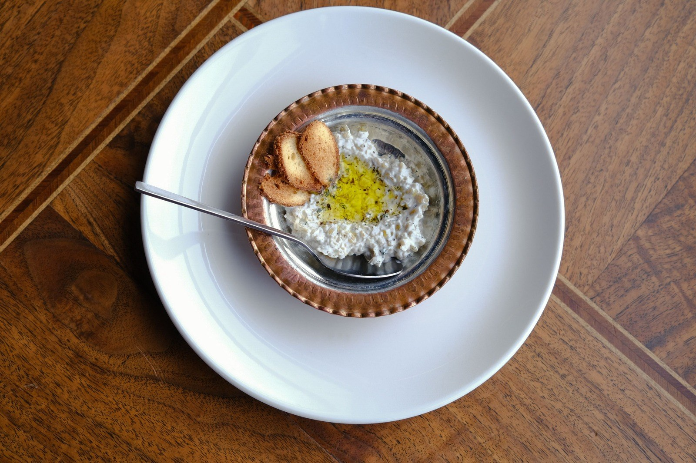
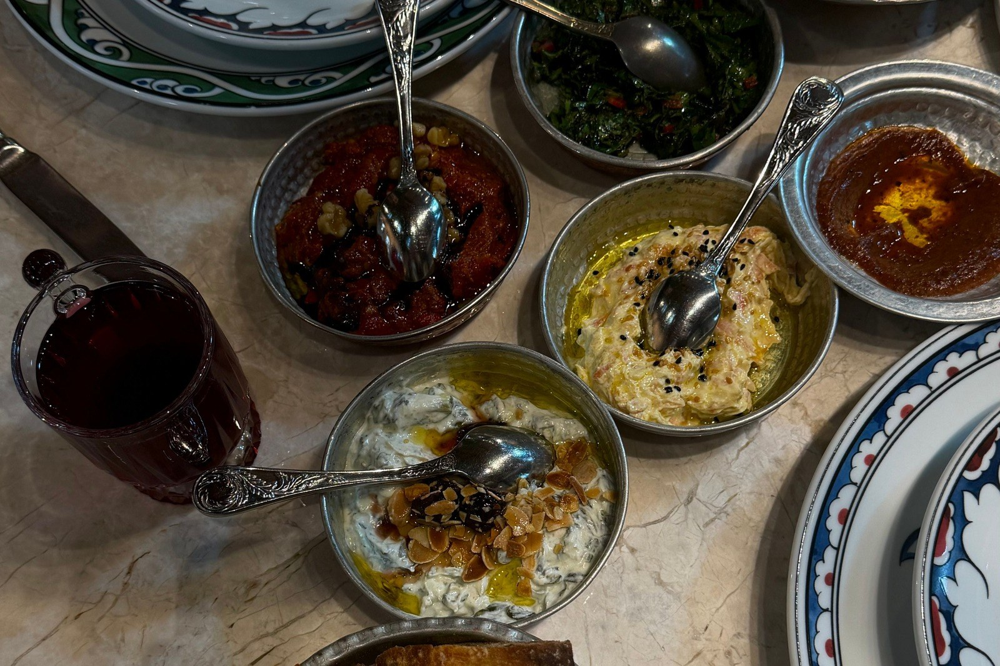
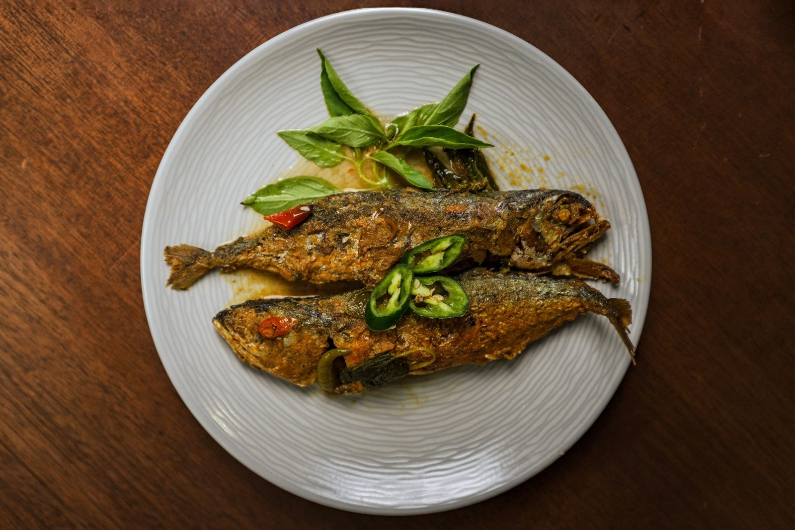

Rakı sofrası, Türkiye'de beyefendinin masaya nasıl oturduğunu gösteren en eski ritüellerden biridir. Asıl mesele şişenin üzerindeki etiket değil; kadehin nasıl doldurulduğu, mezenin hangi sırayla geldiği, muhabbetin temposu ve akşamın sabaha kalmadan, usulünce kapanmasıdır. İstanbul'un meyhanelerinde bu düzen nesillerdir aynı omurga üzerinde yürür: soğuk mezeler, yavaş yudumlar, yanında ayrı bir bardak su ve masanın ortasında paylaşılan bir sohbet.

Bu rehber, rakıyı bir beyefendi gibi servis etmek, meze kültürünün sırasını bilmek, masada neyin yapılıp neyin yapılmadığını hatırlamak ve Türkiye'de bulunan bazı premium rakıları tanımak isteyen erkekler için yazıldı. Fiyatlar, resmi üretici sayfalarında yayımlanmadığı için burada rakam uydurulmaz; güncel etiket her zaman bayiye, vergiye ve şehre göre değişir. Rakı bir ziyafet içkisidir, bir yarış değildir. Yazının sonunda sorumlu tüketime de yer var; bu metin tıbbi tavsiye yerine geçmez.

> **Kısa özet**
> - **Sıra nettir: önce rakı, sonra soğuk su, en son buz.** Buzu seyreltilmemiş rakının üzerine atmak, anason yağının düzensiz bulanmasına yol açabilir.
> - **Yanında her zaman sade, soğuk su bulunur.** Aslan sütü kadehte kalır; su bardağı akşam boyunca yudumlanır.
> - **Sofra soğuktan sıcağa kurulur:** beyaz peynir ve mevsiminde kavun, soğuk mezeler, deniz ürünü, ara sıcak, sonra balık.
> - **Tempo muhabbettir, tüketim değil.** Küçük yudum, bir çatal meze, sonra yine yudum. Shot gibi içilmez.
> - **“Şerefe” bir kez, kadeh alttan tokuşturulur.** Masada konuşulan masada kalır.
> - **Aç karnına içilmez, rakı başka içkilerle karıştırılmaz, direksiyona geçilmez.**

## Rakı Nedir ve Neden “Aslan Sütü” Denir?

Rakı, üzüm sumasının anasonla damıtılmasıyla üretilen, hacmen genellikle %45 alkollü, berrak bir içkidir. Kadehe soğuk su eklenince bembeyaz olur. Bunun sebebi bir gösteri değil, kimyadır: anasonun taşıdığı anetol alkolde çözünür, suda çözünmez; seyreltince ışığı dağıtan küçük damlacıklar ortaya çıkar. Türkçede bu görüntüye aslan sütü denir. İsim, hem rengi hem de rakının saygı isteyen bir masa içkisi olduğunu ima eder.

Göbek rakısı, damıtımın orta, en temiz kesiminden alınan üslubu anlatır. Üreticiler sıklıkla %100 yaş üzüm, ilave şeker kullanılmaması ve bakır imbikte özenli damıtımı öne çıkarır. Sofra adabı ise markadan bağımsızdır: aynı kadeh, aynı su, aynı tempo, iyi bir meze.

## Rakı Nasıl Servis Edilir: Önce Rakı, Sonra Su, En Son Buz

Servisin tek yasası, neredeyse bütün ciddi kaynaklarda aynıdır. T24'te yayımlanan Aydın Boysan metninden IWSA'daki Nilay Örnek yazısına, klasik meyhanelerin anlatımına kadar sıra değişmez: kadehe önce rakı konur, üzerine soğuk su eklenir, buz istenirse en son atılır. Bu sıra bozulursa anason yağı kadehin yüzeyinde pul pul kesilebilir; hem görünüm hem tat bozulur. Rakı buzluğa da konmaz, aynı gerekçeyle.

Uygulama sadedir. İnce, uzun bir rakı kadehi ve yanına bir su bardağı alınır. Kadehe bir iki parmak, kabaca üçte bir dolusu rakı yeter. Üzerine soğuk, sade su eklenir. Yaygın oran bir ölçü rakıya bir ya da iki ölçü sudur. Boysan, bardağa konulan rakının yarısı kadar suyu makbul sayar; Örnek, dilin alkolü en iyi yaklaşık 22 ila 25 derece civarında tadabildiğini, bu yüzden 45 derecelik bir rakıyı bire bir içmenin kaliteyi anlamayı kolaylaştırdığını yazar. İlk kez oturuyorsanız 1:2 ile başlamak ayıp değil, akıllıcadır. Sert bulunursa suyu artırmak bir zaaf değil, damak zevkidir.

Buz isteğe bağlıdır. Sofranın eskileri çoğu zaman hiç kullanmaz ya da buzu su bardağında tutar. Koyacaksanız, suyu ekledikten sonra, erimesi yavaş bir iki küp yeter. Buzu doğrudan sek rakının üzerine atmayın. Kadehin yanında duran sade su, süs değildir; rakı sofrasında saatlerce oturabilmenin başlıca sebeplerinden biridir. Yudumlar arasında o bardaktan içilir.

Rakının içine sudan başka bir şey konmaz. Nilay Örnek'in de altını çizdiği gibi, maden suyu ve diğer gazlı içecekler masa adabına uymaz; daha çabuk sarhoş ettikleri de söylenir. Şalgam bazı masalarda ayrı bir bardakta bulunabilir, ama rakının kendisine karıştırılmaz.

Meyhanede sipariş dili de sadedir. Tek ve duble, garsonun bildiği iki klasik ölçüdür; yeni oturan bir erkek, ilk kadehte tek isteyip tempoyu kendisinin ayarlamasını tercih edebilir. Evde sofra kurarken aynı kural geçerlidir: ince uzun kadehler, ayrı su bardakları, soğuk su bir karafta, buz ayrı bir kapta. Şişe dik, serin ve ışıktan uzak durur; rakı buzluğa konmaz.

Suyun da soğuk, ama kadehi şok etmeyecek kadar ölçülü olması yeter. Aslan sütünün yumuşak beyazı, suyun rakıyla usulca buluşmasının işaretidir. Bulut hemen oluşmuyorsa suyu biraz artırmak, karışımı kaşıkla çırpmak değil, beklemek gerekir.

Orijinal yazı: [T24 – Aydın Boysan](https://t24.com.tr/yasam/aydin-boysandan-raki-adabi-nedir-meyhane-masasinda-ne-konusulur-ne-konusulmaz,528450)

## Meze Kültürü: Sofranın Sırası Soğuktan Sıcağa

İyi bir rakı sofrası, mezeyi başlangıç sanmaz. Meze, şişe bitene kadar masada kalan asıl yemektir. Michelin Rehberi'nin İstanbul meyhaneleri yazısı da bunu hatırlatır: klasik bir meyhanede ana yemek zorunlu değildir; zeytinyağlılar, yoğurtlular ve deniz ürünleriyle kurulan zengin bir sofra tek başına yeter. Ocakbaşı et ve sınırlı meze üzerine kuruludur; meyhane ise meze ve balık merkezlidir.

Sıra, hafiften ağıra, soğuktan sıcağa ilerler.

İlk kadehler neredeyse her zaman **beyaz peynir ve, mevsiminde, kavunla** açılır. Tuzlu, yağlı, olgun bir Edirne ya da Ezine peynirinin yanında soğuk, tatlı kavun, sofranın klasik kapısıdır. Kavun yaz meyvesidir; kışın garsona o gün ne olduğunu sormak ayıp değil, yerindedir. Aç karnına rakı içilmez. Boysan, zeytinyağlıların midede alkolün genze gelmesini yavaşlattığını yazar; Örnek de boş mideye rakı içilmeyeceğini, illa içilecekse altlık yapılacağını söyler.

Sonra **soğuk mezeler** gelir. Haydari, fava, ezme, şakşuka, köpoğlu, zeytinyağlı enginar veya bakla, sarma, patlıcan salatası: masanın omurgası buradadır. Michelin yazısı, ilk kez giden birine peynir, bir patlıcan mezesi, bir yoğurtlu, bir zeytinyağlı ve bir baklagil mezesi seçmeyi önerir. Her şeyi bir anda istemek yerine birkaç tabakla başlamak, hem tadı hem tempoyu korur.

*Photo: Ayşe İpek / Pexels, [Pexels License](https://www.pexels.com/license/)*

**Deniz ürünü mezeleri** soğukların ardından gelir: lakerda, çiroz, deniz börülcesi, uskumru salatası, ahtapot veya levrek marine. İstanbul meyhanesinin “kral ve kraliçesi” olarak anılan topik ve lakerda, bu katmanın en karakterli tabaklarındandır.

**Ara sıcaklar** bir sonraki basamaktır: kalamar tava, tereyağında karides, midye tava, ciğer. Bir veya iki tane, paylaşarak yeter; ara sıcaklar hesabı sessizce büyüten yerdir.

Asıl balık, tezgâhtan seçilen, mümkünse bütün ızgara edilen, masada paylaşılan balıktır. Fiyatı kilosu üzerinden sorulur, ağırlığı yüksek sesle söylenir. Mevsim önemlidir: kışın hamsi, sonbaharda lüfer ve palamut klasiktir. Akşam, meyve veya peynirle, ardından çay ya da Türk kahvesiyle kapanır. Tatlı şart değildir; kavun ve peynir çoğu zaman yeter.

*Photo: Büşra Yaman / Pexels, [Pexels License](https://www.pexels.com/license/)*

Orijinal yazı: [Michelin Guide](https://guide.michelin.com/tr/en/article/dining-out/istanbul-s-meyhanes-and-mezes-where-to-try-and-what-to-eat...)

## Muhabbet ve Sofra Adabı

Rakı sofrası, uzun ve sıcak bir sohbetin bahanesidir. Boysan'ın cümlesi hâlâ geçerlidir: rakı, güneş battıktan sonra, yavaş yavaş ve muhabbet eşliğinde içilir. Küçük yudumlar alınır. Bir dikişte bir duble bitirmek makbul değildir. Her yudumun yanında bir çatal meze vardır; acele, hem tadı hem sohbeti bozar.

“Şerefe” denir ve kadehler, çoğu zamanda, alttan tokuşturulur. Genç olan ya da misafir, kadehini büyüğünün kadehinin biraz altına denk getirir; bu bir tevazu jestidir. Nilay Örnek'in aktardığı eski usule göre “şerefe,” bu masada konuşulanların bu masada kalacağına dair bir sözdür. Masaya yeni biri geldi, televizyonda gol oldu diye zırt pırt tokuşturulmaz. Bir kez yeter.

Servis de bir nezaket işidir. Örnek'in yazısında garsonun sürekli kadeh doldurmadığı, yaşça en küçük olanın saki sayıldığı, en büyüğünden icazet alınmadan içilmediği anlatılır. Başkasının kadehini doldurmak, kendi kadehinin doldurulmasını beklemek, bu masanın ritmidir. Sofradan kalkıncaya kadar kadeh değiştirilmez; kadeh o masanın şahididir. İki dubleden sonra küçük bir çay veya sade kahve molası, “ara mola,” adaba aykırı sayılmaz.

İçmeyenler için de aynı sofra kurulur. Ayran, maden suyu veya taze sıkılmış portakal suyuyla meze sırası aynı keyifle işler. Asıl incelik, içmeyeni ikna etmeye çalışmamaktır.

Ev sofrasında da meyhane temposu korunur. Televizyon açık bırakılmaz, telefon masanın ortasına yığılmaz, hesap yarışı yapılmaz. Üç dört kişiye bir şişenin bütün bir akşama yayılması gayet olağandır. Kadehi çabuk bitirdiğinizi fark ediyorsanız yanlış içiyorsunuzdur; suyu ve mezeyi artırmak, rakıyı değil, ritmi düzeltir. Ertesi gün işi, aileyi ve yolu olan bir adam, geceyi şişenin dibine kadar zorlamaz.

*Photo: Raditya Amoret / Pexels, [Pexels License](https://www.pexels.com/license/)*

Orijinal yazı: [IWSA – Nilay Örnek](https://www.iwsa.com.tr/gastronomi-kulturu/nilay-ornek-maydanoz-rakinin-gamzesidir.html)

## Türkiye'de Premium Rakı: Üç Referans Şişe

Aşağıdaki üç isim, Türkiye'de bir beyefendinin masasında sıkça anılan, üreticilerinin resmi sayfalarında ayrıntısı yayımlanan referanslardır. Fiyatlar resmi sitelerde listelenmediği için buraya rakam yazılmamıştır; 35, 70 veya 100 santilitrelik şişenin güncel etiketini gittiğiniz bayide, makro marketin reyonunda veya meyhanenin karnesinde kontrol edin.

### Tekirdağ Rakısı Gold Series (Altın Seri)

Yeni Rakı'nın resmi sayfasında Gold Series, en iyi taze üzümlerden elde edilen sumanın kaliteli anason tohumlarıyla bakır imbiklerde damıtılması ve meşe fıçılarda olgunlaştırılmasıyla anlatılır. Fıçı, şişeye altın rengini ve kendine özgü tadını verir. Hacmen alkol derecesi %45'tir; resmi piyasaya çıkış tarihi 2005'tir. 20, 35, 70 ve 100 santilitrelik şişelerde bulunur. Meşe fıçıda dinlendirilmiş, %100 yaş üzüm karakteri arayan bir masa için doğal bir başlangıç noktasıdır.

[Tekirdağ Rakısı Gold Series](https://www.yeniraki.com/tr-tr/urunlerimiz/tekirdag-rakisi-gold-series)

Üç şişe arasında seçim, bir mertebe tablosu değil, bir damak meselesidir. Meşe fıçının altın rengini ve yumuşak olgunluğunu arayan masada Tekirdağ Altın Seri doğal bir adaydır. Daha yalın, göbek kesimli, şeker ilavesiz bir karakter isteyen Efe Göbek veya Beylerbeyi Göbek'e yönelir. Önemli olan, şişeyi masanın yıldızı yapmak değil, mezeyle ve muhabbetle uyumunu denemektir. Aynı akşam birkaç markayı yarıştırmak, rakı sofrasının ritmine aykırıdır; bir şişeyi usulünce bitirmek yeter.

### Efe Göbek

Efe'nin göbek hattı, damıtımın orta (göbek) kesiminden alınan, üzüm sumasına dayalı, şeker ilavesiz üslubuyla anılır. “Göbek” kelimesi burada bir pazarlama süsü değil, damıtım dilidir: ilk ve son kesimin değil, en temiz orta akışın şişelenmesi. Resmi ürün sayfası, şişe hacimleri ve tadım notları için üreticinin kendi sitesine bakılmalıdır.

[Efe Göbek](https://www.efealkollu.com.tr/efe-gobek/)

### Beylerbeyi Göbek

Beylerbeyi, Göbek rakısını %100 taze üzüm, Kalınkoz anasonu, üç kez bakır imbikte damıtım, ilave şeker ve tarımsal etil alkol karışımı olmamasıyla tanımlar. Hacmen alkol %45'tir. Markanın tadım önerisi sadedir: klasik oran olarak üçte bir rakı, üçte iki su; daha yoğun bir içim için yarı yarıya. Buz yine en sona bırakılır. Üretici, Ege üzümünden gelen yumuşak gövdeyi kırmızı et, deniz ürünü ve Akdeniz mezeleriyle eşleştirmeyi önerir.

[Beylerbeyi Göbek](https://beylerbeyi.store/produit/gobek-rakisi/)

## Türkiye'de Premium Viski: Kısa Bir Not

Rakı sofrasının yerini viski almaz; bazı akşamlar ise, özellikle evde veya otelin barında, bir tek malt veya özenli bir harman ayrı bir zevktir. Türkiye'de Macallan, Lagavulin, Hibiki gibi şişeler duty free reyonlarında, seçili Macrocenter ve specialty içki mağazalarında, bazı otel barlarında karşınıza çıkabilir. Stok düzensizdir, ÖTV ve kur fiyatı belirler. Bu yazıda, doğrulanmamış blog listelerinden Türk lirası rakamı aktarılmamıştır. Şişeyi elinize aldığınızda etiketteki fiyat ve hacim sizin referansınızdır. Viskiyi tadacak kadar meraklı bir erkek, rakı sofrasındaki aynı erdemi buraya da taşır: yavaş içmek, yemekle içmek, ertesi sabah direksiyona geçmemek.

## Sorumlu Tüketim

Beyefendilik, kadehi dolu tutmakta değil, masayı ve kendini yönetmektedir. Yeşilay, alkole güvenli bir miktar olmadığına dikkat çeker. Rakı sofrasının kendi disiplini — yavaş tempo, sürekli meze, yanında su, geceyi şişeyle ölçmemek — sağduyunun da tarafındadır. Yine de bu bir güvenlik sınırı değildir.

Aç karnına içilmez. Rakı başka yüksek alkollü içkilerle karıştırılmaz. Bir kadeh fazla geldiyse su ve yemekle tempo düşürülür, kahramanlık yapılmaz. En önemlisi: rakı içtiyseniz direksiyona geçilmez. İstanbul'da vapur, tramvay ve bir taksi, sohbetin değerini korumanın en basit yoludur. İçmeyenlere ısrar edilmez. Alkol bir soruna dönüşüyorsa, bir hekime veya Yeşilay Danışmanlık Merkezi (YEDAM) hattına başvurmak bir zaaf değil, bir sorumluluktur.

Orijinal yazı: [Yeşilay](https://www.yesilay.org.tr/medya/makaleler/alkolun-guvenli-icilebilecek-bir-miktari-yoktur/)

## Sıkça Sorulan Sorular: Rakı Sofrası Adabı

### Rakıya önce su mu konur, rakı mı?
Önce rakı, sonra soğuk su, en son buz. Bu sıra bozulursa anason yağı pul pul kesilebilir, tadı da bozulur.

### Rakı-su oranı ne olmalı?
Bir ölçü rakıya bir veya iki ölçü su yaygındır. Bire bir, kaliteyi daha net göstermesiyle anılır; daha yumuşak bir kadeh isteyen 1:2 ile başlar.

### Rakıya buz konur mu?
Konabilir, ama sudan sonra. Birçok eski rakıcı buzu hiç kullanmaz ya da su bardağında tutar. Sek rakının üzerine doğrudan buz atılmaz.

### Rakı sofrası hangi mezeyle açılır?
Klasik açılış beyaz peynir ve mevsiminde kavundur. Ardından soğuk mezeler, deniz ürünü, ara sıcak ve balık gelir.

### “Şerefe” her yudumda söylenir mi?
Hayır. Bir kez yeter. Kadehler alttan tokuşturulur; masada konuşulanın masada kalacağına dair bir sözdür, her golde tekrarlanan bir alışkanlık değildir.

### Rakı içtikten sonra araç kullanılır mı?
Hayır. Rakı içilen bir akşamın ardından direksiyona geçilmez. Bu, sofra adabının da, sağduyunun da parçasıdır.

---

*Bu yazı, bağlantısı verilen kaynaklardaki kamuya açık bilgileri özetler; tıbbi tavsiye yerine geçmez ve içmeye teşvik niteliği taşımaz. Alkol, yasal yaştaki yetişkinlerin, kendi tercihleriyle ve sorumlulukla tüketebileceği bir içkidir.*
