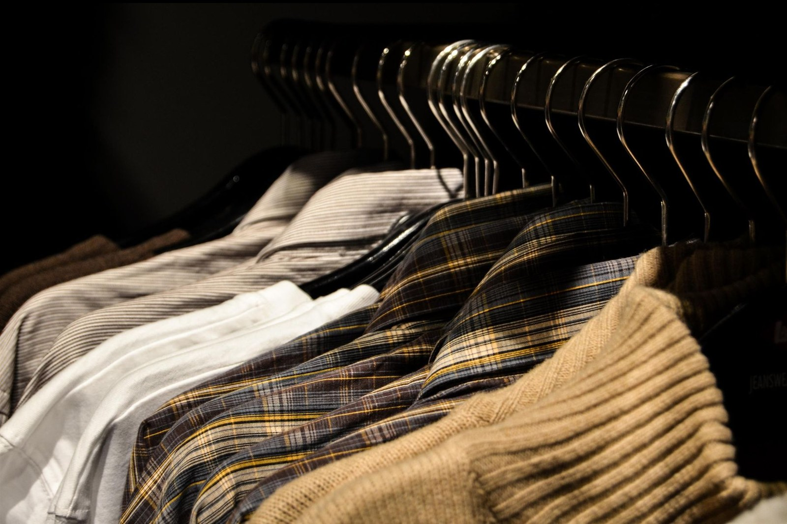

Bir beyefendinin gardırobunda en çok giyilen ama en az düşünülen parça gömlektir. Takım elbise için terziye gidilir, ayakkabı için kundura ustası aranır, saat bakıma verilir. Gömlek ise çoğu zaman aceleyle alınır, fazla sıcak suda yıkanır, yaka balenleri içindeyken ütülenir ve yakası yıprandığında yenisiyle değiştirilir. Oysa yüzü, sakalı ve kravat düğümünü en yakından çerçeveleyen şey iyi dikilmiş bir gömleğin yakasıdır.

Bu erkek gömlek rehberinde, Türkiye'deki stil kaynaklarına ve markaların kendi rehberlerine dayanarak doğru gömleği seçmenin ve yıllarca korumanın yollarını derledik: yaka tipleri, poplin, oxford ve twill kumaş farkı, kusursuz beden ölçüsü, ortama göre gömlek seçimi, yıkama ve ütü kuralları ve Vakko ile Beymen'de bulunabilecek lüks gömlek seçenekleri. Kış aylarında gömlek, kazak ve ceketin altında daha da belirleyici olduğu için konuya tam zamanında giriyoruz.

## Kısa özet

- **Gömlek seçimi üç adımdır:** önce ortama ve mevsime göre kumaşı, sonra yüz hattınızı dengeleyen yakayı, en son omuz dikişine bakarak kalıbı seçin.
- **Poplin "toplantı" der, oxford "bütün gün" der.** Kravatlı takım altında poplin, kravatsız ofiste ve hafta sonunda oxford en doğru tercihtir; twill ise ütüyü en uzun tutan dokumadır.
- **Yaka testi tek parmaktır:** ilk düğme kapalıyken boyunla yaka arasına bir parmak rahatça girmelidir.
- **Omuz dikişi omuz ucunda bitmeli,** manşet bilek kemiğini hafifçe geçmeli ve ceket altında 1–2 cm görünmelidir.
- **Bakım ömrü belirler:** yaka balenlerini çıkarın, 30–40 °C'de hassas programda yıkayın, kurutma makinesine atmayın, hafif nemliyken yakadan başlayarak ütüleyin.
- **Lüks gömlekte fark kumaşta ve işçiliktedir:** uzun elyaflı pamuk, sık dokuma, sedef düğme ve sağlam yaka telası.

## Kumaş, yaka ve kalıp: doğru gömleği seçmenin üç adımı

Görmek Lazım'ın gömlek seçimi rehberi, işin özünü çok net özetliyor: etikette "yüzde yüz pamuk" yazması tek başına bir şey söylemez, asıl farkı dokuma yaratır. Poplin ince, düz ve hafif parlaktır; resmi görünümün klasiğidir ama üç temel dokuma arasında en çabuk buruşanıdır. Oxford daha kalın ve gözeneklidir; belirgin dokusu kırışığı gizler ve kravatsız kullanımda affedicidir. Twill ise çapraz yüzeyiyle yumuşak döküm verir ve ütüyü en uzun süre tutar.

Rehber, pamuk-polyester karışımlarının daha az kırıştığını ama polyester nem emmediği için gömleğin daha az nefes aldığını da hatırlatıyor. Lüks bir gardırop için bu, saf pamuğu ya da kaliteli pamuk karışımlarını tercih etmek anlamına gelir. Beyaz ve açık tonlarda pratik bir test de öneriliyor: kumaşı satın almadan önce ışığa tutun. Fazla şeffaf bir yüzey, altına tişört giymeyi zorunlu kılar ve takım altında şık durmaz.

Yaka seçiminde ilke dengedir, benzerlik değil. Uçları birbirine yakın klasik yaka dikey bir çizgi kurar ve yuvarlak, geniş yüzleri uzatır. Uçları açık, geniş açılı yaka ise ince ve uzun yüzlerde oturaklı durur. Karar sırası da belli: önce ortamı ve mevsimi düşünüp kumaşı belirleyin, sonra yüz formunuza denge kuran yakayı seçin, en son omuz dikişini prova ederek kalıbı onaylayın. Bu sırayla alınmış bir gömlek, doğru yıkandığı ve doğru askıda durduğu sürece yıllarca duruşunu korur.

Sakallı erkekler için bir not: dolgun bir sakal, dar açılı klasik yakanın uçlarını dışarı itebilir ve gün ortasında dağınık bir görüntü yaratabilir. İtalyan yaka ya da geniş açılı yaka, sakala alan açar ve kravat düğümünü daha dengeli gösterir.

*Photo: Pixabay / Pexels, [Pexels License](https://www.pexels.com/license/)*

Kaynak: [Görmek Lazım](https://gormeklazim.com/blog/gomlek-secimi-kumas-yaka-ve-kalip/)

## Poplin mi oxford mu? Aynı pamuk, iki farklı karakter

Beyefendi'nin Stil Kulübü yazısı, poplin ile oxford arasındaki farkı bir cümleyle özetliyor: aynı beyaz renkte poplin gömlek "toplantı" der, oxford gömlek "bütün gün" der. İki kumaş da pamuktur; fark, dokuma sıklığında ve iplik kalınlığındadır. Poplin ince iplikle sık dokunur, yüzeyi pürüzsüz ve parlaklığa yakındır, dokunuşu serin ve resmidir. Kravatlı takım altında en doğru tercih poplindir. Oxford ise kalın iplikle daha gevşek dokunur, yüzeyi dokulu ve mattır, duruşu daha rahattır.

Yazı, Türkiye'nin iklimine uygun bir kullanım rehberi de veriyor. Kurumsal ofiste ceket ve kravatla poplin öndedir; ceketli ama kravatsız çalışılan bir ofiste oxford tam yerindedir. Hafta sonu, yolculuk, akşam yemeği ve ilk buluşmada oxford tek başına yeterli şıklığı verir. Türkiye'de dört mevsim giyilebilir: kalın dokusu ilkbahar ve sonbaharda tek kat, kışın kazak altında çalışır. Yazın en sıcak günlerinde ise ince poplin ya da keten daha serin kalır.

Oxford'un en bilinen modeli button-down, yani yaka uçlarının düğmeli olduğu kesimdir. Bu detay yakayı her zaman düz tutar; kravat takılmadığında bile yaka açılıp dağılmaz. Düğmesiz klasik yaka ise kravatla daha resmi ve estetik durur. Tek gömlek alacaksanız ve gününüz toplantı ile şehir arasında geçiyorsa, yazının tavsiyesi oxford yönünde. Ama iyi bir gardıropta ikisinin de yeri vardır.

Kış için ek bir öneri: dokulu oxford ya da twill gömlek, kaşmir bisiklet yaka kazak altında yakası dışarıda bırakıldığında hem sıcak hem son derece zarif görünür. Gri flanel pantolon ve koyu kahverengi süet ayakkabıyla tamamlandığında hafta sonu için kusursuz bir beyefendi kombini çıkar.

Kaynak: [Beyefendi](https://beyefendi.com.tr/stil-kulubu/oxford-gomlek-nedir)

## Doğru gömlek bedeni: omuz, yaka, kol ve göğüs

İyisi Var'ın erkek gömlek rehberi, beden konusunu dört ölçüye indiriyor ve bu ölçüler her lüks gömlek alışverişinde kontrol listesi olarak kullanılabilir.

1. **Omuz:** Omuz dikişi tam omuz ucunda, kolun başladığı noktada olmalıdır. Rehber, omzun bir terzinin kolayca düzeltemeyeceği tek yer olduğunu vurguluyor; bu yüzden gömlek seçerken önce omza bakın.
2. **Yaka:** İlk düğme kapalıyken yaka ile boyun arasına bir parmak sığmalıdır. Kravat takacaksanız bu ölçü kritiktir; sıkı yaka hem rahatsız eder hem de yakayı kıvırır.
3. **Kol boyu:** Kol düz dururken manşet bilek kemiğini hafifçe geçmelidir. Blazer ya da ceket altında manşetin bir iki santim görünmesi düzenli bir ayrıntıdır.
4. **Göğüs ve bel:** Düğmeler kapalıyken ve otururken düğmeler arasında X şeklinde çekme olmamalıdır. Fazla kumaş ise belde balon gibi toplanır.

Etek boyu için de net bir ölçü veriliyor: içe sokulacak gömleklerde etek kalçanın ortasına inmeli, dışarıda giyilecek gömleklerde kemerin biraz altında, fermuarın ortasında bitmelidir. Rehber, yıl boyu bir erkek gardırobunu taşımak için beyaz ve açık mavi iki klasik gömlek, bir oxford ve mevsime göre bir keten ya da flanel gömleğin çoğu zaman yeterli olduğunu da hatırlatıyor.

Pratik bir alışkanlık: gömleği mağazada mutlaka oturarak deneyin ve kollarınızı öne uzatın. Ayakta kusursuz görünen bir gömlek, otururken düğmeler arasında açılıyorsa ya da manşet bileğin üstüne kaçıyorsa doğru beden değildir. Kalıp seçiminde slim fit, regular fit ve rahat kesim arasında karar verirken de vücut tipinizi esas alın; geniş omuzlu ve göğüslü erkeklerde fazla dar bir kalıp, düğmelerde çekmeye yol açar.

*Photo: Jose Ricardo Barraza Morachis / Pexels, [Pexels License](https://www.pexels.com/license/)*

Kaynak: [İyisi Var](https://iyisivar.com/blog/erkek-gomlek-rehberi)

## Gömlek yaka çeşitleri: hangi yaka nerede giyilir?

Wessi'nin yaka çeşitleri rehberi, en yaygın dört yakayı ve kullanım alanlarını bir tablo hâlinde topluyor. Bu sınıflandırma, gardırop planlarken çok işe yarar.

- **Klasik yaka (point collar):** En yaygın gömlek yakasıdır. Uçlar birbirine yakındır ve aşağı doğru uzanır. Rehbere göre oval ve yuvarlak yüzlere daha uygundur, kravatla en iyi sonucu verir ve ofis ile resmi günler için idealdir.
- **İtalyan yaka (spread collar):** Uçlar birbirinden uzak ve yanlara açıktır. Windsor ve yarım Windsor kravat düğümlerine en uygun yakadır. Kravatsız giyildiğinde de sofistike görünür; hem ofiste hem düğünde kullanılır.
- **Button-down yaka:** Yaka uçları küçük düğmelerle gömleğe tutturulur. Oxford kumaşla en ikonik hâlini alır; kravatsız, hatta blazer altında bile doğal durur. Amerikan preppy stilinin ayrılmaz parçasıdır.
- **Hakim yaka (mandarin/bant yaka):** Katlanan bir yaka yoktur, yalnızca boyun çevresinde küçük bir bant bulunur. Modern ve minimal bir karakter verir; kravat takılmaz.

Görmek Lazım'ın rehberi de kravatla ilgili basit bir kural ekliyor: uçları açık yakalar hacimli düğümleri, dar klasik yakalar küçük düğümleri taşır; kravatın ucu da kemer tokasında bitmelidir. Resmi davetler ve smokin için ise ata yaka (wing collar) ve kol düğmeli Fransız manşet ayrı bir kategori oluşturur. Kış davet sezonunda, lacivert ya da gece mavisi bir takımın altında beyaz İtalyan yaka gömlek ve sade kol düğmeleri, her zaman en güvenli ve en şık seçimdir.

Kaynak: [Wessi](https://tr.wessi.com/blogs/erkek-giyim-tarzlari-blogu/erkek-gomlek-yaka-cesitleri-ve-kullanim-alanlari)

## Gömlek nasıl yıkanır? Sıcaklık, program ve yaka koruması

Giovanni Fratelli'nin gömlek bakım rehberi, kaliteli bir gömleğin yanlış yıkama sıcaklığı, sert deterjan ya da bilinçsiz ütüleme yüzünden dikişlerinin çekebileceğini, yaka formunun bozulabileceğini ve renginin solabileceğini hatırlatıyor. Önerileri şöyle:

- **Sıcaklık:** Gömlekleri 30 °C ile 40 °C arasında yıkayın. Yüksek ısı, kumaş liflerinin sıkışmasına ve gömleğin çekmesine yol açar.
- **Program:** Makinenin "Hassas" ya da "Gömlek/Bluz" programını seçin.
- **Sıkma devri:** En fazla 600–800 devir. Yüksek devir lifleri kırıştırır ve ütüyü zorlaştırır.
- **Yaka ve manşet:** Yıkamadan önce tüm düğmeleri açın, gömleği ters çevirin ve yaka balenlerini mutlaka çıkarın. Yaka kirleri için çamaşır suyu yerine yıkama öncesi lokal leke çıkarıcı ya da sıvı sabun kullanın.
- **Kurutma:** Gömlekleri asla kurutma makinesine atmayın. Yıkama biter bitmez silkeleyin, geniş omuzlu ahşap ya da plastik bir askıya asın ve doğrudan güneş almayan gölgeli bir yerde kurutun.

Görmek Lazım'ın rehberi de balen konusunda aynı uyarıyı yapıyor: çıkarılabilir yaka balenleri yıkamadan önce alınmazsa yakayı kıvırır ve zamanla yaka ucunu deforme eder. Sakal yağı ve balm kullanan erkekler için ek bir tavsiye: ürünü giyinmeden önce uygulayın, birkaç dakika emilmesini bekleyin ve yakayı iliklemeden önce çene hattını hafifçe silin. Böylece beyaz gömleğin yaka içinde yağ izi oluşmaz.

*Photo: Arnie Chou / Pexels, [Pexels License](https://www.pexels.com/license/)*

Kaynak: [Giovanni Fratelli](https://giovannifratelli.com/blog/erkek-gomlek-bakim-rehberi-yikama-utu-puf-noktalari)

## Gömlek nasıl ütülenir ve saklanır?

Aynı bakım rehberi, ütü ve saklama için de net bir sıra veriyor. Gömlek henüz tam kurumadan, hafif nemliyken ütülendiğinde kırışıklıklar çok daha hızlı açılır. Ütüleme sırası yaka, manşetler, kollar, omuz (roba), ardından ön ve arka gövde şeklindedir. Siyah, lacivert ya da füme gömlekler, kumaşın parlamaması için mutlaka tersinden ütülenmelidir.

Saklamada ise katlamak yerine askıyı tercih edin; katlanarak saklanan gömleklerde çizgi kırışıklıkları oluşur. Rehberin güzel bir ipucu var: gömleği askıya astıktan sonra en üst düğmeyi iliklemek, yaka formunun dik ve düzgün kalmasını sağlar. Dolapta gömleklerin birbirini sıkıştırmamasına ve aralarında hava dolaşımı olmasına da dikkat edin.

Lüks bir gardırop için birkaç alışkanlık daha:

- Geniş omuzlu ahşap askılar kullanın; ince tel askılar omuzda iz bırakır.
- Gömlekleri dönüşümlü giyin, her biri giyimler arasında dinlensin.
- Yaka balenlerini çamaşır sepetinin yanında küçük bir kapta saklayın; hem kaybolmaz hem de yıkamaya karışmaz.
- Yaka ve manşet uçlarına ütüyle bastırmayın; en çabuk yıpranan noktalar buralardır.
- Kuru temizlemeyi yalnızca gerektiğinde tercih edin; sık kimyasal temizlik, doğal pamuk liflerini yorabilir.

Kaynak: [Giovanni Fratelli](https://giovannifratelli.com/blog/erkek-gomlek-bakim-rehberi-yikama-utu-puf-noktalari)

## Hazır gömlek mi, ısmarlama gömlek mi?

Hazır giyimde doğru bedeni bulmak her zaman mümkün değildir. Geniş omuzlu, uzun kollu ya da boynu kalın erkekler için hazır bir gömlek, yakada iyi otururken gövdede bol kalabilir ya da tam tersi olabilir. Böyle durumlarda iki yol vardır.

İlki, iyi bir hazır gömleği terziye götürmektir. Bel daraltmak, kol boyunu kısaltmak ve etek boyunu ayarlamak, usta bir terzi için basit işlerdir. Ancak omuz ve yaka ölçüsü hatalıysa bu düzeltmeler genellikle sonuç vermez; bu yüzden hazır gömlekte önce omuz ve yakanın doğru olmasına bakın.

İkincisi, ölçüye göre ya da ısmarlama gömlektir. Bu yolda yaka yüksekliği, yaka açısı, manşet tipi, cep olup olmayacağı ve kumaş tamamen size göre seçilir. İlk siparişte tek bir gömlek yaptırıp birkaç kez giyip yıkamak, kalıbı gerçek hayatta test etmenin en akıllıca yoludur; memnun kalırsanız aynı kalıpla farklı kumaşlarda devam edebilirsiniz. Uzun elyaflı pamuklar, sık dokunmuş iki katlı iplikler ve gerçek sedef düğmeler, ısmarlama bir gömleği yıllarca taşıyacak ayrıntılardır.

## Kışın gömlek kombinleri: takım, kazak ve davet

Kış, iyi bir gömleğin en çok fark edildiği mevsimdir; çünkü daha fazla katmanın altında giyilir ve yaka çevresinde daha yakından değerlendirilir. Her zaman işe yarayan birkaç kombin:

- **Beyaz İtalyan yaka poplin, lacivert takım, koyu kravat:** toplantı odasının klasiği. Geniş sivri yakalı ceketle daha yüksek yakalı bir gömlek seçin.
- **Açık mavi twill, gri flanel takım, bordo ya da kahverengi örgü kravat:** kışın en sıcak görünen kombini; kır düşmüş sakallarla özellikle uyumludur.
- **Oxford button-down ve kaşmir kazak:** yaka uçlarını kazağın dışında bırakın; düğmeli uçlar kravatsız da düzgün durur.
- **Kol düğmeli Fransız manşet:** akşam davetleri için koyu takım ve sade kol düğmeleriyle. Kol düğmeleri küçük olsun; asıl yıldız gömlek kalmalı.

## Ürün seçkisi: Türkiye'de bulunabilen lüks erkek gömlekleri

- **Vakko Erkek Beyaz Oxford Gömlek.** Vakko'nun beyaz oxford gömleği, dokulu oxford kumaşı Türk lüks markasının çizgisiyle buluşturan, kravatsız ofis ve hafta sonu için ideal bir temel parça. [Vakko](https://www.vakko.com/gomlek/beyaz-oxford-gomlek-p-M301394546-0012)
- **Vakko Erkek Beyaz Exclusive Twill Gömlek.** Ütüyü uzun tutan twill dokusuyla, takım elbise altında ve uzun iş günlerinde zarif bir seçenek. [Vakko](https://www.vakko.com/gomlek/beyaz-exclusive-twill-gomlek-p-M301394632-0012)
- **Vakko Erkek Beyaz Balıksırtı Pamuk Gömlek.** Hafif dokulu balıksırtı kumaşı, kışın flanel takımlar ve kaşmir kazaklarla çok iyi çalışır. [Vakko](https://www.vakko.com/gomlek/beyaz-baliksirti-pamuk-gomlek-p-M301394548-0012)
- **Eton gömlekler, Beymen.** İsveçli gömlek ustası Eton'un koleksiyonu, Beymen'in marka sayfasında güncel modelleriyle yer alıyor; geniş kalıp seçenekleriyle klasik iş gömleği arayanlar için güçlü bir adres. [Beymen](https://www.beymen.com/tr/brand-eton-3128)

## Sıkça sorulan sorular

### Erkek gömleğinde en çok yönlü yaka hangisi?

İtalyan (geniş açılı) yaka. Kravatla da kravatsız da düzgün durur, Windsor düğümü taşır ve sakallı erkeklerde yakaya alan açar. Günlük şıklık için button-down yaka idealdir.

### Poplin ile oxford gömlek arasındaki fark nedir?

Poplin ince iplikle sık dokunur, pürüzsüz ve resmidir; kravatlı takım altında tercih edilir. Oxford daha kalın ve dokuludur, kırışığı gizler; kravatsız ofis ve hafta sonu için uygundur.

### Gömlek yakası ne kadar bol olmalı?

İlk düğme kapalıyken boyunla yaka arasına bir parmak rahatça girmelidir. Daha bol yaka kravatın altında çöker, daha dar yaka ise gün boyu rahatsız eder.

### Ceket altında gömlek manşeti ne kadar görünmeli?

Yaklaşık 1–2 cm. Manşet bilek kemiğini hafifçe geçmeli ve kollarınızı uzattığınızda yukarı kaçmamalıdır.

### Gömlek kaç derecede yıkanmalı?

Etikete uyun; genel öneri 30–40 °C arasında hassas programdır. Yaka balenlerini çıkarın, düğmeleri açın ve kurutma makinesi kullanmayın.

### Gömlek nasıl ütülenir?

Hafif nemliyken ve şu sırayla: yaka, manşetler, kollar, omuz, ön ve arka gövde. Koyu renkli gömlekleri tersinden ütüleyin, yaka uçlarına bastırmayın.
