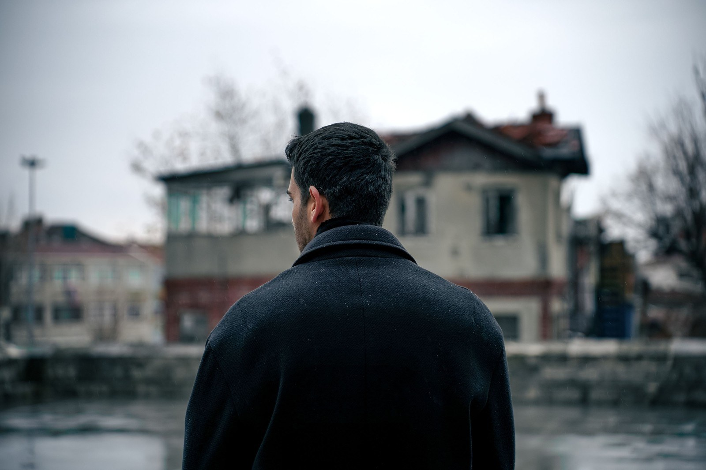
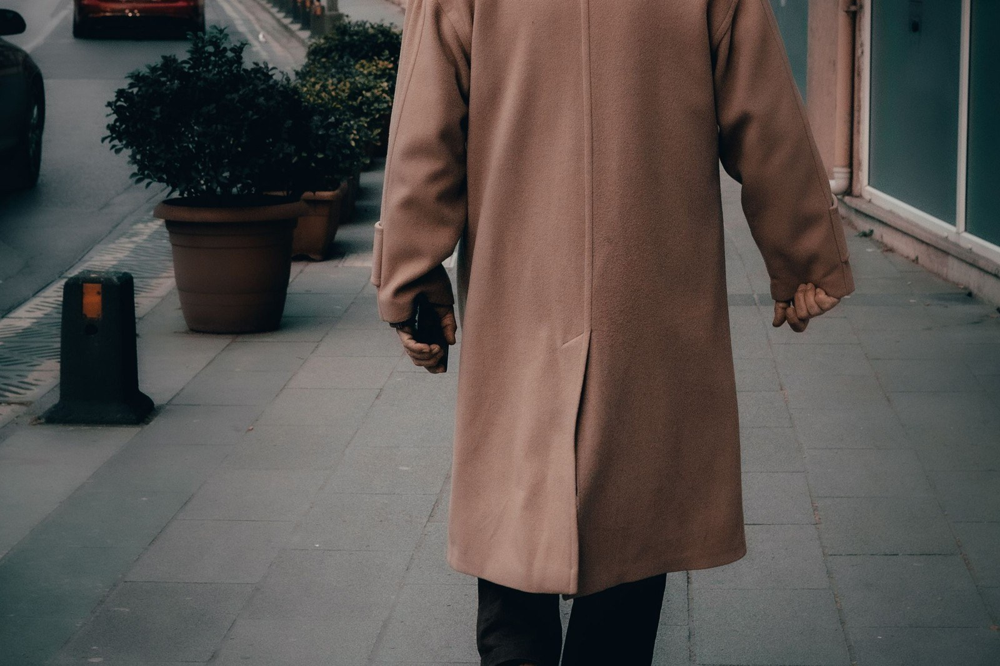
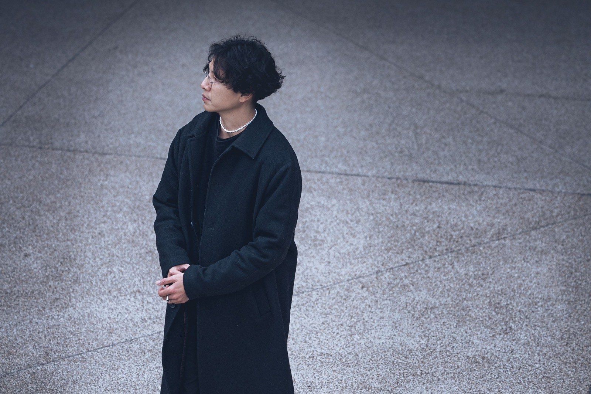

İstanbul kışı New York kadar sert değildir, ama ıslaktır ve rüzgârı kemirir. Ocak ayında şehirde gündüz sıcaklığı çoğu zaman 5 ila 11 °C arasında gezer; yağmur ve poyraz, ince bir kabanı çabuk ele verir. Ankara'da gece sıfırın altına inen günler daha sıktır. Bu iklimde beyefendinin asıl meselesi, vitrindeki en kalın paltoyu almak değil, takım elbisenin üzerine oturan, lacivert ya da antrasit bir kumaşla yıllarca taşınacak doğru kesimi seçmektir.

Nişantaşı'nda bir öğle yemeği, Levent'te bir toplantı, Beyoğlu'nda akşam yemeği: palto, o günün ilk ve son cümlesidir. 2026 kışında Türkiye'de bu cümleyi kurmak için Chesterfield'den deve tüyü paltoya, kaşmirden yün-kaşmir karışımına kadar klasik bir sözlük yeter. Fiyatlar yalnızca incelenen sayfalarda göründüğü biçimiyle yazılmıştır.

## Kısa özet

- **İlk palto lacivert veya antrasit olmalı ve takım ceketini örtmeli.** GQ Türkiye, etek ucunun diz altına, mümkünse kaval kemiğinin ortasına kadar inmesini ister. Hürriyet'in klasik palto rehberi de aynı ölçüyü verir: diz hizasının biraz altı; diz üstü kısa palto, özellikle içine ceket giyildiğinde silueti bozar.
- **Kesimleri ayrıntılarından tanıyın.** Chesterfield, çoğu zaman gizli düğmeli (fly front) ve kimi örneklerde kadife yakalı bir şehir paltosudur. Deve tüyü palto, Amerikan polo coat geleneğinden gelir; kruvaze, yama cep ve bel kuşağıyla tanınır. British Warm ağır bir asker paltosudur; Ulster uzun ve yakası kalkabilen bir kır paltosudur; peacoat ise daha kısa ve gündeliktir.
- **Gramaj, lif kadar önemlidir.** Çok ince bir kumaş İstanbul'un nemli soğuğunda yetersiz kalabilir; aşırı ağır bir İngiliz meltonu ise 8 °C'lik bir günde fazla gelebilir. Orta gramajlı, iyi sıkıştırılmış bir yün veya kaşmir, boğazın nemi için çoğu zaman daha akıllıdır.
- **Etiketteki "kaşmir" oranını okuyun.** Yüzde 7 kaşmir, kumaşın elini ancak fısıldar. Yüzde 50 veya yüzde 100 kaşmir başka bir evrendir. Karışımda poliamid varsa, bunu da görmezden gelmeyin.
- **Peacoat, takım elbisenin üzerine diz boyu paltonun yerini tutmaz.** Kalça hizasında duran bir denizci kabanı, ceketin etek ucunu açıkta bırakır.
- **Türkiye'de ölçü, Nişantaşı ve büyük mağazaların güncel etiketidir.** Vakko, Beymen, Network Limited ve Damat Tween'in sayfalarında görünen fiyatlar aşağıdadır; Kiton gibi evler Beymen'de durur.

## Klasik Kesimler: Chesterfield'den Peacoat'a

Palto adları ülkeden ülkeye değişir. Terzi "Chesterfield" demeyebilir; "mono yaka, gizli düğme, diz altı, lacivert kaşmir" dediğinizde ise ne istediğiniz anlaşılır. Önemli olan isim değil, parçaların bir araya gelişidir.

### Chesterfield

Chesterfield, takım elbisenin üzerine giyilen şehir paltosunun adıdır. 19. yüzyılda Earl of Chesterfield'e bağlanan bu kesim, bel dikişi olmayan, alttaki ceketi sıkmayan, biraz daha rahat bir dış katman olarak doğmuştur. Hürriyet'in palto rehberi de bunu "bir centilmenin en klasik günlük paltosu" diye tanımlar: bel dikişi yoktur, ilk modellerinde yakasında kadife bulunur, kumaş yün veya kaşmirdir, renk çoğunlukla lacivert, koyu gri veya siyahtır. Rehber, siyah kadife yakalı Chesterfield'i akşam kıyafeti ve smokinle de kullanılabilecek, resmi toplantılar için en sofistike erkek paltosu olarak gösterir.

Orijinal makale: [Hürriyet](https://www.hurriyet.com.tr/kelebek/palto-rehberi-39279545)

Bugünün vitrininde kadife yaka şart değildir. Aynı ailenin sade, mono yakalı, lacivert veya antrasit, diz altına inen tek sıra düğmeli hali, iş gününün asıl paltosudur. Düğmeler bir plaka altında gizleniyorsa (fly front) ön yüz daha sakin durur.

### Crombie ve tek sıra düğmeli topcoat

Crombie önce bir kumaşçı evinin adıdır. J. & J. Crombie 1805'te Aberdeen'de kurulmuş, o kadar yerleşmiştir ki Oxford sözlüğü "Crombie"i bu evin ürettiği bir palto türü olarak tanımlamıştır. Sokak dilinde kelime, diz hizasında veya hemen üstünde biten, kadife yakasız, koyu ve sıkı bir yün paltoyu da anlatır. Türkiye'de vitrinde "Crombie" etiketi aramaktan çok, o sade, ağır, tek sıra düğmeli şehir paltosunun kendisini aramak daha doğrudur.

### Deve tüyü palto ve polo coat

Deve tüyü, hem bir lif hem de gevşekçe kullanılan bir renk adıdır. Asıl deve tüyü palto, baktriyan devenin alt tüyünden dokunur; eli kaşmire yaklaşır, aşınmaya karşı ise çoğu zaman daha dayanıklı kabul edilir. Renk, açık kumludan koyu karamele kadar doğal bir skalada durur. Amerikan polo coat'u bu kumaşın ve bu rengin kruvaze, yama cepli, arkası kuşaklı, manşeti katlanan halidir. Lacivert ve gri takımın, kahverengi ayakkabının üzerine kolayca oturur; resmiyet olarak koyu bir Chesterfield'den bir basamak daha rahattır.

Türkiye'de "deve tüyü" bazen yalnızca rengi ifade eder. Hürriyet rehberi de bunu hatırlatır: gerçek deve tüyü kumaş seyrektir, sözcük çoğu zaman tonu anlatmak için kullanılır. Etiketteki lif bileşimini okumak bu yüzden şarttır. Deve rengi bir yün palto da çok güzel olabilir; deve tüyü olduğunu iddia etmek başka iştir.

### British Warm

British Warm, 20. yüzyıl başının asker paltosundan sivil hayata geçmiş, kruvaze, çoğu zaman deri düğmeli, kimi örneklerde apoletli, ağır bir meltondur. Geleneksel rengi kumlu, putty ya da deve tüyüne çalan bir ton olsa da lacivert de yaygındır. Kumaşın gramajı şehir paltosundan ayrı bir sınıftadır; gerçek bir kış günü, rüzgârlı bir Boğaz geçişi veya Ankara'nın ayazı için düşünülmüştür. İstanbul'un 8 °C'lik, nemli bir öğleden sonrası için ise çoğu zaman fazla palto olur. İkinci palto olarak anlamı vardır; ilk palto olarak lacivert bir şehir kesimi daha çok iş görür.

### Ulster

Ulster, uzun ve kır karakterli kuzenidir. Yakası rüzgâra karşı yukarı kalkacak biçimde kesilir; palto genellikle kruvaze ve kuşaklıdır, kumaş çoğu zaman ağır bir tweeddir. Tarihî örneklerinde kısa bir pelerin de bulunur. Takımın üzerine, kumaş yeterince koyu ve boy yeterince uzunsa giyilebilir; karakteri yine de şehirden çok yolculuğa ve hava muhalefetine aittir.

### Peacoat

Peacoat, bu rehberin en kısa paltosudur ve bu bilinerek alınmalıdır. Çift sıra düğmeli, geniş yakalı, kalça ile üst uyluk arasında biten, ağır lacivert bir meltondur; kökeni denizcilere dayanır. Örme kazak ve flanel pantolonla çok iyi durur. Takım ceketinin etek ucunu örtmez. Diz boyunda bir Chesterfield veya deve tüyü palto dururken, peacoat'u onun yerine koymak kesim hatasıdır.

## Kumaş, Lif ve Gramaj

Bir paltoda ısı; lif, dokuma ve her şeyden önce gramajdan gelir. Çok ince bir kumaş, üzerine ceket giyildiğinde bile İstanbul'un ıslak soğuğunu tutmayabilir. Çok ağır bir kumaş ise metro, ofis ve akşam yemeği arasında sizi terletebilir. Özel dikim palto üzerine yazan Okan Ateşci, kumaş seçiminde yalnızca renge değil, lif içeriğine ve gramaja bakılmasını, yüzde 100 yün, kaşmir veya yün-kaşmir karışımlarının ısı yalıtımı ve nefes alırlık açısından öne çıktığını belirtir. Çok ince kumaşın kışın yetersiz, çok ağır kumaşın mevsim geçişinde fazla gelebileceğini de ekler.

Orijinal makale: [Okan Ateşci](https://okanatesci.com/ozel-dikim-palto-nasil-olmalidir/)

Kaşmir, aynı gramajda sıradan koyun yününden daha yumuşak ve çoğu zaman daha sıcaktır; dökümü de daha sessiz bir lüks taşır. Buna karşılık bakımı daha naziktir. Deve tüyü, benzer bir el ve biraz daha dayanıklı bir kumaş arayan için klasik alternatiftir. Sıkı bir melton veya compact bir yün, lacivert şehir paltosunun ve British Warm'un asıl işçisidir.

Karışımlarda oranı okumak gerekir. Vakko'nun stoktaki bazı lacivert palto modelleri yüzde 93 koyun yünü ve yüzde 7 kaşmirdir: kaşmir burada bir imza, kumaşın asıl gövdesi yündür. Aynı evin kapüşonlu uzun paltosunda oran yüzde 50 yün, yüzde 50 kaşmire çıkar. Beymen Club ve Network Limited'in bazı modelleri yüzde 100 kaşmir keçi yünü taşır. Damat Tween'de hem yüzde 100 kaşmir hem de içinde poliamid bulunan karışımlar vardır. "Kaşmir palto" demek, tek başına yeterli değildir.

İstanbul'un ciddi terzilerinde kumaş defterinde Loro Piana ve Vitale Barberis Canonico adları da görünür. Bu evlerin palto kumaşlarında, uluslararası kumaş defterlerinde sıkça 480 ila 620 gram civarı ağırlıklar görülür; saf kaşmir twill ve düz kumaşlar çoğu zaman bu skalanın alt-orta bandında, çift yüzlü kaşmirler daha yukarıda durur. Sipariş verirken sayıyı sorun, kumaşı elle yoklayın ve paltoyu ceketinizin üzerine giyerek dökümüne bakın.

*Photo: Oktay Köseoğlu / Pexels, [Pexels License](https://www.pexels.com/license/)*

## Takım Elbise Üzerine Kalıp ve Boy

Palto, takım ceketinin üzerine rahatça oturmalı, yürürken ve otururken gerilmemeli, omuzda yine de bir terzilik çizgisi bırakmalıdır. GQ Türkiye bu konuda keskindir: etek ucu uyluk ortasında biten palto, "skinny-suit döneminden kalma bir fosil"dir. Palto ne kadar uzunsa bacak o kadar sıcak kalır, pantolon kar ve çamurdan o kadar korunur. Doğru boy, diz altına, mümkünse kaval kemiğinin ortasına kadar iner. Bu uzunluk, gövdeyi hoş bir oranda böler; uyluk hizasında kesilen bir palto ise silueti bozar.

Orijinal makale: [GQ Türkiye](https://gq.com.tr/erkek-paltosu-ne-kadar-uzun-olmali)

Hürriyet rehberi aynı prensibi merceğe alır. Palto mutlaka ceketle denenmelidir; ceket veya süveter için pay bırakılmalı, kollar ceket kollarından biraz daha uzun seçilmeli, bileği 1,5–2 santimetre geçmeli, gömlek ve ceket kolu paltonun altından görünmemelidir. Boy, dizden biraz aşağıda olmalı; daha uzun isteniyorsa dizin 15–20 santimetre altına inebilir. Diz üstü kısa palto, şişman ve hantal bir görünüm verir. Yırtmacın derinliği de önemlidir: rüzgâhta açılıp pantolonun basenini gösteren sığ bir yırtmaç tavsiye edilmez.

Omuz sakin durmalı, alttaki ceketten bir miktar daha geniş olmalıdır. Göğüs ve kol başı, düğmeler gerilmeden bir ceket veya kalın bir triko alacak kadar pay bırakmalıdır. Denemeyi gömlekle değil, gerçekten giydiğiniz ceketle yapın. Yürüyün, oturun, kolunuzu kaldırın, önü ilikleyin. Yaka çökerse veya sırt kürek kemiklerinde gerilirse palto dar demektir.

*Photo: Musa Ortaç / Pexels, [Pexels License](https://www.pexels.com/license/)*

## Lacivert, Antrasit ve Deve Tüyü

Üç renk, bir ömürlük gardıroba yeter. Lacivert birincidir: gri ve lacivert takımın, kahverengi ve siyah ayakkabının üzerine sessizce oturur, kendini ilan etmez. Antrasit, biraz daha resmi komşusudur; koyu bir takımla ve tek sıra düğmeli bir şehir kesimiyle çok iyi durur. Siyah, gün ışığında sertleşebilir; akşam için yeri vardır, ancak ilk palto olarak en çok yönlü seçim değildir.

Deve tüyü, klasik çizgiden ayrılmadan gardırobu aydınlatan tek sapmadır. Gri flanel pantolonun üzerinde, kahverengi deri ayakkabıyla, kruvaze bir kesimde özellikle güzel durur. Orta, sütlü bir deve tüyü, bağıran sarı bir tondan daha uzun ömürlüdür. Kahverengi, haki ve belirgin tweedler ikinci veya üçüncü paltonun işidir.

## Türkiye'de Evler ve Etiket Fiyatları

Ölçü, Nişantaşı'ndaki evlerin ve büyük mağazaların güncel sayfalarıdır. Vakko ve Beymen'in Abdi İpekçi ve çevresindeki mağazaları, Zorlu Center ve İstinye Park bu alışverişin doğal duraklarıdır. Beymen ürün sayfalarında, yeni sezon hazır giyimde ücretsiz tadilat da belirtilir: omuz doğruysa, etek ve kol payı mağazada netleştirilebilir.

[Vakko'nun lacivert yün/kaşmir paltosu](https://www.vakko.com/palto/lacivert-yun-kasmir-palto-p-M401191763-0041) (ürün kodu M401191763), yüzde 93 koyun yünü ve yüzde 7 kaşmir dokuma kumaştan, düğme kapamalı ve yan ceplidir. Sayfada fiyat ₺129.990 üzerinden ₺71.990 olarak görünmektedir. [Kapüşonlu uzun palto](https://www.vakko.com/palto/kapisonlu-uzun-palto-p-M403534405-0002) ise yüzde 50 koyun yünü, yüzde 50 kaşmirdir ve sayfada ₺199.950 üzerinden ₺99.990 olarak yer alır; kapüşon, klasik Chesterfield'den daha çağdaş bir okumadır, kaşmir oranı ise daha yüksektir. Evin lacivert, kruvaze yakalı, yüzde 100 kaşmir paltosu (M403534392) yazım sırasında stokta görünmemiş, sayfada fiyat da yer almamıştır; model vardır, rakam uydurulmamıştır.

Beymen'de hem evin kendi çizgisi hem de İtalyan evler durur. [Beymen Club Premium Siyah Kaşmir Palto](https://www.beymen.com/tr/p_beymen-club-premium-siyah-kasmir-palto_1827422), yüzde 100 kaşmir keçi yünüdür; sayfada 50.950 TL üzerinden 27.495 TL olarak görünür. [Kiton Mavi Yün Palto](https://www.beymen.com/tr/p_kiton-mavi-yun-palto_1803686) Beymen'de 444.950 TL üzerinden 249.950 TL olarak listelenmiştir. Başlık "yün palto" demektedir; aynı sayfadaki bileşim alanı ise "%100 Kaşmir Keçisi Yünü" yazar. Satın almadan önce etiketi ve sayfayı birlikte doğrulamak gerekir. Bu, Türkiye'de hazır giyim palto pazarının en üst bandıdır.

Network'ün kendi sitesinde [Limited Siyah Kaşmir Palto](https://www.network.com.tr/limited-siyah-kasmir-palto-p-193225) 2026 Sonbahar/Kış sezonunda, yüzde 100 kaşmir, slim fit, mono yaka ve kapaklı cep ile yer alır. Fiyat 83.949,00 TL üzerinden 50.349,00 TL olarak görünmektedir. Limited çizgisi, evin daha seçilmiş kumaşlarını toplar. Daha erişilebilir Network palto modellerinde yün yanında poliamid de çıkabilir; o yüzden Limited'deki yüzde 100 kaşmir kaydı özellikle değerlidir.

Damat Tween, daha geniş bir coğrafyada duran evdir. [Slim Fit Fındık Kahve Düz Palto](https://www.damattween.com/damat-slim-fit-findik-kahve-duz-palto-8683408515776/) sayfada 29.950 TL ve yüzde 100 kaşmir olarak görünür. Aynı evin kaşmir-yün karışımlı palto rafında 19.950 TL'lik modeller de vardır; bazılarının bileşiminde poliamid bulunur. Yine etiketi okumak, "kaşmir" sözcüğüne güvenmekten iyidir.

Brioni ve Kiton gibi evleri Beymen katında denemek, İstanbul'da bu seviyenin en doğrudan yoludur. Stok ve fiyat haftadan haftaya değişir; yukarıdaki rakamlar yalnızca anılan sayfalarda görünenlerdir.

*Photo: Manuel Schlichter / Pexels, [Pexels License](https://www.pexels.com/license/)*

## Bakım ve Saklama

İyi bir palto, giyilmekten çok kötü bakımdan yıpranır. Vakko'nun palto etiketleri nettir: makinede yıkanmaz, ağartıcı kullanılmaz, tamburda kurutulmaz; kuru temizleme yapılabilir, 150 °C'ye kadar ütülenebilir. Sürtünen bölgelerde tüylenme olabileceği de yazılır. Network Limited'in yüzde 100 kaşmir paltosunda ütü tavanı 110 °C'dir; yine yıkanmaz, ağartılmaz, tambur kullanılmaz, kuru temizleme yapılabilir.

Beymen Club, yüzde 100 kaşmir palto sayfalarında daha ayrıntılı bir yol çizer. Temizlik için soğuk suda, uygun bir yün şampuanıyla el yıkama veya profesyonel kuru temizleme önerilir; yıkama sonrası palto sıkılmadan, temiz bir yüzeyde serilerek kurutulmalıdır. Saklarken doğrudan güneş, ısı ve nemden uzak durulmalı; kaşmir ürünler uzun süre askıda bırakılmamalı, formunu koruması için katlanarak, tercihen pamuk bir torba içinde tutulmalıdır. Oluşabilecek doğal tüylenme için nazik bir kaşmir tarağı yeterlidir.

VIP Terzi'nin kaşmir kaban ve palto bakımı yazısı da aynı disiplini ev haline getirir: doğal kıllı, yumuşak bir giysi fırçasıyla haftada bir, yukarıdan aşağı, kısa ve hafif hareketlerle fırçalamak; sert fırçadan ve yuvarlak hareketlerden kaçınmak. Doğru bakımla kaşmir bir kabanın on yıldan uzun giyilebileceğini belirtir.

Orijinal makale: [VIP Terzi](https://vipterzi.net/blog/kasmir-kaban-bakimi/)

Islanan palto, radyatörün üstüne veya güneşe değil, geniş omuzlu tahta bir askıya asılarak kendi kendine kurumalıdır. Sezon sonunda, gerekiyorsa temizletilip nefes alan bir pamuk kılıfta, sedirle birlikte serin ve kuru bir dolaba kalkmalıdır. Kuru temizlemecinin naylon poşetinde yaz geçirmek, kumaşa iyilik etmez. Çanta askısı ve emniyet kemerinin sürtündüğü yerlerde oluşan boncuklar bir kaşmir tarağıyla alınır; jilet kumaşı keser.

## Sıkça Sorulan Sorular

### Palto ile pardösü arasında fark nedir?

Klasik dilde pardösü çoğu zaman daha ince ve daha hafif, palto ise kışın asıl, daha ağır dış katmandır. Vitrinde iki sözcük zaman zaman birbirinin yerine kullanılır. Karar, isimden değil, kumaşın gramajından, etek boyundan ve paltonun ceketi örtüp örtmediğinden verilmelidir.

### Erkek paltosu ne kadar uzun olmalı?

Takımın üzerine giyilecek palto diz altına inmelidir. GQ Türkiye, mümkünse kaval kemiğinin ortasını işaret eder. Hürriyet, dizin biraz altını esas alır; daha uzun istenirse 15–20 santimetre daha inilebileceğini söyler. Uyluk ortasında biten palto, ceketin altına girdiğinizde oranı bozar.

### İstanbul kışı için hangi gramaj yeter?

İstanbul'da kış çoğu zaman 5–11 °C arasında, nemli ve rüzgârlıdır. Orta gramajlı, sıkı bir yün veya kaşmir, kaliteli bir astarla çoğu gün yeter. Ankara ve Doğu Anadolu'nun ayazı için daha ağır bir yün, hatta British Warm karakterinde bir kumaş anlam kazanır. İlk paltoyu İstanbul'a göre alırken bile, kumaşı elle yoklamak etiket okumaktan iyidir.

### Peacoat takım elbisenin üzerine giyilir mi?

Ceket kısaysa ve peacoat göğüste rahatsa zorlanarak giyilebilir; etek ucunu örtmez ve oran bozulur. Takım için diz boyu Chesterfield, sade bir tek sıra palto veya deve tüyü palto alın, peacoat'u triko ve flanelle bırakın.

### Türkiye'de iyi bir kaşmir palto ne kadara duruyor?

İncelenen sayfalarda Damat Tween'in yüzde 100 kaşmir paltosu 29.950 TL, Network Limited'in siyah kaşmir paltosu 50.349 TL (83.949 TL üzerinden), Beymen Club'un yüzde 100 kaşmir paltosu 27.495 TL (50.950 TL üzerinden), Vakko'nun yüzde 50 kaşmir kapüşonlu uzun paltosu ₺99.990 (₺199.950 üzerinden), Kiton'un Beymen'deki paltosu ise 249.950 TL (444.950 TL üzerinden) olarak görünmüştür. Bu rakamlar hareket eder. Siparişten önce sayfayı yeniden kontrol edin.

### Kaşmir palto yazın nasıl saklanır?

Gerekiyorsa temizletilir, sonra nefes alan pamuk bir kılıfta, sedirle birlikte, karanlık, serin ve kuru bir yerde tutulur. Beymen Club'un uyarısı yerindedir: kaşmir uzun süre askıda bırakılmamalı, formunu koruması için katlanarak saklanmalıdır. Kuru temizlemecinin plastiğinde sezon geçirmeyin.
