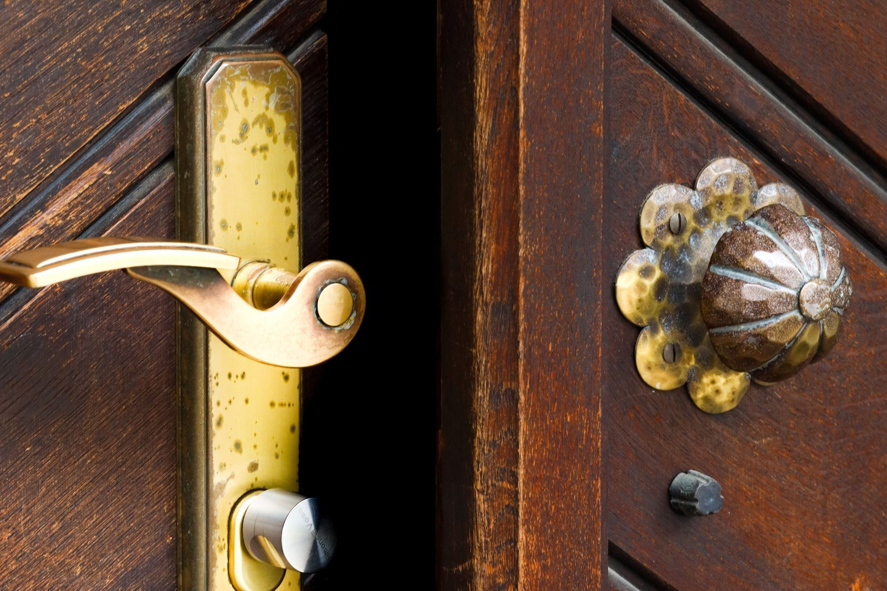
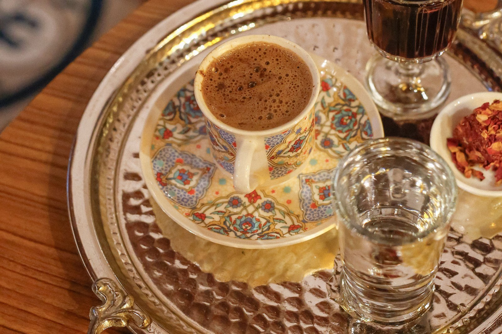

Beyefendilik, Türkiye'de ithal bir poz değil, köklü bir ölçü meselesidir. İyi bir evde, iyi bir iş yemeğinde veya bir bayram sabahı büyüklerin kapısında, adamı asıl belli eden şey kumaşın markası değil, odaya nasıl girdiği, kimi nasıl selamladığı ve yanında çalışanlara nasıl baktığıdır. Bu yazı sofra düzenini, çatal bıçağı ve hesabı kimin ödeyeceğini bir yana bırakıyor. Konu, toplum içindeki genel davranıştır: ilk izlenim, tanıştırma ve tokalaşma, büyükleri selamlama, isimleri hatırlamak, sohbet, dakiklik, telefon, ev sahibi ve misafir olmak, bayram ziyareti, Türk kahvesi ikramı, hizmet edenlere saygı, vakar ve dijital nezaket.

## Kısa özet

- **İlk izlenim, bakımlı ve sakin bir gelişle kurulur.** Ayakkabı, yaka ve el; eşikte telefonuna bakmadan odaya girmek.
- **Selam geciktirilmez.** Küçük büyüğü, gelen evdekileri selamlar; bayan veya yaşça büyük elini uzatmadıkça tokalaşmaya zorlanılmaz.
- **Büyüklerin hatırı ayrıdır.** Bayramda ve aile ziyaretinde el öpmek bir saygı ifadesidir; iş hayatında ise karşılıklı rıza ve ölçü esastır.
- **İsim bir kez doğru söylenir.** Unutulursa telâşsızca yeniden sorulur; "siz" hitabı, davet edilmeden bırakılmaz.
- **Sohbet dinlemekle yürür.** Sürekli kendi hikâyesini anlatmak, özel meseleyi kalabalıkta konuşmak ve başkasının evinde tartışma açmak beyefendiliğe aykırıdır.
- **Randevu saatine uyulur.** "Türk saati" bir beyefendi için mazeret değildir; gecikecekse ev sahibi bir kez, net bir saatle haberdar edilir.
- **Misafirlikte telefon cebinde kalır.** Ev sahibi kahveyi nasıl içtiğinizi hatırlar, suyu ve lokumu düzgün sunar; misafir de ufak bir hediye ve ertesi gün bir teşekkür bırakır.

## İlk İzlenim: Sözden Önce Ne Anlaşılır

Bir odaya girerken adam daha konuşmadan okunur. Temiz bir ayakkabı, oturan bir ceket omzu, düzgün bir yaka ve kuru, bakımlı bir el, İstanbul'da da Ankara'da da hâlâ ilk ölçüye girer. Eşikte telefonunu kontrol ederek, nefes nefese veya özür dilemeye hazır bir yüzle girmek, odayı bekletmek demektir.

Ayağa kalkmak, Türkiye'de de saygının en sade biçimidir. Yeni biri odaya veya masaya katıldığında, özellikle yaşça büyük biri geldiğinde, oturduğu yerden el uzatmak ağır durur. Yer dar değilse ve sağlık elveriyorsa, kişi ayağa kalkar, yüzünü döner, selamı tamamlar. Kapıdan içeri buyur edilmeden, meraklı bakışlarla evin içini taramadan durmak da aynı disiplinin parçasıdır.

Orijinal yazı: [Görgü ve Nezaket Kuralları – EBA](http://img.eba.gov.tr/952/83f/b1a/884/d30/1d4/780/92d/420/d1a/288/394/280/4d8/015/95283fb1a884d301d478092d420d1a2883942804d8015.pdf)

## Selamlaşma, Tanıştırma ve Tokalaşma

Selam, Türkiye'de yaşa, makama ve ortama göre incelik taşıyan bir davranıştır. Verilen selamı almak geciktirilmez; "sen" değil, davet edilene kadar "siz" denir. İstanbul Erkek Lisesi'nin uzun yıllardır aktardığı görgü özeti hâlâ işe yarar: selamlaşmada abartıdan kaçınılır, genç yaşlıyı, kıdemsiz kıdemliyi, gelen evde duranları selamlar. Hal hatır sorma önceliği büyüğündür.

Tanıştırırken sıra gözetilir. Milli Eğitim kaynaklı görgü metinleri bunu açık yazar: küçüğü büyüğe, öğrenciyi hocaya, memuru amire, yeni geleni evdekine takdim etmek esastır. İsimler net söylenir, mümkünse iki kişiye ortak bir cümle bırakılır — aynı şehir, aynı ev sahibi, aynı meslek — ki sohbet boşa düşmesin. Bir grupta tanışılmamış biri varsa, onu orada tanıyan kişi bu işi üzerine alır; "siz tanışın" diye bırakmak, o kişiyi ortada bırakmaktır.

Tokalaşmada ölçü, ne kuvvet denemesi ne de cansız bir el bırakmaktır. El, karşıdaki eli kavrayacak kadar tutulur, kısa sıkılır, bırakılır. Gelenekte üst makam veya yaşça büyük elini uzatır; kadın elini uzatmadıkça erkeğin elini uzatması hoş karşılanmaz. Bu kural, modern iş hayatında her ortamda aynı sertlikte uygulanmaz, fakat zorlamak yine de yanlıştır. El uzatıldıysa havada bırakılmaz. El sıkışırken omza, kola ikinci eli koymak, karşılıklı bir yakınlık yoksa fazladır.

Orijinal yazı: [Selamlaşma, Hitap Etme, Telefonla Konuşma – İstanbul Erkek Lisesi](https://istanbulerkeklisesi.meb.k12.tr/icerikler/selamlasma-hitap-etme-telefonla-konusma_352602.html)

## Büyükleri Selamlama ve El Öpmek

Türk aile hayatında büyüğe saygı, sadece bir cümleyle bitmez. Yaşça büyük akrabaya ismiyle hitap edilmez; amca, dayı, teyze, yenge, abi gibi sözler kullanılır. Onların olduğu odada ses, şaka ve konu bir derece kısılır. Millî Eğitim'in Temel Dini Bilgiler metni, bayramlarda büyük akrabaların ziyaret edilmesini ve ellerinin öpülmesini bu geleneğin parçası olarak anlatır.

El öpmek, özellikle bayramlarda ve aile ziyaretlerinde, küçüğün büyüğün elini öpüp alnına götürmesiyle gösterilen bir hürmettir. Bu bir gösteri değil, bir ölçü işidir. Zorla, merasimle veya iş çıkararak yapılmaz; mahremiyet sınırına dikkat edilir. Modern bir iş toplantısında, tanışmanın hemen ardından el öpmeye yeltenmek yersiz durur. Karşılıklı bir aile bağında, büyüğün bu teması beklediği bir ziyarette ise, yapmamak soğuk kaçabilir. Beyefendi, ortamı okur.

Orijinal yazı: [Temel Dini Bilgiler – Millî Eğitim](https://dogm.eba.gov.tr/panel/upload/etkilesimli/kitap/TDBO1/unite4/files/basic-html/page17.html)

Orijinal yazı: [Bayramlarda ziyaretleşme – Diyanet Haber](https://www.diyanethaber.com.tr/bayramlarda-ziyaretlesme)

## İsimleri Hatırlamak

Bir ismi doğru hatırlamak, ucuz ve görünür bir saygıdır. İlk duyuşta tekrar etmek, sonra gereğinden sık kullanmamak yeterlidir. Unutulursa ev sahibi gibi davranılmaz; "Özür dilerim, adınızı bir kez daha söyler misiniz?" denir, isim doğru tekrarlanır, konu kapatılır. Haftalardır yanlış söylenen bir iş arkadaşının adını öğrenmek de aynı nezakettendir: kâğıda yazılır, telâffuzu çalışılır, doğaçlama bırakılır.

Türkiye'de bir incelik daha vardır. Yaşça büyük birine veya yeni tanışılan birine, davet edilmeden adıyla, hele "sen" diye hitap etmek yersizdir. "Lütfen bana Ahmet deyin" denene kadar "siz" ve, gerekirse, unvan yerinde durur.

## Sohbet: Dinlemek ve Açılmayan Konular

İyi sohbet, odadaki en parlak hikâyeyi anlatmak değil, karşıdakini dinlenmiş hissettirmektir. Konuşurken yüz dönülür, tempo ne hızlı ne ağır tutulur, söz kesilmez. Görgü metinlerinin uyardığı iki uç da aynı derecede bozuktur: sürekli kendinden bahsetmek ve hiç konuşmamak. İltiyat içten olur; eleştiri varsa, kalabalığın ortasında değil, özelde yapılır.

Kalabalık bir salonda, hele bir ev ziyaretinde, özel meseleler yüksek sesle konuşulmaz. Maaş, ev fiyatı, bir evliliğin hali, bir hastalığın ayrıntısı ve odada olmayan birinin ayıbı, tanışıklığın ilk saatinin işi değildir. Siyaset ve sert bir tartışma, ev sahibinin sofrasını bir kürsüye çevirir. Söz oraya kayarsa, bir cümleyle konu değiştirilir veya bahane edilerek kalkılır. Başkasının evinde haklı çıkmak, ev sahibine borçlu kalmaktan daha pahalıya mal olur.

Orijinal yazı: [Görgü ve Nezaket Kuralları – EBA](http://img.eba.gov.tr/952/83f/b1a/884/d30/1d4/780/92d/420/d1a/288/394/280/4d8/015/95283fb1a884d301d478092d420d1a2883942804d8015.pdf)

## Dakiklik

Dakiklik, başkasının vaktini kendi vakti kadar ciddiye almaktır. Görgü kuralları bunu yalın söyler: randevu ve ziyaret saatine uyulur. İş görüşmesinde, tiyatroda, resmi bir davette "biraz geç kalmak" bir üslup değil, bir ihmalkârlıktır. Sosyal hayatta evler bazen daha esnek tutulur; bu, ev sahibini habersiz bekletmenin mazereti değildir. Gecikilecekse bir kez, gerçekçi bir saatle haber verilir ve ev sahibine "siz başlayın" denir.

Erken gelmek de, merdiven boşluğunda ev sahibini ev terliğiyle karşı karşıya bırakır. Davette yazılan saatte, veya birkaç dakika sonra, kapıda olmak yeterlidir. Açık ev, davette bir başlangıç ve bitiş saati varsa, o aralık içinde gelinir.

## Telefonda ve Yanındaki İnsanla Nezaket

Bugünün en sık görülen kusuru, sohbette telefonun ikinci bir misafir gibi masaya konmasıdır. Toplantıda, sinemada, sofrada, asansörde ve misafir olunan evde telefon sessize alınır, görünmez kılınır. Zorunlu bir arama varsa — evdeki bir çocuk, yaşlı bir ebeveyn, ertelenemeyen bir iş — ev sahibine bir kez söylenir, konuşma başka odada veya kapının dışında alınır. Hoparlör, paylaşılan bir odada neredeyse her zaman ayıptır.

Klasik telefon görgüsü de unutulmuş değildir. İstanbul Erkek Lisesi'nin derlediği kurallar hâlâ yerindedir: arayan kendini tanıtır, ses ölçülü tutulur, gizli konular telefonda konuşulmaz, sabah ondan önce ve akşam yirmi ikiden sonra, zorunluluk yoksa, aranmaz. Cep telefonu, uygun olmayan yer ve zamanda kapatılır. Mesajda büyük harf bağırmak sayılır; gece yazılan iş mesajı, acil değilse sabaha bırakılır.

Orijinal yazı: [Selamlaşma, Hitap Etme, Telefonla Konuşma – İstanbul Erkek Lisesi](https://istanbulerkeklisesi.meb.k12.tr/icerikler/selamlasma-hitap-etme-telefonla-konusma_352602.html)

Orijinal yazı: [Sosyal Yaşamda Görgü ve Nezaket – Vizyonder](https://www.vizyonder.org.tr/egitim/sosyal-yasamda-gorgu-kurallari-rehberi)

## Ev Sahibi ve Misafir Olmak

Türk evinde misafirlik, hâlâ ciddi bir iştir. Temel kural, davetsiz misafir olmamaktır. Ne kadar samimi olunursa olunsun, gidilecek ev önceden haberdar edilir; müsait bir saatte, mümkünse küçük bir hediyeyle gidilir. Kapı çalınır, evin içini görmeyecek şekilde biraz geride beklenir, buyur edilmeden ve yer gösterilmeden oturulmaz. Evin özel eşyası karıştırılmaz. Ayrılırken "Siz de bize buyrun" demek, boş bir cümle değil, nezaketin devamıdır.

*Photo: Loredana Dumke / Pexels, [Pexels License](https://www.pexels.com/license/)*

Ev sahibinin işi daha ağırdır. Misafir, mümkün olduğunca geri çevrilmez; ev temiz ve hazır olur; bütün misafirlere aynı yakınlık gösterilir. Ev sahibi kapıda karşılar, kapıda uğurlar, sıkıldığını belli edecek biçimde saate bakmaz. İkramda aşırı ısrar da, hiç ısrar etmemek de bozar; ölçü, misafirin rahatıdır. Yemek beğenilmese bile bu sözle, yüzle veya tabağı iterek gösterilmez. Teşekkür, "ellerinize sağlık" ile sade ve yeterli olur.

Hediye gösterişli olmak zorunda değildir. Bir kutu baklava, iyi bir çikolata, evin sevdiği bir kahve, bir buket — çiçek vazoyu ev sahibinin eline zorla tutuşturmayacaksa — yeter. Şişe getiriliyorsa, o akşam açılacağı varsayılmaz; hediye evde kalır. Ertesi gün kısa bir mesaj, daha resmi bir davette ise kısa, el yazısı bir not, ziyareti tamamlar.

Orijinal yazı: [Görgü ve Nezaket Kuralları – EBA](http://img.eba.gov.tr/952/83f/b1a/884/d30/1d4/780/92d/420/d1a/288/394/280/4d8/015/95283fb1a884d301d478092d420d1a2883942804d8015.pdf)

Orijinal yazı: [Temel Dini Bilgiler – Millî Eğitim](https://dogm.eba.gov.tr/panel/upload/etkilesimli/kitap/TDBO1/unite4/files/basic-html/page17.html)

## Bayram Ziyareti

Bayram sabahı, Türkiye'de beyefendiliğin en açık imtihanıdır. Önce anne baba ve yaşça büyük akrabalar ziyaret edilir; eller öpülür, hayır duaları alınır. Diyanet Haber'in de hatırlattığı gibi, fiziken ulaşılamayan yakınlara en azından bir arama veya özenli bir mesaj düşer. Ziyaretler, o gün birçok kapı dolaşılacaksa kısa ve temiz tutulur: ev sahibini saatlerce meşgul etmek bir iltifat değildir.

Çocuklara harçlık, büyüğün kendi adetidir; misafir bunu bir yarışa çevirmez, parayı konuşmanın merkezine koymaz. Şehit aileleri, yaşlı ve kimsesiz komşular da bu günün hatırına dahildir. Evden evde dolaşırken telefon, sohbetin önüne geçmez; bir evde çekilen fotoğraf, içindeki herkesin rızası olmadan paylaşıma düşmez.

Orijinal yazı: [Bayramlarda ziyaretleşme – Diyanet Haber](https://www.diyanethaber.com.tr/bayramlarda-ziyaretlesme)

## Türk Kahvesi İkramı

Türk kahvesi, bir içecek olduğu kadar bir ağırlama biçimidir. Kültür Portalı'nın da kaydettiği gibi, kahvenin yanındaki su ve lokum geleneğin değişmezleridir. Ev sahibi, misafire kahvesini nasıl içtiğini sorar: sade, az şekerli, orta, şekerli. İkinci veya üçüncü ziyarette bunu hatırlamak, soruyu tekrarlattan daha ince bir ev sahipliğidir. Yemek.com'un adab yazısının uyardığı gibi, misafirin tercihini sormadan, kendi alışkanlığına göre kahve pişirmek ayıp karşılanabilir.

*Photo: Betül Nur Akyürek / Pexels, [Pexels License](https://www.pexels.com/license/)*

Sunum sadedir ve yeterlidir. Fincan tabağıyla, kulpu misafirin sağ eline gelecek biçimde, yanında bir bardak su ve bir iki parça lokumla tepside gelir. Su, kahveden önce içilir; ağız temizlenir, kahvenin ilk yudumu net alınır. Kahveyi bitirir bitirmez suyu sonuna kadar içmek, bazı evlerde kahvenin beğenilmediği anlamına gelir; bu ince noktayı bilen misafir, suyu kahvenin ardından bir yudumda tüketmez. İkram, gelenekte büyükten başlar. Köpüksüz, soğumuş veya telaşla sarsılmış bir fincan, iyi çekirdeği de bozar.

Orijinal yazı: [Türk Kahvesi – Kültür Portalı](https://www.kulturportali.gov.tr/portal/turkkahvesi)

Orijinal yazı: [Kaç Yıl Hatrı Vardı: Türk Kahvesi İçme Adabına Giriş – Yemek.com](https://yemek.com/turk-kahvesi-icme-adabi/)

Orijinal yazı: [7 Adımda Mükemmel Türk Kahvesi Kılavuzu – Türk Kahvesi Kültürü ve Araştırmaları Derneği](https://www.turkkahvesidernegi.org/index.php?gastronomi=menuactive&icerik=7-adimda-mukemmel-turk-kahvesi-kilavuzu)

## Hizmet Edenlere Saygı

Bir adamın asıl hali, kendisine hizmet edenlere baktığında görünür. Garson, barmen, vale, kapıcı, şoför, otel kat görevlisi, ofiste yolu gösteren asistan, bir dekor değildir. Yüzlerine bakılır, "lütfen" ve "teşekkür ederim" denir, isimleri söylenmişse isimleriyle hitap edilir. Parmak şıklatılmaz, ıslık çalınmaz, yanlarındaymış gibi değil de yokmuşlar gibi konuşulmaz. Bir aksaklık varsa, bunu masaya oyun yapmadan, düzeltebilecek kişiye sakin söylenir.

Müşteriye tatlı, çalışana sert davranan adam, karakterini gizlemiş olmaz; ilan etmiş olur. Bahşiş, şehrin ve mekânın âdetine göre, gösterişsiz verilir. Sofra adabının ayrıntısı başka bir yazının işidir. Buradaki ilke daha basittir: yanınızda çalışan hiç kimse, sizin sabırsızlığınızı üstlenmek zorunda değildir.

## Vakar ve Mahremiyet

Vakar, içindeki havayı başkasının meselesi haline getirmemektir. Bir yanlış, herkesin önünde değil, özelde düzeltilir. Bir evin, bir işin, bir evliliğin sırrı, iyi bir hikâye olsa bile üçüncü kişiye taşınmaz. Lobide, vapurda, restoranda ses yükseltilmez. Mahremiyet, sadece kendi hayatını saklamak değil, emanet alınan sözü de saklamaktır.

Bu ölçü, dijital hayata da taşınır. Başkasının evinde çekilen bir fotoğraf, etiketlenmemiş bir meslektaş, bir iş yemeğinin menüsü, paylaşımın malzemesi değildir.

## Sosyal Medya Nezaketi

Bir özel akşam, bir dakikada herkese açık hale gelebilir. Bu yüzden dijital görgü, artık genel davranışın parçasıdır. Başkasının fotoğrafı, konumu ve özel konuşması izinsiz paylaşılmaz; etikette ve konum bildiriminde rıza aranır. İş yerinin ve iş arkadaşlarının mahremiyetine saygı, ofis dışında da sürer. Tartışmada üslup bozulmaz, hakaret bir yorumun doğal hakkı sanılmaz.

Bir ev sahibi, "bu akşam paylaşmayalım" dediyse, bu istek bir giyim kuralı kadar bağlayıcıdır. İnsan kendi hayatını dilediği kadar görünsün; başkalarını kendi sahnesinin figüranı yapamaz. Düşünülerek yazılmış bir mesaja yalnızca bir tepki emojisi bırakmak da, yüz yüze sohbette sözü yarıda kesmeye benzer. Ara sıra telefonla aramak, hâlâ bir inceliktir.

Orijinal yazı: [Sosyal Yaşamda Görgü ve Nezaket – Vizyonder](https://www.vizyonder.org.tr/egitim/sosyal-yasamda-gorgu-kurallari-rehberi)

## Ürün Önerisi: Teşekkür Notu İçin Bir Kalem ve Kartlık

Kısa bir teşekkür, hâlâ elde yazıldığında başka durur. Kâğıt ve kalem asıl mesele değildir, fakat alışkanlığı ayakta tutar ve notun tonunu belirler.

**[Montblanc Meisterstück Classique Siyah Tükenmez Kalem](https://www.beymen.com/tr/p_montblanc-meisterstuck-classique-siyah-tukenmez-kalem_1400703)** — 1924'ten beri süren Meisterstück çizgisinin Classique tükenmez kalemi, siyah değerli reçine gövde ve bireysel seri numarasıyla. Ev sahibi notu, bir tebrik veya kısa bir teşekkür için duran bir kalem. Beymen, ürünü şu anda 27.950 TL olarak listeliyor.

*Photo: Pixabay / Pexels, [Pexels License](https://www.pexels.com/license/)*

**[Montblanc Meisterstück Kahverengi Deri Kartlık](https://www.beymen.com/tr/p_montblanc-meisterstuck-kahverengi-erkek-deri-kartlik_1848279)** — Logo detaylı, dört kart bölmeli, 7 x 10,5 santimetre, yüzde yüz dana derisi bir kartlık. Kartviziti ve birkaç kişisel kartı dağınık bir cep yerine düzgün taşımak, tanışmanın küçük bir parçasıdır. Beymen, ürünü şu anda 19.250 TL olarak listeliyor. Sipariş öncesi güncel fiyatı sayfadan doğrulayın.

## Sıkça Sorulan Sorular

### Tokalaşmada kim önce el uzatır?

Gelenekte yaşça büyük, üst makam veya kadın elini uzatır; karşı taraf o zaman yanıt verir. El uzatıldıysa havada bırakılmaz. Sıkma, kuvvet gösterisi değil, kısa ve kararlı bir temastır.

### Bayramda her büyüğün eli öpülür mü?

Aile ziyaretinde, büyüğün bu teması beklediği evlerde el öpmek hâlâ yerinde bir saygı ifadesidir. İş toplantısında veya yeni tanışılan birinde zorlanmaz. Ölçü, ortamın ve mahremiyetin okunmasıdır.

### Misafirliğe ne götürülür?

Küçük ve düşünülmüş bir hediye yeter: iyi bir tatlı, çikolata, evin sevdiği kahve veya, vazoyu kapıda sorun etmeyecekse, çiçek. Şişe götürülüyorsa o akşam açılacağı varsayılmaz. Davetsiz gidilmez; saat önceden bildirilir.

### Türk kahvesinde su ne zaman içilir?

Su, kahveden önce, ağzı temizlemek için içilir. Kahve bitince suyu bir solukta tüketmek, bazı evlerde kahvenin beğenilmediği anlamına gelir. Şeker tercihi önceden sorulur; ikinci ziyarette hatırlanır.

### Misafirlikte telefon kullanılabilir mi?

Kural olarak hayır. Telefon sessize alınır ve görünmez kılınır. Zorunlu bir arama varsa ev sahibine bir kez söylenir, konuşma odanın dışında alınır. Başkalarının fotoğrafı rızasız paylaşılmaz.

### Teşekkür için mesaj yeterli midir?

Yakın bir arkadaşın çayına ertesi gün kısa bir mesaj yeter. Özenle kurulmuş bir akşam yemeği, evde geçirilen bir gece veya sizin için verilen bir davetten sonra kısa, elde yazılmış bir not hâlâ daha doğru durur. Bir ayrıntıyı anmak, notu tamamlar.
