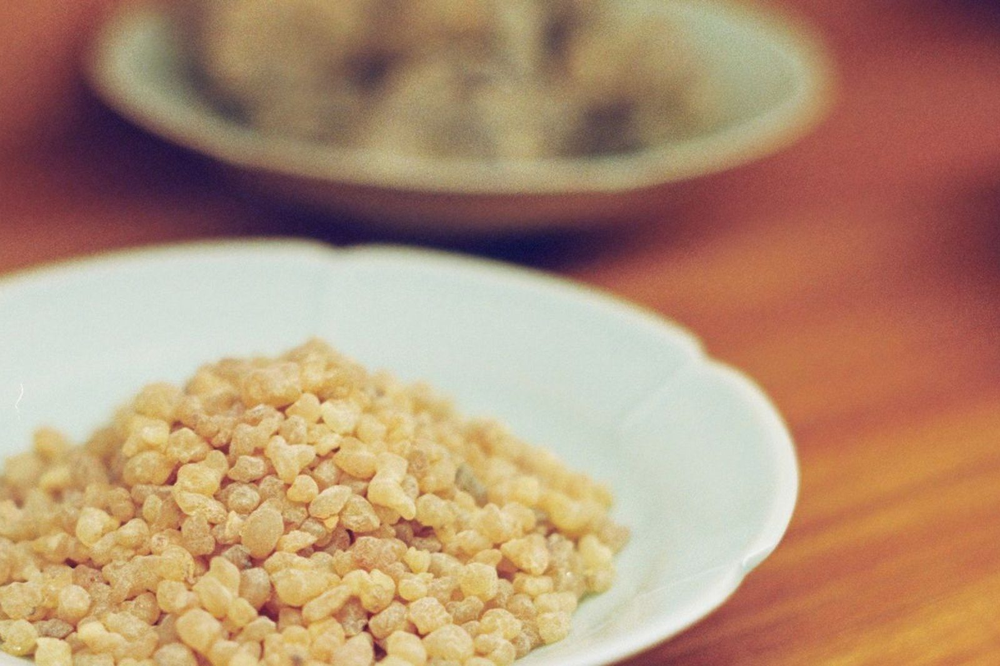
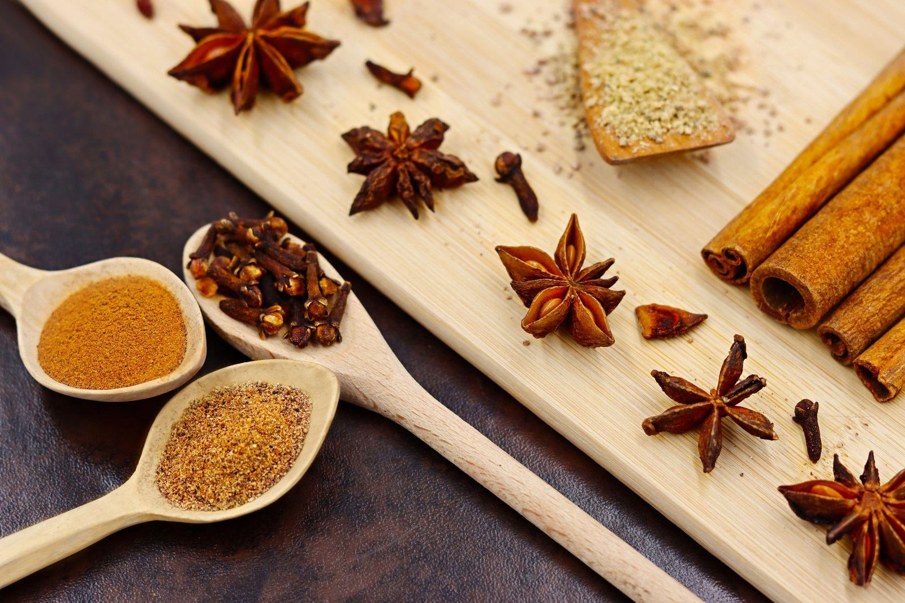
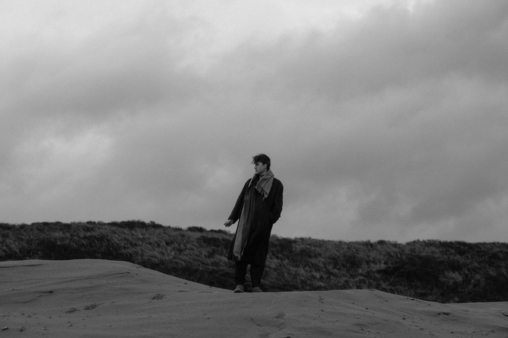

İstanbul'da poyraz esmeye başladığında, yazın bileğinizde parlayan o ferah narenciye parfümü bir anda sessizleşir. Palto yakası kalkar, atkı boyna dolanır ve koku, kumaşın altında kaybolur. İşte tam bu noktada erkek kış parfümü devreye girer: soğuk havada açılan, saatlerce tende kalan, odunsu, amberli, reçineli ve dumanlı kokular.

Bu rehberde 2026 kışı için kalıcı erkek parfümlerini seçerken bilmeniz gereken her şeyi bir araya getirdik: sezonun yeni sıcak kokuları, odunsu ve ud ağırlıklı klasikler, EDP ile extrait arasındaki gerçek fark, parfümün nereye ve nasıl sıkılacağı, kalıcılığı artıran küçük alışkanlıklar, doğru saklama koşulları ve İstanbul'un dünyaya açılan koku evleri. Her bölüm, güncel ve isimli bir Türkçe kaynağa dayanıyor.

## Kısa özet

- **Kış, sıcak notaların mevsimi**: odunsu, amber, ud, deri, tütün, tütsü ve rafine vanilya soğukta daha dengeli ve kalıcı hissedilir.
- **EDP mi extrait mi?** Extrait daha yoğundur ama çoğu zaman tene daha yakın durur; ofis için EDP, akşam için extrait mantıklı bir ayrımdır.
- **Doğru sıkma**: temiz ve nemlendirilmiş tene, boyun ve bileklere, yaklaşık 15 cm mesafeden; bilekleri birbirine sürtmeyin.
- **Atkı ve palto yakası** kışın kokuyu en uzun taşıyan yerlerdir; bir iki fıs yeterlidir.
- **Saklama**: 12 ile 22 °C arası, karanlık ve kuru bir dolap; banyo, pencere kenarı ve araç kesinlikle değil.
- **İstanbul'un koku mirası**: 1895'ten bu yana Atelier Rebul ve dünya niş parfüm sahnesinde yer alan Nishane.

## 2026 kışının yeni sıcak kokuları: niş evlerden öne çıkanlar

GQ Türkiye'nin parfüm tutkunlarının favorisi olan yeni kokular seçkisi, bu kışın yönünü net biçimde gösteriyor: reçineler, odunlar, likör akorları ve amber. Listenin en dikkat çekici isimlerinden biri D.S. & Durga Cognac Reign. Dergi bu kokuyu odunsu amber ailesine, likör akorlarıyla yerleştiriyor; XIV. Louis'nin görkemli salonlarından ilham alan, antik odunların orris, karamelize bergamot ve bolca konyakla buluştuğu, hafif tatlı ve hafif pudralı, ısıtan bir kompozisyon.

İkinci önemli isim Amouage Opus XVI Timber. GQ Türkiye, Amouage'ı en rafine yağlarla çalışan ve her kuruşuna değen ustalıkla kurgulanmış kompozisyonlar yaratan saygın evlerden biri olarak tanımlıyor. Opus serisi bir kütüphane gibi tasarlanmış; her parfüm baharatları, odunları, reçineleri, tütsüyü, deriyi ve amberi araştıran bir "cilt". Timber, kakule, bir tutam kakao ve pembe biberle açılıyor, ardından balsam köknarı, tütsü, palo santo, sedir, selvi, sandal ağacı ve paçuliyle serin ve davetkâr bir kış ormanına yerleşiyor. Sonuç, uzun süre kalıcı, lüks ve katmanlı bir orman kokusu.

Üçüncü isim ise Le Labo'nun City Exclusives koleksiyonundan Osmanthus. Kyoto'nun erken kışından ilham alan koku, amber ve tütsüyle sabitlenen, lavantayla dinginleşen bir kış çiçeği olarak anlatılıyor. Şehir kokularının yalnızca kısa bir süre her yerde satışa sunulduğunu da hatırlatmakta fayda var.

### Bu seçkiden çıkan ders

Kış parfümü artık yalnızca "ağır ve tatlı" demek değil. Konyak gibi likör notaları, orman ve reçine akorları ve tütsüyle dengelenmiş çiçekler, kış dolabına farklı ruh halleri getiriyor. Beyefendi için ideal rotasyon: gündüz için odunsu ve dengeli bir koku, akşam için daha derin, amberli ya da dumanlı bir imza.

Kaynak: [GQ Türkiye](https://gq.com.tr/en-iyi-yeni-erkek-parfumleri)

## Odunsu ve ud ağırlıklı klasikler: kışın güvenli limanları

Yeni çıkanlar heyecan verici, ama kışın en sağlam temeli hâlâ odunsu ve ud ağırlıklı klasikler. KokuAsistan'ın sonbahar ve kış için en iyi odunsu ve derin parfümler rehberi, bu kategorinin iyi bilinen isimlerini notaları, kalıcılık ve yayılım tahminleriyle birlikte sıralıyor.

Maison Francis Kurkdjian Oud Saffron, ud'u lüks ve egzotik bir şekilde yorumluyor: ud, safran, amber, gül ve paçuli. Rehberde kalıcılığı 8 ila 10 saat, yayılımı güçlü olarak veriliyor; ilk başta baharatlı, zamanla odunsu ve tatlı bir hale geçiyor. Le Labo Santal 33, sandal ağacı, paçuli, kakule, iris, amber ve deriyle New York'un en ikonik kokularından biri olarak anılıyor ve minimalist bir sandal ağacı arayanlar için öneriliyor. Byredo Mojave Ghost, çölün gizemli atmosferini taşıyan modern bir koku olarak, Xerjoff Erba Pura ise taze ve odunsu notaların dengesiyle günlük kullanım için listeleniyor.

*Photo: 晓鸟 蓝 / Pexels, [Pexels License](https://www.pexels.com/license/)*

### Ud: Doğu'nun "sıvı altını" ve Türk zevki

Ud (oud ya da agarwood), Anadolu ve Orta Doğu'nun koku kültüründe yüzyıllardır yer alan, yoğun, odunsu, hafif dumanlı ve hayvansı bir nota. Batılı niş evlerin son yıllarda ud'u safran, gül ya da pralinle yumuşatarak sunması, bu kokuyu yeni başlayanlar için de erişilebilir kıldı. Türkiye'de ud'a aşinalık yüksek olsa da yoğunluğu nedeniyle dozaj kritik: kışın bir iki fıs genellikle yeterli.

Rehberin seçim önerileri de pratik: yağlı ciltler kokuyu daha uzun tutar, kuru ciltlerde kalıcılık azalabilir; odunsu parfümler soğuk havada daha iyi performans gösterir; gündüz için daha hafif odunsu kokular (örneğin Santal 33), gece için daha yoğun kokular (örneğin Oud Wood) tercih edilebilir.

Kaynak: [KokuAsistan](https://www.kokuasistan.com/blog/en-iyi-10-odunsu-ve-derin-parfum-sonbahar-kis)

## EDP mi extrait mi? Kalıcılık sandığınız gibi değil

Parfüm alırken en çok sorulan sorulardan biri: "Extrait olsun, en kalıcısı o." KokuHub'ın Ekim 2026'da güncellenen yazısı bu inancı ince ayarlıyor. Sınıflandırma parfüm yağının (esansın) alkol ve su karışımına oranıyla yapılıyor: EDP çoğu markada kabaca yüzde 15 ila 25, extrait de parfum ise genelde yüzde 20 ila 40 bandında, bazen daha da üstünde. Ancak bu oranlar markadan markaya birebir standart değil; formül, hammadde, molekül yapısı ve hatta alkol kalitesi işin içine giriyor.

Yazının en değerli tespiti şu: daha yüksek konsantrasyon genel olarak daha uzun tutunma potansiyeli demek, ama "mutlaka daha kalıcı" değil. Extrait çoğu zaman tene daha yakın durur, daha yağlı ve sıcak bir ten parfümü karakteri taşır, açılışı daha yumuşaktır. Bazı extrait'ler ilk saatte "az geliyor" hissi verir, oysa kalıyordur; sadece yayılmıyordur. Yani kalıcılık ile fark edilirlik aynı şey değil.

Kış için önemli bir not daha: sıcak havada koku daha çok yayılır ama daha hızlı uçar; soğukta daha az yayılır ama daha uzun ve daha düz bir çizgide kalır. Kışın amber, vanilya ve odunsu bazlar daha baskın kalır.

### Ofis mi akşam mı? Konsantrasyona göre seçim

- **Günlük kullanım, ofis, yakın temas**: EDP çoğu zaman daha güvenli; net yayılır, ortamı boğma riski daha düşüktür.
- **Akşam, özel gün, daha yoğun bir aura**: extrait daha kadifemsi ve derindir; daha az "bağırır" ama daha çok iz bırakır.
- **Pratik doz**: tene 2 ila 4 fıs, kıyafete 1 ila 2 fıs. Yün atkı ve kazak kokuyu çok uzun süre tutar.

Kaynak: [KokuHub](https://kokuhub.com.tr/blog/edp-mi-extrait-mi-kaliciilik/)

## Parfüm nasıl sıkılır? GQ Türkiye'den uzman önerileri

GQ Türkiye'nin parfümün tüm gün kalıcı olması için nasıl sıkılması gerektiğini anlatan yazısı, işin kişisel bir tercih olduğunu kabul ederek başlıyor; ancak sade kullanıcılar için ideal bölgeleri net biçimde sıralıyor: boğazın alt kısmı, bilekler ve kulak arkası.

Ruth Mastenbroek Fragrances'ın parfümörü Nic Mastenbroek, nabız noktalarına sıkma önerisinin kalp atışının kokunun yayılmasına yardımcı olmasıyla ilgili olduğunu ve bunun belli bir doğruluk payı taşıdığını söylüyor. Kaç fıs sorusuna da net bir kural olmadığını, ama hafif bir etki için üç fısın ideal olduğunu belirtiyor.

Kıyafete mi tene mi? Yazıda görüşüne yer verilen Lim'e göre herkese uyan tek bir doğru yok: kıyafetler kokuyu daha uzun tutar ama karakterini biraz değiştirebilir ve bazı kumaşlarda leke yapabilir; tene uygulandığında ise kişisel kimya devreye girer ve koku gün içinde gelişir. Çoğu kişi ikisini birlikte kullanıyor: gömleğe bir iki fıs, boyna bir iki fıs.

Bilekleri birbirine sürtme meselesine gelince, Lim bunu bir makaronu ezmeye benzetiyor: sürtünme üst notaları ısıtır ve daha hızlı buharlaşmalarına yol açar. Dokunmanız gerekiyorsa hafifçe bastırın, en iyisi kendi haline kurumasına izin vermek.

### Sakal sahipleri için not

Çoğu parfüm alkol bazlıdır ve alkol kılı ve altındaki cildi kurutabilir; kalorifer sezonunda bu etki daha da belirginleşir. Parfümü doğrudan sakala değil, sakal hattının altındaki boyun derisine sıkın. Sakalda koku istiyorsanız, bu iş için tasarlanmış bir sakal yağı ya da balmı tercih edin.

Kaynak: [GQ Türkiye](https://gq.com.tr/parfum-nasil-kalici-olur-11090)

## Kalıcılığın sırrı: nemli cilt, nabız noktaları ve sabır

Elle Türkiye'nin parfüm kalıcılığı rehberi, kışın daha da önem kazanan bir gerçeğin altını çiziyor: parfüm kuru ciltte çok daha hızlı buharlaşır. Bu yüzden duş sonrası hafif nemli cilde ya da kokusuz bir nemlendiricinin üzerine uygulamak, koku moleküllerinin cilde daha iyi tutunmasını sağlıyor. Kalorifer ve soğuk rüzgârın cildi kuruttuğu aylarda bu adım, kalıcılık için en etkili ve en az bilinen alışkanlık.

Rehber, boyun, bilek içi, kulak arkası, dirsek içi ve diz arkası gibi nabız noktalarının gün içinde daha fazla ısı yaydığını ve kokunun tek seferde uçup gitmek yerine saatler içinde katman katman yayılmasına yardımcı olduğunu anlatıyor. En yaygın hata ise yine aynı: bilekleri birbirine sürtmek, özellikle üst notaların daha hızlı kaybolmasına neden oluyor.

Elle Türkiye'nin bir başka önemli uyarısı da burun alışkanlığıyla ilgili: siz kokuyu daha az hissediyor olsanız bile çevrenizdekiler onu hâlâ rahatlıkla algılıyor olabilir. Gün içinde art arda parfüm tazelemeden önce biraz beklemek gerekiyor. Ofiste ve toplantı odasında bu, beyefendice bir incelik.

*Photo: Marta Branco / Pexels, [Pexels License](https://www.pexels.com/license/)*

### Kış sabahı için beş adımlık rutin

- Ilık bir duş ve havluyla hafifçe kurulama.
- Boyun ve bileklere kokusuz bir nemlendirici.
- Bir dakika bekleyip parfümü yaklaşık 15 cm mesafeden boyun ve bileklere sıkma.
- Atkının iç kısmına ya da palto yakasının astarına tek fıs.
- Gün içinde tazeleme gerekiyorsa çantada küçük bir seyahat şişesi.

*Bu bölüm yayımlanmış bakım önerilerini özetler, tıbbi tavsiye değildir. Hassas cildiniz, egzamanız ya da koku alerjiniz varsa yeni ürünleri önce küçük bir alanda deneyin ve bir dermatoloğa danışın.*

Kaynak: [Elle Türkiye](https://www.elle.com.tr/guzellik/parfum/parfum-kaliciligina-yaz-ayari)

## Parfüm nasıl saklanır? Işık, sıcaklık, nem ve hava

Lüks bir parfüm bir yatırımdır ve kokunun ilk günkü gibi kalması büyük ölçüde saklama koşullarına bağlıdır. Rebul'ün parfüm saklama rehberi bu konuda son derece net rakamlar veriyor. İdeal saklama sıcaklığı 12 ila 22 °C arası. Nem oranı yüzde 40 ila 60 arasında tutulmalı ve kapak her kullanımdan sonra sıkıca kapatılmalı.

Rehbere göre parfümü doğrudan güneş ışığından ve yapay aydınlatmadan uzak tutmak gerekiyor; orijinal kutusu ışığa karşı en etkili bariyer. Şeffaf şişeler özellikle hassas; pencere kenarı ve aydınlık banyo rafı en riskli noktalar. En uygun alan yatak odası ya da giyinme odasındaki kapalı bir çekmece veya dolap, çünkü bu alanlar sabit sıcaklığa sahip ve güneş almıyor. Şişeleri dik tutmak, sıvının kapak contasıyla uzun süreli temasını önlüyor.

Banyo ise parfüm için en kötü ortam: sıcaklık ve nem sürekli değişiyor, duş buharı şişeyi sarıyor. Araç içi yaz aylarında 60 °C'yi aşabiliyor ve parfümü birkaç günde kullanılamaz hale getirebiliyor; rehber bu yüzden parfümün asla torpido gözünde bırakılmamasını öneriyor. Buzdolabı kullanılacaksa parfümün sürekli orada kalması, sık sık çıkarılıp konmaması gerekiyor, çünkü sıcaklık şoku moleküler yapıya zarar veriyor.

### Parfümünüz bozuldu mu? İşaretler

- Ferah üst notaların yerini ekşi, sirkemsi ya da metalik bir kokunun alması oksidasyon belirtisi.
- Daha önce 6 ila 8 saat kalan bir parfümün aynı koşullarda 1 ila 2 saatte kaybolması, esans bileşenlerinin bozulduğuna işaret ediyor.
- Kış için özel uyarı: kaloriferin hemen yanındaki bir şifonyer, şişeyi aylarca sessizce ısıtabilir.

Kaynak: [Rebul](https://www.rebul.com/blog/icerik/parfumu-dogru-saklamak-icin-ne-yapilmali-kokunuzu-taze-tutmanin-rehberi)

## İstanbul'un koku mirası: Atelier Rebul'ün 130 yılı

Kış parfümü konuşurken İstanbul'un kendi koku hikâyesini atlamak olmaz. Elle Türkiye'nin Ekim 2025 tarihli yazısı, Atelier Rebul'ün 130 yıllık yolculuğunu anlatıyor. Hikâye 1895'te Beyoğlu'nda, Rue de Pera'da başlıyor: genç Fransız eczacı Jean Cesar Reboul, İstanbul'un ruhundan ilham alarak "Grande Pharmacie Parisienne" adlı eczanesini kuruyor. Yıllar sonra yanında işe başlayan Kemal Müderrisoğlu ile yolları kesişiyor ve bu karşılaşma Rebul Eczanesi'nin doğuşuna dönüşüyor. 1938'de ise Rebul Lavanda Kolonyası ortaya çıkıyor.

Elle Türkiye'ye göre marka bugün 3 kıtada, 21 ülkede ve 1.000'in üzerinde lüks satış noktasında yer alıyor. Grasse lavantalarından Kapalıçarşı baharatlarına uzanan içerikler, Fransız eczacılık geleneğini İstanbul'un kültürel dokusuyla buluşturuyor. 130. yıla özel J.C.R. İmza Koleksiyonu, nostaljik eczane şişelerinden esinlenen tasarımı ve amberin sıcak ışığını öne çıkaran detaylarıyla dikkat çekiyor.

Kışlık bir erkek parfümü arayanlar için markanın Pera İmza Koleksiyonu da ilgi çekici: Pera Eau de Parfum kakule, zencefil ve pembe biberle açılıyor, sandal ağacı ve paçuliyle sıcak ve baharatlı bir dipte kapanıyor.

*Photo: Alina Chernii / Pexels, [Pexels License](https://www.pexels.com/license/)*

### Nishane: "Made in İstanbul" niş parfüm

İstanbul'un dünya niş parfüm sahnesindeki ikinci büyük ismi Nishane. Hürriyet'in markanın kuruluş döneminde yayımladığı habere göre eski devlet tiyatrosu oyuncusu Murat Katran ve sosyolog Mert Güzel, Paris'in hâkim olduğu parfüm dünyasına İstanbul'un gücüyle girdi. Katran, kokularını "hem oryantal hem modern, hem Doğu hem Batı, yani İstanbul'un ta kendisi" diye tanımlıyor; Güzel ise markanın aynı anda modern, Batılı ve Osmanlı olduğunu vurguluyor. Marka, o dönemde Milano'da en lüks parfümlerin sergilendiği fuara ilk Türk markası olarak davet edildi. Bugün Nishane Hacivat, Robb Report'un 2025 kalıcı erkek parfümleri listesinde en iyi extrait'ler arasında gösteriliyor.

Kaynak: [Elle Türkiye](https://www.elle.com.tr/guzellik/parfum/130-yildir-istanbuldan-dunyaya-uzanan-koku-yolculugu-atelier-rebul) · [Hürriyet](https://www.hurriyet.com.tr/ekonomi/kobi2/istanbul-un-gucuyle-nis-parfum-markasi-28282100) · [Robb Report](https://robbreport.com/style/grooming/lists/best-long-lasting-colognes-men-1236741749/)

## Seçtiklerimiz: kış için lüks erkek parfümleri

- **[Tom Ford Oud Wood Eau de Parfum (yaklaşık 50 ml, Beymen)](https://www.beymen.com/tr/p_tom-ford-oud-wood-edp-50ml_115346)**: ud, sandal ağacı ve vanilyanın rafine buluşması; kış akşamları ve ud'a yeni başlayanlar için zarif bir giriş.
- **[Nishane Hacivat (yaklaşık 50 ml, Beymen)](https://www.beymen.com/tr/p_nishane-hacivat-50-ml-parfum_1165512)**: İstanbul'un niş parfüm evinden ananas, greyfurt, bergamot, yosun, sedir ve paçulili şipre karakter; kış ofisi ve gündüz için güçlü ama ferah bir imza.
- **[Atelier Rebul Pera Eau de Parfum](https://www.atelierrebul.com.tr/pera-imza-koleksiyonu/)**: Rebul'ün doğduğu semte adanmış koleksiyondan kakule, zencefil, pembe biber, sandal ağacı ve paçulili sıcak, baharatlı bir koku.

## Sıkça sorulan sorular

### Kış için en iyi erkek parfümü hangisi?
Tek bir doğru yok, ancak 2026 kışında odunsu, amber, ud, deri ve tütsü ağırlıklı kokular öne çıkıyor. Amouage Opus XVI Timber, D.S. & Durga Cognac Reign, Tom Ford Oud Wood ve Maison Francis Kurkdjian Oud Saffron güçlü örnekler.

### EDP mi extrait mi daha kalıcı?
Extrait genelde daha yoğundur ve daha uzun kalabilir, ancak çoğu zaman tene daha yakın durur ve daha az yayılır. Ofis için EDP, akşam ve özel günler için extrait mantıklı bir seçimdir.

### Parfüm nereye sıkılır?
Temiz ve nemlendirilmiş tene; boğazın alt kısmı, bilekler ve kulak arkası gibi nabız noktalarına, yaklaşık 15 cm mesafeden. Kışın atkının iç kısmına tek fıs kalıcılığı artırır.

### Parfüm sakala sıkılır mı?
Önerilmez. Alkol bazlı parfümler kılı ve cildi kurutabilir. Parfümü sakal hattının altındaki boyuna sıkın, sakalda koku için sakal yağı ya da balmı kullanın.

### Parfüm banyoda saklanır mı?
Hayır. Banyodaki sıcaklık ve nem değişimleri parfümü bozar. En iyisi 12 ila 22 °C arasında, kapalı bir dolap ya da çekmecede, orijinal kutusunda ve dik saklamaktır.

### Parfümün bozulduğunu nasıl anlarım?
Ferah üst notaların yerini ekşi, sirkemsi ya da metalik bir koku alıyorsa veya kalıcılık belirgin şekilde düştüyse parfüm oksitlenmiş olabilir.
