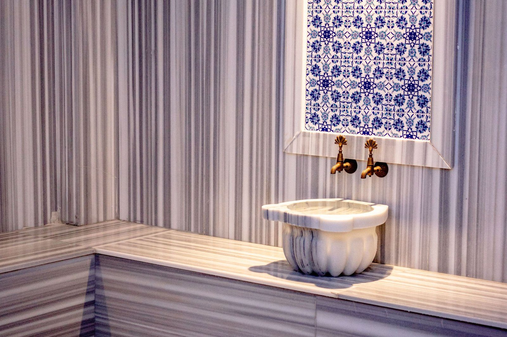
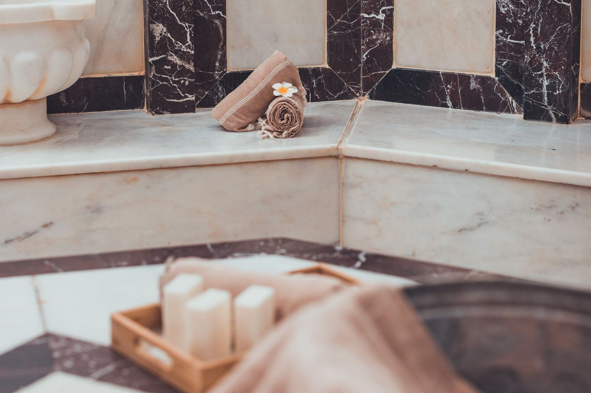
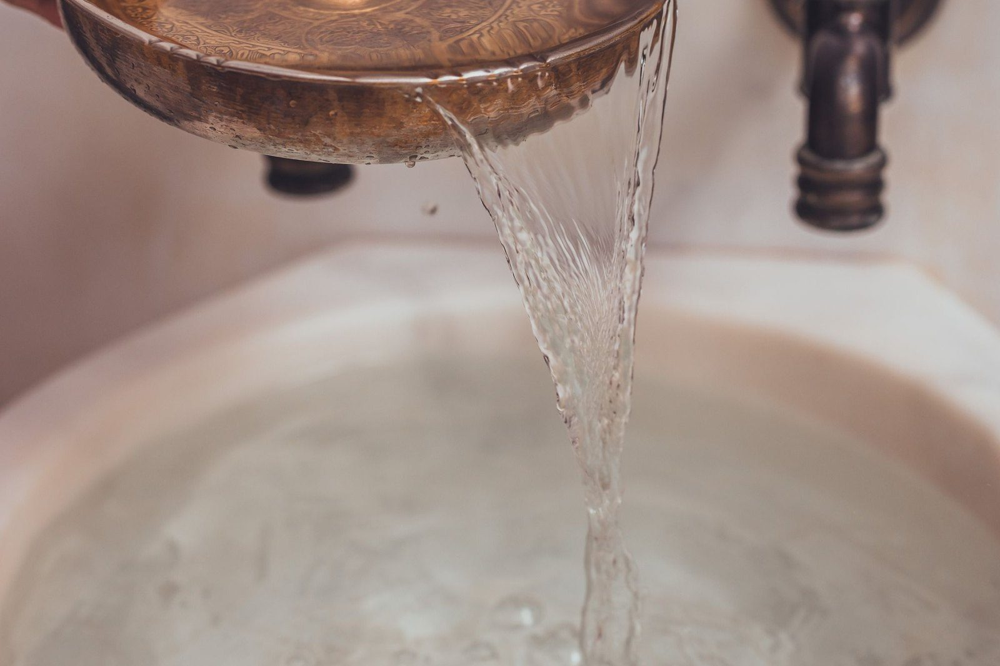

Kasım geldiğinde İstanbul'da hamam yeniden gündeme oturur. Hava soğur, gün kısalır, sırtta biriken yorgunluk ağırlaşır. Tam da bu dönemde sıcak mermerin, buharın ve kubbeden süzülen ışığın verdiği huzur başka hiçbir yerde bulunmaz. Spor salonlarındaki saunalar da kışın en çok kullanılan köşe haline gelir. Ancak erkekler için hamam ve sauna çoğu zaman yanlış yaşanır: gereğinden uzun kalınır, kese sertçe yapılır, çıkışta soğuğa dalınır ve ertesi sabah cilt gerilir, sakal saman gibi olur.

Bu rehberde hamam ile sauna arasındaki farkı, Türk hastanelerinin sağlık rehberlerinde öne çıkan faydaları ve riskleri, kimlerin hamama ve saunaya girmemesi gerektiğini, beyefendiye yakışan hamam adabını, kese tartışmasını, İstanbul'un en görkemli tarihi hamamlarından birini ve hamam sonrası cilt ve sakal bakımını derledik.

> **Kısa özet**
> - Türk hamamı yaklaşık 48 °C sıcaklık ve %100'e varan nemle çalışır. Klasik kuru saunada sıcaklık yaklaşık 65-90 °C'ye çıkar, nem ise düşüktür.
> - Sağlık rehberleri hamam ve saunanın kas gevşemesi, stres azalması ve dolaşım açısından faydalı olabileceğini belirtir. Başlıca riskler sıvı kaybı, tansiyon düşmesi ve baş dönmesidir.
> - Kalp-damar hastalığı, kontrolsüz yüksek veya düşük tansiyon, ciddi astım ve KOAH, bulaşıcı cilt hastalığı ya da hamilelik durumunda önce doktora danışılmalıdır. Düzenli kalp veya tansiyon ilacı kullananlar da bu gruptadır.
> - Hamam adabının üç temeli vardır: peştamal belden çıkmaz, kurnaya sabun karışmaz, sessizlik korunur.
> - Kese konusunda uzmanlar ikiye ayrılır: kimi cildi yenilediğini söyler, kimi koruyucu tabakayı soyduğu için seyrek ve nazik yapılması gerektiğini vurgular. Çıkışta nemlendirici ve sakal yağı şarttır.

*Bu yazı, yayımlanmış kaynakları genel bilgilendirme amacıyla özetler ve tıbbi tavsiye değildir. Kalp rahatsızlığınız, tansiyon sorununuz varsa ya da düzenli ilaç kullanıyorsanız hamam veya saunaya gitmeden önce doktorunuza danışın.*

## 1. Hamam mı Sauna mı? Aradaki Fark Düşündüğünüzden Büyük

Pek çok erkek hamamı "Türk usulü sauna" sanır. Oysa ikisi farklı deneyimlerdir. Medicana'nın sağlık rehberine göre Türk hamamı, %100'e varan nem oranına ve yaklaşık 48 °C gibi nispeten düşük bir sıcaklığa sahip bir ortamdır. Kökleri antik Roma hamam geleneğine uzanır. Bu kültür önce Bizanslılar, ardından 15. yüzyılda İstanbul'un fethiyle Osmanlılar tarafından benimsenip geliştirilmiştir.

### Hamamın bölümleri: soğukluk, ılıklık, sıcaklık

Klasik hamam tek bir oda değil, bir yolculuktur. Sıcak bir bölümden buhara, oradan ılık ya da serin suya uzanan bir sıra izlenir. Aralarda sohbet ve dinlenme için ortak alanlar bulunur. Sauna ise ahşap kaplı, kapalı bir odada kuru ve çok daha yüksek bir sıcaklık sunar. Kısacası hamam nemli ve yumuşak bir sıcaklıktır, sauna ise kuru ve yoğun.

### Hangisini seçmeli?

Hamam, kese ve köpükle birlikte yaşanan bir temizlik ve bakım ritüelidir. Uzun ve yavaş bir yarım gün için idealdir. Sauna ise sporun ardından 15-20 dakikalık hızlı bir toparlanma seansıdır. Pek çok beyefendi ikisini birleştirir: hafta içi spor salonunda sauna, ayda bir iki kez tarihi bir hamamda kese-köpük.

### Hamam ve sauna için doğru zamanlama

İyi bir hamam ya da sauna seansı acele kaldırmaz. Ağır bir yemeğin hemen ardından değil, hafif bir öğünden bir iki saat sonra gidin. Aç ve susuz da girmeyin, iki durum da baş dönmesi riskini artırır. Spordan sonra gidecekseniz önce nabzınızın sakinleşmesini bekleyin ve bir bardak su için. Akşam saatleri pek çok erkek için idealdir: hamamın verdiği gevşeme doğrudan derin bir uykuya taşınır. Ertesi sabah önemli bir toplantınız varsa keseyi o güne değil, hafta sonuna bırakın. Cildin kendini toparlaması için bir gece yeterli olur.

Kaynak: [Medicana](https://www.medicana.com.tr/hamamin-faydalari-nelerdir-hamama-gitmek-saglikli-mi/blog/25761)

## 2. Saunanın Faydaları ve Yan Etkileri: Hastane Rehberleri Ne Diyor?

Medipol'ün sağlık rehberi saunayı yüksek ısı ve kontrollü nem ortamında yapılan bir terapi olarak tanımlar. Listelenen olası faydalar şunlardır: vücudu gevşetmesi, stresin azalmasına ve uyku kalitesinin artmasına yardımcı olması, kan dolaşımını geçici olarak artırması, kas ve eklem ağrılarının hafiflemesine katkı sağlaması ve kalp-damar fonksiyonlarını destekleyici etkiler göstermesi. Rehber, egzersiz yapması zor olan kişilerde genel iyilik halini artırabileceğini de ekler.

### Sauna kilo verdirir mi?

Rehberin sık sorulan sorular bölümü bazı yaygın inançları da düzeltir: Sauna yağ yakımına neden olmaz, terleme yoluyla su kaybına neden olur ve kanı temizlemez. Damarlar sauna sırasında geçici olarak genişler. On dakikalık bir seansın ortalama 20-50 kalori harcatabileceği belirtilir. Yani sauna bir zayıflama yöntemi değil, bir dinlenme ve toparlanma ritüelidir.

*Photo: Atlantic Ambience / Pexels, [Pexels License](https://www.pexels.com/license/)*

### Saunanın yan etkileri

Medipol'e göre yan etkiler genellikle hafiftir. En sık görülenler aşırı sıcaklık hissi, geçici tansiyon düşüklüğü, sıvı kaybı ve susuzluk, sık idrara çıkma ve kısa süreli baş dönmesidir. Bazı kişilerde öksürük, bacak ağrısı, klostrofobi ya da solunum yolu hassasiyeti görülebilir.

### Kimler saunaya girmemeli?

Rehberin listesi açıktır: kalp hastalığı veya kalp yetmezliği olanlar, yüksek tansiyon hastaları, astım ve KOAH gibi kronik solunum sorunu yaşayanlar, hamileler, aç veya susuz kalmış kişiler, açık yarası ya da ciddi cilt hastalığı olanlar ve düzenli tansiyon ya da kalp ilacı kullananlar. Alkol aldıktan sonra saunaya girmek de genel olarak önerilmez.

Kaynak: [Medipol](https://medipol.com.tr/saglik-rehberi/sauna-faydalari-nelerdir)

## 3. Hamamın Faydaları ve Hamama Kimler Gitmemeli?

Medicana'nın rehberine göre hamamın faydaları geniş bir yelpazeye yayılır. Isı gözenekleri açar, kese ölü derileri uzaklaştırarak cildi daha pürüzsüz ve canlı gösterir. Sıcak atmosfer gergin kasları gevşetir, eklem sertliğini giderir ve egzersiz sonrası toparlanmaya yardımcı olur. Damarların genişlemesiyle kan dolaşımı artar. Yüksek su buharı burun tıkanıklığını hafifletebilir. Gevşeyen beden de daha rahat uykuya geçer.

### Hamamın riskleri

Aynı kaynak riskleri de saklamaz: sıvı kaybı, tansiyon düşmesi ve kalp rahatsızlıkları başlıca risklerdir. Uzun süre çok sıcak ortamda kalmak baş dönmesine, halsizliğe hatta bayılmaya yol açabilir. Rehbere göre kalp-damar sorunu, şiddetli astım, kontrol altına alınmamış yüksek ya da düşük tansiyon veya bulaşıcı cilt hastalığı olanlar hamamdan uzak durmalıdır. Aynı tavsiye hamileler ve yürüme güçlüğü gibi hareket sorunu yaşayanlar için de geçerlidir.

### Hamamda ne kadar kalınmalı?

Kesin bir süre yoktur. Bedeninizi dinleyin, sıcaklıkta uzun kalmak yerine ılıklıkta mola verin. Baş dönmesi, çarpıntı ya da aşırı yorgunluk hissettiğinizde hemen serin bir bölüme geçin.

Kaynak: [Medicana](https://www.medicana.com.tr/hamamin-faydalari-nelerdir-hamama-gitmek-saglikli-mi/blog/25761)

## 4. Hamam Adabı: Peştamaldan Kurnaya Beyefendi Kuralları

Hamamda görgü, deneyimli bir erkeği acemiden ilk bakışta ayırır. Hamam Vakti'nin TDV İslâm Ansiklopedisi'nin "Hamam" maddesine dayanan rehberi, hamam kurallarının üç katmandan geldiğini anlatır: dine dayananlar, kadılık nizamnâmeleriyle belirlenenler ve gelenekle oluşanlar. Bu üç katman bugün de iç içe yaşar.

### Peştamal kuralı

Görgünün ilk maddesi örtünmedir. Erkekler için kural göbekle diz arasının örtülmesidir. Peştamal soyunmalıkta ya da kabinde bağlanır ve çıkana kadar çözülmez. Islak peştamal değiştirilecekse bu da kabinde ya da havluyla örtünerek yapılır. Kese ve köpük sırasında peştamal yerinde kalır, iyi bir tellak bunu zaten bilir.

*Photo: Ata Ebem / Pexels, [Pexels License](https://www.pexels.com/license/)*

### Kurna adabı

TDK kurnayı "hamam ve banyolarda musluk altında bulunan, içinde su biriktirilen, yuvarlak, mermer, taş veya plastik tekne" diye tanımlar. Türk hamamlarında havuz bulunmaz, kurna başında su dökünerek yıkanılır. Bu yüzden kurna ortak bir kaynaktır ve görgü en çok burada sınanır:

- Boş bir kurna seçin. Dolu bir kurnaya geçmeden önce göz göze gelip izin isteyin.
- Kurnanın içine sabun, köpük ya da kese kalıntısı karıştırmayın. Tası kurnadan doldurun, suyu kurnanın dışına dökün.
- Suyu açık bırakıp gitmeyin. Suyu israf etmemek eski hamam âdâbının bir parçasıdır.
- Kurnanın mermer kenarına oturmayın, üzerine eşya koymayın.

### Sessizlik ve "sıhhatler olsun"

Kubbe sesi toplar ve geri yollar. Atasözlerinin dediği gibi "hamamda türkü çağırmak her akıllının kârı değil." Alçak sesle konuşmak, çıkışta "sıhhatler olsun" demek ve hizmet ücretini kasada yazılı tarifeye göre ödemek geleneğin bugüne taşınan nezaketidir.

Kaynak: [Hamam Vakti](https://hamamvakti.com.tr/rehber/hamam-gorgu-kurallari)

## 5. Kese Tartışması: Cildi Yeniler mi, Yıpratır mı?

Kese, Türk hamamının imzasıdır ve uzmanların üzerinde en çok tartıştığı konudur. Medicana rehberi geleneksel kese peelingini ölü deri hücrelerini soyarak daha parlak, pürüzsüz ve sağlıklı bir görünüm sağlayan bir uygulama olarak anlatır. Hürriyet'e konuşan dermatoloji uzmanı Prof. Dr. Hamdi Memişoğlu ise daha temkinlidir.

### Dermatoloğun uyarısı

Prof. Dr. Memişoğlu'na göre deri üzerinde zararlı maddelerin içeri girmesini engelleyen koruyucu bir katman bulunur ve bu katmanın tahriş edilmesi bazı deri hastalıklarına davetiye çıkarabilir. Uzman, sık ve sert kullanılan kesenin deriyi soyduğunu, yağını aldığını ve kuruluk oluşturduğunu söyler. Asitli sabunlar yerine nötr sabun ve jellerin kullanılmasını, duş sonrasında ise mutlaka nemlendirici krem sürülmesini önerir.

### Orta yol: seyrek ve nazik kese

İki görüşten çıkan pratik ders şudur: kese her hafta yapılacak bir alışkanlık değil, ara sıra yapılacak bir ritüeldir. Cilt sıcaklıkta yeterince yumuşadıktan sonra, nazik bir el ve temiz bir keseyle yapılmalı, yüze ve sakal bölgesine uygulanmamalıdır. Egzama, sivilce ya da hassas cildi olanlar keseyi atlayıp yalnızca köpükle yetinebilir. Kesenin ardından gelen köpük ve bol ılık su, cildi yeniden dengeler.

Kaynak: [Hürriyet](https://www.hurriyet.com.tr/aile/lif-ve-kese-cilde-zararli-415824)

## 6. Tarihi Hamam Deneyimi: Kılıç Ali Paşa Hamamı

Bir erkeğin hamam kültürünü tam anlamıyla yaşaması için en az bir kez Mimar Sinan'ın imzasını taşıyan bir kubbenin altına uzanması gerekir. Tophane'deki Kılıç Ali Paşa Hamamı bunun en zarif örneklerinden biridir. Hamamın kendi tarihçesine göre yapı, 16. yüzyılda Osmanlı donanmasının amirali Kılıç Ali Paşa tarafından leventlere hizmet vermesi için Mimar Sinan'a yaptırılmış ve 1578-1583 yılları arasında inşa edilmiştir.

### Kubbe, ışık ve restorasyon

Işığı geçiren fil gözleriyle bezeli kubbelerin ortasında, İstanbul'un ikinci en büyük hamam kubbesi yükselir: 17 metre genişliğinde, 14 metre yüksekliğinde. Hamam yedi yıl süren titiz bir restorasyonun ardından 2012'de yeniden hizmete açıldı. Restorasyon, Avrupa'nın öncü kültür mirası kuruluşu Europa Nostra tarafından 2017'de ödüllendirildi.

*Photo: Ata Ebem / Pexels, [Pexels License](https://www.pexels.com/license/)*

### Kılıç Ali Paşa'nın hikâyesi

Hamamın hikâyesi de etkileyicidir. Güney İtalya'da Calabria'da Giovanni Dionigi Galeni adıyla doğan Kılıç Ali Paşa, çocukken esir düştüğü Osmanlı donanmasında Barbaros Hayrettin Paşa'nın yanında yetişti ve Kaptan-ı Derya oldu. Rivayete göre Cervantes, Don Kişot'ta ondan "Uçali" diye söz eder. İstanbul'da Cağaloğlu, Çemberlitaş ve Ayasofya Hürrem Sultan gibi tarihi hamamlarla birlikte bu yapı, hamamı bir temizlik rutininden bir kültür deneyimine dönüştürür. Hafta sonu için rezervasyon yaptırmak akıllıca olur.

Kaynak: [Kılıç Ali Paşa Hamamı](https://www.kilicalipasahamami.com/tr/our-story)

## 7. Hamam ve Sauna Sonrası Cilt ve Sakal Bakımı

Hamamın ve saunanın asıl farkı çıkıştan sonraki bir saatte ortaya çıkar. Medicana'nın rehberi hamam sonrası için net öneriler sunar. Vücudu hemen soğuğa maruz bırakmayın, önce ılık bir ortamda 15-30 dakika dinlenin. Bol su için, ayran ya da mineral açısından zengin içecekler de iyi bir seçimdir. Cilt bu sırada hassaslaştığı için sert hareketlerden, tahriş edici ürünlerden ve çok sıcak duşlardan kaçının, mutlaka nemlendirin. Ağır yemeklerden uzak durun. Soğuk havada dışarı çıkacaksanız saçınızı ve sakalınızı iyice kurulayın.

### Sakallı erkeğin hamam sonrası rutini

Sıcaklık ve buhar sakalı yumuşatır, ama doğal yağlarını da alır. Bir saat sonra gelen sertlik ve kaşıntı bundandır. Kısa bir rutin yeter:

1. Son durulamayı ılık suyla yapın ve sakalı nazik, nötr bir temizleyiciyle yıkayın.
2. Sakalı havluyla ovmayın, peştemal ya da yumuşak bir havluyla bastırarak kurulayın.
3. Cilt hafif nemliyken yanaklara ve boyna hafif bir nemlendirici sürün.
4. 3-5 damla sakal yağını köklerden uçlara doğru yedirin ve tarayın.
5. Soğuk havaya çıkmadan önce sakalın tamamen kuruduğundan emin olun.

### Peştemal ve havlu seçimi

Kaliteli bir peştemal hamamın görünmeyen lüksüdür. Saf pamuk ya da pamuk-keten karışımı peştemaller ince oldukları halde suyu iyi emer ve çabuk kurur. Islak mermerde ağırlaşan kalın havlulara göre çok daha zariftir. Koyu tonlar, lacivert-beyaz çizgiler ve sade baklava desenleri klasik erkek zevkine en yakın seçeneklerdir. Kendi peştemalinizi hamama götürmek hem hijyen hem üslup açısından bir beyefendi tercihidir. Çıkışta sakal için ayrı, yumuşak bir küçük havlu kullanmak da tüylerin kırılmasını önler.

Kaynak: [Medicana](https://www.medicana.com.tr/hamamin-faydalari-nelerdir-hamama-gitmek-saglikli-mi/blog/25761)

## Seçkilerimiz: Hamam ve Sauna İçin Premium Ürünler

- **[Beymen Hamam Marine Beyaz Peştemal](https://www.beymen.com/tr/p_hamam-marine-beyaz-pestemal_752733)**: beyaz-lacivert çizgili, 100x180 cm ölçülerinde klasik bir peştemal. Hamamda belde, evde duş sonrası omuzda aynı zarafeti taşır. Beymen'de 3.499 TL.
- **[Vakko Baklava Desen Bağlama Saçaklı Peştamal](https://www.vakko.com/plaj-havlulari/baklava-desen-baglama-sacakli-pestamal-p-M406524629-0002)**: pamuklu, el bağlaması saçaklı ve baklava desenli. Vakko'nun peştemal koleksiyonundan; kendi peştemalini hamama götürmek isteyen erkekler için.
- **[L'Occitane Cade Yumuşatıcı Sakal Yağı](https://www.loccitane.com.tr/cade-softening-beard-oil-cade-yumusatici-sakal-yagi-20hb030h20/)**: L'Occitane'ın odunsu, ardıç notalı Cade erkek serisinden. Hamam ve sauna sonrası sakalı besler, yumuşatır ve şekillendirir.
- **[Kiehl's Facial Fuel Erkekler İçin Cildi Canlandıran Günlük Nemlendirici](https://www.kiehls.com.tr/erkek-bakimi/cilt-tipine-gore-erkek-bakimi/erkekler-icin-yagli-cilt/facial-fuel-energizing-moisture-treatment-for-men---erkekler-icin-cildi-canlandiran-gunluk-nemlendirici/555.html)**: 125 ml, yağsız ve hızlı emilen bir erkek nemlendiricisi. Kese ve buhardan sonra cildi ağırlaştırmadan dengeler.

## Erkekler İçin Hamam ve Sauna: Sık Sorulan Sorular

### Hamam ile sauna arasındaki fark nedir?

Türk hamamı yaklaşık 48 °C sıcaklık ve %100'e varan nemle çalışan, kese-köpükle tamamlanan bir yıkanma ritüelidir. Sauna ise ahşap kaplı bir odada kuru ve çok daha yüksek, yaklaşık 65-90 °C sıcaklık sunar.

### Kimler saunaya ve hamama girmemeli?

Kalp hastalığı veya kalp yetmezliği, kontrolsüz yüksek ya da düşük tansiyon, ciddi astım ve KOAH, bulaşıcı cilt hastalığı olanlar ve hamileler önce doktora danışmalıdır. Düzenli kalp veya tansiyon ilacı kullananlar da önce doktora danışmalı, alkol aldıktan sonra ise hamam ya da saunaya hiç girilmemelidir.

### Sauna kilo verdirir mi?

Hayır. Medipol'ün rehberine göre sauna yağ yakımına neden olmaz. Kaybedilen kilo terle atılan sudur ve su içildiğinde geri gelir.

### Kese cilde zararlı mı?

Uzmanlar ayrışıyor. Kese ölü deriyi alarak cildi pürüzsüzleştirir, ancak sık ve sert yapıldığında koruyucu tabakayı yıpratıp kuruluğa yol açabilir. Seyrek, nazik ve yüz-sakal bölgesi hariç yapılmalıdır.

### Hamamda peştamal nasıl kullanılır?

Peştamal soyunmalıkta bele bağlanır, göbekle diz arasını örter ve hamamdan çıkana kadar çözülmez. Kese ve köpük sırasında da yerinde kalır.

### Hamam sonrası sakal bakımı nasıl yapılır?

Ilık suyla durulayın, nazikçe temizleyin, ovmadan kurulayın, cilt hafif nemliyken nemlendirici sürün ve 3-5 damla sakal yağı yedirin. Soğuk havaya çıkmadan sakalı tamamen kurutun.
