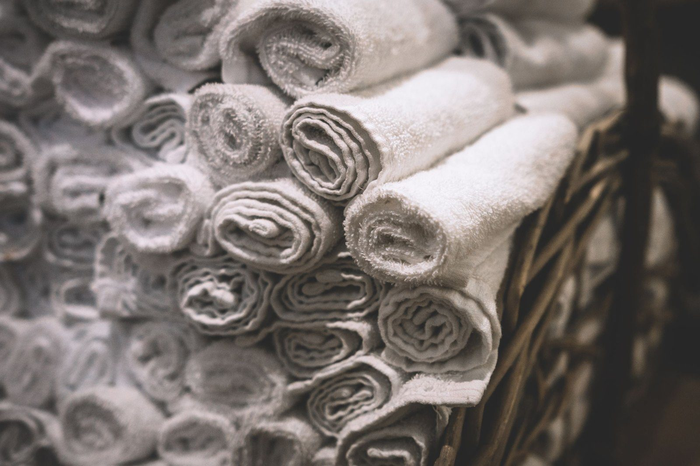
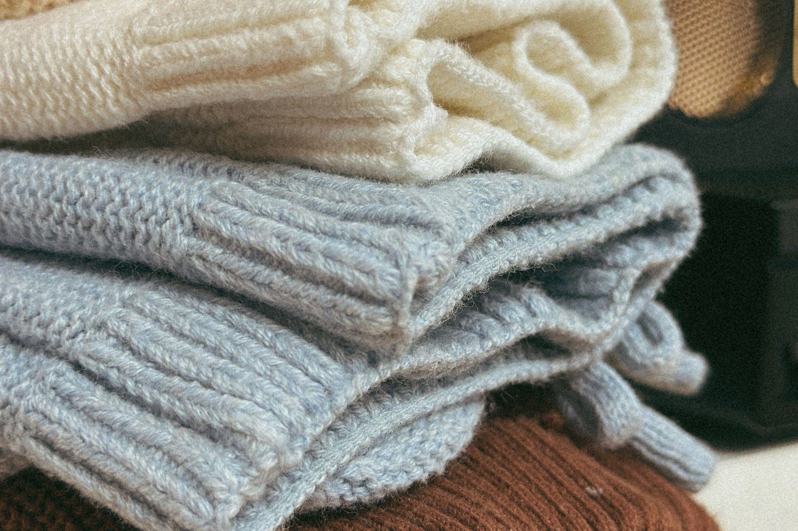
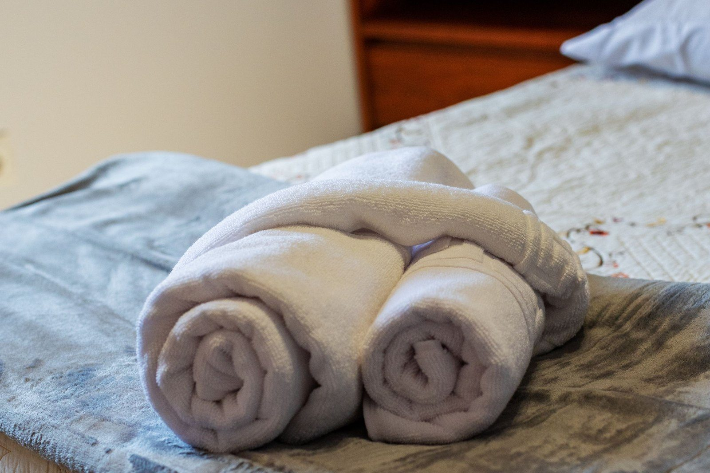

Kasım akşamlarında kapıdan girip ceketi astığınız an, günün ikinci yarısı başlar. Ayakkabılar çıkar, kravat gevşer ve asıl soru ortaya çıkar: Şık bir erkek evde ne giyer? Pek çoğumuzun cevabı hâlâ eskimiş bir eşofman altı ve solmuş bir tişört. Oysa evde geçirdiğimiz saatler, ailemizle, misafirlerimizle ve kendimizle geçirdiğimiz en değerli saatlerdir. Beyefendilik kapının önünde bitmez.

Erkek ev giyimi son yıllarda sessiz ama güçlü bir dönüşüm yaşıyor. Kimono ve şalyaka bornozlar, biyeli pijama takımları, keten sabahlıklar ve zarif ev terlikleri Vakko ve Beymen gibi Türkiye'nin lüks adreslerinde kendine geniş yer buluyor. Bu rehberde Türk kaynaklarından derlediğimiz bilgilerle bornoz gramajının ne anlama geldiğini, kışlık pijama kumaşının nasıl seçileceğini, uyku için ideal oda sıcaklığını, bornozun nasıl yıkanacağını ve gerçekten yatırım yapmaya değer parçaları ele alıyoruz.

> **Kısa özet**
> - Bornozda kalite etiketteki GSM değerinde saklıdır: 400-600 g/m² ev kullanımı için ideal denge, 600-900 g/m² ise otel ve spa hissidir.
> - Uzun lifli pamuk, örneğin Ege pamuğu, yıkandıkça yumuşar ve daha az tüylenir. Bukle (terry) dokuma en yüksek emiciliği sunar.
> - Kışlık pijamada flanel ve kadife sıcak tutar; modal terleyenler için, pamuk her mevsim için güvenli seçimdir. Saten ve ipek zarif ama hassastır.
> - Uykuya daldıktan sonra oda sıcaklığının yaklaşık 16-18 °C olması tercih ediliyor. Sıcak oda uykuyu bölüyor.
> - Bornozu 30-40 °C'de, düşük devirde yıkayın; yumuşatıcıyı az kullanın, sertleşmeye karşı durulamaya biraz beyaz sirke ekleyin.

## 1. Lüks Ev Giyimi Yükselişte: Vakko'nun Bornoz ve Terlik Seçkisi

Türkiye'de lüks ev giyiminin en net vitrini Vakko'nun ev koleksiyonu. Markanın bornoz ve terlik sayfası, beyefendi ev giyiminin bugün nasıl bir çizgiye oturduğunu açıkça gösteriyor: gösterişli desenler yerine temiz kesimler, kaliteli kumaşlar ve ince detaylar.

### Kimono mu, şalyaka mı?

Vakko seçkisinde iki ana kesim öne çıkıyor. **Kimono bornoz**, düz ve yakasız bir hat ile hafif, sade bir görünüm sunar. Spa sonrası ya da sabah kahvesinde rahat ve zamansızdır. **Şalyaka bornoz** ise boyun çevresini saran yuvarlak yakasıyla daha sıcak ve daha klasik durur. Kış sabahları için idealdir. Seçkide şantuklu kimono ve şantuklu şalyaka modeller 4.850 TL'den başlıyor. Keten bantlı kimono bornozlar ise kenar detayıyla sade bir zarafet ekliyor.

### Üç sıra piko ve doubleface armürlü bornozlar

Seçkinin üst segmentinde, kenarlarında üç sıra piko işçiliği bulunan unisex bornozlar ve ince armürlü doubleface modeller yer alıyor. Lacivert veya bej biye ile tamamlanan bu bornozlar 6.950 TL fiyatla listeleniyor. Doubleface kumaş, iki yüzü de kullanılabilir bitişiyle hem dokuda hem görünümde zenginlik sağlıyor. Lacivert biye, erkek gardırobuna en kolay uyum sağlayan detay.

### Terlik bütünlüğü

Vakko aynı sayfada bornozları tamamlayan ev terliklerini de sunuyor. Locatelli aksesuarlı unisex terlikler 2.250 TL'den listeleniyor. Bornoz, pijama ve terliğin aynı renk ailesinde buluşması, evdeki şıklığın en basit formülü.

Kaynak: [Vakko](https://www.vakko.com/home/bornoz-terlik-c-308030402)

## 2. Bornozun Sırrı: GSM ve Gramaj Ne Anlama Geliyor?

Mağazada dokunduğunuzda kadife gibi gelen bir bornoz, evde duştan çıktığınızda suyu itiyormuş gibi hissettirebilir. Karaca'nın bornoz ve havlu rehberi bunun sırrını açıklıyor: Etiketteki küçük puntolu teknik terimler, bornozun altı ay sonra sertleşip sertleşmeyeceğini belirler. Bunların başında GSM, yani metrekare başına gram ağırlık geliyor.

### Hangi gramaj kime uygun?

- **300-400 g/m² (hafif)**: Peştemal ve spor havluları bu aralıktadır. Çok hızlı kurur, yer kaplamaz ama emiciliği düşüktür.
- **400-600 g/m² (ideal denge)**: Ev kullanımı için altın standart. Suyu iyi emer, makul sürede kurur ve üzerinizde zırh gibi ağır durmaz.
- **600-900 g/m² (lüks ve spa tipi)**: O "otel havlusu" hissi buradadır. Çok yoğundur, bulut gibi yumuşaktır ama kuruması uzun sürer ve ıslakken ağırlaşır.

Karaca'nın uzman tavsiyesi net: Kış ayları için yüksek gramajlı bornozlar sizi sıcak tutar, yaz ve nemli bölgeler için düşük gramajlı, hızlı kuruyan modeller bakteri oluşumunu engeller.

### Bukle mi, kadife mi?

Bornozun yüzeyinde binlerce minik halka görüyorsanız bu bukle (terry) dokumadır ve en yüksek emiciliği sunar. Kadife (velour) dokuma ise bu halkaların üst kısmı tıraşlanarak elde edilir. Daha pürüzsüz ve şık görünür ama su emiciliği düşüktür. Beyefendiye önerimiz: kurulanmak için bukle, salonda oturmak için kadife ya da şantuk.

### Ege pamuğu ve beden seçimi

Etikette "uzun lifli" ibaresi, örneğin Ege pamuğu, bornozun yıkandıkça yumuşayacağı ve tüylenme yapmayacağı anlamına gelir. Bambu karışımlı modeller ise ipeksi bir dokunuş ve yüksek emicilik sunar. Beden konusunda Karaca, sarmalanma hissi için normal bedeninizden bir beden büyük bornoz seçmenizi öneriyor. Yeni bornozu ise ilk kullanımdan önce mutlaka yıkayın; böylece lifler açılır ve su emici hale gelir.

*Photo: Lum3n / Pexels, [Pexels License](https://www.pexels.com/license/)*

Kaynak: [Karaca Blog](https://www.karaca.com/blog/bornoz-ve-havlularda-gramaj-gsm-nedir-hangisi-daha-iyi-kurular)

## 3. Kışlık Pijama Kumaşı: Pamuk, Modal, Saten mi, Flanel mi?

Pijama seçerken model ve renk kadar, hatta daha önemli olan detay kumaştır. Pınarca'nın pijama kumaşı rehberi, gece boyunca cilde temas eden dokunun hem uyku konforunu hem de mevsime uygunluğu belirlediğini hatırlatıyor ve dört temel kumaşı karşılaştırıyor.

### Kumaş kumaş farklar

- **Pamuk**: Nefes alan klasik. Gözenekli yapısı hava akışına izin verir, hipoalerjeniktir ve sık yıkamaya dayanıklıdır. Hassas ciltler için her mevsim güvenilir seçenek.
- **Modal**: Kayın ağacı selülozundan elde edilen yarı doğal bir elyaf. Pamuktan daha yumuşaktır, daha fazla nem emer ve yıkamada formunu korur. Gece terleyen erkekler için ideal.
- **Saten**: Parlak, kaygan ve serin bir dokunuş. Pamuğa göre daha az sürtünme yaratır. Zarif ama genellikle hassas yıkama ister.
- **Polar ve kadife**: Tüylü yapıları sıcaklığı içeride tutar. Soğuk odalarda uyuyanlar için kışlık seçenek, ancak daha kalın ve ağırdır.

### Beyefendi için kış formülü

Lüks segmentte flanel ve fırçalanmış pamuk, kış gecelerinin klasik kumaşlarıdır. Biyeli bir pamuk ya da viskon takım, hem sıcak tutar hem de kapıyı açtığınızda ya da kahvaltı masasında derli toplu görünmenizi sağlar. Pınarca'nın da belirttiği gibi pamuk-modal karışımları iki kumaşın yumuşaklığını birleştirir. Etiketteki karışım oranını kontrol etmek beklediğiniz konforu bulmanın en kolay yolu.

### Cilt tipine göre seçim

Hassas ve alerjik ciltler için pamuk ve modal, terlemeye yatkın ciltler için modal, kuru ciltler için düşük sürtünmeli saten, soğuğa duyarlı olanlar için kadife öne çıkıyor. Kış boyu cildi ve sakalı kuruyan erkekler için yumuşak, sürtünmesi düşük bir pijama yakası da küçük ama hissedilir bir fark yaratır.

*Photo: Ruxanda Scutelnic / Pexels, [Pexels License](https://www.pexels.com/license/)*

Kaynak: [Pınarca](https://www.pinarca.com/blogs/haberler/pijama-kumasi-rehberi-pamuk-modal-saten-polar)

## 4. Beymen'de Erkek Pijama: Viskon, Flanel ve Klasik Biye

Beymen'in erkek pijama seçkisi, ev giyiminin Türkiye'de artık ciddi bir moda kategorisi olduğunu gösteriyor. Sayfada İsviçreli iç giyim ve gecelik ustası Zimmerli gibi köklü markalar ile House of Silk gibi ev giyimine odaklanan etiketler yan yana yer alıyor.

### Öne çıkan parça: viskon biyeli takım

House of Silk'in indigo lacivert, ekstra yumuşak viskon biyeli erkek pijama takımı, seçkinin en klasik örneklerinden biri. Viskon, ipeksi düşüşü ve serin dokunuşuyla ısıtılan apartman dairelerinde bunaltmadan rahat bir uyku sunar. Lacivert zemin üzerindeki kontrast biye ise takıma terzi işi bir gömlek ciddiyeti katar. Beymen'de 2.990 TL fiyatla listeleniyor.

### Pijama alırken nelere bakmalı?

- **Yaka ve düğme**: Klasik yaka ve gerçek düğmeler, takımı kapıda ve kahvaltıda prezentabl kılar.
- **Biye**: Dikilmiş biye, baskı biyeden daha uzun ömürlüdür ve takımın kalitesini ilk bakışta ele verir.
- **Bel**: Lastikli ve bağcıklı bel, uzun gecelerde en rahatıdır.
- **Renk**: Lacivert, gri, bordo ve ince çizgiler zamansızdır. Büyük logolar ve esprili baskılar beyefendi gardırobuna uymaz.

Kaynak: [Beymen](https://www.beymen.com/tr/erkek-giyim-ic-giyim-pijama-59917)

## 5. İdeal Uyku Sıcaklığı: Pijamanız Kadar Odanız da Önemli

En güzel pijama da çok sıcak bir odada işe yaramaz. BBC News Türkçe'nin evin ideal sıcaklığına dair haberi, uyku uzmanlarının bu konudaki görüşlerini derliyor. Dünya Sağlık Örgütü (WHO), ılıman ve soğuk iklimlerde oda sıcaklığının 18 °C olmasını öneriyor; bu düzeyde soğuğun olumsuz etkilerinden korunmak mümkün.

### Uyku uzmanı ne diyor?

Imperial College London'daki İngiltere Demans Araştırma Enstitüsü'nden uyku uzmanı Bill Wisden'e göre, uykuya dalmadan birkaç saat önce melatonin salgılanmasıyla vücut ısısı düşmeye başlıyor ve gece boyunca düşmeye devam ediyor. Yatmadan önce alınan sıcak bir duş uykuya dalmaya yardımcı olabiliyor. Uykuya daldıktan sonra ise oda sıcaklığının 16-18 °C olması tercih ediliyor. Çok sıcak bir odada uyumak gece boyunca uyanmaya ve iyi dinlenememeye yol açabiliyor.

### Sıcaklığa göre ev giyimi

- **Yaklaşık 16-18 °C**: flanel veya fırçalanmış pamuk pijama, sabah için yatağın yanında şalyaka bornoz.
- **Yaklaşık 18-20 °C**: pamuk poplin, modal veya viskon pijama ve daha hafif bir yorgan.
- **Kombili, çok sıcak dairelerde**: kalın polar yerine nefes alan doğal kumaşlar ve yatmadan önce kısa bir havalandırma.

Wisden'in de vurguladığı gibi herkese uyan tek bir sıcaklık yok; yaş, metabolizma ve alışkanlıklar tercihi değiştiriyor. Yine de serin oda ve sıcak pijama, çoğu erkek için en iyi formül.

*Bu bölüm yayımlanmış kaynakları genel bilgilendirme amacıyla özetler ve tıbbi tavsiye değildir. Süregelen uyku sorunlarınız varsa doktorunuza danışın.*

Kaynak: [BBC News Türkçe](https://www.bbc.com/turkce/articles/cr528pv7pj1o)

## 6. Bornoz Nasıl Yıkanır? Yumuşak ve Emici Kalmasının Sırrı

Denizli'nin köklü tekstil geleneğinden gelen İRYA'nın bakım rehberi, pahalı bir bornozun yanlış yıkama ile birkaç ayda nasıl sertleşebileceğini anlatıyor. Özellikle pamuk ve bambu dokulu modeller, yanlış sıcaklık ve yüksek devirli programlarda lif yapısını kaybedebiliyor.

### Doğru sıcaklık

İRYA'ya göre bornozlar genellikle 40 °C'de yıkanmalı. Günlük kullanım bornozları için 30-40 °C, kalın dokulu bornozlar için 40 °C, hassas lifli bornozlar için 30 °C öneriliyor. Her durumda etiketteki talimat esas alınmalı. Karaca da havluları "mikroplar ölsün" diye sürekli 90 °C'de kaynatmanın lifleri pişirip sertleştirdiğini hatırlatıyor.

### Sertleşmeyi önleyen alışkanlıklar

- **Yumuşatıcıyı ölçülü kullanın**: Yumuşatıcı lifleri görünmez bir tabakayla kaplar ve su emiciliği düşürür. Özellikle uzun lifli Ege pamuğu gibi değerli dokularda bu etki belirgindir.
- **Deterjanda "az ve öz"**: Fazla deterjan durulanamaz, lifler arasında birikir ve yüzeyi sertleştirir.
- **Makineyi aşırı doldurmayın** ve yüksek devirli programlardan kaçının. Karaca, sıkma devrinin en fazla 800 devirde tutulmasını öneriyor.
- **Benzer renklerle yıkayın**, bornozu ağır tekstillerle bir arada yıkamaktan kaçının.

### Doğru kurutma

Bornoz düşük ısıda kurutma makinesinde ya da iyi havalanan, gölge bir yerde kurutulmalı. Doğrudan güneş ve aşırı ısı dokuyu kurutup sertleştirir. Kurutmadan önce bornozu sertçe silkelemek ilmekleri açar. Sertleşmiş bir bornoz için yumuşatıcı yerine durulama suyuna yarım çay bardağı beyaz sirke eklemek kireci ve deterjan kalıntısını çözer; kuruyunca koku kalmaz.

*Photo: Frederick Adegoke Snr. / Pexels, [Pexels License](https://www.pexels.com/license/)*

Kaynak: [İRYA](https://irya.com/blogs/news/bornoz-nasil-yikanir-kac-derecede-yikanmali-ve-bakim-rehberi)

## Beyefendinin Ev Giyimi Gardırobu: Kısa Kontrol Listesi

Yukarıdaki kaynaklardan yola çıkarak, kışa girerken eksiksiz bir ev giyimi gardırobu için şu parçaları öneriyoruz:

- **Bir çalışma bornozu**: duş ve hamam sonrası için 500-700 g/m² civarında, uzun lifli pamuktan bukle bornoz.
- **Bir salon sabahlığı**: pijamanın üzerine giyilecek şantuklu, keten bantlı ya da doubleface bir kimono veya şalyaka model.
- **İki kışlık pijama takımı**: biri flanel veya fırçalanmış pamuk, diğeri viskon ya da modal; biri yıkanırken diğeri giyilsin.
- **Bir çift kaliteli ev terliği**: bornozla aynı renk ailesinde, deri ya da süet detaylı.
- **Bir ince örgü üst**: misafir geldiğinde pijama ceketinin yerine geçecek kaşmir ya da merinos bir kazak.

## Ev Giyiminde Stil ve Adap: Misafir Geldiğinde Ne Giymeli?

Ev giyimi rahatlık için vardır ama rahatlık özensizlik anlamına gelmez. Türk misafirperverliğinde kapıyı açan kişinin görünümü, eve dair ilk izlenimdir. Bu yüzden birkaç basit kural, evdeki şıklığı korur.

### Kapı ve kahvaltı kuralı

Kargo görevlisine ya da komşuya kapıyı açarken üzerinizdeki bornoz bağlı, pijama takımınız eksiksiz olmalı. Pazar kahvaltısında aileyle oturuyorsanız biyeli bir pijama ceketi ya da ince bir kazak, tişörtten çok daha derli toplu durur. Bornozla kahvaltı sofrasına oturmak ise yalnızca en yakın aile arasında hoş görülür.

### Misafir ağırlarken

Akşam misafiriniz varsa pijamayı tamamen bir kenara bırakın. Koyu renk bir kumaş pantolon, ince bir kaşmir kazak ve şık bir ev terliği ya da deri loafer, ev sahibine en çok yakışan kombinasyondur. Misafirlere ev terliği ikram etmek ise Türk evinin güzel geleneklerinden biridir; bunun için birkaç çift temiz, sade ve kaliteli misafir terliği bulundurun.

### Renk ve bakım uyumu

Bornoz, pijama ve terliği lacivert, gri, bej ya da bordo gibi tek bir renk ailesinde toplamak, gardırobu sadeleştirir ve her sabah düşünmeden şık görünmenizi sağlar. Sakal yağı ve nemlendirici kullanıyorsanız, yağın açık renkli bornoz yakasında iz bırakabileceğini unutmayın; yakayı düzenli yıkamak ve sakal yağını tamamen emildikten sonra bornozu giymek iyi bir alışkanlıktır.

## Bizim Seçimlerimiz: Yatırım Yapmaya Değer Ev Giyimi Parçaları

- **[Vakko Unisex Ekose Kapüşonlu Bornoz](https://www.vakko.com/bornoz-terlik/unisex-ekose-kapusonlu-bornoz-p-M404739700-0002-0025)**: kapüşonlu kesimi ve ekose deseniyle kış sabahları ve hamam sonrası için sıcak, sarmalayan bir seçenek. Vakko'nun ev koleksiyonundan.
- **[House of Silk İndigo Lacivert Viskon Biyeli Erkek Pijama Takımı](https://www.beymen.com/tr/p_house-of-silk-indigo-lacivert-ekstra-yumusak-viskon-biyeli-erkek-pijama-takimi_1686374)**: ekstra yumuşak viskon, lacivert zemin ve kontrast biye ile klasik, prezentabl bir takım. Beymen'de 2.990 TL.
- **[Vakko Unisex Terlik](https://www.vakko.com/bornoz-terlik/unisex-terlik-p-M868289840200-0021-0012)**: Vakko bornozlarıyla aynı çizgide, evde şıklığı ayaklara kadar taşıyan ev terliği. Vakko'da 2.250 TL.

## Erkek Ev Giyimi: Sık Sorulan Sorular

### Erkek bornozunda gramaj kaç olmalı?

Ev kullanımı için 400-600 g/m² ideal dengedir. Otel ve spa hissi için 600-900 g/m², hızlı kuruma ve peştemal hafifliği için 300-400 g/m² tercih edilir.

### Sabahlık ile bornoz arasındaki fark nedir?

Bornoz genellikle bukle pamuktan yapılır ve duş sonrası kurulanmak içindir. Sabahlık ise pamuk, keten, şantuk ya da ipek gibi daha ince kumaşlardan dikilir ve pijamanın üzerine giyilir.

### Kışın erkekler için en iyi pijama kumaşı hangisi?

Soğuk odalarda flanel, fırçalanmış pamuk ve kadife sıcak tutar. Kombili, sıcak dairelerde ve gece terleyenlerde modal, viskon ya da pamuk poplin daha rahattır.

### Uyumak için ideal oda sıcaklığı kaç derece?

Uyku uzmanlarına göre uykuya daldıktan sonra oda sıcaklığının yaklaşık 16-18 °C olması tercih edilir. WHO ılıman ve soğuk iklimlerde evler için 18 °C'yi öneriyor.

### Bornoz kaç derecede yıkanır?

Çoğu pamuklu bornoz 30-40 °C'de, düşük devirde yıkanmalıdır. Sürekli 90 °C'de yıkamak lifleri sertleştirir. Etiket her zaman esastır.

### Bornoz neden sertleşir ve nasıl yumuşatılır?

Fazla yumuşatıcı ve deterjan lifleri kaplayıp sertleştirir. Az deterjan kullanın, yumuşatıcı yerine durulamaya yarım çay bardağı beyaz sirke ekleyin ve bornozu silkeleyip düşük ısıda kurutun.
