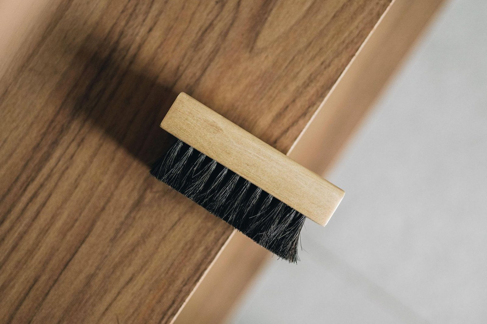
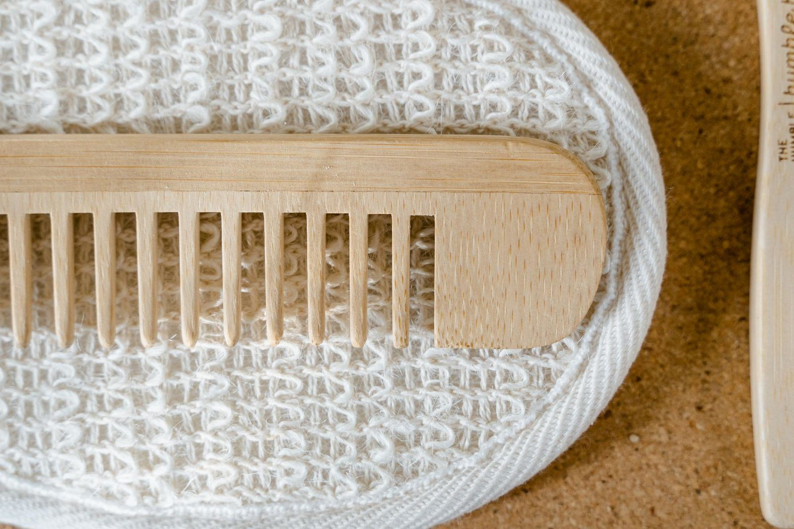
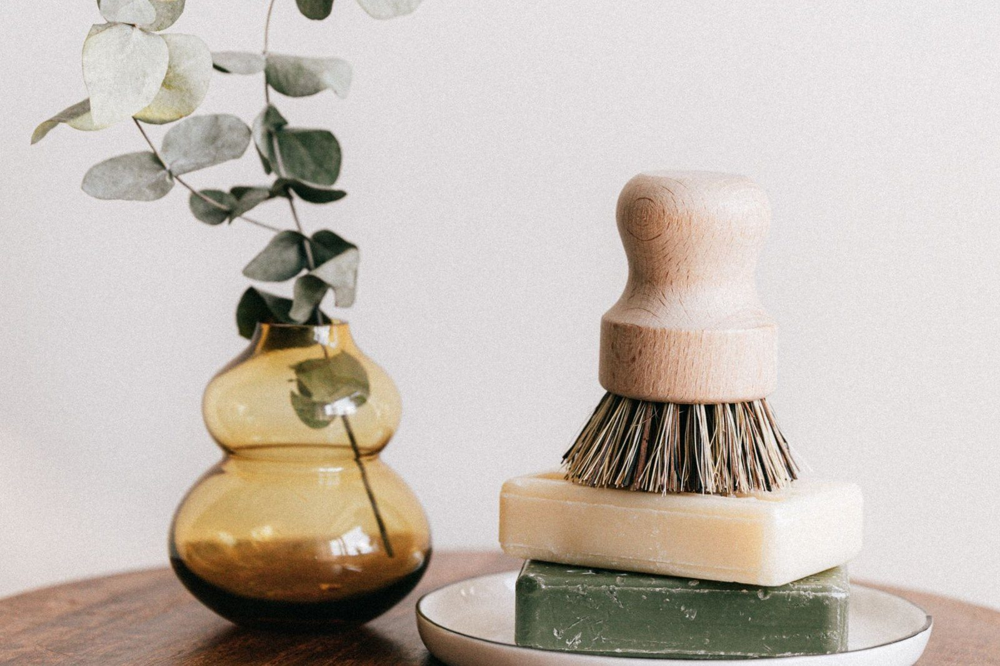

Bakımlı bir sakal, çoğu zaman pahalı bir yağdan ya da usta bir berberden önce küçük bir sabah alışkanlığıyla başlar: doğru fırça ya da doğru tarakla geçirilen bir iki dakika. Sakal bırakan hemen her erkek bir noktada aynı soruyu sorar: **sakal fırçası mı, sakal tarağı mı?** Kısa cevap şu: İkisi farklı işler yapar. Uzun cevabı, yani domuz kılının neden standart olduğunu, ahşap tarağın neden önemli olduğunu, sakal uzunluğuna göre doğru rutini, kış aylarında dikkat edilmesi gerekenleri ve Türkiye'de bulunabilen seçkin markaları bu rehberde bulacaksınız.

**Kısa özet**

- **Sakal fırçası** kılları yönlendirir, yüzeyi düzleştirir, sakal altı cilde masaj yapar ve sakal yağını eşit dağıtır; **sakal tarağı** düğümleri açar, kılları ayırır ve şekil verir.
- **Kısa sakalda** çoğu zaman fırça yeterlidir; **orta ve uzun sakalda** önce tarak, ardından fırça kullanılır.
- **Domuz kılı fırça** ilk başta serttir; düzenli kullanımla kıl uçları çatallanıp yumuşar.
- **Kalın ve kıvırcık sakal** için geniş dişli, **ince ve düz sakal** için daha sık dişli tarak seçin.
- Fırçayı **kaynar suyla yıkamayın**, kapalı ve nemli dolapta saklamayın.
- Seçkin öneriler: **Mühle Sakal Fırçası** (Almanya), **Mason Pearson** fırçaları (Beymen) ve **Gent's İstanbul Sakal Fırçası**.

## Sakal Fırçası ile Sakal Tarağı Arasındaki Fark

İki aletin benzer göründüğü doğru, ama sakal üzerinde çok farklı çalışırlar. Türkiye'nin köklü fırça üreticilerinden Elsa'nın rehberi bu farkı net biçimde özetliyor: Sakal fırçası genellikle doğal kıl ya da yoğun naylon kıllardan oluşur; sakalı düzenlemek, dolaşıklığı açmaya yardımcı olmak ve bakım yağı ya da balmı kıllar boyunca eşit dağıtmak için kullanılır. Tarak ise daha az sayıda ve daha geniş aralıklı dişe sahiptir; kalın ya da kıvırcık sakal tellerini kırmadan ayırmaya ve şekillendirmeye yardımcı olur.

Pratikte pek çok erkek ikisini birlikte kullanır: Önce tarakla büyük düğümler açılır, ardından fırçayla kıllar yönlendirilir ve yüzey düzleştirilir. Bu sıralama, özellikle sabahları yastık izinden ve atkıdan kabaran sakalı birkaç dakikada toparlamanın en güvenilir yoludur.

### Hangi alet ne işe yarar?

- **Fırça:** Yön verme, kabarıklığı bastırma, sakal yağını cilde kadar taşıma, sakal altı cilde hafif masaj.
- **Tarak:** Düğüm açma, kılları tek tek ayırma, kesim öncesi hattı görme, kalın balmı yoğun sakalın içine yedirme.

Elsa'nın önemli bir hatırlatması daha var: Sakal telleri baş saçına göre genellikle daha kalın ve kıvrık olduğundan, çok sık dişli plastik taraklar yerine dişleri arasında yeterli boşluk bırakan modeller kırılmayı azaltır.

Kaynak: [Elsa Fırça](https://www.elsafirca.com/blogs/haberler/sakal-fircasi-ve-taragi-nasil-secilir)

## Neden Domuz Kılı? Sakal Fırçasında Doğal Kılın Gücü

Berber tezgâhlarında gördüğünüz sakal fırçalarının çoğu domuz kılıdır. Braun Türkiye'nin sakal bakım rehberi bunun nedenini şöyle açıklıyor: Sakal fırçası gür sakalı ehlileştirerek yumuşak bir yeleye dönüştürür ve cildin doğal yağı olan sebumun dipten sakal uçlarına kadar dağıtılmasında büyük yardım sağlar. Fırça kılları normal bir saç fırçasından daha kalın olduğu için, cildi aşırı sert fırçalayarak zarar vermemek adına yaban domuzu kılından yapılmış sakal fırçaları öneriliyor.

Braun'un uygulama önerisi de pratik: Yağ ve bakım ürünlerini önce ellerinizle sakalınıza ve cildinize masaj yaparak uygulayın, ardından fırçayla ürünü sakalın tamamına dengeli biçimde dağıtın. Bu yöntem, ürünün bir noktada birikip yağlı görünmesini önler.

### Sert başlar, zamanla yumuşar

Mühle Türkiye'nin doğal kıllı fırçalar hakkındaki yazısı, domuz kılının bir özelliğine dikkat çekiyor: Bu kıl tipi ilk alındığında sertliğiyle öne çıkar, zamanla uçları çatallanarak açılır ve yumuşar. Mühle'nin tıraş fırçaları için verdiği bilgiye göre bu süreç yaklaşık 30 kullanım sürer. Yani yeni bir domuz kılı fırçanın ilk günlerde biraz "batması" kusur değil, doğal bir alışma dönemidir.

Mühle aynı yazıda domuz kılının ısıyı çok iyi tuttuğunu ve masaj etkisinin yüksek olduğunu vurguluyor. Kış aylarında, kalorifer havasıyla kuruyan bir cilt için bu hafif masaj hissi ayrıca keyiflidir.

Kaynak: [Braun Türkiye](https://tr.braun.com/tr-tr/male-grooming/beard-care/how-to-take-care-of-your-beard)

*Photo: Azka Nandya / Pexels, [Pexels License](https://www.pexels.com/license/)*

## Doğru Sakal Tarağı Nasıl Seçilir?

Tarak seçimi, çoğu erkeğin en az düşündüğü ama sakalın dokusunu en çok etkileyen karardır. Elsa'nın rehberi tarak seçimini sakalın kalınlığına ve dokusuna göre üç basit kurala bağlıyor:

1. **Kalın veya kıvırcık sakal:** Geniş diş aralıklı taraklar kılları çekmeden ve koparmadan ayırır.
2. **İnce ve düz sakal:** Daha sık dişli taraklar daha hassas şekillendirme ve düzeltme sağlar.
3. **Günlük kullanım:** Yanınızda taşıyacağınız kompakt bir tarak; evde detaylı düzenleme için daha geniş yüzeyli bir model.

### Ahşap tarağın avantajı

Mühle'nin sakal bakım serisindeki tarak, ahşaptan üretilmiş ve antistatik özellikte. Ahşap, kuru kış havasında elektriklenmeyi azaltır, elde sıcak bir his bırakır ve sakal yağıyla uyumludur. Tek dikkat edilmesi gereken nokta, ahşabın suyla temas ettikten sonra tamamen kurutulması gerektiğidir.

### Cebinizde bir tarak

Braun Türkiye de sakal kıllarının karışarak kolayca matlaştığını hatırlatıyor ve gün boyu yanınızda bir tarak taşımanızı öneriyor. Bıyık için ayrıca daha küçük taraklar da mevcut. İstanbul'un rüzgârlı bir sabahında ya da kaşe paltonun yakası ve atkı arasında sıkışan bir sakalı toparlamak için cepteki küçük ahşap tarak, bakımlı görünümün en sessiz yardımcısıdır.

Kaynak: [Elsa Fırça](https://www.elsafirca.com/blogs/haberler/sakal-fircasi-ve-taragi-nasil-secilir)

## Sakal Uzunluğuna Göre Doğru Rutin

Sakal bakımında en sık yapılan hata, doğru aleti yanlış aşamada kullanmaktır. Sakal Baba'nın sakal tarakları ve fırçaları rehberi, iki aletin de günlük rutinin parçası olması gerektiğini vurgular: Taraklar sakal tellerinin yönlendirilmesine ve dolaşık görünümün azalmasına yardımcı olur, kepeği ve ölü deriyi uzaklaştırarak sakal altı cildin hava almasını sağlar. Fırçalar ise sakal tellerini nazikçe tararken sakal altı cilde temas eder ve bakım yağı ya da balmın homojen yayılmasına katkıda bulunur.

### Kirli sakal ve kısa sakal (yaklaşık 1–2 cm'ye kadar)

Bu uzunlukta tarağın ayıracağı pek bir şey yoktur. Domuz kılı fırça cilde ulaşır, ölü deriyi alır ve kısa kılları aşağı doğru eğitir. Kaşıntı ve pullanmanın en sık görüldüğü dönem de budur; fırçanın hafif masajı bu yüzden özellikle faydalıdır.

### Orta boy sakal (yaklaşık 2–5 cm)

Burada belirleyici olan kılın dokusudur. Düz ve ince sakalda fırça hâlâ yeterli olabilir. Daha gür, dalgalı ya da sert sakalda önce geniş dişli tarak, ardından birkaç fırça darbesi idealdir.

### Uzun sakal (5 cm ve üzeri)

Uzun sakalda tarak ana alettir, fırça ise bitiriş aracıdır. Düğümlü bir sakalda fırçayı zorlamak sürtünme yaratır ve kılları kırar. Önce tarakla düğümleri uçlardan başlayarak açın, sonra fırçayla yüzeyi düzleştirin.

### Sakal Baba'ya göre kullanım sırası

1. Sakal temiz ve kuru ya da hafif nemliyken taramaya başlayın.
2. Bakım ürünü kullandıysanız tarak veya fırçayla sakala eşit şekilde dağıtın.
3. Sakalı doğal çıkış yönünde nazik hareketlerle tarayın.
4. Bunu günlük bakım rutininizin parçası hâline getirin.

Kaynak: [Sakal Baba](https://www.sakalbaba.com/sakal-taraklari-ve-fircalari)

*Photo: Tima Miroshnichenko / Pexels, [Pexels License](https://www.pexels.com/license/)*

## Kıl Türleri: Domuz Kılı, Porsuk ve Vegan Lifler

Sakal fırçası alırken en çok karıştırılan konulardan biri, sakal fırçası ile tıraş fırçası arasındaki farktır. Tıraş fırçası köpük hazırlamak ve sakalı ıslak tıraşa hazırlamak için tasarlanır; sakal fırçası ise kuru ya da hafif nemli sakalı taramak, yönlendirmek ve bakım ürününü dağıtmak içindir. Yine de kıl türlerini anlamak, iki kategoride de doğru seçimi kolaylaştırır.

Mühle Türkiye'nin fırça rehberi, bir fırçanın yumuşaklığını, masaj etkisini, su tutuşunu ve kuruma süresini belirleyen şeyin kullanılan lif olduğunu vurguluyor. Rehberdeki karşılaştırmadan sakal bakımı açısından öne çıkan noktalar şunlar:

- **Doğal domuz kılı:** Başta sert, zamanla açılır; omurgası çok güçlüdür. Güçlü masaj hissi isteyenler ve gür, sert sakallar için idealdir.
- **Porsuk kılı:** Çok daha yumuşaktır ve klasik, lüks bir his verir; ancak daha yavaş kurur. Bu nedenle daha çok tıraş fırçalarında tercih edilir.
- **Sentetik ve vegan lifler:** Hızlı kurur, bakımı kolaydır ve hassas ciltler ile seyahat için uygundur. Mühle'nin sakal fırçasında kullanılan Tampico lifi de bitkisel kökenli bir seçenektir.

### Sakalınıza göre hangi kıl?

Kalın, sert ve hızlı uzayan bir sakal için domuz kılının güçlü omurgası kılları yönlendirmekte daha başarılıdır. Hassas ciltlerde ya da yeni çıkan ince sakallarda ise daha yumuşak, esnek lifler tahrişi azaltır. Hangi kılı seçerseniz seçin, sapın ahşap kalitesi, kılların gövdeye ne kadar sağlam yerleştirildiği ve fırçanın avuca oturuşu, fırçanın yıllarca kullanılıp kullanılamayacağını belirler. Seçkin bir fırça, ilk gün olduğu kadar beşinci yılında da kıl dökmeden çalışmalıdır.

Kaynak: [Mühle Türkiye](https://muehle-shaving.com.tr/pages/muhle-tiras-fircalari)

## Kışın Sakal Bakımında Fırça ve Tarağın Rolü

Kasım ve aralık aylarında sakal iki yönden saldırı altındadır: Dışarıda soğuk ve rüzgâr, içeride kalorifer ve klimanın kuru havası. Sonuç, sert ve kabaran kıllar, altında ise gerilen ve pullanan bir cilttir. Bu dönemde fırça ve tarak, sakal yağı ya da balm kadar önemli hâle gelir.

### Kış için pratik ayarlamalar

- **Fırçaya daha çok iş verin:** Sakal yağını önce elle, sonra fırçayla dibe kadar taşıyın. Amaç yalnızca kılı değil, altındaki cildi de beslemektir.
- **Bastırmayın:** Mühle'nin uyarısı burada da geçerli; fırçayı aşırı bastırmak hem kılların yapısını bozar hem de zaten kuru olan cildi tahriş eder.
- **Ahşap tarak tercih edin:** Kuru havada plastik tarakların yarattığı elektriklenme sakalın daha kabarık görünmesine yol açar.
- **Atkı ve bere sonrası:** Paltoyu çıkardıktan sonra cepteki tarakla tek bir geçiş, sakalı yeniden derli toplu gösterir.

### Sabah için iki dakikalık rutin

1. Sakalı ılık suyla yıkayıp havluyla kurulayın.
2. Uzun sakalda tarakla uçlardan köklere doğru düğümleri açın.
3. Birkaç damla sakal yağını avuçlarda ısıtıp sakala ve cilde yedirin.
4. Fırçayla kıl çıkış yönünde, yanaklarda aşağı ve hafif öne doğru tarayın.
5. Son olarak tarakla yanak ve boyun hattını kaldırıp kontrol edin.

Kaynak: [Mühle Türkiye](https://muehle-shaving.com.tr/blogs/blog/dogal-killi-tiras-fircalari)

## Fırça ve Tarak Temizliği: Hijyen ve Uzun Ömür

Sakal fırçası zamanla dökülen kılları, yağ ve balm kalıntısını ve ölü deriyi biriktirir. Temizlenmeyen fırça bu birikintiyi yeniden yüzünüze taşır. Sakal.com.tr'nin domuz kılı fırçalar için önerileri kısa ama değerli.

### Yapılması gerekenler

- **Elin dayanacağı sıcaklıkta suyla temizleyin.** Doğal kıllı fırça kaynar suya maruz kalınca deforme olur, bükülür ve kıl dökebilir.
- **Sabun yeterlidir.** Çamaşır suyu, sirke ya da boraks gibi çözücüler fırçanın düğümüne zarar verir ve ömrünü kısaltır.
- **Kurumadan kaldırmayın.** Hava almayan kapalı bir dolap rutubet, bakteri ve kötü koku demektir.
- **Dik değil, yan ya da ters koyun.** Bu, kılların dibinin daha kolay kurumasını sağlar.

### Pratik takvim

- Haftada bir fırçadaki kılları elle ya da tarağın ucuyla temizleyin.
- Yoğun balm kullanıyorsanız iki haftada bir, değilse ayda bir ılık su ve hafif sabunla yıkayın.
- Ahşap tarağı her yıkamadan sonra hemen kurulayın.

Mühle de kendi sakal fırçası için benzer bir öneride bulunuyor: Kıllarda ürün birikirse nazikçe temizleyin ve tamamen kurumadan kapalı bir yerde saklamayın. Böyle bakılan kaliteli bir fırça ve tarak, yıllarca aynı performansı korur.

Kaynak: [Sakal.com.tr](https://www.sakal.com.tr/sakal-fircasi-nedir-firca-turleri-nelerdir/)

*Photo: Kaboompics / Pexels, [Pexels License](https://www.pexels.com/license/)*

## Seçkin Ürün Önerileri: Türkiye'de Bulunabilen Sakal Fırçası ve Tarakları

Aşağıdaki öneriler zanaat, dayanıklılık ve sade bir kaliteyi öne çıkarıyor.

### Mühle Sakal Fırçası (BEARDCARE)

Alman tıraş kültürünün simge markalarından Mühle'nin sakal bakım serisinden. Sapı yağlı armut ağacından, kılları vegan Tampico lifinden üretilmiş; oval ve ergonomik formda, PEFC sertifikalı sürdürülebilir ahşap kullanılıyor. Ölçüleri yaklaşık 9,2 × 5 × 3,5 cm. Mühle Türkiye resmi mağazasında fiyatı 2.009 TL olarak listeleniyor; sayfada ürün şu an "yakında stokta" görünüyor. Hayvansal ürün kullanmak istemeyen erkekler için zarif bir alternatif.

Ürün sayfası: [Mühle Sakal Fırçası](https://muehle-shaving.com.tr/products/sakal-bakim)

### Mühle Sakal Tarağı

Aynı serinin ahşap, antistatik tarağı; fırçayla birlikte kullanıldığında kısa ve orta boy sakallar için eksiksiz bir set oluşturur.

Ürün sayfası: [Mühle Sakal Tarağı](https://muehle-shaving.com.tr/products/sakal-taragi)

### Mason Pearson (Beymen)

On dokuzuncu yüzyıldan bu yana Londra'da el işçiliğiyle üretilen Mason Pearson fırçaları, domuz kılı ve kauçuk yastıklı tasarımlarıyla dünyanın en saygın fırçaları arasında. Beymen'in Mason Pearson seçkisinde farklı boy ve kıl seçenekleri bulunuyor; avuca oturan kompakt modeller kısa ve gür sakallarda da kullanılabiliyor.

Marka sayfası: [Mason Pearson, Beymen](https://www.beymen.com/tr/brand-mason-pearson-105856)

### Gent's İstanbul Sakal Fırçası

İstanbul merkezli Gent's İstanbul'un doğal ve sentetik kıl karışımı sakal fırçası, tüm sakal tipleri için tasarlanmış ve ergonomik sapıyla dikkat çekiyor. Markanın sitesinde fiyatı 850 TL olarak listeleniyor.

Ürün sayfası: [Gent's İstanbul Sakal Fırçası](https://www.gentsistanbul.com/magaza/urunler/gent-s-istanbul-sakal-fircasi/88)

### Seti nasıl kurmalı?

- **Kısa sakal:** Tek bir kaliteli domuz kılı ya da yumuşak lifli sakal fırçası yeterlidir.
- **Orta boy sakal:** Fırçaya ek olarak geniş dişli bir ahşap tarak alın.
- **Uzun sakal:** Evde kullanmak için geniş dişli büyük bir tarak, palto cebi için kompakt bir tarak ve bitiriş için bir fırça.

Seçim yaparken yalnızca fiyata değil, kılların gövdeye sağlam yerleştirilmesine, ahşabın işçiliğine ve tarak dişlerinin pürüzsüz bitirilmesine bakın. Parmak ucunuzu tarak dişlerinin kenarında gezdirdiğinizde hiçbir çapak hissetmemelisiniz; sakalınız da hissetmeyecektir.

## Sıkça Sorulan Sorular

### Sakal fırçası mı almalıyım, sakal tarağı mı?

Kısa sakalınız varsa domuz kılı bir sakal fırçası çoğu zaman yeterlidir. Sakalınız birkaç santimetreyi geçtiyse önce tarakla düğümleri açın, ardından fırçayla yüzeyi düzleştirip yağı dağıtın.

### Domuz kılı sakal fırçası neden önerilir?

Domuz kılı, sakal kıllarını koparmadan tutar, cildin doğal yağını dipten uçlara taşır ve hafif masaj etkisi yapar. İlk kullanımlarda serttir, düzenli kullanımla yumuşar.

### Sakal ıslakken mi taranmalı, kuruyken mi?

Sakalı temiz ve kuru ya da hafif nemliyken tarayın. Uzun ve sırılsıklam bir sakalı tarakla zorlamak kılları gerer ve kırılmayı artırır.

### Sakal fırçası sakal kepeğine iyi gelir mi?

Düzenli ve nazik fırçalama sakal altı ciltteki ölü deriyi uzaklaştırır ve doğal yağı dağıtır; bu da pullanmayı azaltmaya yardımcı olur. Geçmeyen kaşıntı ve kepek için dermatoloğa danışın.

### Sakal fırçası nasıl temizlenir?

Kılları haftada bir temizleyin, fırçayı ılık su ve sabunla yıkayın, kaynar su ve kimyasal kullanmayın. Fırçayı yan ya da ters koyarak havadar bir yerde tamamen kurutun.

### Hangi sakal tarağı daha iyi?

Kalın ve kıvırcık sakal için geniş dişli, ince ve düz sakal için sık dişli bir tarak seçin. Ahşap taraklar antistatiktir ve kış aylarında elektriklenmeyi azaltır.

*Bu yazı yayımlanmış bakım önerilerini özetler ve tıbbi tavsiye değildir. Sakal altında süren kaşıntı, tahriş veya pullanma için bir dermatoloğa başvurun.*
