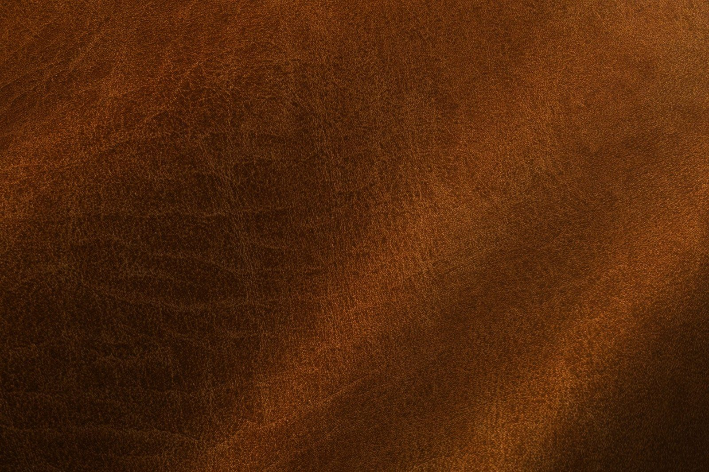

Kapadokya'da bir butik otel, Bodrum'da sezon sonu sakinliği, Abant'ta kar altında iki gece ya da Londra'da kısa bir iş seyahati: modern beyefendinin hayatında hafta sonu kaçamakları artık takvimin vazgeçilmez bir parçası. Bu kaçamakların en sadık yol arkadaşı da tekerlekli bir valiz değil, elde ya da omuzda taşınan bir erkek deri seyahat çantasıdır. İyi seçilmiş bir hafta sonu çantası havalimanında, otel lobisinde ve arabanın bagajında aynı zarafeti korur; her yolculukta biraz daha koyulaşan, karakter kazanan bir eşyaya dönüşür.

Bu rehberde lüks seyahat çantası alırken nelere dikkat etmeniz gerektiğini adım adım ele alıyoruz: kaç litrelik bir çantaya ihtiyacınız olduğu, hakiki deri türleri, Türk Hava Yolları kabin bagajı ölçüleri, el bagajındaki 100 ml sıvı kuralı, çantanın nasıl düzenleneceği, deri çantanın nasıl temizlenip saklanacağı ve Türkiye'de bulabileceğiniz premium seçenekler.

> **Kısa özet**
> - İki ya da üç gecelik bir kaçamak için yaklaşık 30–35 litrelik bir hafta sonu çantası idealdir.
> - Hakiki deri ya da deri-kanvas kombinasyonu tercih edin; sağlam fermuar, düzgün dikiş ve güçlü sap bağlantıları arayın.
> - THY'de ekonomi sınıfı kabin bagajı en fazla 55 x 40 x 23 cm ve 8 kg; buna ek olarak 40 x 30 x 15 cm ve 4 kg'a kadar kişisel eşya taşınabilir.
> - El bagajındaki sıvılar en fazla 100 ml'lik kaplarda, yaklaşık 1 litrelik şeffaf ve ağzı kilitli tek bir poşette olmalı.
> - Deri çantayı kuru bezle düzenli silin, 3–6 ayda bir ince bir tabaka bakım kremi sürün ve asla kaloriferde kurutmayın.

## Doğru Boyut: Hafta Sonu Çantası Kaç Litre Olmalı?

Lüks bir hafta sonu çantası seçerken ilk soru marka ya da renk değil, hacimdir. Çok küçük bir çanta sizi zorla doldurmaya iter; dikişler gerilir, gömlekler buruşur. Çok büyük bir çanta ise kapıda kabin bagajından çıkarılıp bagaja verilme riskini taşır.

### Rotanızı listeleyin

Helmbrook London Türkiye'nin seyahat çantası rehberi, çanta seçmeden önce iki ya da üç günlük rotanız için kıyafet, ayakkabı, kişisel bakım ürünleri ve elektronik eşyaları listelemenizi öneriyor. Bu liste, ihtiyacınız olan hacmi tahminden değil gerçek eşyalardan hesaplamanızı sağlar. Rehbere göre iki ya da üç gecelik bir yolculuk için yaklaşık 30–35 litre ideal bir aralık.

### Konforu artıran detaylar

Aynı kaynak geniş ve ayarlanabilir bir omuz askısının, valiz sapına geçen arka bandın ve ayakkabı ya da ıslak eşyalar için ayrı bir bölmenin konforu ciddi biçimde artırdığını vurguluyor. Uçakla seyahat ediyorsanız havayolunun kabin ölçüsünü mutlaka önceden kontrol etmek gerekiyor. Su itici bir taban ise özellikle yağmurlu kış aylarında çantanın ömrünü uzatan küçük ama değerli bir ayrıntı.

*Photo: Valentin Ivantsov / Pexels, [Pexels License](https://www.pexels.com/license/)*

Pratik bir kural olarak, arabayla yapılan hafta sonu kaçamaklarında biraz daha büyük bir çanta tercih edebilirsiniz; uçakla seyahatte ise 30–40 litre bandında kalmak hem kabin kurallarına uymayı hem de çantayı rahat taşımayı kolaylaştırır.

### Renk seçimi

Konyak, taba ve koyu kahverengi deri, hem lacivert hem gri hem de toprak tonlarındaki kıyafetlerle uyum sağladığı ve patina geliştikçe en güzel görünen renkler olduğu için ilk lüks seyahat çantası için en güvenli seçimdir. Siyah deri ise iş seyahatlerinde, koyu takım elbise ve palto ile daha resmi ve modern bir görünüm sunar. Haki ya da zeytin yeşili tonlar, özellikle deri-kanvas modellerde, hafta sonunun rahat ruhunu yansıtan karakterli bir alternatiftir.

Kaynak: [Helmbrook London Türkiye](https://helmbrook.com.tr/blogs/bloglar/seyahat-cantasi-rehberi-kabin-boy-katlanabilir-ve-deri-modeller-nasil-secilir)

## Deri Türü ve Model Seçimi: Kalite Nerede Saklı?

Bir deri seyahat çantasının fiyatını ve ömrünü belirleyen asıl şey derinin kendisi ve işçiliktir. İki çanta dışarıdan benzer görünse de yıllar içinde birbirinden çok farklı yaşlanabilir.

### Hakiki deri ve kombinasyonlar

Modica Deri'nin erkek deri çanta rehberi, çanta seçimini model, ölçü ve kullanım amacına göre yapmayı öneriyor. Seyahat çantasında tamamen hakiki deri en prestijli seçenektir; deri ile kanvasın birleştiği modeller ise daha hafiftir ve günlük kullanıma daha dayanıklı bir alternatif sunar. Lüks segmentte genellikle tam tahıllı (full grain) dana derisi tercih edilir; bu deri yüzeyini korur, zamanla doğal bir patina kazanır ve her çizgisiyle sahibinin hikâyesini taşır.

### İşçiliği kontrol edin

Mağazada bir çantayı incelerken şu noktalara bakın:

- **Dikiş:** Sapların gövdeye bağlandığı yerlerde dikişler sık, düzgün ve sağlam olmalı.
- **Fermuar:** Ağır, akıcı çalışan metal fermuarlar uzun ömürlü kullanımın işaretidir.
- **Donanım:** Pirinç ya da kaplamalı metal tokalar ve halkalar plastik parçalardan çok daha uzun dayanır.
- **Taban:** Metal ayaklar ya da sağlam bir taban, çantayı yerdeki nem ve aşınmadan korur.
- **Kenarlar:** Boyanmış değil, cilalanarak kapatılmış kenarlar ustalığın göstergesidir.

### Neden yatırım değeri taşır?

Kaliteli hakiki deri bir seyahat çantası, yılda yirmi kaçamakta kullanıldığında on yılda iki yüz yolculuğa eşlik eder. Bu ömür boyunca ucuz bir çantanın birkaç kez yenilenmesi gerekirken, iyi işlenmiş deri her yolculukta daha da güzelleşir; renk koyulaşır, yüzey yumuşar ve çanta sahibinin karakterini yansıtan bir patina kazanır. Lüks bir seyahat çantasının gerçek değeri, ilk günkü parlaklığında değil, yirminci yılındaki görünümündedir.

### Kullanım amacına göre model

Sık uçan bir yönetici için kabin ölçüsüne uygun, omuz askılı bir duffle çanta; arabayla kaçamak yapan bir beyefendi için daha geniş, yumuşak gövdeli bir model; iş ve hafta sonunu birleştirenler için ise dizüstü bilgisayar bölmeli bir tasarım daha uygun olabilir.

Kaynak: [Modica Deri](https://modica.com.tr/blogs/icerik/erkek-deri-canta-rehberi-model-olcu-ve-kullanim-amacina-gore-secim)

## THY Kabin Bagajı Ölçüleri: Çantanız Kabine Girer mi?

Hafta sonu çantasının en büyük avantajı, bagaj bandında beklemeden doğrudan şehre çıkabilmenizdir. Bunun için çantanızın havayolunun kabin kurallarına uyması gerekir.

### Ekonomi sınıfında sınırlar

Türk Hava Yolları'nın kabin bagajı sayfasına göre ekonomi sınıfında bir parça kabin bagajı en fazla 55 x 40 x 23 cm boyutunda ve 8 kg ağırlığında olabilir. Buna ek olarak 40 x 30 x 15 cm boyutunda ve 4 kg'a kadar bir kişisel eşya, örneğin bir evrak çantası ya da küçük bir deri çanta, taşıyabilirsiniz. Kurallar sınıfa, rotaya ve bilet türüne göre değişebildiği için yolculuktan önce güncel bilgiyi kontrol etmek en doğrusu.

### Deri çantada ağırlık hesabı

Hakiki deri bir hafta sonu çantası boşken bile birkaç kilogram gelebilir. 8 kg sınırını aşmamak için çantanın kendi ağırlığını hesaba katın, ağır ayakkabıları ve kalın kazakları üzerinizde taşıyın ve şarj aletleri gibi küçük eşyaları kişisel eşya çantanıza koyun. Yumuşak gövdeli bir duffle çanta, sert kabuklu bir valize göre ölçü kalıbına daha kolay sığar; ancak aşırı doldurulmuş bir çanta yine de ölçüyü aşabilir.

Kaynak: [Türk Hava Yolları](https://www.turkishairlines.com/tr-at/bilgi-edin/kabin-bagaji/)

## El Bagajında Sıvı Kuralı: Bakım Ürünlerinizi Nasıl Taşırsınız?

Sakal yağı, parfüm, nemlendirici ve tıraş köpüğüyle seyahat eden bir beyefendi için sıvı kuralı, seyahat çantası hazırlığının önemli bir parçasıdır.

### Kural ne diyor?

Sivil Havacılık Genel Müdürlüğü'nün sıvı kısıtlamaları uygulamasına göre el bagajında sıvı, jel, aerosol ve spreyler yalnızca her biri en fazla 100 ml'lik kaplarda taşınabilir. Bu kaplar, her yolcunun bir adet taşıyabileceği, yaklaşık 20 x 20 cm boyutunda, ağzı kilitlenebilir, şeffaf ve yaklaşık 1 litrelik bir poşete konmalıdır. Güvenlik kontrolünde bu poşet çantadan çıkarılarak ayrıca taranır. Reçeteli ilaçlar ve yolculuk süresince gerekli bebek maması gibi istisnalar bulunur.

### Premium bir seyahat bakım seti

- Günlük parfümünüzü yaklaşık 10 ml'lik doldurulabilir bir seyahat şişesine aktarın.
- Mümkün olduğunda katı ürünler seçin: sakal balmı, tıraş sabunu ya da katı parfüm sıvı sınırına dahil değildir.
- Şeffaf sıvı poşetini çantanın en üstüne ya da dış cebe yerleştirin; güvenlikte tüm çantayı boşaltmak zorunda kalmazsınız.
- Deri bir tıraş çantası (necessaire) çantanın içinde kalabilir; şeffaf poşet onun üzerinde yolculuk eder.

### Tıraş çantasında neler olmalı?

Kısa bir kaçamak için sakal bakımını aksatmamak da beyefendi seyahatinin bir parçası. Küçük bir sakal tarağı, katı bir sakal balmı, seyahat boyu bir yüz temizleyici, nemlendirici ve dudak balmı çoğu hafta sonu için yeterlidir. Kış aylarında uçak kabinindeki kuru hava cildi ve sakalı çabuk kurutur; bu nedenle nemlendiriciyi el bagajında, kolay ulaşılabilir bir yerde tutmak akıllıca olur.

Kaynak: [Sivil Havacılık Genel Müdürlüğü](https://web.shgm.gov.tr/tr/s/5219-sivi-kisitlamalari-uygulamasi)

## Hafta Sonu Şehir Rotası İçin Çanta Nasıl Hazırlanır?

İyi bir çanta, ancak doğru hazırlandığında değerini gösterir. Gömleklerin kırışmadan, ayakkabıların kıyafetlere değmeden ulaşması tamamen yerleştirme düzenine bağlıdır.

### Kapsül gardırop mantığı

Manovam'ın erkek seyahat çantasıyla hafta sonu şehir rotası yazısı, kısa kaçamaklarda kıyafetleri birbiriyle uyumlu az sayıda parçadan seçmenin hem çantayı hafiflettiğini hem de şık görünmeyi kolaylaştırdığını anlatıyor. Kış için lacivert, gri, kahverengi ve krem tonlarında bir palet seçtiğinizde her üst her altla uyum sağlar ve tek bir çift koyu deri ayakkabı ya da bot tüm hafta sonunu kurtarır.

### Yerleştirme sırası

1. **Ağır eşyalar en alta:** Ayakkabılar toz torbası içinde, tabanları çanta duvarına bakacak şekilde bir uca yerleştirilir; içlerine çorap doldurulur.
2. **Rulo yapılan parçalar:** Tişört, triko, pijama ve kot pantolon sıkıca rulo yapılıp ayakkabıların etrafındaki boşlukları doldurur.
3. **Katlanan parçalar en üste:** Kumaş pantolon ve gömlekler, üzerine hiçbir şey baskı yapmayacak şekilde düz yerleştirilir.
4. **Bakım çantası en son:** Güvenlikte ya da otelde kolayca çıkarılabilmesi için en üstte kalır.
5. **Küçük eşyalar cepte:** Şarj aleti, kemer ve kravat iç cepte; telefon, anahtar ve biniş kartı dış cepte.

### Yolculuk kıyafeti de çantanın parçasıdır

Hafta sonu çantasını hafif tutmanın en zarif yolu, en hacimli parçaları üzerinizde taşımaktır. Kışın yün ya da kaşmir bir palto, koyu renk bir balıkçı yaka kazak, klasik kesim yün bir pantolon ve koyu deri botlar hem yolculukta şık görünmenizi sağlar hem de çantada ciddi yer açar. Paltonun iç cebi pasaport ve biniş kartı için en güvenli yerdir. Bu yaklaşım, deri çantanın da aşırı doldurulmadan formunu korumasına yardımcı olur.

### Varışta

Otele ulaştığınızda çantayı açın, önce takım ya da ceketi asın. Hafif kırışan bir gömleği sıcak bir duş sırasında banyoda asmak, buharın kumaşı rahatlatmasını sağlar.

*Photo: Robert Grant / Pexels, [Pexels License](https://www.pexels.com/license/)*

Kaynak: [Manovam](https://www.manovam.com/blog/icerik/erkek-seyahat-cantasi-ile-hafta-sonu-sehir-rotasi)

## Deri Seyahat Çantası Bakımı: Temizleme, Nemlendirme ve Saklama

Hakiki deri bir çanta doğru bakımla on yıllarca kullanılabilir. Bakım için gereken süre, mevsimde birkaç dakikadan fazla değildir.

### Düzenli temizlik

Opia Leather'ın deri bakım rehberi, çantanın tozunu haftada bir kuru bir mikrofiber bezle almayı öneriyor. Kirlenme varsa bez hafifçe nemlendirilir ve deri dairesel hareketlerle silinir. Deriye özel bir temizleyici kullanacaksanız önce görünmeyen bir noktada test edin. Alkol, deterjan ve ıslak mendil gibi ürünler derinin doğal yağlarını alıp çatlamalara yol açabileceği için kesinlikle kullanılmamalı.

### Islanan deri

Yağmurda ıslanan bir deri çanta kuru bir bezle bastırılarak kurulanmalı ve oda sıcaklığında, gölgede kurumaya bırakılmalıdır. Kalorifer, soba ya da saç kurutma makinesi deriyi sertleştirir ve çatlatır. Çantanın içini kâğıtla hafifçe doldurmak, kururken formunu korumasına yardımcı olur.

### Nemlendirme

Deri zamanla doğal yağlarını kaybeder. 3–6 ayda bir az miktarda deri bakım kremi ince bir tabaka hâlinde sürülmeli, emildikten sonra kuru bir bezle parlatılmalıdır. Özellikle saplar, askı kenarları ve köşeler en çabuk kuruyan bölgelerdir.

### Saklama

Seyahatler arasında çantayı pamuklu bir toz torbasında, içi kâğıtla doldurulmuş olarak, serin, kuru ve güneşten uzak bir yerde saklayın; yaklaşık 18–22 °C'lik normal bir oda sıcaklığı idealdir. Naylon poşet deriyi nefessiz bırakıp küflenmeye yol açabileceği için tercih edilmemeli. Mürekkep, yağ ya da şarap lekesi gibi derin lekelerde ve yırtık ya da kırık donanımda profesyonel bir deri ustasına başvurmak en doğrusudur.

*Photo: Anna Tarazevich / Pexels, [Pexels License](https://www.pexels.com/license/)*

Kaynak: [Opia Leather](https://opialeather.com/blogs/faydali-bilgiler-opia-leather/deri-bakimi-nasil-yapilir-canta-cuzdan)

## Türkiye'de Premium Seçimler: Beymen'den Lüks Deri Seyahat Çantaları

İstanbul'da ya da online olarak lüks bir erkek deri seyahat çantası arayan bir beyefendi için Beymen, İtalyan işçiliğinden yerli premium markalara kadar geniş bir seçki sunuyor. Fiyatlar ve stok durumu sık değiştiği için güncel bilgiyi ürün sayfasından kontrol etmenizi öneririz.

### Officine Creative Deri Seyahat Çantası

İtalyan Officine Creative, el işçiliğiyle yaşlandırılmış görünümlü derileri ve karakterli tasarımlarıyla tanınır. Beymen'deki haki renkli model, ürün sayfasına göre yaklaşık 50 x 30 cm ölçülerinde, çıkarılabilir omuz askılı, çift iç cepli ve yüzde 100 dana derisinden üretilmiş. Hafta sonu kaçamakları için hem kabin dostu hem de son derece şık bir seçenek. [Officine Creative deri seyahat çantasını inceleyin](https://www.beymen.com/tr/p_officine-creative-haki-erkek-deri-seyahat-cantasi_1568867)

### Beymen Collection Flotter Deri Seyahat Çantası

Beymen'in kendi koleksiyonundan bu kahverengi model, yumuşak dokulu flotter deriden yapılmış; yaklaşık 44 x 28 cm ölçüsü, çift kulpu ve omuz askısıyla kısa kaçamaklar ve iş seyahatleri için kompakt bir alternatif. [Beymen Collection Flotter seyahat çantasını inceleyin](https://www.beymen.com/tr/p_beymen-collection-flotter-kahverengi-erkek-deri-seyahat-cantasi_1352295)

### Network Acı Kahve Deri Seyahat Çantası

Türk erkek modasının köklü premium markası Network'ün acı kahve rengi deri seyahat çantası, çıkarılabilir omuz askısı ve iç cebiyle klasik ve sade bir tasarım arayanlar için güçlü bir yerli seçenek. [Network deri seyahat çantasını inceleyin](https://www.beymen.com/tr/p_network-aci-kahve-erkek-deri-seyahat-cantasi_1920284)

Kaynak: [Beymen](https://www.beymen.com/tr/p_officine-creative-haki-erkek-deri-seyahat-cantasi_1568867)

## Sıkça Sorulan Sorular

### Hafta sonu kaçamağı için kaç litrelik çanta gerekir?
İki ya da üç gecelik bir yolculuk için yaklaşık 30–35 litrelik bir hafta sonu çantası idealdir. Daha uzun yolculuklarda ya da arabayla seyahatte daha büyük bir model seçilebilir.

### THY'de kabin bagajı ölçüsü nedir?
Türk Hava Yolları'nda ekonomi sınıfı kabin bagajı en fazla 55 x 40 x 23 cm ve 8 kg olabilir; ayrıca 40 x 30 x 15 cm ve 4 kg'a kadar bir kişisel eşya taşınabilir.

### El bagajında parfüm ve sakal yağı taşıyabilir miyim?
Evet, her biri en fazla 100 ml'lik kaplarda ve yaklaşık 1 litrelik şeffaf, ağzı kilitli tek bir poşette olmak şartıyla taşıyabilirsiniz. Poşet güvenlikte ayrıca taranır.

### Deri seyahat çantası ıslanırsa ne yapmalıyım?
Kuru bir bezle bastırarak kurulayın, içini kâğıtla doldurun ve oda sıcaklığında gölgede kurumaya bırakın. Kalorifer ya da saç kurutma makinesi kullanmayın.

### Deri çantaya ne sıklıkla bakım kremi sürülmeli?
Genellikle 3–6 ayda bir, ya da deri kuru ve sert hissettirdiğinde, ince bir tabaka bakım kremi sürüp emildikten sonra kuru bezle parlatmak yeterlidir.

### Hakiki deri seyahat çantası yatırıma değer mi?
Evet. Kaliteli hakiki deri bir çanta doğru bakımla on yıllarca kullanılır, zamanla patina kazanarak güzelleşir ve kullanım başına maliyeti ucuz alternatiflerden daha düşük olur.
