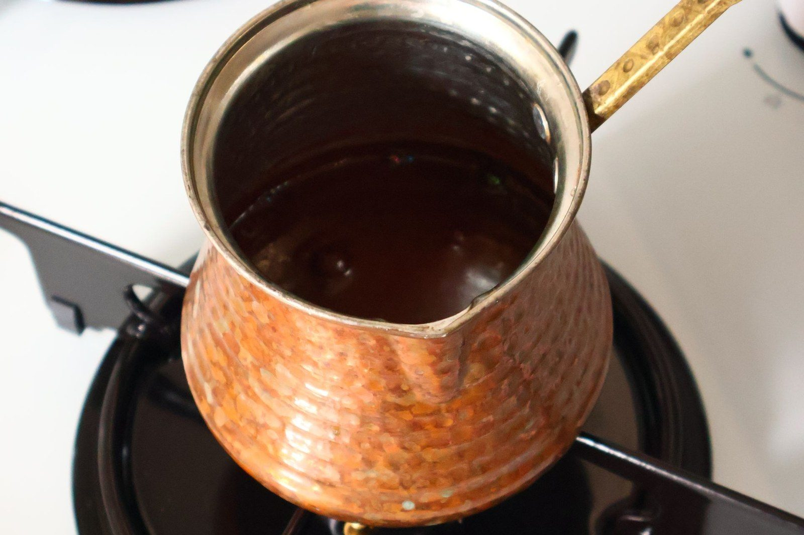
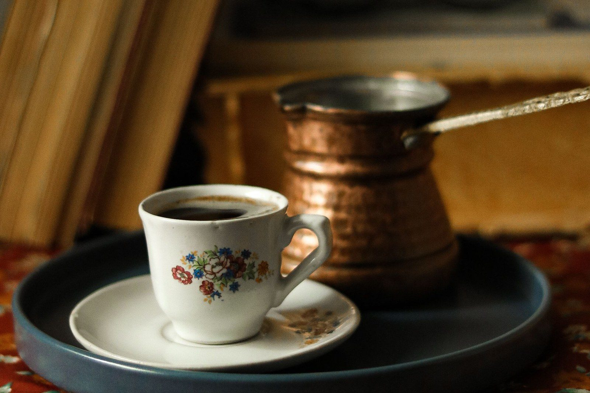
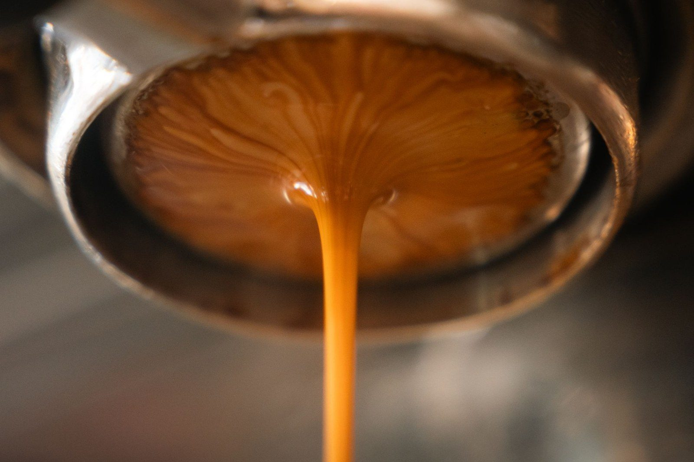

Bir beyefendinin gününü belirleyen küçük ritüeller vardır: özenle yapılmış bir tıraş, ütüsü yerinde bir gömlek, kurulmuş bir saat. Bu ritüellerin belki de en zarifi, kendi elinizle pişirdiğiniz bir fincan Türk kahvesidir. Cezvenin ocakta yavaşça kabarması, köpüğün fincana eşit paylaştırılması, yanında bir bardak su ve bir parça lokum... Bunlar sadece bir içeceğin hazırlanışı değil, yüzyıllardır süren bir misafirperverlik ve sohbet kültürünün parçasıdır.

Bu rehberde Türk kahvesi nasıl yapılır sorusunu en ince ayrıntısına kadar ele alıyoruz: Türk kahvesinin kültürel mirastaki yeri, Türk Kahvesi Kültürü ve Araştırmaları Derneği'nin 7 adımlık pişirme kılavuzu, köpüklü Türk kahvesinin sırrı olan kabarma anları, kahve ikram adabı, kahve çekirdeğinin nasıl saklanacağı, Türk kahvesi ile filtre kahvenin kafein farkı ve günde kaç fincan kahvenin makul sayıldığı. Yazının sonunda Türkiye'de bulabileceğiniz premium kahve ekipmanlarından seçkiler ve sık sorulan sorular yer alıyor.

> **Kısa özet**
> - Türk kahvesi kültürü ve geleneği 2013'te UNESCO İnsanlığın Somut Olmayan Kültürel Mirası Temsili Listesi'ne alındı.
> - Her fincan için bir tepeleme tatlı kaşığı, yani yaklaşık 7–8 gram, pudra inceliğinde taze çekilmiş kahve kullanın.
> - Malzemeyi oda sıcaklığındaki suyla ocağa koymadan önce karıştırın; ocağa koyduktan sonra asla karıştırmayın.
> - Kısık ateşte yaklaşık 3 dakika pişirin; ilk kabarma yaklaşık 80 °C, ikinci kabarma yaklaşık 90 °C civarındadır. Kahveyi kaynatmayın.
> - Kahve su ve lokumla ikram edilir; su kahveden önce içilir.
> - Çekirdekleri hava geçirmeyen, ışık almayan bir kapta, serin ve kuru bir dolapta saklayın; günlük kahveyi buzdolabına koymayın.
> - Bir fincan Türk kahvesinde yaklaşık 60–65 mg kafein bulunur; bir kupa filtre kahvede bu miktar çok daha yüksek olabilir.

## Bir Fincan Kahvenin Kırk Yıl Hatırı: Türk Kahvesinin Kültürel Mirası

Türk kahvesini dünyadaki diğer kahvelerden ayıran şey yalnızca pişirme yöntemi değildir. Kültür ve Turizm Bakanlığı'nın Kültür Portalı'na göre kahve yaklaşık 500 yıl önce Osmanlı topraklarına girdi ve hızla yayıldı. Tarihi, adını verdiği yapılar, içilme ve sunulma biçimi, yapımında kullanılan araçlar ve sosyal ilişkilerdeki rolüyle Türk kültüründe özgün bir yere sahip oldu.

### UNESCO listesindeki yeri

Bu zengin kültürel temel nedeniyle "Türk Kahvesi Kültürü ve Geleneği", 2013 yılında UNESCO tarafından İnsanlığın Somut Olmayan Kültürel Mirası Temsili Listesi'ne dahil edildi. Yani her sabah cezveyi ocağa koyduğunuzda, aslında dünya mirası kabul edilmiş bir geleneği sürdürüyorsunuz.

### "Bir fincan kahvenin kırk yıl hatırı vardır"

Kültür Portalı, kahvenin Türkiye'deki önemini bu ünlü özdeyişle özetliyor. Kahve, evlilik öncesi törenlerin parçasıdır, gelen misafire mutlaka ikram edilir ve sohbetlerin vazgeçilmez içeceğidir. Kahvenin kültürdeki izleri dilde bile görülür: "kahverengi" ve "kahvaltı" kelimeleri kökünü bu içecekten alır.

### Osmanlı'nın sosyal merkezleri: kahvehaneler

16. yüzyılın başlarında kahvenin İstanbul'a gelmesi ve yeni bir yöntemle pişirilip sunulmaya başlanmasının ardından, adını bu içecekten alan kahvehaneler tüm imparatorluğa yayıldı. Kitapların ve şiirlerin okunduğu, edebiyat sohbetlerinin yapıldığı, satranç ve tavlanın oynandığı bu mekanlar Osmanlı sosyal hayatının merkezleri hâline geldi. Bugün modern bir beyefendinin evindeki kahve köşesi, bu sohbet ve incelik kültürünün küçük bir devamıdır.

Kaynak: [Kültür Portalı – T.C. Kültür ve Turizm Bakanlığı](https://www.kulturportali.gov.tr/portal/turkkahvesi)

## 7 Adımda Mükemmel Türk Kahvesi: Ölçü, Şeker ve Pişirme

Türk Kahvesi Kültürü ve Araştırmaları Derneği, kusursuz bir fincan için 7 adımlık bir kılavuz yayımlıyor. Kılavuzun güzelliği sadeliğinde: doğru malzeme, doğru ölçü ve sabır.

### Kahve: taze ve pudra inceliğinde

İlk kural, taze kavrulmuş ve pudra inceliğinde çekilmiş Türk kahvesi kullanmaktır. Türk kahvesi, dünyadaki en ince öğütülen kahvelerden biridir; bu incelik hem yoğun gövdeyi hem de kadifemsi köpüğü mümkün kılar. Kahveyi küçük miktarlarda almak ve paketini sıkıca kapatmak, aromanın korunmasının ön şartıdır.

### Türk kahvesi kaç gram olmalı?

Dernek, her porsiyon için bir tepeleme tatlı kaşığı, yani yaklaşık 7–8 gram kahvenin boş ve kuru cezveye konmasını öneriyor. Önemli bir not daha var: köpüğün ideal kıvamda olması ve kahvenin yeterince kabarabilmesi için porsiyon sayısına uygun boyutta bir cezve kullanılmalı. Tek kişilik kahveyi büyük cezvede pişirmek, köpüğün dağılmasına yol açar.

### Sade, az, orta, şekerli: şeker ölçüsü

Derneğin ölçülerine göre:

- **Sade:** Hiç şeker eklenmez.
- **Az şekerli:** 1 küp, yaklaşık 2–3 gram şeker.
- **Orta şekerli:** 1,5 küp, yaklaşık 3–4,5 gram şeker.
- **Şekerli:** 2 küp, yaklaşık 4–6 gram şeker.

Gerçek bir kahve tutkunu çoğu zaman sadeyi tercih eder; çünkü kaliteli çekirdeğin aroması şekerle örtülmeden ortaya çıkar. Yine de misafire şeker tercihini sormak, ikram adabının ilk kuralıdır.

### Su ve karıştırma

Her porsiyon için bir kahve fincanı dolusu oda sıcaklığında su cezveye eklenir. Malzeme, cezve ocağa konmadan önce iyice karıştırılır. Dernek bu noktada çok net: cezve ateşe konduktan sonra kahve kesinlikle karıştırılmaz. Sonra cezve kısık ateşe yerleştirilir ve kahve ortalama 3 dakikada pişecek şekilde sabırla beklenir.

*Photo: Derya Nur / Pexels, [Pexels License](https://www.pexels.com/license/)*

Kaynak: [Türk Kahvesi Kültürü ve Araştırmaları Derneği](https://www.turkkahvesidernegi.org/index.php?gastronomi=menuactive&icerik=7-adimda-mukemmel-turk-kahvesi-kilavuzu)

## Köpüklü Türk Kahvesinin Sırrı: Kabarma Anları ve Sıcaklık

Köpüksüz Türk kahvesi, ütüsüz bir gömlek gibidir: içilir ama eksik kalır. Köpüğün sırrı tamamen zamanlamada saklıdır ve dernek kılavuzu bu anları sıcaklıklarıyla birlikte tarif ediyor.

### İlk kabarma: yaklaşık 80 °C

Kahve yaklaşık 80 °C civarında köpürmeye başlar. Köpük cezveden taşmadan önce cezve ateşten alınır ve köpük fincanlara eşit şekilde paylaştırılır. Ardından cezve tekrar ateşe konur. Bu, birden fazla fincan hazırlarken her misafire aynı özeni göstermenin de yoludur.

### İkinci kabarma: yaklaşık 90 °C

Köpük yaklaşık 90 °C civarında tekrar yükselir. Kahve taşmadan önce cezve ateşten kaldırılır ve kahvenin birkaç saniye dinlenmesine izin verilir. Kalan kahve, ilk kabarmada olduğu gibi fincanlara eşit olarak paylaştırılır; böylece bütün fincanlarda eşit miktarda kahve ve köpük olur.

### Asla kaynatmayın

Dernek, isteyenin kabartma aşamasını tekrarlayabileceğini ancak kahvenin kesinlikle kaynatılmaması gerektiğini vurguluyor; aksi takdirde kahve acı ve sulu olur. Kısık ateş, doğru boyutta cezve ve dikkatli bir göz, köpüklü Türk kahvesinin üç temel şartıdır. Bakır cezve ısıyı eşit dağıttığı için geleneksel olarak tercih edilir; paslanmaz çelik cezveler ise bakımı kolay modern bir alternatiftir.

### Servise hazırlık

Kılavuzun son cümlesi aynı zamanda adabın da ilk kuralıdır: servise çıkacak kahvelerin yanında bir bardak su ikram edilir. Fincanları önceden ılık suyla ısıtmak da köpüğün ve kahvenin sıcaklığının daha uzun korunmasına yardımcı olabilecek küçük bir inceliktir.

Kaynak: [Türk Kahvesi Kültürü ve Araştırmaları Derneği](https://www.turkkahvesidernegi.org/index.php?gastronomi=menuactive&icerik=7-adimda-mukemmel-turk-kahvesi-kilavuzu)

## Türk Kahvesi İkram Adabı: Su, Lokum ve Kahvenin Sosyal Dili

Türk kahvesi bir içecekten fazlasıdır; bir davettir. Bir beyefendi kahveyi nasıl ikram ettiğiyle de kendini anlatır.

### Neden kahvenin yanında su verilir?

Kültür Portalı'na göre Türk kahvesi geleneksel olarak su ve lokumla birlikte ikram edilir. Suyun kahveden önce içilmesi, kahvenin boğazdan daha kolay geçmesini sağladığı inancıyla bağlantılıdır. Uygulamada su damağı temizler ve kahvenin aromasını daha net algılamanıza yardımcı olur.

### Lokumun yeri

Tarihi Osmanlı dönemine kadar giden lokum, Türk kahvesiyle birlikte ikram edilen en önemli lezzettir. Küçük bir tabakta bir iki parça lokum, kahvenin yoğun ve hafif acı tadını dengeler. Kaliteli bir lokum ya da bitter çikolata, sade kahvenin en şık eşlikçileridir.

*Photo: Feyza Daştan / Pexels, [Pexels License](https://www.pexels.com/license/)*

### Kız isteme ve kahvenin sınavı

Kahve, Türk geleneklerinden kız isteme törenlerinin ayrılmaz parçasıdır. Müstakbel damada mutlaka kahve ikram edilir ve bu kahvenin müstakbel gelin tarafından pişirilmesinin nedeni, kahvenin lezzetinin bir tür sınav niteliği taşımasıdır. Kahve kültürünün etrafında gelişen fincanlar, cezveler ve tepsiler de bu yüzden Türkiye'den dostlara götürülebilecek en anlamlı hediyeler arasında sayılır.

### Telve ve fal geleneği

Fincanın dibinde kalan ve içilmeyen telve, Türk kahvesine özgü fal geleneğinin doğmasına neden olmuştur. Fal bir eğlence olarak sofrada yer alabilir; ancak bir beyefendi için asıl mesele, kahvenin etrafında kurulan sohbet ve misafire gösterilen ilgidir.

Kaynak: [Kültür Portalı – Türk Kahvesi](https://www.kulturportali.gov.tr/portal/turkkahvesi)

## Kahve Çekirdeği Nasıl Saklanır? Tazeliği Korumanın Kuralları

En iyi kavurmacıdan aldığınız kahve bile yanlış saklanırsa birkaç gün içinde canlılığını kaybeder. Karaca'nın kahve saklama rehberi, aromayı bozan dört düşmanı net biçimde sıralıyor: hava, ışık, nem ve sıcaklık.

### Doğru kap ve doğru yer

Kahve çekirdekleri, kapağı sıkıca kapanan ve mümkünse ışık geçirmeyen opak bir kapta saklanmalı. Kabın kahve miktarına yakın boyutta olması önemli; içeride fazla boşluk kaldığında kahvenin temas ettiği hava artar. Şeffaf cam kavanoz kullanılacaksa mutlaka karanlık bir dolapta durmalı. Ocak, fırın, bulaşık makinesi ve güneş alan tezgâhlar ise kahve için uygun değildir. Kahve nemi ve güçlü kokuları emdiği için lavabonun yanı ya da baharat dolabı da kaçınılması gereken yerlerdir.

### Buzdolabı mı, dondurucu mu?

Rehbere göre günlük kahve için buzdolabı iyi bir tercih değildir: içerideki nem ve yiyecek kokuları kahvenin aromasını etkiler, kap her açıldığında sıcaklık ve nem değişir. Dondurucu ise uzun süreli saklama gerektiğinde değerlendirilebilir. Kahve kullanılacak porsiyonlara ayrılmalı, hava geçirmeyen ambalajlarda dondurulmalı, çıkarıldığında ambalaj açılmadan oda sıcaklığına gelmesi beklenmeli ve çözülmüş kahve yeniden dondurulmamalıdır.

### Az al, taze öğüt

Kavurma tarihi yazan paketleri tercih etmek, kahvenin ne kadar süredir beklediğini takip etmeyi kolaylaştırır. Çekirdek öğütüldüğünde yüzey alanı büyük ölçüde artar, bu yüzden öğütülmüş kahve aromasını çekirdeğe göre daha hızlı kaybeder. En iyi sonuç için çekirdeği demlemeden hemen önce öğütün, kaşığı kuru tutun ve farklı kahveleri ayrı kaplarda saklayın.

Kaynak: [Karaca Blog](https://www.karaca.com/blog/kahve-cekirdekleri-nasil-saklanmali)

## Türk Kahvesi mi, Filtre Kahve mi? Kafein Karşılaştırması

Modern beyefendinin kahve rafında artık yalnızca cezve yok; filtre kahve demleyicileri ve espresso makineleri de evlerde yer buluyor. Peki hangisi ne kadar kafein içeriyor?

### Fincan ve kupa farkı

İstanbul Atlas Üniversitesi Beslenme ve Diyetetik Bölüm Başkanı Prof. Dr. M. Emel Alphan, 5 Aralık Dünya Türk Kahvesi Günü vesilesiyle yaptığı açıklamada, bir fincan (yaklaşık 50 ml) Türk kahvesinin yaklaşık 65 mg kafein içerdiğini, bir kupa (yaklaşık 240 ml) filtre kahvede ise 120–270 mg kafein bulunduğunu belirtiyor. Yani küçük fincanıyla Türk kahvesi, bir kupa filtre kahveye göre çoğu zaman çok daha az kafein sağlıyor.

### Diğer içecekler

Aynı açıklamaya göre bir fincan (yaklaşık 50 ml) espresso 130–200 mg, bir kupa (180–240 ml) granül kahve 60–80 mg, bir kupa (240 ml) Amerikano yaklaşık 100 mg kafein içerirken, bir çay bardağı (yaklaşık 100 ml) demlenmiş siyah çayda 40–80 mg kafein bulunuyor. Kafeinsiz kahvede ise kafeinin yaklaşık yüzde 95'i azaltılmış oluyor.

*Photo: James Collington / Pexels, [Pexels License](https://www.pexels.com/license/)*

### Dikkat edilmesi gerekenler

Prof. Dr. Alphan, kahvenin kan basıncını geçici olarak yükseltebileceğini, filtrelenmemiş kahvenin aşırı tüketiminin kolesterol seviyelerinde hafif bir artışla ilişkilendirildiğini ve kişisel özelliklere göre mide yanması, sinirlilik veya uykusuzluk gibi yan etkiler görülebileceğini hatırlatıyor. Günlük ortalama 500–600 mg kafein tüketiminin ise önemli sağlık riski oluşturabileceğini vurguluyor.

Kaynak: [İstanbul Atlas Üniversitesi](https://www.atlas.edu.tr/blog/bir-fincan-turk-kahvesi-mi-bir-kupa-filtre-kahve-mi)

## Günde Kaç Fincan Kahve İçilmeli? Güvenli Kafein Sınırı

Ritüel keyif vermeli, çarpıntı değil. Günlük kafein sınırını bilmek, kahveyi uyku ve spor düzeninizi bozmadan hayatınızda tutmanın en kolay yoludur.

### 400 mg ve 300 mg referansları

Acıbadem'in sağlıklı yaşam rehberine göre ABD Gıda ve İlaç Dairesi (FDA), sağlıklı yetişkinler için günlük 400 mg kafein alımını güvenli kabul ediyor. Türk Tabipleri Birliği ise bu miktarı günlük 300 mg olarak belirlemiş. Rehber, 400 mg kafeinin ortalama 4–5 fincan, 300 mg kafeinin ise ortalama 3–4 fincan kahveye denk geldiğini belirtiyor. Bu miktarlar güvenli üst sınırlar olarak kabul ediliyor; ancak kişinin kafeine duyarlılığı ve kafeini ne kadar hızlı metabolize ettiği bu sınırları değiştirebilir.

### Kahve türüne göre kafein

Acıbadem'in tablosuna göre 1 fincan (yaklaşık 65 ml) Türk kahvesi 60–65 mg, 1 kupa (yaklaşık 150 ml) filtre kahve 115–175 mg, tek shot espresso (30–50 ml) yaklaşık 63 mg ve 1 fincan (yaklaşık 480 ml) soğuk demleme kahve yaklaşık 200 mg kafein içeriyor. Farklı kaynaklarda espresso değerlerinin değişmesi, kahvenin türüne, kavrumuna ve hazırlanışına göre kafeinin geniş bir aralıkta oynadığını gösteriyor.

### Bağımlılık işaretleri

Rehber, günlük 700 mg'ın üzerindeki kafein alımının kafein bağımlılığına işaret ettiğini belirtiyor. Güvenli limitlerde kalmak, bol su içmek ve kahve saatlerine dikkat etmek bağımlılığı önlemenin yolları arasında sayılıyor. Kalp ritim sorunu, yüksek tansiyon, uyku problemi olanların ve ilaç kullananların kahve tüketimini doktorlarıyla konuşmaları en doğrusu.

Kaynak: [Acıbadem](https://www.acibadem.com.tr/saglikli-yasam/kahve-bagimliligi/)

## Beyefendinin Kahve Köşesi: Türkiye'de Bulabileceğiniz Premium Seçimler

Bu üç seçim, geleneksel ve modern kahve ritüelinin farklı yüzlerini temsil ediyor: el işçiliği bir cezve, zarif bir fincan takımı ve köpüğü kusursuz tutturan bir Türk kahvesi makinesi.

### Coho Artisan Döküm Sarma Kulp Bakır Türk Kahve Cezvesi 180 ml

Geleneğin zanaatkâr hâli. Beymen'de satılan Coho Objet imzalı bu parlak bakır cezve, döküm ve sarma kulp detayıyla öne çıkıyor. Yaklaşık 180 ml hacmi, derneğin "porsiyona uygun cezve" önerisine uygun olarak iki kişilik kahve için idealdir; daha kalabalık sofralar için 340 ml'lik versiyonu da bulunuyor. [Coho Artisan Bakır Cezveyi Beymen'de inceleyin](https://www.beymen.com/tr/p_coho-objet-coho-artisan-dokum-sarma-kulp-bakir-turk-kahve-cezvesi-180-ml_1112186)

### Vakko 2'li Kahve Fincan Takımı

İkramın zarafeti. Vakko Home'un mavi rengiyle öne çıkan 2'li kahve fincan takımı, gold renk kenarları ve gold tutma kulplarıyla dikkat çekiyor. Özel bir misafire ya da sabah ritüelinize asalet katmak için ideal bir seçim. Ürün sayfasındaki fiyat: 18.950 TL. [Vakko 2'li Kahve Fincan Takımını inceleyin](https://www.vakko.com/cay-kahve/2-li-kahve-fincan-takimi-p-M403050495-0038)

### Arzum Okka Rich Spin Pro Türk Kahvesi Makinesi (Bakır)

Modern beyefendinin pratik tercihi. Arzum'un açıklamasına göre Okka Rich Spin Pro, karıştırıcılı cezvesiyle geleneksel Türk kahvesi, közde kahve, sütlü Türk kahvesi ve sıcak çikolata gibi içecekleri tek seferde 5 fincana kadar hazırlayabiliyor; 8 farklı modu, otomatik demleme sıcaklığı ayarı ve kolay temizlenebilir paslanmaz çelik cezvesi bulunuyor. Ürün sayfasındaki fiyat: 8.259 TL. [Arzum Okka Rich Spin Pro'yu inceleyin](https://www.arzum.com.tr/ok0020-arzum-okka-rich-spin-pro-turk-kahvesi-makinesi-bakir)

## Sık Sorulan Sorular

### Türk kahvesi için kaç gram kahve kullanılır?
Türk Kahvesi Kültürü ve Araştırmaları Derneği'ne göre her fincan için bir tepeleme tatlı kaşığı, yani yaklaşık 7–8 gram pudra inceliğinde kahve ve bir kahve fincanı dolusu oda sıcaklığında su kullanılır.

### Türk kahvesi neden köpürmez?
Genellikle kahve kaynatıldığı, ateş fazla yüksek olduğu, ocağa konduktan sonra karıştırıldığı ya da porsiyona göre çok büyük cezve kullanıldığı için. Kısık ateşte yaklaşık 3 dakika pişirin ve kabarınca ateşten alın.

### Kahvenin yanında neden su verilir?
Geleneğe göre su kahveden önce içilir; bu, kahvenin boğazdan daha kolay geçmesini sağladığı inancıyla bağlantılıdır ve damağı temizleyerek aromanın daha iyi algılanmasına yardımcı olur.

### Kahve çekirdeği buzdolabında saklanır mı?
Günlük kullanım için hayır. Nem ve yiyecek kokuları aromayı bozar. Serin, kuru ve karanlık bir dolapta, hava geçirmeyen opak bir kap en iyisidir; uzun süreli saklama için porsiyonlanmış kahve dondurulabilir.

### Bir fincan Türk kahvesinde ne kadar kafein var?
Kaynaklara göre bir fincan Türk kahvesinde yaklaşık 60–65 mg kafein bulunur. Bir kupa filtre kahve ise kupa boyutuna göre yaklaşık 115–270 mg kafein içerebilir.

### Günde kaç fincan kahve içmek güvenli?
FDA sağlıklı yetişkinler için günde 400 mg, Türk Tabipleri Birliği 300 mg kafeini referans alıyor; bu yaklaşık 3–5 fincan kahveye denk gelir. Kişisel duyarlılık farklı olabileceği için vücudunuzu dinleyin.

*Bu yazı, bağlantısı verilen kaynaklardaki kamuya açık bilgileri özetler ve tıbbi tavsiye yerine geçmez. Kalp ritim bozukluğu, yüksek tansiyon, mide rahatsızlığı, uyku sorunu yaşıyorsanız ya da düzenli ilaç kullanıyorsanız kafein tüketimini doktorunuzla konuşun.*
