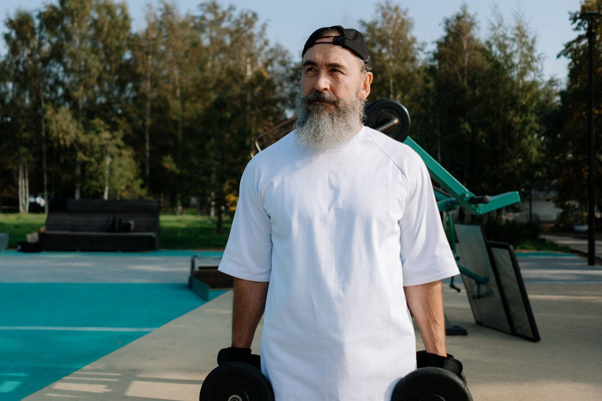
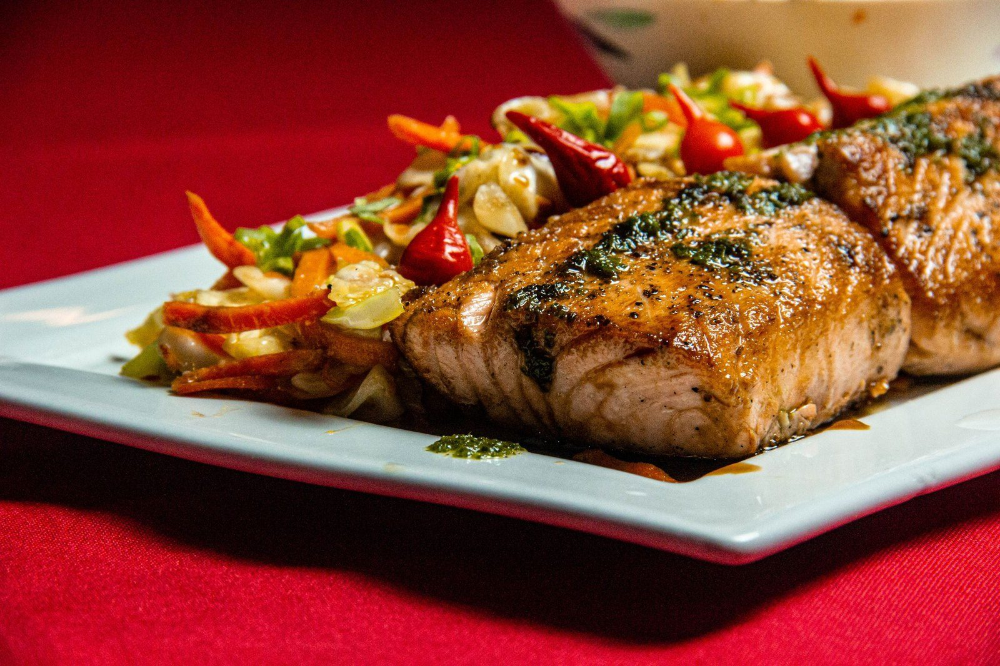
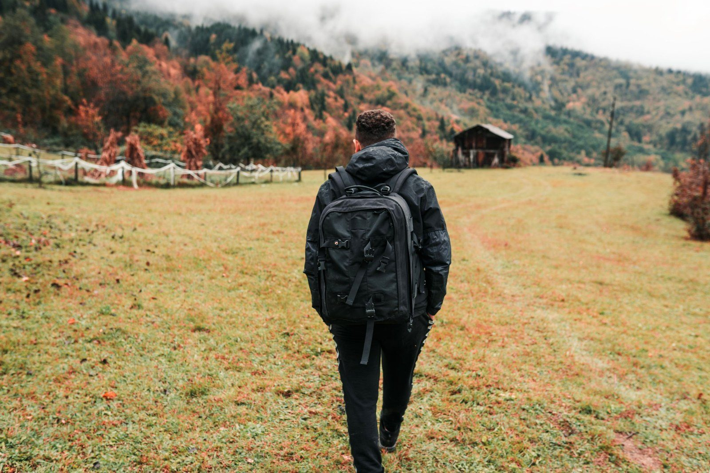

Kırk yaş bir sınır değil, bir eşiktir. Merdivenleri çıkarken bavul eskisinden biraz daha ağır gelir, hafta sonu bahçe işinden sonra omuz sızlar, gömlek hâlâ iliklenir ama içindeki form yumuşamaya başlamıştır. Bunların hiçbiri bir hüküm değildir; vücudun gönderdiği nazik bir uyarıdır. Bu uyarıya verilecek en akıllıca cevap ise ani diyetler ya da kendinizi tüketen antrenman kampları değil, 40 yaş üstü erkekler için iyi planlanmış bir kuvvet antrenmanıdır.

40 yaşından sonra spor, özellikle de ağırlık ve direnç egzersizleri, yaşa bağlı kas kaybına, yani tıptaki adıyla sarkopeniye karşı bir erkeğin elindeki en güçlü araçtır. Kemikleri ve eklemleri korur, vücut kompozisyonunu iyileştirir, dengeyi güçlendirir ve en önemlisi insana kendi bedeninde yeniden güven verir. Bu rehberde Acıbadem, Medical Park ve Memorial gibi Türkiye'nin önde gelen sağlık kurumlarının, Sağlık Bakanlığı'nın Türkiye Fiziksel Aktivite Rehberi'nin ve Türk bilimsel literatürünün önerilerini bir araya getirdik: sarkopeni nedir ve belirtileri nelerdir, ne zaman doktora gitmeli, haftada kaç gün ağırlık çalışılmalı, 40 yaşından sonra kas yapmak için ne kadar protein gerekir, spordan sonra kas ağrısı ve toparlanma nasıl yönetilir. Yazının sonunda Türkiye'de resmi kanallardan ulaşabileceğiniz premium ev spor ekipmanlarını ve sık sorulan soruları bulacaksınız.

> **Kısa özet**
> - Sarkopeni, yaşla birlikte kas kütlesi ve gücünün azalmasıdır; 50 yaş sonrası belirginleşir ama hareketsizlik ve yetersiz beslenmeyle daha erken hızlanabilir.
> - Ağırlık, elastik bant ya da vücut ağırlığıyla yapılan direnç egzersizleri, kas kaybına karşı en etkili yöntemler arasındadır.
> - Türkiye Fiziksel Aktivite Rehberi, yetişkinlere haftada en az 2 gün büyük kas gruplarını çalıştıran kuvvet egzersizleri önerir.
> - Kas kütlesini korumak için böbrek fonksiyonları normal olan kişilerde günde kilogram başına yaklaşık 1,0 ile 1,2 g protein önerilmektedir; protein üç ana öğüne dengeli dağıtılmalıdır.
> - Yükü her antrenmanda en fazla yaklaşık yüzde 10 artırın, dinamik ısının ve 7 ile 9 saat uyuyun.
> - Spordan sonra kas ağrısı genellikle 3 ile 7 günde geçer; 10 günü aşan, keskinleşen veya şişlikle seyreden ağrıda ortopedi uzmanına başvurun.
> - Programa başlamadan önce, özellikle kronik bir hastalığınız varsa, doktorunuza danışın.

## Sarkopeni Nedir? 40 Yaşından Sonra Kaslarınıza Ne Oluyor?

Doğru programı seçmeden önce rakibi tanımak gerekir. Sarkopeni yalnızca çok ileri yaşların sorunu değildir; sessizce ilerleyen, ama doğru adımlarla yavaşlatılabilen bir süreçtir.

### Kas kütlesi ve gücünde sessiz düşüş

Acıbadem'e göre sarkopeni, yaşlanmayla birlikte ortaya çıkan kas kütlesi ve kas gücündeki azalma durumudur. Genellikle 50 yaş sonrasında daha belirgin hale gelir, günlük aktiviteleri zorlaştırır ve düşme riskini artırır. Ancak bu tablo yalnızca yaşın bir sonucu değildir: yetersiz fiziksel aktivite, dengesiz beslenme, hormonal değişiklikler ve kronik hastalıklar da sarkopeniye yol açabilir. Yaşla birlikte kas hücreleri küçülür, kas lifleri azalır ve hareketsiz yaşam tarzı bu kaybı hızlandırır.

### Erken uyarı işaretleri

Acıbadem'in sıraladığı erken işaretler, 40'lı ve 50'li yaşlarındaki her erkeğin dikkat etmesi gereken türden: yavaş hareket etme, oturup kalkmada güçlük, dengesizlik ve sık düşmeler. İlerleyen süreçte merdiven çıkmak ve yük taşımak zorlaşır, yürüme yavaşlar, adımlar kısalır. Sürekli yorgun hissetmek ise depresyon riskini de artırabilir. Özellikle bacak kaslarındaki kayıp, ayakta dururken ya da yürürken denge kaybına neden olabilir.

### Çözümün merkezinde direnç egzersizleri

Kurumun vurguladığı en önemli nokta, sarkopenin kaderin değil alışkanlıkların da sonucu olduğudur. Ağırlık kaldırma ya da elastik bantlarla yapılan direnç egzersizleri kas gücünü artırmada özellikle etkilidir ve kas liflerinin yeniden büyümesini destekler. Yürüme, yüzme ve bisiklet gibi aerobik aktiviteler ise bu programı tamamlar. Erken dönemde fark edilen sarkopeninin etkileri, egzersiz ve protein ağırlıklı dengeli bir beslenmeyle azaltılabilir.

Kaynak: [Acıbadem](https://www.acibadem.com.tr/hastaliklar-ve-belirtiler/sarkopeni/)

## Sarkopeni Nasıl Teşhis Edilir ve Ne Zaman Doktora Gitmelisiniz?

Kas kaybından şüphelenen bir erkek için ilk adım spor salonu değil, doğru değerlendirmedir. Medical Park'ın sarkopeni rehberi, tanının nasıl konduğunu ve tedavinin hangi unsurlardan oluştuğunu net biçimde anlatıyor.

### Nedenler: yaş, hareketsizlik, hormonlar

Medical Park sarkopeninin başlıca nedenlerini yaşlanma, hareketsizlik, yetersiz beslenme, kronik hastalıklar, inflamasyon ve hormonal değişimler olarak sıralar. Yaş ilerledikçe kas proteinlerinin sentezi azalır. Erkeklerde testosteronun düşmesi ve büyüme hormonunun azalması da kas gücü kaybına katkıda bulunabilir. Yetersiz protein alımı ve D vitamini eksikliği de nedenler arasında yer alır; diyabet, böbrek yetmezliği ve KOAH gibi kronik hastalıklar da kas kaybını hızlandırabilir.

### Tanıda kullanılan testler

Tanı süreci, doktorun tıbbi öyküyü, beslenme düzenini ve fiziksel aktivite seviyesini değerlendirmesiyle başlar. El dinamometresiyle kavrama kuvveti ölçülür, kişiden belirli bir süre içinde sandalyeden kalkıp oturması istenir, yürüme hızı ölçülür. Gerekirse vücut yağ ve kas kütlesi ölçümleri, MR veya tomografi ile kas dokusu incelenir ve D vitamini eksikliği ya da hormonal bozukluklar gibi altta yatan sorunlar için kan testleri yapılır.

### Tedavi ve takip

Tedavinin temelinde direnç ve kuvvet egzersizleri, protein açısından zengin beslenme ve yaşam tarzı değişiklikleri vardır; gerektiğinde doktor ilaç ya da D vitamini takviyesi önerebilir. Sigara ve alkolü bırakmak, düzenli uyku ve stres yönetimi de kas gücünü korumaya yardımcı olur. Medical Park, sürecin fizyoterapist ve beslenme uzmanıyla birlikte yürütülmesini ve düzenli doktor kontrolünü öneriyor. Merdiven çıkmakta zorlanma, yürüme hızında belirgin yavaşlama ya da sık tökezleme gibi belirtiler fark ediyorsanız bir uzmana danışmak için beklemeyin.

Kaynak: [Medical Park](https://www.medicalpark.com.tr/saglik-rehberi/sarkopeni)

## Haftada Kaç Gün Ağırlık Çalışılmalı? Türkiye Fiziksel Aktivite Rehberi Ne Diyor?

Kuvvet antrenmanında en sık sorulan soru, ne kadarının yeterli olduğudur. Bu sorunun resmi cevabı, Sağlık Bakanlığı Halk Sağlığı Genel Müdürlüğü'nün yayımladığı Türkiye Fiziksel Aktivite Rehberi'nde yer alıyor.

### Haftada en az iki gün kuvvet

Rehber, yetişkinlerin haftada en az 2 gün, vücudun farklı bölgelerindeki büyük kas gruplarını çalıştıran kuvvet egzersizleri yapmasını önerir. Bunun amacı, kas ve kemik dokusunun korunması ve kaybının önlenmesidir. Bacaklar, kalça, sırt, karın, göğüs, omuzlar ve kollar bu programın ana başlıklarıdır. Rehber ayrıca kuvvet çalışmasının yanında düzenli aerobik aktiviteyi de, yani haftaya yayılmış orta şiddette tempolu yürüyüş, yüzme ya da bisiklet gibi hareketleri, temel bir sağlık önerisi olarak konumlandırır.

### Pratikte nasıl uygulanır?

Yoğun bir iş hayatı olan bir erkek için bu öneri, pazartesi ve perşembe gibi iki gün 40 ile 60 dakikalık tüm vücut antrenmanı anlamına gelebilir. Her seansta bir bacak hareketi (goblet squat ya da lunge), bir itiş hareketi (şınav ya da dambıl press), bir çekiş hareketi (dambıl row ya da barfiks çalışması) ve bir gövde hareketi (plank) yeterli bir çekirdek oluşturur. Diğer günler yürüyüş ve hafif aktiviteyle değerlendirilebilir.

### Aynı kas grubuna dinlenme

Büyük kas gruplarını haftada iki ya da üç kez çalıştırırken aynı bölgeye ağır yüklenmeler arasında en az bir gün ara vermek, hem toparlanmayı hem de bir sonraki antrenmanın kalitesini korur. Asıl hedef, kuvvet çalışmasını bir dönemlik heves değil, ömür boyu sürecek bir rutin haline getirmektir.

Kaynak: [T.C. Sağlık Bakanlığı – Türkiye Fiziksel Aktivite Rehberi](https://hsgm.saglik.gov.tr/depo/birimler/saglikli-beslenme-ve-hareketli-hayat-db/Dokumanlar/Rehberler/Turkiye_Fiziksel_Aktivite_Rehberi.pdf)

## Ağırlık Antrenmanına Nasıl Başlanır? Memorial'den Kişiye Özel Egzersiz Reçetesi

40 yaşından sonra spora başlamak, yirmili yaşlardaki gibi salona girip rastgele ağırlık kaldırmak demek değildir. Memorial Wellness Medikal Fitness Danışmanı Murat Biçer, sporun bir yaşam biçimi olması gerektiğini ve programın kişiye özel hazırlanmasını vurguluyor.

### Önce uzman, sonra program

Spora başlamaya karar veren kişi öncelikle bir uzmana danışmalıdır. Program; kişinin yaşına, fiziksel, sosyal ve psikolojik durumuna göre hazırlanır. Antrenman şiddeti belirlenmeden önce şu sorular yanıtlanmalıdır: Ortopedik ya da metabolik bir sorun var mı? Daha önce geçirilmiş bir hastalık ya da operasyon var mı? Teşhis konmuş metabolik bir hastalık var mı? Ailede erken yaşta ölüm öyküsü var mı?

*Photo: cottonbro studio / Pexels, [Pexels License](https://www.pexels.com/license/)*

### Egzersiz reçetesinin beş unsuru

Memorial'e göre iyi bir plan beş başlıkta şekillenir: egzersizin tipi (kardiyo ya da rezistans), şiddeti, sıklığı, süresi ve artırılışı. Şiddet ne çok düşük ne de limitleri zorlayacak kadar yüksek olmalıdır. Yoğun tempoda çalışan biri için haftada 5 günü ve günde bir saati aşmayan bir program önerilir; egzersizin ısınma ve soğuma hariç en az 20 dakika sürmesi genel kabul görür. En önemli kural ise sürekliliktir: egzersizin faydaları, egzersiz yapıldığı sürece görülür.

### Uyku, beslenme, stres ve su

Biçer, sporu uyku, beslenme ve stres yönetimiyle desteklemenin altını çiziyor: yorulan kaslar dinlenerek yeniden yapılanır. Su tüketimi de soğuk havalarda sıklıkla ihmal edilir; Memorial'in önerisi, vücut ağırlığının her 30 kilogramı için günde yaklaşık 1 litre su ve egzersiz günlerinde buna ek olarak 1 ile 1,5 litre daha.

Kaynak: [Memorial](https://www.memorial.com.tr/saglik-rehberi/spora-baslamak-isteyenlere-onemli-oneriler)

## 40 Yaşından Sonra Kas Yapmak İçin Günlük Protein İhtiyacı

Antrenman sinyali verir, protein ise yapı malzemesini sağlar. DergiPark'ta yayımlanan "Sarkopeni ve Beslenme Yaklaşımı" başlıklı Türkçe derleme, bu konuda Türkçe kaynaklar arasında en net rakamları sunuyor.

### Kilogram başına 1,0 ile 1,2 gram

Derlemeye göre ileri yaş için genel öneri olan günde kilogram başına 0,8 g protein, kas protein sentezini uyarmakta yetersiz kalabilmektedir. Bir çalışmada protein alımının 0,8'den 1,0 g/kg'a çıkarılması, kas kütlesini korumak için gereken minimum miktar olarak belirlenmiştir. Böbrek fonksiyonları normal ve başka bir engel yoksa günde 1,0 ile 1,2 g/kg protein alınması önerilmektedir. Yani 85 kg'lık bir erkek için kabaca günde 85 ile 100 g protein.

*Photo: Horizon Content / Pexels, [Pexels License](https://www.pexels.com/license/)*

### Tek öğün değil, üç öğün

Derlemenin dikkat çeken bir bulgusu: bir öğünde 30 g'dan fazla protein almanın kas protein sentezine ek katkısı olmadığı bildirilmiştir. Bu nedenle proteinin üç ana öğüne dengeli dağıtılması önerilir. Kahvaltıda yumurta ve peynir, öğlede tavuk ya da baklagil, akşam balık ya da kırmızı et, bu dağılımı kurmanın klasik ve şık bir yoludur.

### Protein kalitesi ve egzersizle sinerji

Aynı miktarda hayvansal protein tüketenlerde bitkisel protein tüketenlere göre daha yüksek kas gücü bulunduğu da bildirilmiştir; bunun nedeni anabolik etki yaratan esansiyel amino asitlerdir. Derleme ayrıca egzersizin rolünü hatırlatıyor: haftada bir yapılan direnç egzersizi bile kas gücünde düzelme sağlayabilir, haftada 2 ile 3 kez yapılan direnç egzersizi ise yürüme ve sandalyeden kalkma hızında anlamlı iyileşme gösterir.

Kaynak: [DergiPark – Sarkopeni ve Beslenme Yaklaşımı](https://dergipark.org.tr/en/pub/geriatrik/article/699252)

## Spordan Sonra Kas Ağrısı, Toparlanma ve Uyku

40 yaşından sonra kas salonda değil, dinlenme sırasında inşa edilir. Memorial'in spordan sonra kas ağrısı rehberi, normal hamlık ağrısını gerçek bir sakatlıktan ayırmayı ve toparlanmayı hızlandırmayı anlatıyor.

### DOMS: normal hamlık ağrısı

Gecikmiş kas ağrısı (DOMS), alışılmadık bir aktiviteden 24 ile 72 saat sonra ortaya çıkar. Genellikle ilk 12 ile 24 saatte başlar, 48. saatte zirveye ulaşır ve 3 ile 7 gün içinde kendiliğinden geçer. Nedeni laktik asit değil, kas liflerindeki mikroskobik hasar ve vücudun başlattığı onarım sürecidir. Squat'ta aşağı iniş ya da dambılı yavaşça indirme gibi eksantrik hareketler bu ağrıyı daha fazla tetikler. Önemli bir not: ağrı hissetmemek antrenmanın boşa gittiği anlamına gelmez.

### Ağrıyı önlemek: ısınma, kademeli yük, uyku

Memorial'in önerileri net: statik esneme yerine yapılacak hareketlerin hafif formlarıyla dinamik ısınma yapın, ağırlık, tekrar ya da süreyi her antrenmanda en fazla yaklaşık yüzde 10 artırın ve doğru formla, gerekirse profesyonel rehberlikle çalışın. Büyüme hormonu en çok derin uykuda salgılandığı için günde 7 ile 9 saat kaliteli uyku, kasların gece boyunca onarılmasını destekler.

*Photo: Emre Öztürk / Pexels, [Pexels License](https://www.pexels.com/license/)*

### Aktif dinlenme ve ne zaman ortopediye gidilmeli

Tamamen hareketsiz kalmak kası daha da katılaştırabilir; 20 ile 30 dakikalık hafif tempolu yürüyüş ya da yüzme gibi aktif dinlenme, köpük silindir uygulaması ve sıcak duş toparlanmayı hızlandırır. Bacaklarınız ağrıyorsa o gün üst vücut çalışabilirsiniz. Ancak ağrı keskinleşiyor, bölgede ısı artışı, morarma ya da şişlik oluyorsa veya 10 günü geçmesine rağmen azalmıyorsa bu durum kas lifi kopmasının belirtisi olabilir; Ortopedi ve Travmatoloji bölümüne başvurulmalıdır. Memorial ayrıca ağrı kesicilerin bilinçsizce kullanılmamasını, önce bir hekime danışılmasını öneriyor.

Kaynak: [Memorial](https://www.memorial.com.tr/saglik-rehberi/spordan-sonra-kas-agrisi-neden-olur)

## Türkiye'de Bulabileceğiniz Premium Ev Spor Ekipmanları

Evde antrenman yapan erkek daha düzenli antrenman yapar. Aşağıdaki iki seçim, İtalyan tasarımlı akıllı ağırlık ile profesyonel düzeyde toparlanmayı bir araya getiriyor; her ikisi de markaların Türkiye sayfalarından incelenebilir.

### Technogym Connected Dumbbells+

Ev spor salonunun zarif merkezi. Technogym Türkiye'nin sunduğu bu ayarlanabilir dambıl seti, tek bir çevirme hareketiyle her dambılda 2 kg'dan 24 kg'a kadar 2 kg artışlarla ağırlık seçmenizi sağlar ve geleneksel bir düzine dambılın yerini alır. Set; köpük rulo, antrenman matı ve üç döngü bandını da saklayan şık bir stand ile gelir. Bluetooth ile Technogym App'e bağlanarak tekrarlarınızı takip eder ve performansınıza göre kişiselleştirilmiş yük önerileri sunar. Fiyat bilgisi ürün sayfasında talep üzerine veriliyor. [Technogym Connected Dumbbells+ ürün sayfası](https://www.technogym.com/tr-TR/product/technogym-connected-dumbbells_A000TMDP.html)

### Therabody Theragun PRO Plus

Toparlanmanın lüks versiyonu. Therabody Türkiye'nin sayfasında yer alan Theragun PRO Plus; perküsif masaj, ısı, titreşim ve yakın kızılötesi LED ışık masajını tek cihazda birleştirir. Paketten toplam 7 masaj başlığı çıkar, LCD ekranda görsel yönlendirmeli rutinler ve 5 masaj hızı bulunur, dahili biyometrik sensör kalp atış hızını ölçer. Ortalama pil ömrü yaklaşık 150 dakika, garanti süresi 2 yıldır. Yoğun bir bacak antrenmanının ertesi günü için ideal bir yardımcı. [Theragun PRO Plus ürün sayfası](https://therabody.com.tr/theragun-pro-plus/)

## Sık Sorulan Sorular

### 40 yaşından sonra kas yapmak mümkün mü?
Evet. Direnç egzersizleri ve yeterli protein alımıyla 40, 50 ve hatta 60 yaşından sonra da kas kütlesi ve gücü artırılabilir. Haftada 2 ile 3 kez yapılan direnç egzersizinin yürüme ve sandalyeden kalkma hızını iyileştirdiği gösterilmiştir.

### Haftada kaç gün ağırlık çalışmalıyım?
Türkiye Fiziksel Aktivite Rehberi'ne göre yetişkinler haftada en az 2 gün büyük kas gruplarını çalıştıran kuvvet egzersizleri yapmalıdır. Aynı kas grubuna ağır yüklenmeler arasında en az bir gün dinlenin.

### Sarkopeni belirtileri nelerdir?
Kas kütlesi ve gücünde azalma, oturup kalkmada ve merdiven çıkmada güçlük, yürüme hızında yavaşlama, denge kaybı, sık düşme ve çabuk yorulma en sık görülen belirtilerdir.

### 40 yaş üstü erkek günde ne kadar protein almalı?
Böbrek fonksiyonları normal olan kişilerde kas kütlesini korumak için günde kilogram başına yaklaşık 1,0 ile 1,2 g protein önerilir; protein üç ana öğüne, öğün başına en fazla yaklaşık 30 g olacak şekilde dağıtılmalıdır.

### Spordan sonra kas ağrısı ne kadar sürer?
Normal hamlık ağrısı (DOMS) genellikle 48. saatte zirve yapar ve 3 ile 7 gün içinde geçer. 10 günü aşan, keskinleşen veya şişlik ve morarmayla seyreden ağrıda ortopedi uzmanına başvurun.

### Ağırlık antrenmanına başlamadan önce doktora gitmeli miyim?
Evet, özellikle kalp, tansiyon, diyabet, eklem ya da bel sorunlarınız varsa veya uzun süre ara verdiyseniz. Medikal değerlendirmenin ardından bir uzmanla kişiye özel bir egzersiz reçetesi hazırlatmak en güvenli yoldur.

*Bu yazı tıbbi tavsiye değildir. Bağlantısı verilen kaynaklardaki kamuya açık bilgileri özetler. Yeni bir egzersiz veya beslenme programına başlamadan önce, özellikle bir sağlık sorununuz varsa ya da ilaç kullanıyorsanız, doktorunuza danışın.*
