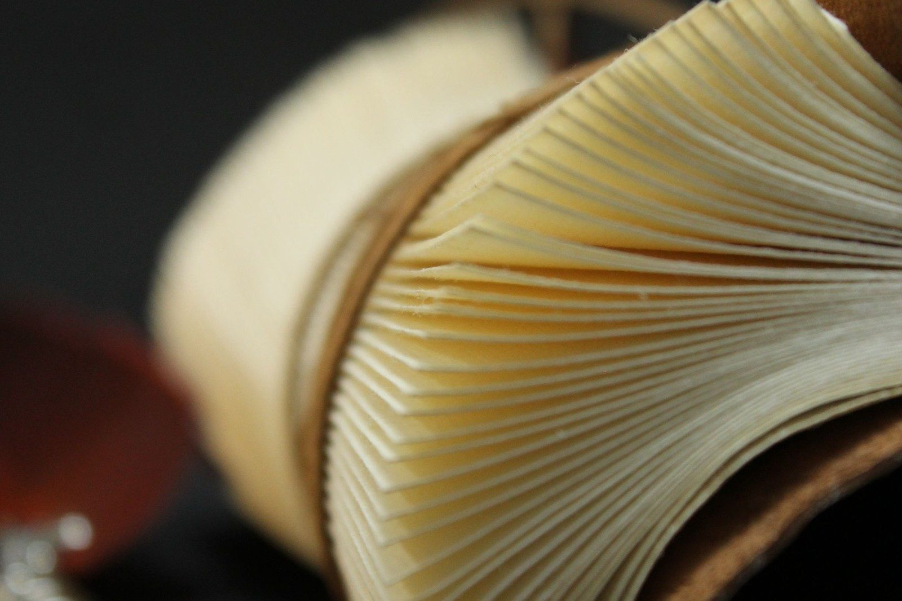
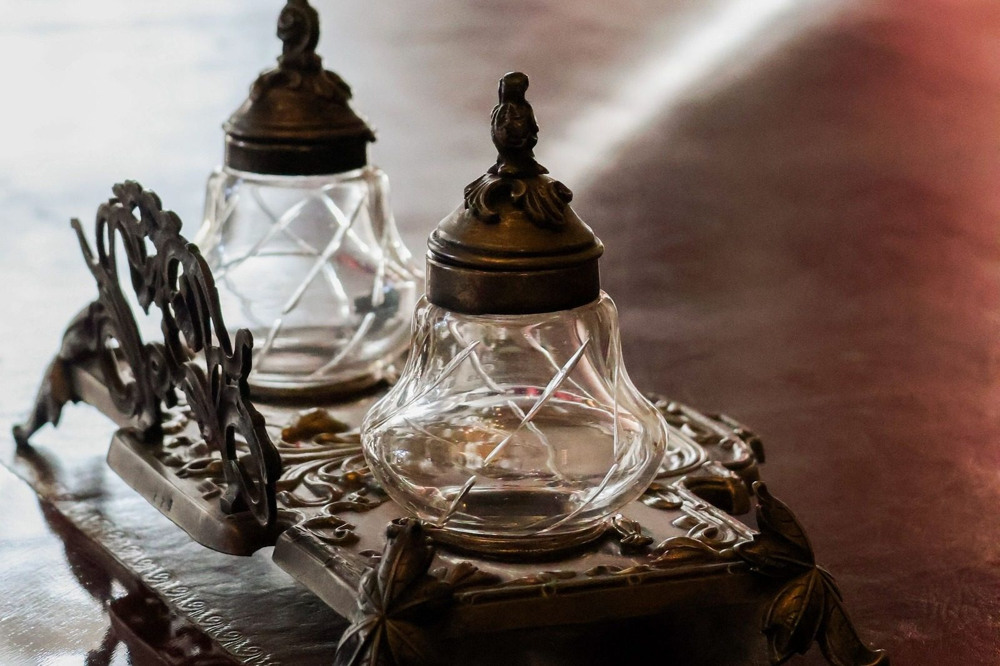
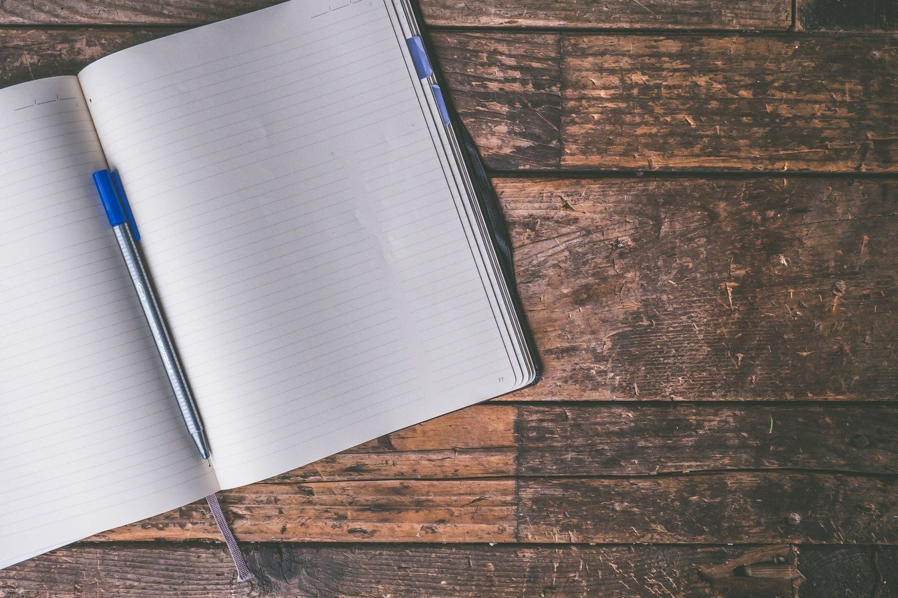

Dolma kalem, sıvı mürekkebi bir rezervuarda tutup metal bir uçtan kâğıda veren yazı aletidir. Tükenmez kalem değildir, her satırda hokkaya batırılan bir daldırma kalem de değildir. Türkiye'de bir dönem okul sırasının, sonra imza masasının, bugün ise yine masaya dönen mektubun aletidir. Bu rehber dolma kalemin ne olduğunu, ucun ve dolum sisteminin nasıl çalıştığını, ilk ciddi kalemde nelere bakılacağını, bakımın nasıl yapılacağını, hangi mürekkep ve kâğıdın yakışacağını, 2026'da bir mektubun nasıl yazılıp gönderileceğini ve yazım sırasında Lamy Türkiye mağazasında görülen üç kalemi ele alır: Safari, studio ve Lamy 2000. Montblanc Meisterstück 149 gibi bir tören kalemine de, fiyat uydurmadan, yer verilir.

> **Kısa özet**
> - Dolma kalem, sıvı mürekkebi kartuş, converter veya piston gibi bir rezervuarda tutar ve kılcal hareketle uçtan kâğıda verir. Çizgi, ıslak bir hattır; el, kâğıdı hisseder.
> - Uç kalınlığı bir rütbe değil, bir tercihtir. İnce ve extra fine, küçük el yazısı ve gündelik kâğıt için pratiktir; orta uç, iyi bir yazı kâğıdında mürekkebi daha çok gösterir.
> - Altın uç ile çelik uç bir kalite merdiveni değildir. İyi kesilmiş bir çelik uç mükemmel yazabilir; ayarsız bir altın uç ise eziyet olabilir. Asıl olan, ucun kesimi, yarığı ve kâğıttaki duruşudur.
> - Dolma kaleme yalnızca dolma kalem mürekkebi konur. Çin mürekkebi, daldırma kaligrafi mürekkebi ve çoğu çizim mürekkebi beslemeyi tıkayabilir. Şüphede kalınırsa, şişenin dolma kalem mürekkebi olduğu açık olmalıdır.
> - Kâğıt, aletin diğer yarısıdır. İyi tutkalanmış bir yazı kâğıdı hattı temiz gösterir; gevşek elyaf ise mürekkebi dağıtır. Türkiye'de de "dolma kaleme uygun" defter ve bloknot aramak boş bir incelik değildir.
> - Mektup hâlâ en tam kişisel iletidir. Tarih konur, kişi ismiyle hitap edilir, cümleler tamamlanır, kapanış temiz olur, zarfa dönüş adresi yazılır.
> - Lamy'nin resmi Türkiye mağazasında, yazım sırasında görülen fiyatlar: [Safari](https://lamyshop.com.tr/products/lamy-safari-blk-2) 1.600,00 TL, [studio](https://lamyshop.com.tr/products/lamy-studio-dolma-kalem) 4.055,00 TL, [Lamy 2000](https://lamyshop.com.tr/products/lamy-2000-dolma-kalem) 12.000,00 TL.

## Dolma Kalem Nedir, Neden Hâlâ Önemlidir?

Dolma kalem, sıvı mürekkebi bir rezervuarda saklayan ve onu metal bir uçtan kâğıda ulaştıran kalemdir. Mürekkep, kartuşta, converterda, piston odasında veya bazı tasarımlarda gövdenin kendi içinde durur; besleme kanalından kılcal hareketle uca gelir. Her satırda hokkaya batırılmaz. Bir bilye, macunumsu bir pastayı kâğıda sürmez. Çizgi ıslaktır ve el, kâğıdın dokusunu duyar.

Bu tanım yeterlidir. Gerisi kültürdür. Türkiye'de dolma kalem, bazı kuşaklar için okulun zorunlu aracıydı; bazıları için yalnızca nüfus cüzdanındaki imzanın, tapunun, evlilik cüzdanının kalemidir. 2026'da bunların hiçbiri tek başına hüküm sürmez. Beyefendi için dolma kalem, adını, kısa bir mektubu ve zaman zaman bir tebrik veya taziye notunu, otel gişesinden alınan bir plastik çubuğa borçlu kalmadan yazmanın yoludur. Telefondan yavaştır; mesele de biraz budur. Yazılıp katlanıp postaya verilen bir cümle, ekranda kaybolan bir mesajdan farklı bir ağırlık taşır.

Bir de dikkat ister. Ucuz bir tükenmez, kâğıda, mürekkebe ve bakıma karşı neredeyse kayıtsızdır. Dolma kalem değildir. Yanlış mürekkep tıkar. Yanlış kâğıt, ince ucu dağınık gösterir. Çekmecede unutulmuş, mürekkebi kurumuş bir kalem, ertesi gün tek hamlede yazmaz. Bunların hiçbiri esrarengiz değildir ve bir laboratuvar da gerektirmez. İyi bir saate veya bir çift ayakkabıya gösterilen dikkatin aynısı yeter: kullanılır, temizlenir, kutuda saklanan bir süs gibi muamele görmez.

İlk kalemin bir aile yadigârı, bir sınırlı üretim veya bir vitrin parçası olması gerekmez. Temiz bir hatla başlaması, bir iki sayfa boyunca elde rahat durması yeter. Altın, piston, ünlü bir klips sonradan gelir, eğer gelecekse. İyi seçilmiş, orta segment bir kalemle yazan adam, ünlü bir kalemi doldurmaya çekinen adamdan zaten ileridedir.

## Uç, Dolum Sistemi ve Mürekkep Nasıl Çalışır?

Uç, kâğıda değen kısımdır. Genellikle çelik veya altındır, ortadan yarılmıştır ve çabuk aşınmasın diye sert bir alaşımla tıkanmıştır. Mürekkep bu yarıktan iner. Hattın kalınlığı, ucun büyüklüğüne, elin açısına ve baskısına bağlıdır. Batı ölçüsünde yaygın genişlikler extra fine (EF), fine (F, ince), medium (M, orta) ve broad (B, kalın) olarak anılır. Pilot, Platinum, Sailor gibi Japon uçları, aynı isim altında çoğu kez Avrupa ölçüünden biraz daha ince gelir. Küçük yazan veya çoğunlukla fotokopi kâğıdı kullanan biri için bu fark işe yarar.

Doğru uç genişliği diye bir ahlak kuralı yoktur. İnce ve extra fine, gündelik kâğıtta, formlarda ve sıkışık bir yazıda pratiktir. Orta uç, iyi bir yazı kâğıdında mürekkebin mürekkep gibi görünmesini sağlar; mektubu da göle çevirmez. Kalın ve stub uçlar, mürekkebin gölgelenmesini görmek isteyen ve buna dayanan bir kâğıt seçmiş adam içindir. İlk kalem çoğu zaman ince veya orta uçla mutludur. Elinizi tanıdıktan sonra daha geniş bir uç eklenebilir.

Altın ve çelik, bir kalite merdiveni değildir. İyi kesilmiş bir çelik uç çok iyi yazabilir; kötü ayarlanmış bir altın uç eziyet olabilir. 14 ayar veya 18 ayar altın çoğu zaman biraz daha esnek veya yaylıdır; çelik çoğu zaman daha sert ve daha uygun fiyatlıdır. Lamy 2000'in 14 ayar altın ucu, gösterişten uzak bir gövdenin içindedir: mesele yazıdadır, sarı bir tabela değildir.

Dolum sistemi, mürekkebin kaleme nasıl girdiğidir. Kartuş en yalın yoldur: o markaya uygun bir plastik kapsül takılır. Converter ise aynı kaleme, şişeden doldurulabilen küçük bir pompa ekler. Pistonlu kalemlerde — Lamy 2000 buna örnektir — bir düğme veya mil, mürekkebi doğrudan gövdeye çeker. Pistonlu kalemler çoğu zaman daha çok mürekkep alır ve kartuş görünmediği için daha sade durur. Vakumlu dolum, eyedropper gibi başka sistemler de vardır; ama kartuş-converter ve piston, bir beyefendinin ihtiyacının hemen tamamını karşılar.

Mürekkep de alelade bir sıvı değildir. Dolma kalem mürekkebi, bir beslemeden akmak ve metal bir uçta durmak üzere yapılmış, su bazlı bir boya — kimi zaman özenle üretilmiş bir pigment — formülüdür. Çin mürekkebi, daldırma kaligrafi mürekkebi, çizim mürekkebi ve çoğu damga mürekkebi başka bir ailedendir. Birçoğunda kâğıda yapışan bağlayıcılar, yoğun pigment veya şellak bulunur; bunlar beslemeyi tıkar veya metale zarar verebilir. Güvenli kural sadedir: şişe kendini dolma kalem mürekkebi olarak sunmuyorsa, kaleme konmaz. Ailenin içinde tercih zevktir: mektup için klasik bir mavi-siyah, evrak için ölçülü bir siyah, günlük not için sakin bir mavi. Parıltılı ve çok doygun mürekkepler sonradır ve daha sık temizlemeyi göze aldığınız kalemler içindir.

*Photo: Yashasvi Nagda / Pexels, [Pexels License](https://www.pexels.com/license/)*

## İlk Ciddi Dolma Kalemde Nelere Bakılır?

İlk ciddi kalem üç iş yapmalıdır: elinize aldığınızda başlamalı, elde rahat durmalı ve gerçekten kullanacağınız bir dolum sistemini kabul etmelidir. Gerisi ikincildir. Markanın prestiji, kâğıtta takılan bir ucun yerini tutmaz. Fotoğrafta ağır duran bir kalem, bir sayfa sonra eli yorabilir. Çok ince bir kalem kimi elde dakik, kimi elde cılız durur. Deneme imkânı varsa bir imza değil, iki üç satır yazın. Yoksa, uç değişimi veya servisi açık olan bir üreticiyi seçin ve yaygın bir uçla başlayın.

Ağırlık ve denge, sandığınızdan çok iş görür. Kapağı kalemin arkasına takmak (post etmek), iyi dengelenmiş bir aleti bir kaldıraça çevirebilir. Kimi kalem bunun için tasarlanmıştır; kimi, kapak masada yanındayken daha mutludur. Kural, rahatlıktır. Çap da öyledir. Çok ince bir tutuş bölümü büyük eli yorar; çok kalın olanı küçük elde hantal durur. Elinizde hoşunuza giden bir kalem varsa, başparmak ile işaret parmağının değdiği yeri fark edin ve katalog fotoğrafına değil, o duruşa yaklaşın.

Malzeme çoğunlukla zevk ve dayanıklılık işidir: reçine, lake pirinç, çelik, ahşap veya Lamy 2000'deki gibi kompozit bir gövde. Yüksek parlaklık parmak izini ve masa izini gösterir; mat bir gövde çoğu zaman daha sakin bir günlük arkadaştır. Fotoğrafta bile eğri duran bir klips, uç veya kapak halkası, almayın demektir. Otuzluk görünür.

Bütçe, işleri ayırınca netleşir. Çantada taşınacak gündelik bir kalem, bu yazıdaki üç kalemin altında kalan, sağlam bir kartuş-converter model olabilir. Evde mektup yazacak masa kalemi, şişeden doldurulan bir pistonlu kalem olabilir. Sözleşme veya düğün kartı için tören kalemi, aynı masa kalemi de olabilir, yıllarca saklamayı düşündüğünüz bir Meisterstück de. Üçünü birden almak, çoğu zaman kullanılmayan mürekkep çekmecesine giden yoldur. Kullanacağınız bir kalem, güvenilir bir şişe mürekkep ve dağılmayan bir bloknot ile başlayın.

Türkiye'de alışveriş, resmi marka mağazası ile kalem uzmanı arasında bölünür. Lamy'nin Türkiye mağazası, güncel liste fiyatı ve model bilgisi için işe yarar. Kalem dükkânları, uç ayarı, mürekkep çeşitliliği ve elde deneme için işe yarar. Beymen gibi çok katlı mağazalar, özellikle Montblanc gibi tören kalemlerinde stok ve vitrin sunar. Listenin resmi fiyatın çok altında olması bir indirim olabileceği gibi, eski bir bitiş veya garantisi belirsiz bir ürün de olabilir. İlanı okuyun. Ucun yeni ve orijinal olup olmadığı söylenmiyorsa bekleyin.

*Photo: Iago Gleison / Pexels, [Pexels License](https://www.pexels.com/license/)*

## Dolma Kalem Bakımı Nasıl Yapılır?

Günlük bakım neredeyse hiçbir şeydir. Ara verdiğinizde kapağı kapatın. Anahtarla aynı cebe veya çantanın dibine bırakmayın. Taşıyorsanız basit bir kılıf veya defterin kalem yuvası yeter. Eli hafif tutun. Dolma kalem tükenmez değildir; daha sert basmak daha iyi bir hat vermez, zamanla ucu bozabilir. Kalem atlıyorsa önce apaçık olanlara bakın: mürekkep var mı, uç sıcakta kurumuş mu, kâğıt mürekkebi tutuyor mu? Kirli bir besleme sık görülen bir nedendir ve çoğu zaman atölyeyle değil, bir yıkamayla çözülür.

Temizlik, ılık su ve sabırdır. Kartuş-converter kalemde kapsülü veya converterı çıkarıp bölmeden su berrak akana kadar ılık su geçirin. Pistonlu kalemde temiz suyu birkaç kez çekip boşaltın, renk gidene kadar. İlk çare olarak sıcak su, ev temizleyicisi, alkol veya aseton kullanmayın; reçineyi bozabilir, tutkalları gevşetebilir. Kurumuş bir mürekkep varsa, uç bölümünü serin veya ılık suda bekletmek, beslemeye alet sokmaktan daha doğru bir sonraki adımdır. Kalem temizlendikten sonra doldurmadan önce kurulayın, ya da doldurup birkaç satır yazarak beslemeyi yeniden ıslatın.

Ne sıklıkla temizleneceği kullanıma bağlıdır. Her gün, sade bir boya mürekkebiyle yazılan bir kalem, renk değiştirirken veya akış isteksizleşince yıkanır. Haftalarca duracak bir kalem, çekmeceye girmeden boşaltılıp yıkanmalıdır. Zengin veya alışılmadık bir mürekkebi beslemede kurutmak, iyi bir aleti bir onarım işine çevirmenin yoludur. Birden fazla kaleminiz varsa, birini günlük kullanıma mürekkepli bırakın; diğerlerini temiz ve kuru, sıcaktan uzak saklayın.

Yolculuk da biraz dikkat ister. Uçaktaki basınç farkı, kalemin mürekkep "çıkarmasına" yol açabilir. Pek çok adam kalemi boş veya taze kapatılmış halde, sıcak bir cepte değil bir çantada, küçük bir kılıfın içinde taşır. Kalemi açık bir mürekkep şişesiyle evrak çantasının dibine koymayın; şişeyi de otel örtüsünün üzerinde açmayın.

Servisin de bir yeri vardır. Çok kuru, çok ıslak veya bir yana yatan bir uç, çoğu zaman bir uzman tarafından ayarlanabilir. Bu, kötü alımın değil, iyi bir kalem sahibi olmanın parçasıdır. Evde altın ucu pensayla bükmek veya bir çatlağı ısıtarak "düzeltmek" ise başka iştir. Piston sertleşirse, kapak yuvasına oturmazsa veya düşen bir uç eğilmiş görünürse kullanmayı bırakıp bakın.

*Photo: beyzz / Pexels, [Pexels License](https://www.pexels.com/license/)*

## Hangi Kâğıt ve Mürekkep Yakışır?

Kâğıt, hattın diğer yarısıdır. Dolma kalem mürekkebi kâğıdın üzerine ve içine oturur; elyaf gevşekse veya tutkal zayıfsa hat dağılır, arka yüze geçer ya da ikisi birden olur. Türkiye'de bulunan gündelik fotokopi kâğıdının kalitesi değişir. Kimi, ince uç ve uslu bir mürekkeple gayet iş görür. Kimi görmez. Mektup, not veya bir defter yazıyorsanız, gerçekten yazı için yapılmış kâğıda değer vermek gerekir: iyi tutkalanmış bir bloknot, bir mektup kâğıdı ya da "dolma kaleme uygun" diye satılan bir defter. Metrekaredeki gramaj bir ipucudur, garanti değildir; iyi tutkalanmış 80 veya 90 g/m² bir yaprak, daha kalın ama susuz bir kâğıdı geçebilir. Deney, tek bir satır yazıp kurumaya bırakmak, sonra arka yüze ve hattın kenarına bakmaktır.

Renk ve doku zevktir. Krem veya fildişi bir yaprak, sert optik beyazdan göze daha yumuşaktır. Çok kaba el yapımı bir kâğıt güzel olabilir ve ince ucu yine de zorlayabilir; çok kaygan bir kâğıt ise geç kuruyabilir. Taslak için pratik bir bloknot, postalanacak mektup için daha iyi bir yaprak bulundurun. Zarf, kâğıda yaklaşık uymalıdır. Ağır bir mektubun ince bir zarfta durması yarım kalmış durur.

Mürekkep seçimi, katalogların ima ettiğinden daha basittir. Güvenilir bir mavi-siyah veya sakin bir mavi, evrak imzalıyorsanız bir de siyah ile başlayın. Dolma kalem için üretilmiş mürekkepleri seçin. Çin mürekkebi, yalnızca kaligrafi veya çizim için satılan şişeler kaleme konmaz. Zarf için suya daha dayanıklı, pigmentli dolma kalem mürekkepleri vardır; bunlar genellikle daha sık temizlik ister. Türkiye'de Lamy'nin kendi mürekkepleri, kalem dükkânlarındaki diğer dolma kalem mürekkepleri ve resmi mağazadaki kartuşlar, ilk şişe için güvenli av sahasıdır. Elli renk gerekmez. Makul sürede kuruyan bir mürekkep, hattı tutan bir kâğıt ve bunları kullanma alışkanlığı yeter.

*Photo: Jessica Lewis / Pexels, [Pexels License](https://www.pexels.com/license/)*

Şişe kapalı, dik ve kuvvetli güneşten uzak durur. Mürekkebe "daha çok gitsin" diye su katılmaz. Kirli bir kalemden artan mürekkep şişeye geri dökülmez. Masada bir kurutma kâğıdı veya sade bir bez, gösterişli bir hokka takımından daha çok iş görür — o takım, gerçekten orada yazıyorsanız zararsızdır.

## 2026'da Bir Mektup Nasıl Yazılır ve Gönderilir?

Mektup, bir erkeğin gönderebileceği en tam kişisel iletidir. Bir tarihi, bir kişisi, bir başlangıcı ve bir sonu vardır; karşı tarafa bir bildirim olarak değil, elde duran bir kâğıt olarak varır. E-posta ve kısa bir ileti kendi yerini bilir. Bir teşekkür, bir taziye, bir tebrik veya masada düşünülmesi gereken bir notun yerini tutmazlar. Dolma kalem, bu işin doğru aletidir. Usul, kalemden eskidir ve karmaşık değildir.

Düz bir masada, yeterince ışıkta, postada dağılmayacak bir kâğıda yazın. Üste tarihi koyun. Kişiye konuşur gibi, ismiyle hitap edin: "Sevgili Mehmet," veya henüz samimi olmadığınız birinde "Sayın Yılmaz," ya da "Sayın Mehmet Yılmaz." Sadece bir "Merhaba" ile açılan resmi bir mektup, yarım kalmış durur. İlk cümle, neden yazdığınızı söylemeli. Gerisi, karşı tarafın okuyabileceği bir el yazısıyla tamamlanmış cümleler olmalıdır. Dolma kalem, özel bir şifrenin bahanesi değildir. Yazınız aceleyse yavaşlayın. Bir kelime bozulmuşsa sayfayı baştan alın; mektup kısadır ve iyi kâğıtta bir üstü çizik, defterdekinden daha kaba durur.

Ton, vesileye uymalıdır. Teşekkür mektubu, hediyeyi veya akşamı adlandırır ve gecikmeden gider. Taziye kısa, somut ve tavsiyesizdir. Tebrik sıcaktır, iğneli değildir. Özür mektubu dolanmaz. İş mektubu, iyi bir antetli kâğıtta bile açık olmalıdır: kimsiniz, ne istiyorsunuz, bundan sonra ne yapacaksınız. Ticari bakımdan önemli bir metni yalnızca mürekkeple yazıp kopyasını almamak yanlıştır.

Kapanış, açılışa uymalıdır. Daha resmi bir hitaptan sonra "Saygılarımla" doğal durur; tanıdık birinde "Sevgiler" veya "İyi dileklerimle" yeter. Her zamanki imzanızla imzalayın; imza okunaksızsa altına adınızı da yazın. Not (P.S.) gerçek bir sonradan akla gelen içindir, mektubun asıl cümlesi için değil.

Zarf, mektubun parçasıdır. Adresi açık yazın; yağmur ihtimali varsa biraz daha suya dayanıklı bir mürekkep seçilebilir. Bir dönüş adresi koyun. Mühür, kişisel bir mektupta isteğe bağlı ve güzeldir; faturada veya iş başvurusunda yersizdir. Mumu yolculuğa dayanacak kadar soğutun ve doğru pulu yapıştırın. Pul eksiğiyle varan güzel bir mektup, yanlış bir ilk izlenim bırakır.

Teşekkür, birkaç gün içinde giden bir not, bir ay sonra mükemmel cümlelerden iyidir. Taziye, geç de olsa hiç gitmemiş olmaktan iyidir. Yazılmış bir mektup ise postalanmalıdır. Çekmecedeki en zarif taslak, yazışma değil, bir günlük cümlesidir.

Türkiye'de bu işin bir de resmi yüzü vardır. Resmî bir yazıda hitap, tarih ve imza daha sıkı tutulur; el yazısı antetli bir sayfada bile okunaklı olmalıdır. Kişisel mektupta ise aynı sıkılık gerekmez, ama aynı netlik gerekir. PTT ya da özel kargo, zarfın ağırlığına uygun seçilir. Elden verilen bir kart da mektuptur; yine de bir zarf, kartı masada başıboş bırakmaktan daha tamam görünür.

*Photo: Iago Gleison / Pexels, [Pexels License](https://www.pexels.com/license/)*

## 2026'da Türkiye'de Alınabilecek Dolma Kalemler Hangileri?

Doğru kalem, yazacağınız kalemdir. Aşağıdaki üç model bir evrensel sıralama değildir; farklı işler ve farklı bütçeler için, yazım sırasında Lamy'nin resmi Türkiye mağazasında fiyatı görülen üç kalemdir. Fiyatlar değişir. Satın almadan önce sayfayı okuyun ve fotoğrafı benzeyen bir kuzeni değil, adı geçen modeli alın.

[Lamy Safari dolma kalem](https://lamyshop.com.tr/products/lamy-safari-blk-2), resmi Türkiye'de mağazada 1.600,00 TL olarak görülmüştür. Safari, kartuşla (ve converter ile) doldurulan, çelik uçlu, sağlam ve gösterişsiz bir gündelik kalemdir. Türkiye'de birçok adamın ilk ciddi dolma kalemi buradan başlar: ucuz bir oyuncak değildir, tören kalemi de değildir, yazmak için alınır. İnce veya orta uç, çoğu ilk işi karşılar. Çantaya, ofis çekmecesine ve bir defterin kapağına uygundur.

[Lamy studio dolma kalem](https://lamyshop.com.tr/products/lamy-studio-dolma-kalem), aynı mağazada 4.055,00 TL olarak görülmüştür. Safari'den bir adım yukarıda, daha giyimli bir masa ve imza kalemidir. Hâlâ bir Lamy'dir: sade, tutulan, abartısız. Günlük yazı ile biraz daha resmi bir imza arasında durmak isteyen adam için mantıklı bir orta basamaktır. Ucu ve dolumunu sayfadan kontrol edin; bitişler değişebilir, fiyat da değişebilir.

[Lamy 2000 dolma kalem](https://lamyshop.com.tr/products/lamy-2000-dolma-kalem), resmi mağazada 12.000,00 TL olarak görülmüştür. Pistonlu bir kalemdir; kartuşa ihtiyaç duymayan, uzun süredir üretilen, masada bağıran değil yazan bir tasarımdır. Türkiye'de "ciddi bir Lamy" dendiğinde çoğu zaman kastedilen model budur. İnce veya orta uçla, evde mektup yazılan bir masa kalemi olarak tam bir cevaptır. Vitrin için değil, doldurulup kullanılmak için alınır.

Bu üçlünün dışında, bir de tören kalemi vardır. Montblanc Meisterstück 149, birçok erkeğin "bir Montblanc" dediği tam boy dolma kalemdir. Beymen'de [Gül Altın Kaplamalı 149](https://www.beymen.com/tr/p_montblanc-meisterstuck-gul-altin-kaplamali-149-dolma-kalem_1878784) modeli yer almıştır; bu yazı için sayfa açıldığında net bir fiyat görünmediği için burada bir rakam yazılmamıştır. 149 büyük bir kalemdir. Günlük yazı kaleminiz olacağını varsaymadan önce kalınlığını ve ağırlığını denemek gerekir. Onu, o kalemi istediğiniz için alın; klipsi fotoğrafta iyi durduğu için değil.

Üçüne birden ihtiyaç yoktur. Daha sade bir kartuşlu kalem zaten yazıyor ve kullanılıyorsa, üçüne de ihtiyaç olmayabilir. Gereken, alınan kaleme bir iş, ona yakışan bir mürekkep, hattı gösteren bir kâğıt ve planlamak yerine mektubu yazma alışkanlığıdır.

*Photo: Iago Gleison / Pexels, [Pexels License](https://www.pexels.com/license/)*

## Sık Sorulan Sorular

### Dolma kalem nedir, tek cümlede?

Sıvı mürekkebi bir rezervuarda tutup metal bir uçtan, kılcal hareketle kâğıda veren kalemdir; bilyeli uç, keçe uç veya her satırda hokkaya batırma değildir.

### İlk kalemde hangi uç seçilmeli?

İnce veya orta uç, neredeyse bütün ilk işleri karşılar. İnce uç, gündelik kâğıtta daha bağışlayıcıdır; orta uç, iyi yazı kâğıdında daha zengin durur. Yazınız çok küçükse extra fine düşünün; kalın ve stub uçları, buna dayanan bir kâğıdınız olunca bırakın.

### Her mürekkep dolma kaleme konur mu?

Hayır. Yalnızca dolma kalem için üretilmiş mürekkep konur. Çin mürekkebi, çizim mürekkebi, daldırma kaligrafi mürekkebi ve çoğu damga mürekkebi beslemeyi tıkayabilir veya zarar verebilir. Şişe kendini dolma kalem mürekkebi olarak sunmuyorsa kaleme yaklaştırılmaz.

### Evde dolma kalem nasıl temizlenir?

Ilık suyla, su berrak akana kadar yıkanır: kartuş veya converter çıkarılarak bölümden su geçirilir, pistonlu kalemde su çekilip boşaltılır. İlk iş olarak sıcak su, ev temizleyicisi veya alkol kullanılmaz. Kalem kurutulur veya yeniden doldurulup birkaç satır yazılır.

### Altın uç çelik uçtan daha mı iyidir?

Kendiliğinden değil. Altın çoğu zaman biraz daha yaylıdır ve daha pahalı kalemlerde yaygındır; çelik uç mükemmel, sert ve daha uygun fiyatlı olabilir. Ucun kesimi, yarığı ve ayarı, kutudaki metal adından daha çok iş görür.

### El ile mektup hâlâ yazılır mı?

Yazılır; ve asıl önemli olanlar — teşekkür, taziye, tebrik, kişisel bir not — hâlâ kâğıtta daha yerindedir. Tarih konur, isimle hitap edilir, okunaklı yazılır, temiz kapanır, zarf postalanır. Dolma kalem, bu işin doğru aletidir.

Dolma kalem bir adamı belagatli kılmaz; ünlü bir klips de kısa bir notu nazik kılmaz. Kalemin yapabileceği, elin bir cümleyi bitirecek kadar yavaşlaması ve o cümlenin birinin saklayabileceği bir kâğıda geçmesidir. Gerçekten dolduracağınız bir alet alın, dürüst bir mürekkep ve düzgün bir kâğıtla eşleştirin, mektubu sebebi tazeyken yazın. Uç genişliği, piston, mum ve zarf, yalnızca bu alışkanlığa hizmet etmek içindir.

