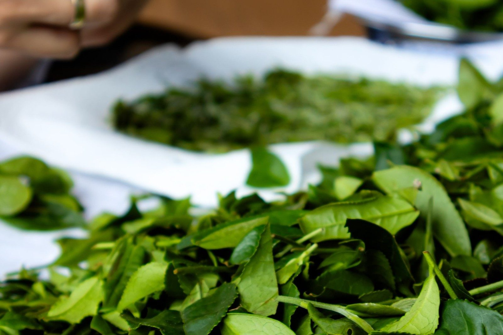
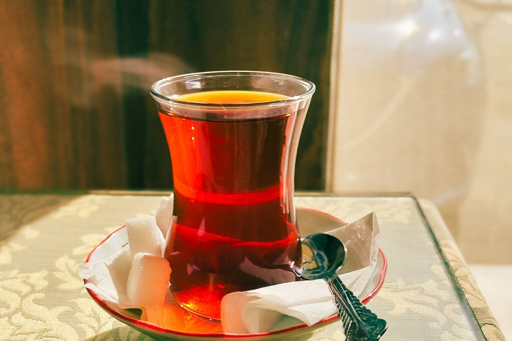
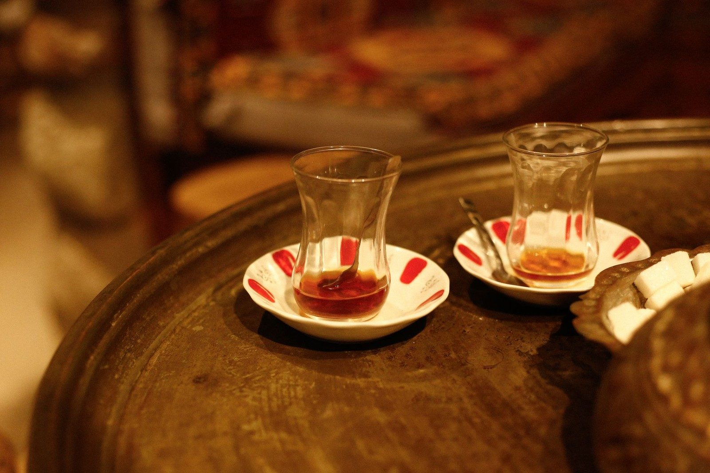
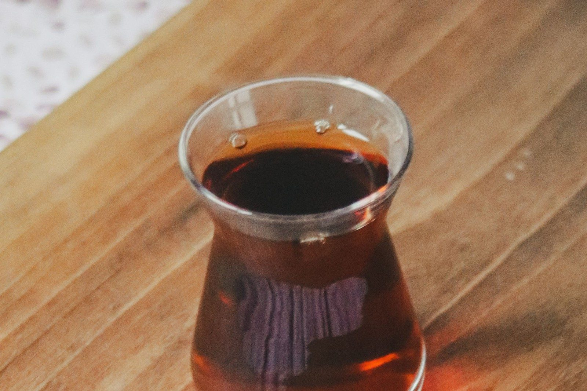
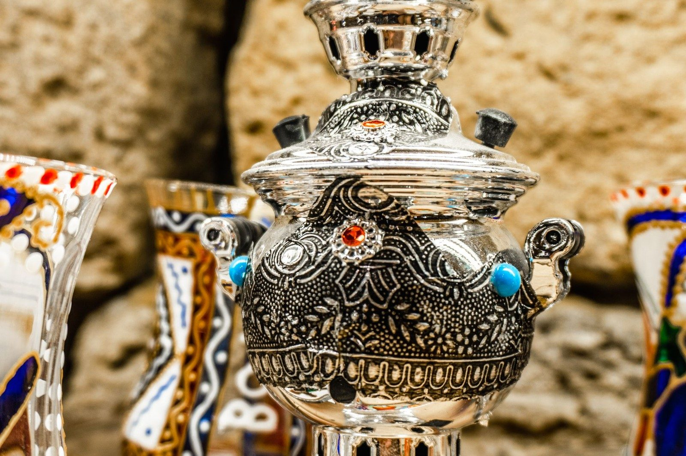
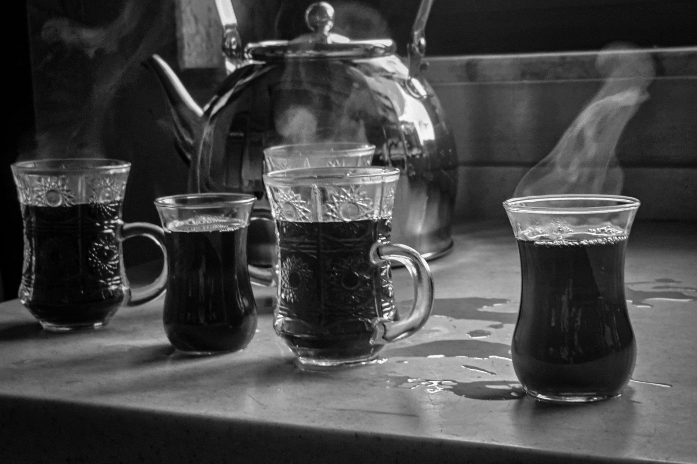

Türk çayı, Camellia sinensis'in Doğu Karadeniz'de, özellikle Rize ve çevresinde işlenen siyah halidir; ince belli cam bardakta, demlik ve çaydanlıkla ikram edilir. Kahveden sonra gelen bir kopya değildir. Kahvaltının, ofis sohbetinin, misafirliğin ve uzun bir günün sonunda masaya konan asıl içecektir. Bu rehber Rize çayının ne olduğunu, Rize Ticaret Borsası'nın yayımladığı demleme esaslarını, ince belli bardağı ve tavşankanı rengi, evde doğru servisi, saklamayı ve bu yazı hazırlanırken resmi satış sayfalarında görülen Çaykur ve Paşabahçe ürünlerini ele alır.

> **Kısa özet**
> - Rize çayı, taze ve kireçsiz suyla, tercihen porselen bir demlikte hazırlanır; su çaydanlıkta kaynarken üstteki demlik ısınır.
> - Rize Ticaret Borsası, her bardak için ortalama bir çay kaşığı çay, 15-20 dakikalık bir demlenme ve ince belli bardakta "tavşankanı" denen dem ölçüsünü önerir.
> - Demlenen çay yarım saat içinde içilmelidir. Demliği kaynatmak, suyu defalarca kaynatmak ve soğuk demliğe çay koymak en sık hatalardır.
> - İnce belli cam bardak hem ölçü hem âdettir: önce dem, sonra çaydanlıktan sıcak su. Açık ya da koyu, ev sahibinin ve misafirin tercihidir.
> - Çay, nemi ve kokuyu çeker. Açılmış paketi baharattan ve kahveden uzak, ağzı kapalı bir kapta saklayın.
> - Çaykur'un resmi satış sayfasında Rize Turist 200 g 90,00 TL, 1 kg 409,00 TL olarak görünmektedir. Paşabahçe ince belli 125 cc bardak 99,50 TL'dir.

## Rize Çayı Nedir ve Neden Türk Sofrasının Çayıdır?

Rize çayı, Türkiye'de "çay" dendiğinde çoğu evin kastettiği içecektir: Doğu Karadeniz'in nemli yamaçlarında yetişen, siyah çay olarak işlenen ve demlikle hazırlanan bir yaprak. Rize Ticaret Borsası, Rize çayının duyusal ölçütlerini net yazar. Kuru çay siyah ya da koyu bakır renkli olmalı, lif ve sap içermemelidir. Demin rengi koyu kırmızı, parlak olmalı; mat, bulanık, tortulu ya da esmerimsi olmamalıdır. Dilde burukluk beklenir, dem dolgun olmalıdır. Posa bakır kırmızısı ve parlak durmalı, yeşil yaprak az olmalıdır. Aroma, çaya özgü karakterde olmalı ve toplam değerlendirmede en az 70 puan aranır. Borsanın özellikle altını çizdiği nokta, dem renginin mat ve bulanık olmamasıdır.

Kaynak: [Rize Ticaret Borsası, Rize Çayı](https://www.rtb.org.tr/tr/rize-cayi)

Bu teknik dilin evdeki karşılığı basittir: iyi bir Türk çayı parlak, tavşankanı bir kırmızıya sahip olmalı, dilde hafif buruşukluk bırakmalı, yorgun ve bulanık durmamalıdır. Siyah çayın parlaklığını ve burukluğunu teaflavinler, rengini daha çok tearubiginler belirler. Borsaya göre Rize çayında teaflavin/tearubigin oranı 1/25'in altına düşmemeli, teaflavin yüksek kalmalıdır. Bunları evde ölçmezsiniz; ama mat, durgun, "ölü" bir dem gördüğünüzde sorunun çoğu zaman yaprakta değil, suda, demlikte ya da sürede olduğunu bilirsiniz.

Çaykur, Türkiye'nin kamusal çay kurumudur ve Rize Turist, evlerde en çok tanınan harmanlarından biridir. Resmi satış sayfası onu "Gerçek Sarı" olarak anar: katkı ve aroma vaat etmeyen, günlük sofranın çayı. Aynı evde daha sert, daha uzun demde kalan bir Tiryaki ya da daha narin bir harman durabilir; ama Rize Turist, bir beyefendinin evinde misafire uzatacağı ilk, en az sürprizli bardağın iyi bir adayıdır.

Türkiye'ye çayın yerleşmesi, kahvenin kaybolduğu bir dönemin hikâyesidir. Cumhuriyetin erken yıllarında kahve ithalatı zorlaşınca Karadeniz'de çay tarımı devlet eliyle büyütüldü; Rize, bu politikanın hem tarlası hem fabrikası oldu. Bugün çay, kahvenin yerini "ikame" olarak değil, kendi başınalığıyla tutar: daha ucuz, daha tekrarlanabilir, daha toplumsal. Bir evde Türk kahvesi özel bir anın içeceği olarak kalabilir; çay ise günün kumaşıdır. Bu yüzden bir beyefendinin çayı bilmesi, gösterişli bir hobiden çok, evini idare etmenin parçasıdır.

Harman seçimi de bu gündelik karaktere göredir. Rize Turist dengeli ve yumuşak, misafir sofrası için "orta yol" bir çay olarak bilinir. Tiryaki daha iri yapraklı ve daha sert içimlidir; uzun demde biraz daha durabilir, koyu renk verir. Filiz ve Altınbaş gibi harmanlar evden evde ayrı bir yer tutar; biri daha hızlı ve pratik, öbürü daha narin ve kokulu aranır. Bunları bir yarış gibi sıralamak yerine, evin ritmine bakmak daha doğrudur. Her gün üç kez demlenen bir evde Turist ya da Tiryaki iş görür; seyrek, özenli bir ikram için daha seçilmiş bir Rize lotu da düşünülebilir. Katkılı, aromalı, "bergamotlu" karışımlar başka bir içecektir ve klasik Türk çayının yerine konmamalıdır.

*Photo: Yeşim Çolak / Pexels, [Pexels License](https://www.pexels.com/license/)*

## Rize Çayı Nasıl Demlenir? Resmi Ölçü ve Süre Nedir?

Doğru demleme, görgüden önce bir teknik iştir ve en sade tarif, Rize Ticaret Borsası'nın kendi sayfasındadır. Rize çayı geleneksel olarak çaydanlık ve demlikle hazırlanır, ince belli bardakla içilir. Demlik tercihen porselen olmalıdır. Su taze, yumuşak ve kireçsiz olmalıdır. Su çaydanlıkta kaynama noktasına gelirken üstündeki demlik de ısınır; böylece demleme sırasında ısı kaybı azalır. Su tam kaynama noktasındayken demliğe aktarılır. Her bardak için ortalama bir çay kaşığı dolusu Rize çayı demliğe eklenir. Çayın kendiliğinden dibe çökerek demlenmesini tamamlaması için 15-20 dakika beklenir. İnce belli cam bardakta sunulan çayın "tavşankanı" adı verilen dem ölçüsü idealdir. Bardağa demlikten çay, çaydanlıktan su eklenir; şekerli ya da şekersiz içilir. Demlenen çay yarım saat içinde tüketilmelidir.

Kaynak: [Rize Ticaret Borsası, Rize Çayı'nın Demlenmesi](https://www.rtb.org.tr/tr/rize-cayi)

Bu tarifin evdeki pratik hali şöyledir. Önce suyu bir kez kaynatın; aynı suyu defalarca kaynatmayın, oksijenini kaybetmiş bir su çayı yorgun bırakır. Demliği çay koymadan önce kaynar suyla çalkalayıp boşaltın. Soğuk cam ya da soğuk metal, suyun ısısını düşürür ve yaprak geç açılır. Porselen ya da cam demlik, tadı en az örseleyen seçeneklerdir; alüminyum ve bazı metal demlikler hem hızlı soğur hem tada metalik bir iz bırakabilir. Demliği çaydanlığın üzerinde, kısık ateşte, fokurdatmadan sıcak tutun. Demliğin kaynaması çayı acılaştırır ve rengi matlaştırır.

Süre konusunda evler biraz ayrılır. Borsa 15-20 dakikayı yazar. Bazı pratik rehberler 12-15 dakikayı yeterli görür ve 20 dakikayı geçen demi burukluk ve mat renk riski olarak okur. İlk kural borsanın süresidir; sonra kendi damağınızı dinlersiniz. Açık içiyorsanız dem biraz daha kısa tutulabilir, koyu içiyorsanız sürenin üst sınırına yaklaşabilirsiniz. Her durumda dem, sonsuz bir bekleyiş değil, yarım saatlik bir ikramdır. Saatlerce demlikte bekleyen çayı "daha koyu olsun" diye savunmak, eski bir alışkanlıktır, iyi bir yöntem değildir.

*Photo: Jepoy Fabian / Pexels, [Pexels License](https://www.pexels.com/license/)*

## İnce Belli Bardak Nedir ve Tavşankanı Ne Demektir?

İnce belli bardak, Türk çayının hem ölçüsü hem âdetidir. Belden incelir, yukarıda biraz açılır; dem ile suyun karışımını gösterir, ısının elde tutulabilir kalmasını sağlar ve sofanın tanıdık silüetidir. Paşabahçe'nin klasik ince belli modeli 125 cc'dir: yükseklik 9 cm, genişlik ve uzunluk 6 cm, ağırlık 110 gram. Bu, bir "fincan" değil, bir çay bardağıdır ve Türk evinin ritmi bu hacme göredir.

Tavşankanı, demin bardağa ilk düştüğünde alması gereken parlak, canlı kırmızı-kahverengi tondur: tavşanın kulağındaki o sıcak renk. Çok açık bir çay, yaprağın yeterince açılmadığını ya da demin fazla sulandırıldığını; mat, koyu, durgun bir çay ise fazla bekletilmiş ya da yorulmuş bir demi düşündürür. Ev sahibi bardağa önce dem koyar, sonra çaydanlıktaki sıcak suyla tamamlar. Açık içenler için kaba bir ölçü, üçte bir dem ve üçte iki sudur; koyu içenler yarı yarıya gidebilir. Asıl olan, misafire "nasıl içersiniz" diye sormak ve bardağı onun istediği tonda kurmaktır.

Şeker ayrı bir konudur. Bazı evler küp şekeri bardağın yanına koyar, bazıları kıtlama âdetini sürdürür: şekeri dudağın kenarında eriterek çayı yudumlamak. Kıtlama bir zorunluluk değil, bir hatıradır; dayatılmaz. Modern bir sofrada şekeri ayrı sunmak, çayı şekersiz içenleri de rahat bırakır. Yapay aroma, hazır karışım ve "çay aromalı" tozlar bu ritüelin dışındadır. Beyefendinin evinde çay, yapraktır.

Tepsi, kural olmasa da görgünün parçasıdır. İnce belli bardaklar, küçük tabaklar, şeker ve bir kaşık, mümkünse bir kez de değil, sohbet uzadıkça yenilenerek gelir. İyi bir ev sahibi çayı unutmaz; kötü bir ev sahibi ilk bardağı koyup konuşmaya dalar ve demliği soğutur.

*Photo: Betül Nur Akyürek / Pexels, [Pexels License](https://www.pexels.com/license/)*

## Evde, Ofiste ve Misafirlikte Çay Nasıl Sunulur?

Türk evinde çay, yemeğin bitimini bekleyen bir "digestif" değildir. Kahvaltının içindedir, öğleden sonranın içindedir, misafir oturur oturmaz gelen ilk ikramdır. Bu yüzden demliği hazır tutmak, görgüden önce bir ev idaresidir. Su kaynar, demlik ısınır, çay bekler; misafir kapıdan girmeden evin kokusu biraz çay, biraz ev olursa, ev sahibi işini yapmış demektir.

Ofiste çay, Türkiye'de hâlâ bir sosyallik aracısıdır. Birçok işyerinde çaycı ya da ortak bir çay ocağı, günü bölen kısa, ayakta durulan sohbetlerin bahanesidir. Burada incelik, bardağı bir iş emri gibi değil, kısa bir molanın parçası gibi taşımaktır. Karton bardak mecburen vardır; ama evde ve ciddi bir misafirlikte ince belli camın yerini tutmaz. Bir beyefendi, evine gelen konuğa kâğıt bardak uzatmaz.

Sohbet uzadıkça çay yenilenir. İkinci ve üçüncü bardak, Türkiye'de bir cömertlik işaretidir; "bir bardak yeter" diye ısrar etmek konuğa kalır, ev sahibine değil. Dem tükendiyse yeni dem yapılır, eski demi kaynatıp "idare" edilmez. Yarım saati geçen, soğumuş, matlaşmış bir dem dökülür. Bu israf değil, standardın korunmasıdır.

Şehir suyu da işin bir parçasıdır. İstanbul, Ankara ve birçok büyük kentin musluk suyu kireçlidir; kireç hem demliğin içinde taş bırakır hem çayın parlaklığını bozar. Borsa "taze, yumuşak, kireçsiz su" der. Pratikte bu, kaliteli bir sürahi filtresi, dinlendirilmiş su ya da kokusuz bir içme suyu demektir. Suyu bir kez kaynatmak yeter; elektrikli kettleyi sürekli kaynar tutup aynı suyu öğleden akşama kullanmak, yukarıda sayılan hataların evdeki en yaygın halidir. Demliğin içindeki kireç tabakasını da ihmal etmeyin: düzenli temizlik, ertesi günkü bardağın rengini görünür biçimde düzeltir.

Çayı yemekle birlikte düşünmek de gerekir. Kahvaltıda peynir, zeytin, bal ve yumurtanın yanındaki çay, yağlı ve tuzlu tatlara bir karşı ağırlıktır. Akşam yemeğinden sonra ise çay, ağır bir tatlıyı ya da uzun bir sohbeti taşır; kahvenin yerini zorla almaz, çoğu evde onunla nöbetleşe durur. Türk kahvesi ayrı bir ritüeldir ve bu yazının konusu değildir. Çayın kendi yeri, daha uzun, daha tekrarlanabilir, daha gündelik bir ikram olmasıdır.

Yolculukta ve dışarıda çay, evdeki standardın imtihanıdır. Bir tren garının ince belli bardağı, bir esnaf kahvesinin demliği, bir otelin kahvaltı salonu: üçünün de tadı evdeki porselen demlikten farklı olabilir. Bunu bir bozgun saymak yerine, evdeki yöntemi daha değerli kılan bir karşılaştırma olarak görmek yeter. Dışarıda çayı ev sahibi gibi yönetemezsiniz; evde yönetebilirsiniz. Misafirliğe giderken de incelik, ev sahibinin demine karışmamaktır. "Daha koyu olsun" diye demliği işaret etmek, ancak evin yakınıysanız ve şaka payı varsa hoş karşılanır. Yabancı bir evde uzatılan bardağı, tavşankanı olmasa da, teşekkürle almak daha doğru bir duruştur.

Çocuğun, yaşlının ve geç saatin masasında da bir ölçü vardır. Çay bir ziyafet içkisi değildir ama kafeinli bir içecektir; gece yarısı üçüncü bardağı herkese ısrarla doldurmak misafirperverlik değil, dikkatsizliktir. Ev sahibi, "bir tane daha"yı teklif eder, kabul edilmezse gönül koymaz. Demliği ocaktan indirmeyi bilmek de bir görgüdür: sohbet bittiğinde çayın da bitmesine izin vermek, konuğu evde tutmak için taze dem yapmaya devam etmemek gerekir.

*Photo: Gizem Gökce / Pexels, [Pexels License](https://www.pexels.com/license/)*

## Sık Yapılan Demleme Hataları Nelerdir?

İyi bir yaprak, kötü bir yöntemle bozulur. En sık hataların bir listesi, evde çayı düzeltmek için yeterlidir.

Suyu defalarca kaynatmak, çayı "ölü" bir tada çeker. Her dem için taze su alın. Soğuk demliğe çay koyup üzerine kaynar su boşaltmak, yaprağın şoka girmesine ve geç, düzensiz açılmasına yol açar; demliği önce ısıtın. Demliği kaynatmak, acı ve mat bir renk demektir; kısık ateş, kapalı kapak, fokurdamayan bir demlik yeterlidir. Kapağı açık bırakmak buharı ve ısıyı kaçırır. Metal, özellikle alüminyum demlik, tada istenmeyen bir iz bırakabilir; porselen ya da cam tercih edin. Fazla çay koymak çayı daha "kaliteli" yapmaz, sadece daha buruşuk ve bazen daha acı yapar. Ölçü, bardak başına bir çay kaşığıdır.

Sürenin iki ucu da bozar. Çok kısa dem, aromayı açmaz, renk zayıf kalır. Çok uzun dem, özellikle 20 dakikayı belirgin biçimde aşan ve saatlerce tezgâhta unutulan dem, buruklaşıp matlaşır. Borsanın 15-20 dakikası bir aralıktır, bir ihmal izni değildir. Demlenen çayın yarım saat içinde içilmesi de aynı disiplinindir: soğuyan, oksitlenen, kenarda unutulan çay ikram olmaktan çıkar.

Nihayet, saklama. Çay, çevresindeki nemi ve kokuyu hızla alır. Açılmış paketi ocağın üstünde, pencere kenarında, baharatlığın yanında bırakmak, ertesi günkü demi bozmanın en sessiz yoludur. Ağzı sıkı kapanan bir kutu, serin, karanlık, kokusuz bir raf, paketin üzerindeki tüketim tarihine kadar tazeliği korumanın bütün sırrıdır. Buzdolabı gerekmez; dolaptaki nem ve koku gerekenden fazladır.

*Photo: Zulfugar Karimov / Pexels, [Pexels License](https://www.pexels.com/license/)*

## Evde Hangi Çay, Demlik ve Bardak Alınmalı?

İyi bir günlük çay, doğru bir demlik ve doğru bir bardak, evdeki ritüelin üç ayağıdır. Aşağıdaki fiyatlar, bu yazı hazırlanırken ürün sayfalarında görülen rakamlardır; kampanya ve stok değişir, satın almadan önce sayfayı kontrol edin.

### Çaykur Rize Turist Çayı 200 g

Günlük evin ölçülü paketi. Çaykur'un resmi satış sayfası, Rize Turist'i evin ve dost sohbetinin çayı olarak tanımlar; 100, 200, 500, 1000 ve 2000 gramlık ambalajlarda satıldığını belirtir. 200 gramlık paket, sayfada stokta ve 90,00 TL olarak görünmektedir. Yeni başlayan ya da çayı taze taze bitirmek isteyen bir ev için doğru ilk ebat budur.

[Çaykur Rize Turist Çayı 200 g](https://caykursatis.com/rize-turist-cayi-200gr-siyah-cay-caykur)

### Çaykur Rize Turist Çayı 1000 g

Sık demlenen evin ve ofis ocağının paketi. Aynı resmi satış sayfasında 1 kilogramlık Rize Turist stokta ve 409,00 TL olarak listelenmektedir. Taze kaldığı sürece, yani ağzı kapalı ve kokudan uzak saklandığı sürece, kiloluk paket günlük tüketimi olan bir ev için daha ekonomiktir. Açıp aylarca tezgâhta unutulan bir kilo çay, tasarruf değildir.

[Çaykur Rize Turist Çayı 1000 g](https://caykursatis.com/rize-turist-cayi-1000gr-siyah-cay-caykur)

### Paşabahçe İnce Belli Çay Bardağı 125 cc

Ritüelin camı. Paşabahçe'nin klasik ince belli bardağı, 125 cc, 9 cm yükseklik, 6 cm genişlik, 110 gram ağırlık. Resmi mağaza sayfasında 99,50 TL olarak görünmektedir. Evde birkaç tanesi değil, misafir sayısını rahat karşılayan bir takım bulundurmak gerekir; çay bardağı kırılır, ve ikram yarıda kalmamalıdır.

[Paşabahçe İnce Belli Çay Bardağı 125 cc](https://www.pasabahce.com/ince-belli-cay-bardagi-125-cc-p-000000000010000018/)

Demlik olarak porselen ya da iyi bir cam, çaydanlık olarak sağlam, kireç tutmayan bir altlık yeterlidir. Semaver güzel bir tören aracıdır, zorunlu değildir. Asıl olan, ısının demlikte korunması ve suyun temiz olmasıdır. Pahalı bir yaprak, kötü bir su ve soğuk bir demlikle bozulur; sade bir Rize Turist, doğru yöntemle parlak bir tavşankanı verir.

Semaver, özellikle eski evlerin ve bazı Karadeniz sofalarının parçasıdır: altta suyun uzun süre sıcak kalması, üstte demliğin sürekli ısınması. Bugünün mutfağında bir çaydanlık-demlik takımı aynı işi daha az yer kaplayarak görür. Bakır bir semaveri vitrin için almak, çayı iyileştirmez; onu gerçekten yakıp, suyunu temiz tutup, demini usulünce kurmak iyileştirir. Aynı şey süslü ince belli takımlar için de geçerlidir. Paşabahçe'nin sade 125 cc'si, altın yaldızlı bir takımdan daha az "gösterişli" olabilir; ama ölçü doğrudur, cam temizdir ve misafir bardağı avucuna aldığında neyle karşı karşıya olduğunu bilir. Beyefendinin evinde araç, resmi destekler; resmi, aracı göstermez.

*Photo: Masoud Kocher / Pexels, [Pexels License](https://www.pexels.com/license/)*

## Sık Sorulan Sorular

### Rize çayı kaç dakikada demlenir?

Rize Ticaret Borsası 15-20 dakika beklenmesini önerir. Demlik kaynamamalı, yalnızca sıcak kalmalıdır. Süreyi belirgin biçimde aşan, saatlerce bekleyen bir dem buruklaşıp matlaşabilir. Demlenen çay yarım saat içinde içilmelidir.

### Çay hangi demlikte demlenmeli?

Tercihen porselen, yoksa cam. Geleneksel düzen, altta çaydanlık, üstte demliktir. Alüminyum ve bazı metal demlikler ısıyı çabuk kaybeder ve tada iz bırakabilir.

### Tavşankanı çay ne demektir?

Demin ince belli bardakta alması istenen parlak, canlı kırmızı-kahverengi tondur. Çok açık bir çay eksik dem ya da fazla su; mat ve durgun bir çay yorulmuş ya da kötü demlenmiş bir yaprak düşündürür.

### Çay açık mı, koyu mu içilir?

İkisi de doğrudur. Ev sahibi misafire sorar. Kaba bir ölçü: açık için üçte bir dem, üçte iki su; koyu için yarı yarıya. Asıl olan, bardağı karşıdakinin istediği tonda kurmaktır.

### Çaykur Rize Turist ne kadardır?

Bu yazı hazırlanırken Çaykur'un resmi satış sayfasında 200 gramlık paket 90,00 TL, 1 kilogramlık paket 409,00 TL olarak görünüyordu. Fiyatlar değişebilir; satın almadan önce sayfayı kontrol edin.

### Açılmış çay nasıl saklanır?

Nemi ve kokuyu çekmemesi için ağzı kapalı bir kapta, serin, karanlık, baharat ve kahveden uzak bir rafta. Ocak üstü ve pencere kenarı aromayı bozar. Buzdolabı gerekmez.

Türk çayı, öğrenilecek kısa bir yönteme ve sonra bırakılacak bir sükûnete bağlıdır: taze su, ısınmış porselen demlik, bardak başına bir kaşık, 15-20 dakika, ince belli bir bardakta tavşankanı bir dem. Gerisi evin âdetidir: şekeri dayatmamak, bardağı yenilemek, soğuyan demi ısrarla ikram etmemek. İyi bir evin çayı, konuşmayı kesmez; konuşmanın arasında, usulünce yeniden gelir. Bir paket Rize Turist, bir porselen demlik ve birkaç ince belli bardak, bu iş için yeterlidir. Pahalı bir makine, aromalı bir karışım ya da vitrinlik bir semaver, yöntemin yerini tutmaz. Çayı doğru demleyen ev, konuşmayı da doğru tempo ile kurar: acele etmeden, soğutmadan, kimseyi masada unutmadan.
