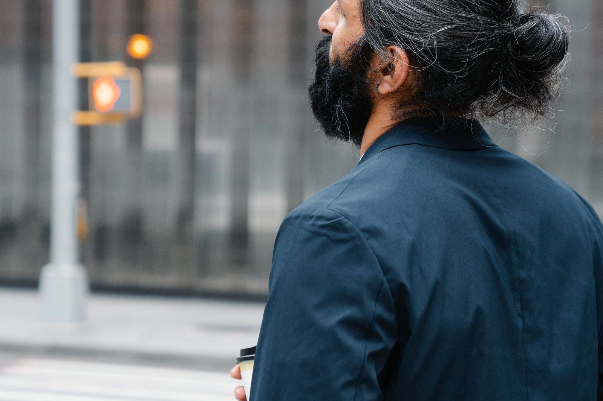
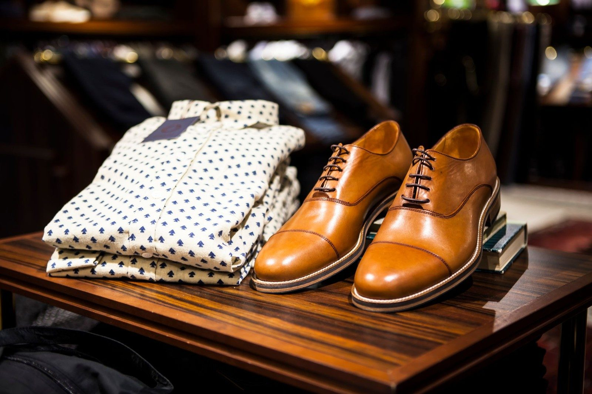
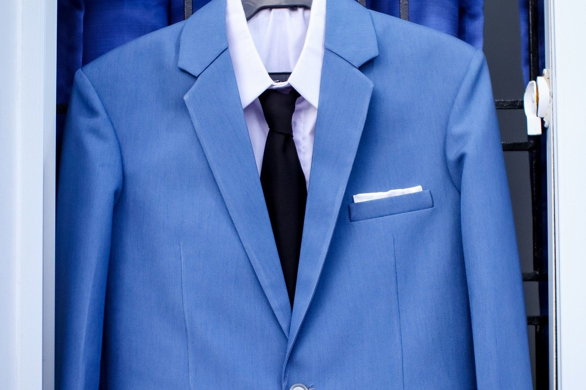

Erkek blazer ceket, takım elbise kadar resmi olmayan, spor giyim kadar da başıboş durmayan bir ara parçadır. Doğru kesilmiş bir lacivert blazer, İstanbul ofisinde iş yemeğine, akşam davetine ve hafta sonu chino-ceket kombinine aynı anda hizmet eder. Spor ceket ise aynı ailenin daha dokulu, daha rahat üyesidir: tweed, balıksırtı, ekose ya da yumuşak omuzlu yünle hafta sonuna ve soğuk aylara aittir. Bu rehber blazer ile spor ceket arasındaki farkı, doğru kalıbı, lacivert blazerın neyle giyileceğini, bakımını ve Beymen'de bu yazı hazırlanırken görülen üç somut modeli, sayfada yazan fiyatlarıyla ele alır.

> **Kısa özet**
> - Takım ceketi, aynı kumaştan pantolonla birlikte kesilir; tek başına giyildiğinde genellikle yarım kalır. Blazer ve spor ceket ise baştan beri ayrı pantolonla giyilmek üzere tasarlanır.
> - Blazer daha çok düz renkli, çoğu zaman lacivert, gri ya da deve tüyü tonlarında, metal ya da belirgin düğmeli bir cekettir. Spor ceket dokulu ya da desenlidir; düğmeleri genelde boynuz, kumaş kaplı ya da sadedir.
> - İlk alınacak parça, kelebek yakalı, iki düğmeli, tek sıra (tek kruvaze) lacivert bir blazer olmalıdır. Kruvaze lacivert blazer ikinci bir satın almadır.
> - Kalıpta ilk bakılacak yer omuzdur. Kol ucu gömlek manşetini bir tutam göstermeli, etek boyu yaklaşık kalça ortasına inmelidir.
> - Lacivert blazerın klasik eşliği gri kumaş pantolondur. Bej chino ve koyu, sade jean günlük alternatiflerdir; içine gömlek, ince merino kazak ya da balıkçı yaka giyilebilir.
> - Yün ve kaşmir ceketler genellikle kuru temizleme ister, ama her giyilişte değil. Fırçalayın, kalıplı askıda dinlendirin, omuzu tutan bir ceketi terziye götürüp attırmayın.

## Blazer Ceket ile Spor Ceket Arasındaki Fark Nedir?

Takım ceketi, takım elbiseye aittir. Pantolonuyla aynı kumaştan kesilir; tek başına giyildiğinde çoğu zaman "takımın yarısı" gibi durur. Blazer ve spor ceket ise odd jacket, yani ayrı cekettir: pantolonları kasıtlı olarak uyumsuz seçilir. Asıl ayrım kumaşta, düğmede ve duruştadır.

Türkçe kaynaklarda da aynı çizgi korunur. Wessi'nin blazer-spor ceket yazısı, blazer ceketi denizcilik kökenli, daha yapılandırılmış, metal düğmeli ve yarı resmi bir parça; spor ceketi ise daha yumuşak omuzlu, sade düğmeli ve günlük kullanıma yakın bir parça olarak tanımlar. Blazer iş toplantısı, kokteyl ve özel davetlerde; spor ceket iş-rahat ortamda, hafta sonu ve şehir gezisinde daha doğrudur.

Kaynak: [Wessi](https://tr.wessi.com/blogs/erkek-giyim-tarzlari-blogu/blazer-ceket-ve-spor-ceket-arasindaki-fark-nedir)

Bu ayrımlar bir yasa değil, bir pusuladır. Günümüzde birçok iyi lacivert ceket koyu boynuz düğmeyle ve yumuşak omuzla üretilir, yine de blazer olarak adlandırılır. Tersine, düz lacivert ama yama cepli, dirsek yamalı ya da çok rahat kesimli bir ceket spor cekete kayar. Bakılacak üç işaret şunlardır: kumaş düz mü, dokulu mu; düğme metal mi, sade mi; cep ve omuz resmi mi, günlük mü. Lacivert, düz ve dengeliyse blazer; desenli, tweed ya da belirgin dokuluysa spor cekettir.

Türkiye'de vitrin dilinde "ceket", "blazer" ve "spor ceket" bazen iç içe geçer. Beymen'de blazer ve spor ceket ayrı kategorilerde durur; Vakko'da erkek ceket reyonu spor ceketlerden daha resmi modellere kadar genişler. Alışverişte isme değil kumaşa, düğmeye ve kalıba bakmak daha güvenilirdir.

*Photo: Danon Gabriel / Pexels, [Pexels License](https://www.pexels.com/license/)*

## İlk Alınacak Parça Neden Lacivert Blazer Olmalı?

Tek bir ayrı ceket alınacaksa bu, lacivert blazer olmalıdır. Türkiye'nin iş ve davet takviminde lacivert, antrasitten daha yumuşak, siyahtan daha gündelik, kahverengiden daha resmi bir yer tutar. Aynı ceket pazartesi günü ofiste açık mavi gömlek ve gri pantolonla, perşembe akşamı yemekte bej chino ve loafer'la, cumartesi günü ince kazak ve koyu jeanle çalışır. Bu aralığı başka bir renk tek başına bu kadar temiz vermez.

Kesim tercihi nettir. İlk blazer, kelebek yakalı, iki düğmeli, tek sıra bir ceket olsun. Üç düğmeli Amerikan kalıpları ve altı düğmeli kruvaze blazerler güzel ikinci parçalardır, ama günlük esneklikleri daha dardır. Kruvaze lacivert blazer, özellikle metal düğmeliyse, gri flanel ya da açık krem pantolonla davette güçlü durur; jean ve tişörtle ise çoğu zaman fazla resmi kalır.

Düğme seçimi ceketin bütün havasını değiştirir. Altın ya da gümüş tonlu metal düğme, blazeri daha klasik ve biraz denizci bir yere çeker. Boynuz ya da koyu mat düğme aynı lacivert kumaşı gömleğin açık yakasıyla, chino ve jeanle daha rahat giydirir. Armalı, okul ya da kulüp düğmeleri yalnızca o kuruma ait olanın takması gereken ayrıntılardır. Düz metal düğmenin böyle bir anlamı yoktur; bir terzi kısa bir ziyarette düğme takımını değiştirebilir.

Kumaş olarak ilk blazer için orta ağırlıkta, hafif dokulu bir yün, özellikle hopsack (sepet örgüsü) tipi bir kumaş en akıllı seçimdir. Çok ince, takım elbise parlaklığındaki bir süper 120'lik düz yün, ayrı pantolonla giyildiğinde "takım ceketi gibi" durabilir. Kışın daha ağır yün, kaşmir karışımı ya da tam kaşmir; yazın fresco, ince hopsack ya da tropikal yün aynı silüeti taşır. Türkiye'de kışın kaloriferli ofislerle soğuk sokak arasında gidilip gelindiği için, nefes alan orta ağırlık çoğu adam için yazlık keten kadar ince, palto altı kadife kadar da ağır olmayan doğru yerdir.

İstanbul'da kış çoğu gün sıfırın altında değil, ıslak ve rüzgârlıdır; Ankara ve İç Anadolu'da ise palto gerçekten gerekir. Bu yüzden lacivert blazer Türkiye'de tek başına bir kış palto değildir. Şehrin nemli soğuğunda bir Chesterfield veya kaşmir paltonun altında durur, ofiste kalorifer açılınca palto çıkar ve blazer kalır. Bu katmanlı kullanım, ceketin fazla kalın olmamasını da gerektirir. Çok baklavalı, çok dolgulu bir omuz palto altında şişer; doğal ya da hafif omuz daha temiz durur.

Alışveriş haritası da buna göre okunmalıdır. Beymen ve Vakko, İtalyan ve ev koleksiyonlarının durduğu yerdir. Network, Damat Tween, Kiğılı ve Ramsey daha ulaşılır günlük blazer ve spor ceket sunar. Brooks Brothers'ın Türkiye'deki mağazaları klasik Amerikan hopsack arayanlar için bir başka duraktır. Fiyatı sayfada teyit etmediğimiz bir modeli buraya yazmıyoruz; esas olan, kumaşı elinizle yoklamak, omuzu giymek ve tadilatı baştan göze almaktır.

## Erkek Blazer Ceket Nasıl Oturmalı?

Bir blazerın kalıbı, iyi bir takım ceketiyle aynı kurallara uyar. Spor cekette tek küçük pay, altına kazak giyilecekse göğüste bir nebze daha fazla rahatlıktır. Geri kalan her şey omuzda başlar. Omuz dikişi, sizin omzunuzun bittiği yerde, kemiğin kola doğru inişe geçtiği noktada durmalıdır. Omuz genişse ceket hiçbir zaman temiz durmaz ve terzi bunu kolay düzeltmez. Omuz darşa kol buruşur, göğüs çekilir.

Yaka, gömleğin yakasına yaslanmalı ve enseyle arasında boşluk bırakmamalıdır. Boşluk genelde sırtın üst kısmının dar geldiğini ya da yaka açısının tutmadığını gösterir. Kol boyu, kollar yanda sarkarken gömlek manşetinden yaklaşık yarım santim görünmesine izin vermelidir. Etek boyu kabaca kalça ortasına iner; boyu uzun olanlarda biraz daha aşağı, kısa olanlarda biraz daha yukarı durabilir. Çift yırtmaç, otururken ve ceplere el sokulurken ceketin belden açılmasını sağlar. Yırtmaçsız ceketlerin duruşu daha katıdır.

Düğme hizası, çalışan üst düğmenin durduğu yerdir. İki düğmeli cekette bu düğme doğal bele, göbeğin hemen yakınına oturmalı, aşağıya karnın üzerine inmemelidir. Ayaktayken bu düğme iliklenir, otururken açılır. Alttaki düğme hiç iliklenmez. Üç düğmeli cekette asıl kapanan orta düğmedir; üst düğme çoğu klasik Amerikan kalıbında yakaya doğru yuvarlanır. Kruvaze blazer, giyildiği sürece, çoğu kalıpta otururken de kapalı durur.

Koltuk altı, kolu kaldırdığınızda ceketin eteklerini birlikte çekmeyecek kadar yüksek, koltuğu kesmeyecek kadar da rahat olmalıdır. Kanvaslı ya da yarı kanvaslı bir göğüs, zamanla vücuda oturur. Yapıştırma (fused) göğüs daha ucuzdur; kötü ütü ve ucuz kuru temizleme ile kabarabilir. On yıl tutulacak bir cekette kanvas, fiyat farkına değer.

*Photo: Pixabay / Pexels, [Pexels License](https://www.pexels.com/license/)*

## Lacivert Blazer Hangi Pantolon ve Gömlekle Giyilir?

Lacivert blazerın en klasik eşliği gri kumaş pantolondur. Kışın orta gri flanel, ilkbaharda daha ince bir yün, iş hayatı ile akşam yemeği arasında en az riskli yoldur. Bisse'nin sonbahar ceket yazısı da aynı eşleşmeyi öne çıkarır: lacivert blazer ile gri kumaş pantolon iş hayatında temiz bir görünüm verir; daha günlük bir stil için bej chino ya da koyu mavi jean önerilir.

Kaynak: [Bisse](https://www.bisse.com/erkek-ceket-kombinleri)

Bej, taş ve zeytin rengi chino, ceketi ofisten çıkarıp şehir hayatına taşır. Koyu, sade ve dar paçalı bir jean, düğmeler boynuz ya da matsa ve kravat yoksa işe yarar. Açık yıkama, yırtık ya da bol jean lacivert yünün karşısında kaybeder. Yazın krem ya da taş rengi pantolon, özellikle kruvaze ceket ve kahverengi loafer ile eski ve doğru bir yaz kombinidir.

Yaka tarafında beyaz ya da açık mavi gömlek varsayılandır; yaka açık da durabilir, sade bir kravatla da. Soğukta ince merino ya da kaşmir bisiklet yaka kazak, ceketin altına en temiz kış katmanıdır. Balıkçı yaka, kazağın ince ve ceketin göğsünün payı varsa, lacivert blazerle erkek gardırobunun en düzenli kış görüntülerinden biridir. Polo yaka, yakası ceket reversinin altında düzgün duruyorsa rahat bir ofiste çalışır. Tişört yalnızca çok yumuşak, yapısız bir ceketle düşünülmelidir; metal düğmeli, resmi bir hopsack'in altında eksik kalır.

Ayakkabı pantolonun resmiyetini izler. Gri kumaşla oxford ya da derby. Chino ile loafer. Jean ve boynuz düğmeyle temiz bir süet chukka, gerisi sade tutulduğunda. Kemer ve ayakkabı aynı renk ailesinden olsun. Beyaz keten ya da pamuk cep mendili her zaman yeterlidir. Desenli mendiller, geri kalan her şey oturduktan sonra bir zevktir.

Beymen'in blazer kombin notları da benzer bir çerçeve çizer: haki chino ile kahverengi blazer, siyah blazer içine nötr polo, baharda beyaz ceket ile balıkçı yaka. Lacivert için en güvenilir ev ise gri, bej ve koyu denimdir.

Kaynak: [Beymen Erkek Blazer](https://www.beymen.com/tr/erkek-giyim-ceket-blazer-59906)

*Photo: Pixabay / Pexels, [Pexels License](https://www.pexels.com/license/)*

## Spor Ceket Ne Zaman Blazere Tercih Edilmeli?

Spor ceket, düz lacivert blazerın fazla resmi ya da fazla yalın kaldığı yerde devreye girer. Balıksırtı, ince kareli, arpa tanesi tweed ya da dokulu hopsack; kahverengi, zeytin ve pas tonlarında, kır yemeğinin, kış cumartesilerinin, yaratıcı ofislerin ve takım elbiseli bir odada "ofis ceketi çıkmamış" görünmek istemediğiniz akşamların ceketidir.

Kumaş konuşur. Tweed ve ağır hopsack tutar, tütülür ve flanel gömlek, kalın triko ya da yelek üzerine doğal oturur. Yama cep ve neredeyse dolgusuz bir omuz bu rahatlığı pekiştirir. Beymen'in spor ceket anlatımı da aynı noktayı vurgular: yama cep, deri dirsek yaması, renkli düğme ya da kontrast astar gibi ayrıntılar, ceketi takım elbise stilinden görsel olarak ayırır ve bedenin doğal formuna daha yumuşak uyar.

Kaynak: [Beymen Erkek Spor Ceket](https://www.beymen.com/tr/erkek-giyim-ceket-spor-ceket-59907?sayfa=0)

İş görüşmesi, şehir yemeği, taziye, müşteri sunumu ve takımların ağırlıkta olduğu odalar yine lacivert blazerın yeridir. İki ceket rakip değil, tamamlayıcıdır. Yalnızca bir ayrı ceket alınacaksa lacivert blazer alınır. O blazer duruyorsa ikinci parça, onunla yarışacak ikinci bir lacivert değil, orta-koyu toprak tonlarında dokulu bir spor ceket olmalıdır.

Kışın spor ceketin pratik bir üstünlüğü de vardır. Tweed ya da ağır yün, orta hopsack blazerdan daha sıcaktır ve palto altında yaka ve doku göründüğünde daha doğal durur. Yazın tersi doğrudur: ince lacivert fresco ya da hopsack, ağır spor ceketten her zaman daha kolaydır. Gardırop bu sırayla kurulursa, askı karşısında "bu fazla mı kaçtı" sorusu seyrek gelir.

Türkiye'nin davet takviminde bir uyarı daha vardır. Düğün, nişan ve bazı kurumsal geceler hâlâ takım, hatta smokin bekler. Blazer bu masalarda "neredeyse takım" değildir; ayrı bir cekettir. Davet kartında özel bir kıyafet notu yoksa ve salonda takımlar ağırlıklı olacaksa lacivert blazer, açık yakayla değil, beyaz gömlek, sade kravat ve gri ya da antrasit kumaş pantolonla gitmelidir. Spor ceket ise böyle bir geceye bırakılır. Tersi de geçerlidir: Bodrum ya da Çeşme'de yaz akşamı, ince bir lacivert blazer açık yaka keten gömlekle takımdan daha doğru durur.

*Photo: Lara Jameson / Pexels, [Pexels License](https://www.pexels.com/license/)*

## Yün Blazer ve Spor Ceket Nasıl Bakılır?

Çoğu yün ve kaşmir ceketin etiketinde "kuru temizleme" yazar ve bu uyarı ciddiye alınmalıdır. Asıl hata ise fazla temizletmektir. Ceket gerçekten kirlendiğinde ya da askıda çıkmayan bir koku aldığında temizletilir, her giyilişte değil. Aralarda yumuşak bir elbise fırçasıyla yaka, manşet ve ön beden taranır; ceket kalıplı ahşap bir askıda tam bir gün dinlendirildikten sonra dolaba girer.

Dinlenme, bakımın parçasıdır. Yün, üst üste iki gün giyilmezse formunu geri alır. Dolaptaki sedir güveye karşı yardımcıdır; larvaların hareketlendiği yaz sonu muayenesi de öyle. Bir güve deliği çıkarsa iyi bir görünmez onarım çoğu zaman kumaşı kurtarır. Buhar, mesafeli ve hafif kullanıldığında, ütünün yünde bırakabileceği parlaklık olmadan kırışığı kaldırır. Reversin rulosunu ezecek kadar sert ütü yapılmaz.

Yağmur felaket değildir, yeter ki ceket çırpılıp askıya alınsın ve kaloriferden uzakta kendiliğinden kurusun. Kuruyunca keçeli ya da at kılı bir fırça kurumuş kiri alır. Kış sonundaki tuz ve şehir kiri, dikkatli bir temizliği hak eder. Temizleyici seçerken kanvaslı terziliği bilen bir yere gidilmelidir. Ucuz ısı, yapıştırma göğsü kabartır ve özenle yuvarlanmış bir yakayı düzleştirir.

Son bakım adımı yeni bir ceket değil, iyi bir terzidir. Kol kısaltılır, bel alınır, düğmeler metalden boynuza çevrilir, bazen yaka yeniden oturtulur. Omuzu tutan bir lacivert blazer hemen her zaman değiştirmeye değil, düzeltmeye değer. Omuzu tutmayan ise nadiren saklanmaya değer. Beymen'in yeni sezon hazır giyim alışverişlerinde ücretsiz tadilat sunduğu modellerde bu işin bir kısmı zaten satışın içindedir; yine de kalıbı beğendiğiniz terzinin eline de güvenebilirsiniz.

*Photo: Terje Sollie / Pexels, [Pexels License](https://www.pexels.com/license/)*

## Türkiye'de 2026'da Alınabilecek Lacivert Blazer ve Ceketler Hangileri?

İyi bir lacivert ceket, kumaşı, kanvası ve kalıbıyla değerlendirilir. Aşağıdaki üç model, bu yazı hazırlanırken Beymen ürün sayfalarında görülen fiyatlardır. Kampanya ve stok değişir; satın almadan önce sayfadaki güncel rakamı kontrol edin.

### Beymen Collection Drop 7 Lacivert Yün Blazer Ceket

Günlük lüksün ölçülü hali. Kelebek yakalı, düğme kapatmalı, yüzde 100 koyun yünü bir blazer; üç dış cep ve bir iç cep. Kumaş, İtalyan'ın köklü kumaş evlerinden Vitale Barberis tarafından üretilmiştir. 2026 sonbahar/kış sezonu. Beymen ürün sayfasında fiyat 27.950 TL olarak görünmektedir.

[Beymen Collection Drop 7 Lacivert Yün Blazer Ceket](https://www.beymen.com/tr/p_beymen-collection-drop-7-lacivert-yun-blazer-ceket_1025810)

### Boglioli Lacivert Ceket

Yumuşak İtalyan terziliğinin spor cekete yakın, lacivert yorumu. Klasik yaka, düğme kapatmalı, yüzde 100 koyun yünü, iki dış cep ve bir iç cep. 2026 ilkbahar/yaz sezonu. Beymen sayfasında 84.950 TL üzerinden 48.495 TL olarak listelenmektedir.

[Boglioli Lacivert Ceket](https://www.beymen.com/tr/p_boglioli-lacivert-ceket_1938673)

### Canali Lacivert Ceket

Daha resmi, daha zengin bir kumaş. Kelebek yaka, düğme kapatmalı, çift yırtmaçlı; üç dış, iki iç cep. İçerik yüzde 49 koyun yünü, yüzde 30 ipek ve yüzde 21 keten — yazlık bir ağırlık ve parlaklık verir, kışın kalın flanelin yerini tutmaz, ilkbahar ve sonbahar yemekleri için ise çok uygundur. 2026 ilkbahar/yaz. Beymen sayfasında 130.950 TL üzerinden 70.495 TL olarak görünmektedir.

[Canali Lacivert Ceket](https://www.beymen.com/tr/p_canali-lacivert-ceket_1906861)

Haftanın üç dört günü giyilecek bir ceket arıyorsanız Drop 7 ya da indirimdeki Boglioli mantıklı bir yerdir. Canali'nin yün-ipek-keten karışımı ise mevsimlik, daha özel bir cekettir; her gün kış palto altı için değil, doğru havada bir davet ve ofis ceketi için alınır. Her üçünde de asıl yatırım omuz kalıbına ve iyi bir tadilata yapılmalıdır, logoya değil.

*Photo: Nothing Ahead / Pexels, [Pexels License](https://www.pexels.com/license/)*

## Sık Sorulan Sorular

### Blazer ile spor ceket arasındaki fark nedir?

Blazer genellikle lacivert, gri ya da deve tüyü gibi düz bir ayrı cekettir; düğmeleri çoğu zaman metal ya da belirgindir. Spor ceket tweed, balıksırtı ya da ekose gibi dokulu veya desenlidir; düğmeleri daha sade, cepleri çoğu zaman yamadır. İkisi de takım pantolonuyla değil, ayrı bir pantolonla giyilir.

### Lacivert blazer jean ile giyilir mi?

Evet, jean koyu, sade ve dikili bir paçaya sahipse ve ceketin karakteri biraz günlükse: boynuz düğme, yumuşak omuz, armalı düğme yok. Metal düğmeli, çok resmi bir hopsack denimle sert durur. Kravatı bırakın, gerisini sade tutun.

### Blazer düğmesi metal mi, boynuz mu olmalı?

İkisi de doğrudur. Metal düğme daha klasik ve biraz daha resmi, özellikle kruvaze blazer ve gri flanelle. Boynuz düğme aynı ceketi chino, jean ve açık yakayla daha kolay giydirir. Terzi düğmeleri sonradan değiştirebilir.

### Erkek blazer omuz ve kol boyu nasıl olmalı?

Omuz dikişi sizin omzunuzun bittiği yerde durmalıdır. Kollar yandayken gömlek manşetinden yaklaşık yarım santim görünmelidir. Yaka gömleğe yaslanmalı, etek boyu kalça ortasına inmelidir.

### İlk blazer kruvaze mi olmalı?

Hayır. İlk blazer, kelebek yakalı, iki düğmeli, tek sıra bir ceket olsun. Kruvaze lacivert blazer güzel bir ikinci parçadır; daha resmi durur ve en çok flanel ya da krem pantolonla parlır.

### Yün blazer ne sıklıkla kuru temizletilir?

Yalnızca kirlendiğinde ya da askıda dağılmayan bir koku aldığında. Giyildikten sonra fırçalayın, kalıplı askıda dinlendirin, üst üste iki gün aynı ceketi giymeyin. Fazla temizleme kumaşı yorar, kanvası ve yapıştırma göğsü bozabilir.

Lacivert bir blazer, erkeğin gardırobundaki her işi görmez; ama takımların yanına asılan hemen her şeyden daha çok iş görür. Gerçekten giyeceğiniz bir kumaş seçin, omuzu ve kolu doğru oturtun, sonra ceketi düşünmeden elinizin gittiği parça olana kadar rahat bırakın. Klasik olmanın bütün anlamı buradadır: bir gün onsuz çıktığınızda eksiği fark edersiniz.
