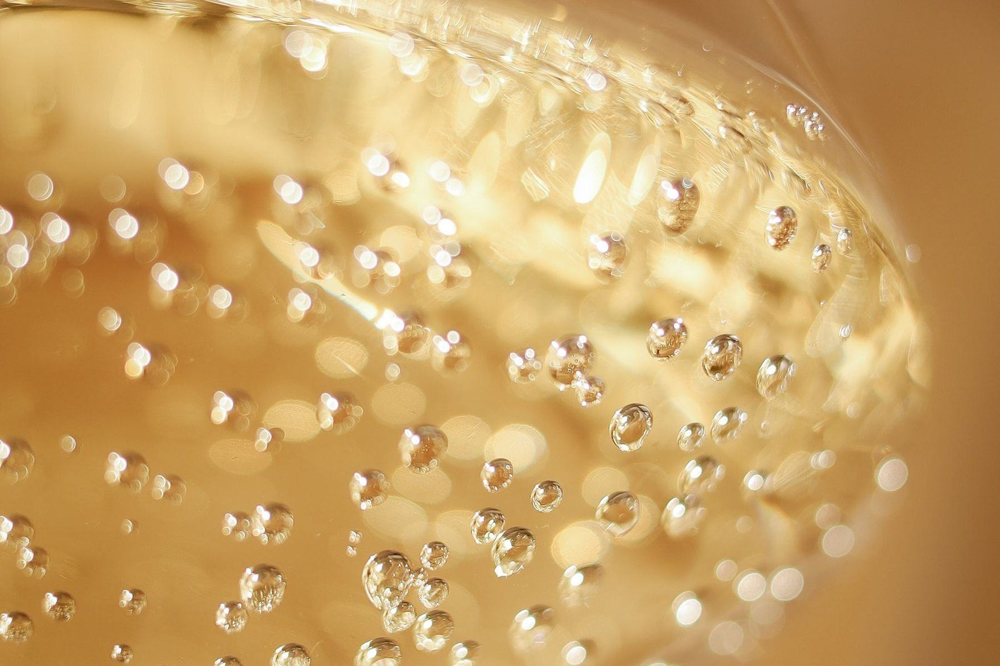
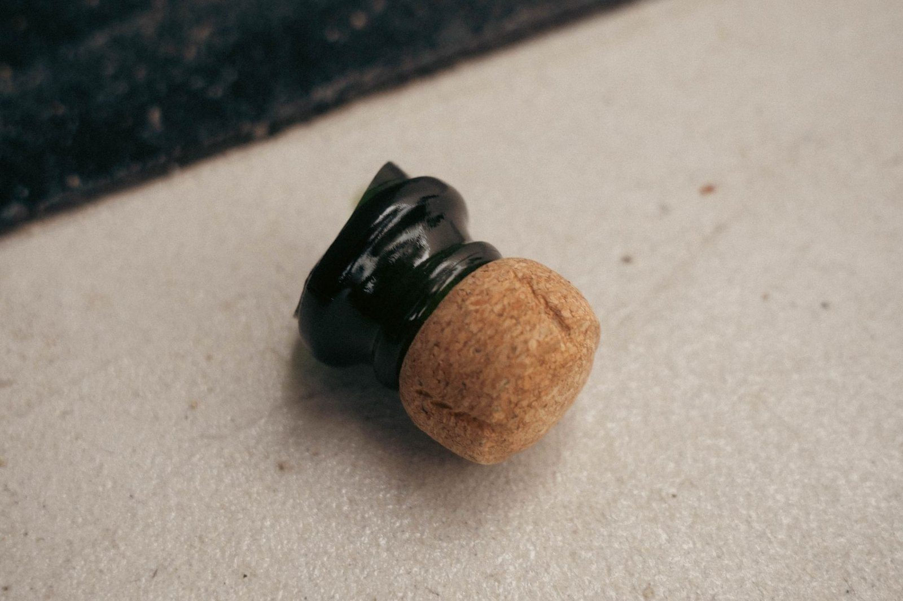
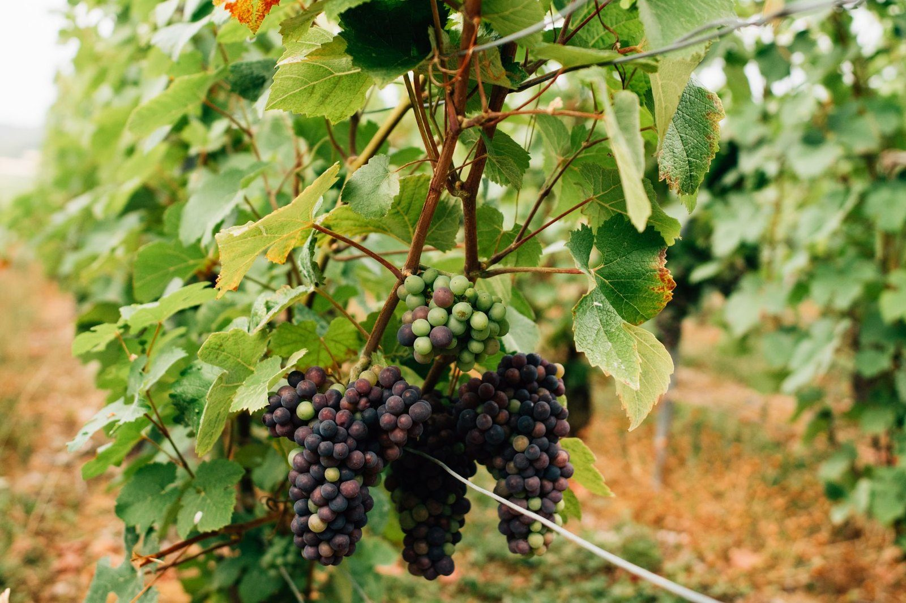

Yılbaşı yaklaşırken her beyefendinin önüne aynı soru gelir: Hangi şampanyayı almalı, nasıl servis etmeli ve sofrada neyle eşleştirmeli? Bu şampanya rehberi, yılbaşı gecesinden özel davetlere kadar her durumda doğru kararı vermeniz için hazırlandı. Şarap uzmanı olmanıza gerek yok. Etiketi on saniyede okuyabilmek, şişeyi doğru sıcaklığa getirmek, patlama sesi çıkarmadan açmak, uygun kadehi seçmek ve stili yemeğe göre ayarlamak yeterli. Pahalı bir şişe satın almakla şampanyayı gerçekten bilmek arasındaki fark, tam olarak bu ayrıntılarda gizli.

Türkiye'de şampanya kültürü son yıllarda belirgin biçimde olgunlaştı. İstanbul'daki iyi restoranlar artık şampanyayı yalnızca kadeh tokuşturmak için değil, yemeğin tamamına eşlik eden bir şarap olarak sunuyor. Aşağıda bu sezon bilmeniz gereken yedi konu, Türkiye'de bulunabilen iki seçkin öneri ve kısa bir soru-cevap bölümü yer alıyor.

## Kısa özet

- **Şampanya yalnızca Fransa'nın Champagne bölgesinden gelir.** Başka yerlerde aynı yöntemle yapılan şaraplar crémant, cava veya Franciacorta gibi adlar taşır.
- **Etiketteki tatlılık terimi belirleyicidir:** Brut litrede 12 grama kadar şeker içerir, extra brut 0–6 gram, brut nature ise 3 gramın altındadır ve şeker eklenmez.
- **İdeal servis sıcaklığı 8–10 °C'dir.** Vintage şampanyalar 11–12 °C'de daha iyi açılır.
- **En iyi kadeh lale biçimli kadehtir.** Flüt köpüğü korur ama aromayı kısar; geniş kupa (coupe) ise hem köpüğü hem aromayı hızla kaybeder.
- **Sessiz açılış:** Mantarı sabit tutun, şişeyi 45 derece eğin ve mantarı değil şişeyi çevirin.
- **Eşleşme:** Somon füme, deniz ürünleri, olgun peynirler, pastırma ve hatta humus şampanyayla çok iyi gider; çok şekerli tatlılardan kaçının.
- **Ölçülü tüketin:** Alkol yalnızca 18 yaşını doldurmuş yetişkinler içindir; alkollü araç kullanmayın.

## 1. Brut, extra brut ve brut nature: tatlılık seviyelerini doğru okumak

Şampanyanın şişede ikinci fermantasyonu tamamlandıktan ve maya tortusu çıkarıldıktan sonra şişeye az miktarda şarap ve şeker karışımı eklenir. Buna dozaj (dosage) denir ve etikette gördüğünüz tatlılık terimini belirler. Comité Champagne'ın resmî tanımlarına göre brut nature (pas dosé, zero dosage olarak da yazılır) litrede 3 gramın altında şeker içerir ve hiç şeker eklenmez. Extra brut 0–6 gram, brut ise 12 grama kadar şeker içerir.

### Neden daha kuru stiller öne çıkıyor?

Şampanya dünyasında son yılların en belirgin eğilimi şekerin azalması. Dozaj düştükçe şarap kendini daha çıplak gösterir: daha gergin, daha mineral, daha tuzlu ve zaman zaman daha sert. Bu yüzden extra brut ve brut nature, istiridye, deniz tarağı ve çiğ balık gibi yemeklerde sommelier'lerin ilk tercihi hâline geldi. Brut ise hâlâ en çok yönlü seçenek: Aperatiften ana yemeğe kadar bütün akşamı taşıyabilir.

### Etiketteki tuzak

Fransızca terimler sezgiye ters düşer. "Extra dry" ve "sec" kelimeleri kuru gibi görünse de aslında brut'tan daha tatlıdır. Demi-sec ise açıkça tatlıdır ve yalnızca tatlı servisinde anlam taşır. Yılbaşı sofrasının ana bölümü için brut, extra brut veya brut nature seçin.

Kaynak: [Champagne FAQ – Comité Champagne](https://www.champagne.fr/en/champagne-frequently-asked-questions)

## 2. Vintage ve non-vintage: millésime ne anlama gelir?

Şampanyaların büyük çoğunluğu non-vintage (yılsız) olarak üretilir. Bu şişeler birkaç farklı hasat yılının harmanıdır ve amaçları her yıl aynı ev stilini sunmaktır. Vintage ya da Fransızca adıyla millésime şampanya ise yalnızca etikette yazan tek bir hasat yılının üzümlerinden yapılır. Üreticiler bunu yalnızca başarılı yıllarda üretir ve genellikle daha uzun süre mahzende dinlendirir.

### Tadımda fark

Uzun mahzen süresi şampanyaya kızarmış ekmek, briyoş, fındık ve kuru meyve tonları kazandırır. Türkiye'nin köklü tadım platformu Degustasyon, Bollinger'in Verzenay grand cru bağlarından gelen 2019 hasatlı PN VZ19 Brut'unu anlatırken tam olarak bu karakteri vurguluyor: Beş yıl mahzende dinlendirilmiş, burunda maya tortusundan gelen briyoş kokuları, damakta olgun elma ve mineral bir bitiş. Sitenin önerisi de dikkat çekici: 11–12 derecede içilmeli ve ıstakoz, bıldırcın, köy tavuğu gibi sofistike beyaz etlere eşlik etmeli.

### Blanc de blancs ve blanc de noirs

Etikette göreceğiniz iki terim daha var. Blanc de blancs yalnızca beyaz üzüm Chardonnay'den yapılır; ince, zarif ve mineraldir. Blanc de noirs ise kırmızı üzümler Pinot Noir ve Meunier'den beyaz olarak üretilir; daha dolgun ve şarap karakteri daha belirgindir. Balık ve deniz ürünlerinde blanc de blancs, hindi, tavuk ve mantarlı yemeklerde blanc de noirs daha doğru tercihtir.

Kaynak: [Bollinger PN VZ19 Brut tadım notu – Degustasyon](https://degustasyon.net/bollinger-pn-vz19-brut-fransa/)

## 3. Lale, flüt ya da kupa: doğru şampanya kadehi

Eski filmlerde gördüğümüz geniş ve sığ kupa kadeh (coupe) şık görünür, ancak iyi bir şampanya için en kötü seçimdir. Geniş yüzeyi köpüğü hızla dağıtır ve şarap kısa sürede düzleşir. Antika kadeh uzmanı Antique by Betül'ün kadeh rehberi de bunu açıkça belirtiyor: Kupa aromayı rahat yayar, ancak köpük çok çabuk kaybolur ve ince ayaklı modeller kalabalık sofrada kolay devrilir.

### Flüt mü, lale mi?

Flüt kadehin dar formu kabarcıkların yüzeye uzun bir yol kat etmesini sağlar ve köpürmenin daha uzun sürdüğü izlenimini verir. Ancak dar ağız, aromanın açılmasını sınırlar. Lale biçimli kadeh ise ortası genişleyen, ağzı hafifçe daralan yapısıyla ikisinin arasındaki en dengeli seçenektir: Aromaya alan bırakır, köpüğü de kupa kadar hızlı dağıtmaz. Comité Champagne da aromaların yoğunlaşması ve kabarcıkların gelişmesi için lale biçimli kadehi öneriyor.

*Photo: Nati / Pexels, [Pexels License](https://www.pexels.com/license/)*

### Kadeh seçerken pratik ölçüler

Tek bir kadeh tipi alacaksanız lale biçimli ya da ince bir beyaz şarap kadehi en esnek seçimdir. Ürün sayfalarında hacme ve kâsenin üst çapına bakın; üst çapı yaklaşık 5–6 cm olan kadehler köpüklü şarap için uygundur. Kadehi daima ayağından tutun; avucunuzun sıcaklığı şarabı kısa sürede ısıtır. Kadehleri dondurucuda soğutmaktan kaçının: Ani soğuk, ince camda çatlak riski yaratır.

Kaynak: [Şampanya kadehi: flüt mü, kupa mı seçmeli? – Antique by Betül](https://www.antiquebybetul.com/sampanya-kadehi/)

## 4. Şampanya kaç derecede servis edilir?

Şampanyanın çoğu Türkiye'de de fazla soğuk servis edilir. Buz gibi şampanya serinletir ama aromalarını gizler; fazla ılık şampanya ise servis sırasında kontrolsüz köpürür. Comité Champagne'a göre önerilen servis sıcaklığı 8–10 °C aralığıdır. Vintage ve prestij şampanyalar 11–12 °C'ye kadar çıkabilir.

### Doğru soğutma yöntemi

Resmî servis önerilerinde iki yöntem bulunuyor. Birincisi, şişeyi yarısına kadar su ve buzla doldurulmuş bir kovada yaklaşık 30 dakika bekletmek. Yalnızca buz kullanmayın; su, şişenin bütün yüzeyiyle temas ettiği için çok daha hızlı ve dengeli soğutur. İkincisi, şişeyi servisten birkaç saat önce buzdolabının alt bölümüne yatırmak. Şampanyayı asla dondurucuya koymayın; ani sıcaklık değişimi aromalara zarar verir.

### Bir şişe kaç kadeh eder?

Karekod'un derlediği bilgiye göre Comité Champagne, 75 cl'lik standart şişeden ortalama altı adet 12,5 cl'lik servis yapılabileceğini belirtiyor. Kadehler tamamen doldurulmaz: Önce az miktarda dökülür, köpük yatışınca kadehin yaklaşık üçte ikisine kadar tamamlanır. Altı kişilik bir yılbaşı sofrası için kişi başı iki kadeh hesabıyla en az iki şişe planlamak akıllıca olur. Magnum (1,5 litre) ise hem daha görkemli görünür hem de şarabı daha yavaş ve dengeli olgunlaştırır.

Kaynak: [75'lik Şampanya Kaç Kadeh Çıkar? – Karekod](https://www.karekod.org/blog/75lik-sampanya-kac-kadeh-cikar/)

## 5. Şampanya nasıl açılır? Sessiz açılış ve sabraj

Yüksek bir patlama sesi ve taşan köpük amatörlüğün işaretidir. Şarap boşa gider, kabarcıklar düzleşir ve mantar bir mermi gibi uçabilir. Şampanya şişesinin içindeki basınç bir otomobil lastiğinin yaklaşık iki katıdır; bu yüzden mantara saygı göstermek gerekir.

### Beyefendi yöntemi

Comité Champagne'ın eğitim birimi Champagne Education'ın servis föyü yöntemi adım adım anlatıyor. Soğuk şişeyi beyaz bir peçeteyle kurulayın ve misafirlerinize gösterin. Folyoyu çıkarın, tel kafesi (muselet) gevşetirken başparmağınızı mantarın üzerinde tutun. Kafesi mantarı bırakmadan çıkarın. Şişeyi kimseye doğrultmadan 30–45 derece eğin. Ardından mantarı sabit tutup şişeyi yavaşça kendi ekseninde çevirin. Mantar kontrollü biçimde çıkar ve gaz hafif bir iç çekişi andıran bir sesle kaçar.

*Photo: James Collington / Pexels, [Pexels License](https://www.pexels.com/license/)*

### Sabraj: gösterişli ama riskli

Şişenin boynunu bir kılıçla dikiş hattı boyunca vurarak açmak, yani sabraj, Napolyon döneminden kalma etkileyici bir gelenektir. Ancak deneyimsiz ellerde ciddi yaralanmalara yol açabilir. Yalnızca çok iyi soğutulmuş bir şişeyle, açık havada, insanlardan uzağa doğru ve eğitim aldıktan sonra deneyin. Değerli bir vintage ya da prestij şampanyayı asla bu şekilde açmayın.

### Bir koleksiyoncu ayrıntısı

Aynı föyde keyifli bir bilgi de var: Tel kafeslerin üzerindeki metal kapakçıkları (plaque) biriktiren kişilere "placomusophile" deniyor. Özel bir akşamın kapakçığını saklamak, şıklığı ve hatırayı birleştiren küçük bir alışkanlık olabilir.

Kaynak: [Serving Champagne föyü – Champagne Education](https://www.champagne.education/sites/default/files/2026-08/Factsheet%20-%20Serving%20Champagne.pdf)

## 6. Şampanya yanında ne yenir? Türk sofrasıyla eşleşmeler

Şampanya dünyanın en yemek dostu şaraplarından biridir. Yüksek asiditesi ve ince köpüğü yağı, tuzu ve tereyağını dengeler; maya tortusu üzerinde dinlenmekten gelen kızarmış ekmek notaları ise kızartma ve fırın yemeklerine köprü kurar. Türkiye'nin şarap ve içki eğitiminde öncü kurumlarından IWSA'nın köpüklü şarap rehberi, şampanyaya eşlik eden yiyecekleri sayarken Türk mutfağını da unutmuyor.

### Peynir ve şarküteri

IWSA'nın listesinde Fransız klasikleri brie, camembert, Beaufort ve parmesanın yanında yerli peynirler de yer alıyor: Divle obruk, Çorum Kargı tulumu ve Erzurum civil peyniri. Pastırma ve kuru et gibi şarküteri ürünleri de şampanyanın asiditesiyle dengelenir. Yılbaşı masasında küçük bir yerli peynir tabağı ve ince dilimlenmiş Kayseri pastırması, en seçkin şampanyalarla bile şaşırtıcı bir uyum yakalar.

### Deniz ürünleri ve mezeler

Deniz tarağı, mezgit, yengeç, ıstakoz ve diğer kabuklu deniz ürünleri; somon füme, füme alabalık ve tütsülenmiş balıklar şampanyanın doğal eşleridir. Daha az bilinen bir öneri ise humus gibi tahinli mezeler. Tahinin yağlı dokusu, şampanyanın canlı köpüğüyle temizlenir ve damak her yudumda tazelenir. İstiridye ve çiğ balık için extra brut ya da blanc de blancs, fırın hindi, kestaneli iç pilav veya köy tavuğu için blanc de noirs ya da roze şampanya seçin.

### Tatlı tuzağı

Kuru bir brut, şerbetli tatlıların ya da yoğun çikolatalı pastaların yanında ekşi ve metalik bir tat bırakır. IWSA'nın önerisi meyveli tatlılar ve krem karamel gibi hafif tatlılar. Baklava veya kadayıf servis edecekseniz şampanyayı tatlıdan önce bitirin ya da demi-sec bir şişeye geçin.

Kaynak: [Köpüren Şaraplar – IWSA](https://www.iwsa.com.tr/gastronomi-kulturu/kopuren-saraplar.html)

## 7. Büyük evler, bağcı şampanyaları ve 2026 pazar tablosu

Her şampanya etiketinin altında küçük bir kod bulunur. NM (négociant manipulant), üzümünün tamamını veya bir kısmını satın alan büyük şampanya evlerini gösterir: Krug, Dom Pérignon, Bollinger, Taittinger, Ruinart ve Pol Roger bu gruptadır. RM (récoltant manipulant) ise yalnızca kendi bağlarının üzümünden şampanya yapan bağcıyı ifade eder. Büyük evler her yıl tutarlı bir stil sunar; bağcı şampanyaları ise tek bir köyün, hatta tek bir yamacın karakterini yansıtır.

*Photo: Laura Stanley / Pexels, [Pexels License](https://www.pexels.com/license/)*

### Rakamlar ne söylüyor?

Comité Champagne verilerine göre 2025'te dünya genelinde 266 milyon şişe şampanya sevk edildi; bu, 2020 pandemi yılı dışında son 20 yılın en düşük seviyesi. 2026'da toparlanmayı ihracat taşıyor: Eylül sonuna kadar sevkiyat yüzde 3,2 artışla 174,2 milyon şişeye ulaştı. Büyük evler ilk dokuz ayda yüzde 5,1 büyürken, satışlarının yaklaşık yüzde 80'ini Fransa'da yapan bağcılar yüzde 4 geriledi. Ancak bağcıların ihracatı yüzde 5,7 arttı; yani dünya pazarlarına her zamankinden fazla bağcı şampanyası ulaşıyor.

### Türkiye'de şampanya bulmak

Türkiye'de alkollü içkilerin internet üzerinden satışı yasak olduğu için seçkin şampanyalar mağazada, iyi şarap butiklerinde ve büyük şehirlerdeki seçkin marketlerde satın alınıyor. Bollinger gibi bazı köklü evlerin şişeleri Kavaklıdere ithalatıyla geliyor. Yılbaşı haftasında stoklar hızla tükendiği için özel bir şişeyi birkaç hafta önceden ayırtmak iyi bir alışkanlıktır.

Kaynak: [Exports lift Champagne shipments 3.2%, but growers lose ground – The Drinks Business](https://www.thedrinksbusiness.com/2026/11/exports-lift-champagne-shipments-3-2-but-growers-lose-ground/)

## Seçkin öneriler: Türkiye'de bulunabilen iki şampanya

### Bollinger PN VZ19 Brut

Bollinger'in Pinot Noir odaklı PN serisinin bu cuvée'si, Verzenay grand cru bağlarının 2019 hasadından yapılmış bir blanc de noirs. Beş yıl mahzende dinlendirilmiş, aynı bağın daha eski şaraplarından da eklenmiş. Briyoş, olgun elma ve mineral notalar taşıyor; canlı asiditesi ve dolgun yapısıyla yılbaşı hindisine ya da köy tavuğuna eşlik edecek bir şampanya. Degustasyon'un tadım notuna göre ithalatçısı Kavaklıdere ve tadım tarihindeki fiyatı 8.470 TL.

Ürün sayfası: [Bollinger PN VZ19 Brut – Degustasyon](https://degustasyon.net/bollinger-pn-vz19-brut-fransa/)

### Taittinger Comtes de Champagne Blanc de Blancs

Taittinger'in prestij şampanyası, yalnızca Côte des Blancs'ın grand cru köylerinden gelen Chardonnay ile ve yalnızca seçkin yıllarda üretilen bir vintage blanc de blancs. İnce, zarif ve uzun ömürlü; istiridye, ıstakoz ve somon füme ile yılbaşı akşamının en şık açılışını yapar. 10–12 °C'de, lale biçimli bir kadehte servis edin.

Ürün sayfası: [Comtes de Champagne Blanc de Blancs – Taittinger](https://www.taittinger.com/en/champagnes/comtes-de-champagne-blanc-de-blancs)

## Ölçülü tüketim üzerine bir not

Şampanya kutlamaların şarabıdır ve en güzel kutlamalar hatırlananlardır. Alkol yalnızca 18 yaşını doldurmuş yetişkinler içindir; şampanyayı ölçülü tüketin. Her kadehin yanında su için, yemekle birlikte içmeye özen gösterin ve alkol aldıktan sonra asla araç kullanmayın. Gerçek bir beyefendi, ne zaman kadehi bırakacağını bilir.

## Sık sorulan sorular

### Şampanya kaç derecede servis edilir?

Non-vintage şampanyalar 8–10 °C'de, vintage ve prestij şampanyalar 11–12 °C'ye kadar servis edilir. Şişeyi su ve buz dolu kovada yaklaşık 30 dakika soğutun, dondurucuya koymayın.

### Brut ve extra brut arasındaki fark nedir?

Brut litrede 12 grama kadar şeker içerir, extra brut ise 0–6 gram. Extra brut daha kuru, daha mineral ve daha tuzludur; istiridye ve deniz ürünleriyle idealdir.

### Şampanya hangi kadehte içilir?

En iyi seçim lale biçimli kadeh ya da ince bir beyaz şarap kadehidir. Flüt köpüğü uzun süre korur ama aromayı kısar; geniş kupa kadeh hem köpüğü hem aromayı hızla kaybeder.

### Şampanya patlatmadan nasıl açılır?

Başparmağınızı mantarın üzerinde tutun, tel kafesi çıkarın, şişeyi 45 derece eğin ve mantarı değil şişeyi yavaşça çevirin. Mantar hafif bir sesle, köpük taşmadan çıkar.

### Şampanyanın yanında ne yenir?

Somon füme, kabuklu deniz ürünleri, brie ve parmesan gibi peynirler, Erzurum civil ve Kargı tulumu gibi yerli peynirler, pastırma ve humus. Şerbetli ve çok şekerli tatlılardan kaçının.

### 75 cl şampanya kaç kadeh çıkar?

Comité Champagne'a göre 75 cl'lik standart bir şişeden ortalama altı adet 12,5 cl'lik kadeh servis edilebilir.
