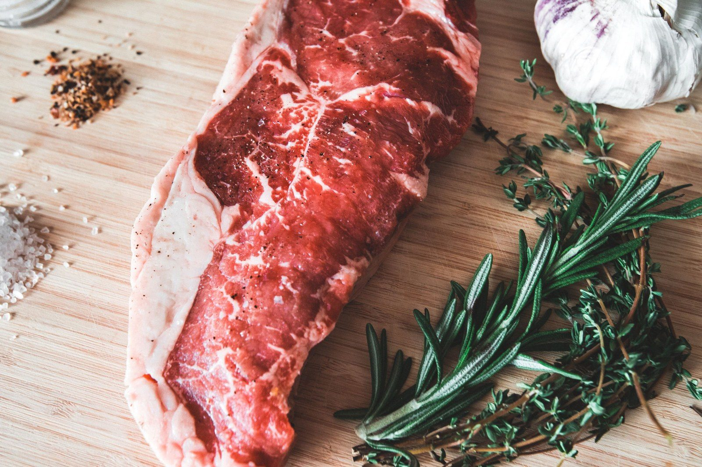
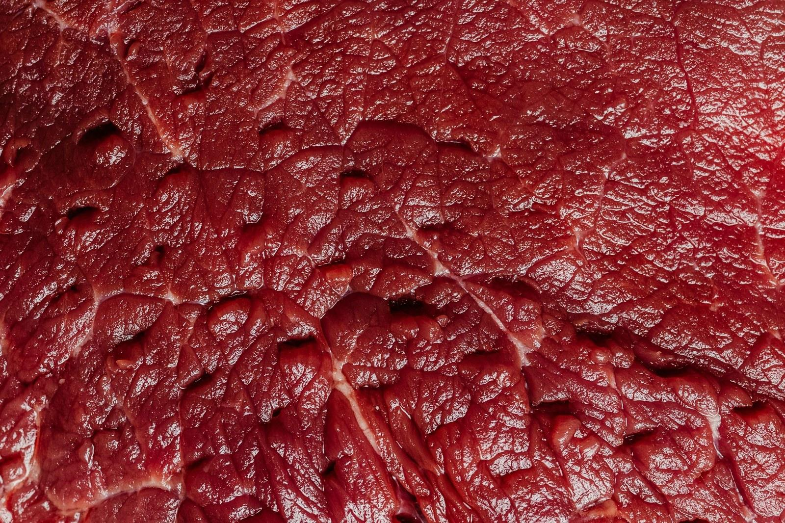
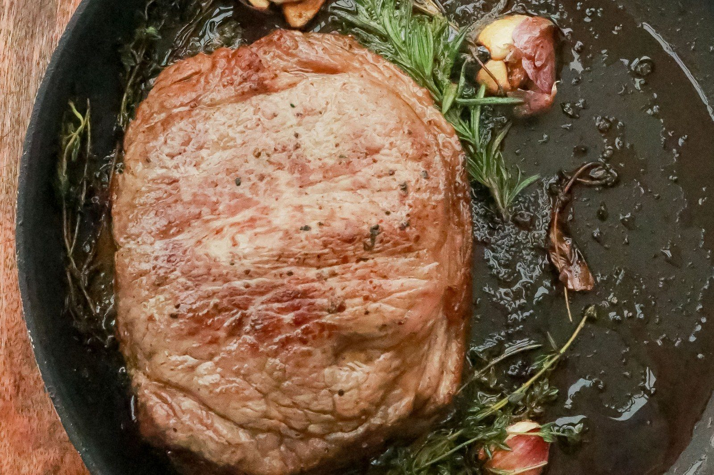
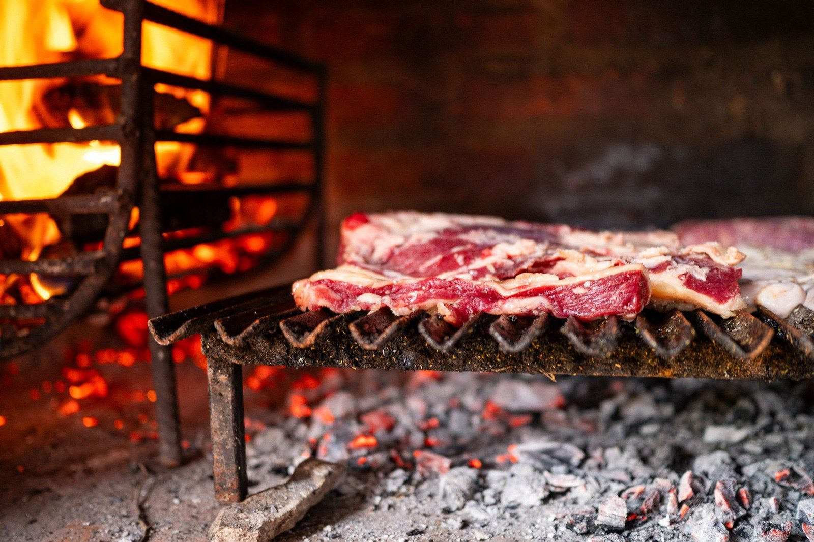
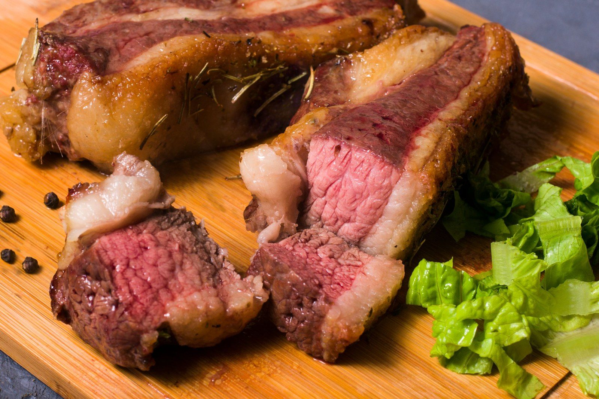
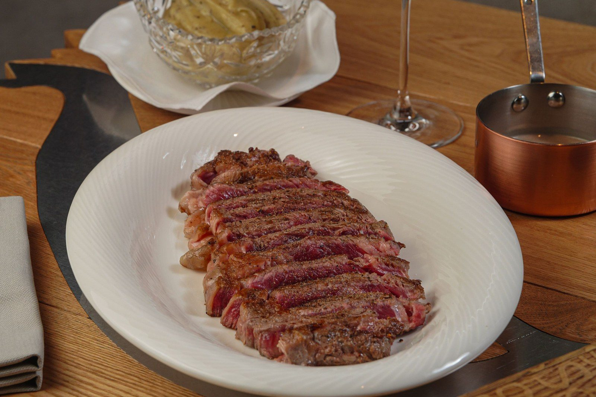
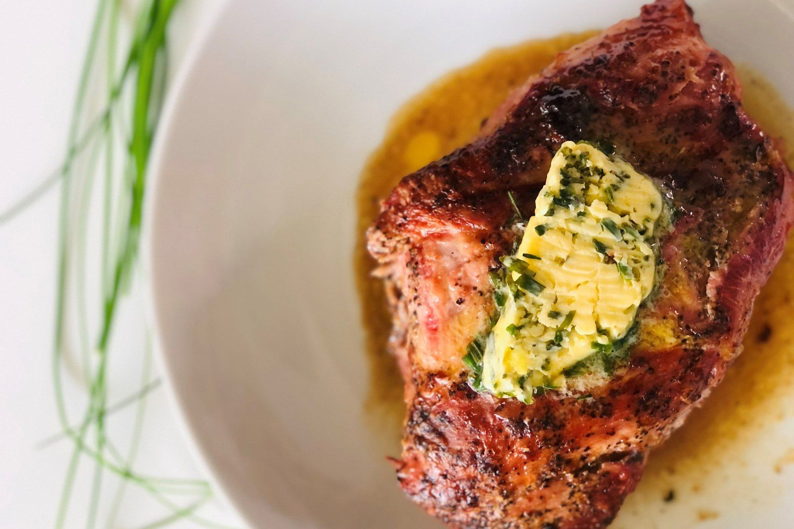

**Evde kusursuz bir biftek pişirmenin sırrı dört karardır: doğru kesim, doğru dinlendirme, doğru ısı ve sabır.** İyi mermerleşmiş, 2,5–3,5 cm kalınlığında bir antrikot; yalnızca tuz ve karabiberle baharatlanıp kızgın döküm tavada mühürlenir, orta-az pişmiş için iç sıcaklık 54–56 °C'ye geldiğinde ocaktan alınır ve birkaç dakika dinlendirilirse, iyi bir steakhouse'u aratmaz. Bu rehberde dry aged etin ne olduğunu, kaç gün dinlendirilmesi gerektiğini, pişirme derecelerini ve bifteğe yakışan yerli şarapları Türkiye'deki kasap, şef ve gastronomi kaynaklarına dayanarak anlatıyoruz.

Kasım sonu ve aralık, sofraların en uzun olduğu dönem. Yılbaşı davetleri, iş yemekleri ve aile buluşmaları arasında bir erkeğin evinde misafir ağırlamasının en zarif yollarından biri, iyi bir eti doğru pişirip masada dilimlemektir. Bunun için pahalı aletlere değil, bilgiye ve özene ihtiyaç var.

**Kısa özet**

- **Dry aged (kuru dinlendirme):** Et, özel dolaplarda yaklaşık 1–3 °C'de ve %75–85 nemde, kontrollü hava akışıyla haftalarca bekletilir; daha yumuşak ve aromatik olur.
- **Kaç gün?** 21 gün dengeli ve yumuşak, 45 gün belirgin fındıksı ve peynirimsi, 90 gün çok yoğun ve uzman işi.
- **Kesim:** Antrikot sulu ve aromatik, bonfile en yumuşak ama en hafif lezzetli kesimdir.
- **Kalınlık:** Döküm tava için en az 2,5–3,5 cm; 4 cm ve üzeri için ters mühürleme (reverse sear).
- **Pişirme dereceleri:** Az pişmiş 50–52 °C, orta-az 55–57 °C, orta 60–63 °C; mutlaka et termometresi kullanın.
- **Şarap:** Dry aged ve yoğun mermerli etlerle Boğazkere, daha hafif ve baharatlı tabaklarla Öküzgözü.

## Dry aged et nedir ve neden bu kadar değerli?

**Dry aged, yani kuru dinlendirme; seçilmiş büyük et parçalarının kontrollü sıcaklık, nem ve hava akışı koşullarında günlerce, hatta haftalarca ambalajsız bekletilmesidir.** Yemek.com'un rehberine göre et bu süreçte özel dolaplarda genellikle **1–3 °C** arasında tutulur, nem oranı **%75–85** civarındadır ve sürekli, temiz bir hava akışı istenmeyen bakteri oluşumunun önüne geçer. Süre 21 günden başlayıp 45, 60 hatta 90 güne kadar uzayabilir.

### Dinlendirme sırasında ette ne olur?

Bu süreçte iki şey aynı anda gerçekleşir. Birincisi, **etin kendi doğal enzimleri kas liflerini parçalar** ve et belirgin şekilde yumuşar. İkincisi, et su kaybeder ve aroması yoğunlaşır. Dış yüzeyde zamanla sert ve koyu bir kabuk oluşur; bu kabuk iç dokuyu korur ve işlem bitince kesilip atılır. Dry aged etin pahalı olmasının nedeni de budur: uzun bekleme, ağırlık kaybı, özel ekipman ve zaten premium olan kesimler.

### Dry aged ile wet aged arasındaki fark

**Wet aged (ıslak dinlendirme)** vakumlu paketlerde yapılır ve daha kısa sürer; et yumuşar ama tadı daha "taze et" karakterindedir. **Dry aged** ise yüzeyin kurumasıyla çok daha yoğun, cevizimsi bir aroma kazanır. Doğru koşullarda dinlendirilmiş dry aged et kötü kokmaz; yoğun ama rahatsız etmeyen bir aroması vardır.

### Hangi parçalar dry aged için uygundur?

Yemek.com'a göre en iyi sonuç **dana sırt bölgesinden** alınır: antrikot (ribeye), T-bone, porterhouse ve yağ şeridi belirgin olan **kontrfile**. Kalın yağ tabakası, uzun dinlendirme sırasında eti korur. Bu yöntem genellikle dana etine uygulanır.

### Evde dry aged yapılır mı?

Kısa cevap: **önerilmez.** Profesyonel dolaplar olmadan sıcaklık ve nem tam kontrol edilemez; bu da gıda güvenliği açısından risk oluşturur. Dry aged eti, kendi dinlendirme dolabı olan güvenilir bir kasaptan ya da dinlendirme gününü etiketinde açıkça belirten bir üreticiden almak en doğrusudur.

*Photo: Javon Swaby / Pexels, [Pexels License](https://www.pexels.com/license/)*

Kaynak: [Yemek.com – Dry Aged (Kuru Dinlendirme) Nedir? Dry Aged Et Nasıl Pişirilir?](https://yemek.com/dry-aged-nedir/)

## Dry aged et kaç gün dinlendirilmeli? 21, 45 ve 90 günün farkı

**Tek bir doğru süre yoktur; süre, istediğiniz aroma yoğunluğuna göre seçilir.** EtDinlendirme.com'un Ağustos 2026 tarihli karşılaştırmasına göre süre uzadıkça iki şey birlikte artar: **aroma yoğunluğu ve fire (ağırlık kaybı).** Kaynağa göre genel kabul gören ortam koşulları 0–4 °C sıcaklık, %75–85 bağıl nem ve sürekli ama nazik bir hava sirkülasyonudur.

### 21 gün: dengeli ve yumuşak

21 günlük dinlendirme dry aged dünyasına giriş seviyesidir. Etin kendi tadı belirgindir, hafif tereyağımsı ve fındıksı notalar başlar; yoğun "funk" aroması henüz yoktur. Önemli bir bilgi: **yumuşamanın büyük kısmı ilk üç-dört haftada tamamlanır.** Fire genellikle %10–15 bandındadır.

### 45 gün: dry aged karakterinin ortaya çıktığı aralık

Uluslararası steakhouse'ların "klasik dry aged" diye sunduğu profil çoğunlukla **40–50 gün** aralığındadır. Umami belirgin şekilde artar; kavrulmuş fındık, olgun peynir ve hafif mantar notaları belirir. Toplam kayıp %20–30'a çıkabilir, bu yüzden porsiyon fiyatı da yükselir. Dry aged'in "imza tadını" arayan bir beyefendi için doğru adres burasıdır.

### 90 gün ve üzeri: uzman işi

90 günlük dinlendirmede aroma çok yoğun, mavi peyniri andıran ve kutuplaştırıcıdır: bazıları bayılır, bazıları hiç sevmez. Fire %35–40'a ulaşabilir ve en küçük nem sapması bütün partiyi bozabilir. Misafirlerinize sunmadan önce bu tadı bir steakhouse'ta denemenizi öneririz.

### Kasapta ne sormalı?

- Et **kaç gün** dinlendirildi ve **dry mı wet mi**?
- **Hangi kesim** ve hangi kalınlıkta kesilebilir? (Döküm tava için en az 2,5–3,5 cm, ters mühürleme için 4 cm civarı.)
- Hayvanın **ırkı ve beslenmesi** (tahıl mı mera mı)?
- Kemikli mi, kemiksiz mi?

Bu sorulara net cevap veren bir kasap, sattığı eti tanıyor demektir.

*Photo: Jonathan Borba / Pexels, [Pexels License](https://www.pexels.com/license/)*

Kaynak: [EtDinlendirme.com – Dry Aged Et Kaç Gün Dinlendirilmeli? 21, 45 ve 90 Günün Farkları](https://etdinlendirme.com/dry-aged-et-kac-gun-dinlendirilmeli/)

## Antrikot mu bonfile mi? Doğru kesimi seçmek

**Antrikot lezzet ve sululuk, bonfile ise yumuşaklık arayanlar içindir.** Besin Analiz'in antrikot rehberine göre dana antrikot, büyükbaş hayvanın sırt bölgesinden, **5. ve 12. kaburgalar arasından** çıkarılır ve kas lifleri arasına homojen dağılmış mermersi yağ dokusuyla (marbling) bilinir. Bu yağ pişerken eriyerek eti içten besler, ağızda eriyen bir doku ve yoğun bir lezzet verir.

**Bonfile** ise hayvanın neredeyse hiç çalışmayan iç kasıdır; çok yağsız ve son derece yumuşaktır, ancak lezzet yoğunluğu antrikota göre düşüktür. Bu yüzden bonfile çoğu zaman sos, tereyağı ya da karabiber kabuğuyla servis edilir.

### Kaliteli antrikot nasıl seçilir?

Besin Analiz'in kasap için önerdiği "altın kurallar" şunlar:

- **Mermerleşme:** Etin içinde ince beyaz kılcal damarlar gibi dağılmış yağ dokusu arayın. Kalın yağ blokları yerine homojen dağılım tercih edin.
- **Kalınlık:** İdeal döküm tava antrikotu en az **2,5–3,5 cm** (yaklaşık iki parmak) kalınlığında olmalıdır. İnce etler mühürlenirken hızla kurur.
- **Renk ve doku:** Canlı kırmızı, bastırıldığında esnekliğini koruyan ve tercihen dinlendirilmiş (dry aged ya da wet aged) et.

### Diğer premium kesimler

- **Kontrfile (New York strip):** Antrikottan daha sıkı, daha "etli" bir lezzet; kenarındaki yağ şeridi pişerken aroma verir.
- **T-bone ve porterhouse:** Kemiğin bir yanında kontrfile, diğer yanında bonfile. Paylaşmak için idealdir.
- **Tomahawk:** Uzun kaburga kemiğiyle bırakılmış kalın antrikot; sofrada gösterişli ama pişirmesi sabır ister.

Kaynak: [Besin Analiz – Dana Antrikot Pişirme Tarifi: Döküm Tava Tekniği](https://www.besinanaliz.com/recipe/dana-antrikot-pisirme-tarifi)

## Döküm tavada antrikot nasıl pişirilir?

**Kızgın döküm tava, kuru bir yüzey ve tereyağı banyosu: evde steakhouse kabuğunun formülü budur.** Besin Analiz'in adım adım tekniği, 3 cm civarı bir antrikot için şöyle özetlenebilir:

### Adım adım döküm tava tekniği

1. **Oda sıcaklığına getirin.** Eti pişirmeden 45–60 dakika önce buzdolabından çıkarın. Soğuk et tavaya girerse dışı yanarken içi çiğ kalır.
2. **Yüzeyi tamamen kurulayın.** Yüzeydeki nem, Maillard reaksiyonunu geciktirir ve eti haşlar. Kağıt havluyla iki yüzü de iyice kurulayın.
3. **Tavayı iyice ısıtın.** Döküm tavayı ocağın en güçlü gözünde, yağ eklemeden **8–10 dakika** ısıtın. Hafif duman tütmeye başladığında yüzey yaklaşık 220–240 °C'ye ulaşmıştır.
4. **Yağı ete sürün, tavaya değil.** Az miktarda dana yağı veya sıvı yağı etin yüzeyine sürün, ardından iri deniz tuzu ve taze çekilmiş karabiberle cömertçe baharatlayın.
5. **Mühürleyin, dokunmayın.** Eti tavaya yerleştirin ve ilk yüzü hiç oynatmadan yüksek ateşte yaklaşık **2,5 dakika** pişirin. Derin altın-kahve bir kabuk oluşunca çevirin.
6. **Tereyağı banyosu (arrosé).** Ateşi orta-yükseğe indirin; tavaya tereyağı, ezilmiş sarımsak ve taze biberiye ekleyin. Köpüren aromatik tereyağını kaşıkla sürekli etin üzerine gezdirin.
7. **Ölçün ve alın.** Orta-az pişmiş için iç sıcaklık **54–56 °C**'ye ulaşınca eti tavadan alın ve tel ızgara üzerinde **5–6 dakika** dinlendirin.
8. **Liflere dik dilimleyin.** Yaklaşık 1 cm kalınlığında, verev dilimler halinde kesip üzerine birkaç kristal deniz tuzu serpin.

### Maillard reaksiyonu: kabuğun kimyası

Besin Analiz'e göre amino asitler ile indirgeyici şekerler yaklaşık **140–165 °C** arasında tepkimeye girer ve etin yüzeyinde karamelize, çıtır, kahverengi bir kabuk oluşturur. Bu kabuk yüzlerce yeni aroma bileşeni açığa çıkarır; ızgara lezzeti dediğimiz şey tam olarak budur.

### Sık yapılan hatalar

- **Tavayı aşırı doldurmak:** Aynı anda birden fazla kalın antrikot tavanın sıcaklığını düşürür; et kızarmaz, haşlanır.
- **Çatal kullanmak:** Eti çevirirken delmeyin; maşa kullanın.
- **Erken dilimlemek:** Dinlenmeden kesilen etin suyu tabağa akar.

*Photo: Geraud pfeiffer / Pexels, [Pexels License](https://www.pexels.com/license/)*

Kaynak: [Besin Analiz – Dana Antrikot Nasıl Pişirilir? Döküm Tavada Lokum Kıvamı](https://www.besinanaliz.com/recipe/dana-antrikot-pisirme-tarifi)

## Ters mühürleme (reverse sear) nedir, ne zaman kullanılır?

**Ters mühürleme, kalın eti önce düşük ısıda yavaşça pişirip en sonda kızgın tavada mühürleme tekniğidir.** 4 cm ve üzeri antrikot, tomahawk ya da T-bone gibi kalın kesimlerde en homojen sonucu verir: kabuğun altında gri bir halka oluşmaz, et baştan sona eşit pembe kalır.

### Nasıl yapılır?

Besin Analiz'in şef ipucuna göre çok kalın antrikotlarda et önce **110 °C fırında iç sıcaklık 45 °C olana dek** pişirilir, ardından kızgın döküm tavada her yüzü yaklaşık **1'er dakika** mühürlenir. Uygulamada şu sırayı izleyin:

1. **Kuru tuzlama:** Eti pişirmeden bir gün önce tuzlayıp buzdolabında tel ızgara üzerinde açıkta bekletin. Yüzey kurur, tuz içeri işler.
2. **Fırın aşaması:** Eti tel ızgara üzerinde, altında tepsiyle fırına koyun ki sıcak hava her yüzü sarsın.
3. **Termometreyi yan taraftan,** yağ şeridine değil, etin yağsız merkezine batırın.
4. **Kısa bekleme:** Fırından çıkan eti birkaç dakika bekletirken döküm tavayı en yüksek ateşte ısıtın.
5. **Hızlı mühürleme:** Her yüz yaklaşık 1 dakika, yağ şeridi birkaç saniye.

### Neden davetler için ideal?

Fırında yavaş piştiği için zamanlama esnektir: et biraz erken hazır olursa fırında bekleyebilir, misafirleriniz gelince yalnızca son mühürleme kalır. Fazla pişmiş bir kenarı geri almak ise mümkün değildir. Ev sahibi olarak şarabı açarken ve sohbet ederken bile kontrol sizde kalır.

### Kor ateşte biftek

Mangalda da aynı mantık geçerlidir: **iki bölgeli ateş.** Bir tarafta yoğun kor, diğer tarafta daha serin bir alan. Eti önce serin tarafta pişirip hedef sıcaklığa yaklaşınca kızgın korun üzerinde mühürleyin. Kaliteli meşe veya kayın odunu kömürü daha temiz ve yüksek ısı verir. Eti spatulayla bastırmayın; her bastırış suyunu ateşe akıtır.

*Photo: Lucas Gramatica / Pexels, [Pexels License](https://www.pexels.com/license/)*

Kaynak: [Besin Analiz – Dana Antrikot Pişirme Tarifi (Ters Mühürleme İpucu)](https://www.besinanaliz.com/recipe/dana-antrikot-pisirme-tarifi)

## Steak pişirme dereceleri: medium rare kaç derece?

**Pişirme derecesini göz kararı değil, iç sıcaklık belirler.** Kocaeli'deki Kasaphan Steakhouse'un bonfile rehberi, uluslararası mutfaklarda kabul edilen beş temel dereceyi şöyle sıralıyor:

| Pişirme derecesi | İç sıcaklık | Görünüm ve doku |
| --- | --- | --- |
| Rare (az pişmiş) | 50–52 °C | Dışı mühürlü, içi kırmızı ve çok sulu |
| Medium rare (orta-az) | 55–57 °C | Ortası pembe, sulu; en popüler tercih |
| Medium (orta) | 60–63 °C | İçi hafif pembe, dengeli |
| Medium well (orta-iyi) | 65–68 °C | Çok az pembe, daha sıkı |
| Well done (iyi pişmiş) | 70 °C ve üzeri | Tamamen kahverengi, suyunu büyük ölçüde kaybetmiş |

### Et termometresi neden şart?

Kasaphan'ın önemli notu: bifteği pişirirken iç sıcaklığı ölçmek için **mutlaka bir et termometresi** kullanın. Parmak testi (başparmak ile işaret parmağını birleştirip etin sertliğini kıyaslamak) bir fikir verir, ama kesin sonuç vermez. Unutmayın, et dinlenirken iç sıcaklığı birkaç derece daha yükselir; bu yüzden hedefinizin 2–3 °C altında ocaktan alın.

### Dinlendirme ne kadar sürmeli?

Kasaphan'a göre et pişirme sonrası **3–5 dakika** dinlendirilmezse suyunu kaybeder. Besin Analiz ise kalın antrikot için 5–7 dakika öneriyor. Eti soğuk bir tahtaya değil, ılık bir tel ızgaraya ya da ılık tabağa alın; kabuğu korumak için sıkıca folyoya sarmayın.

### Hangi kesim hangi dereceye?

Yağsız **bonfile** az pişmiş ile orta-az arasında en iyi halindedir; fazla pişerse çabuk kurur. Mermerli **antrikot** ise orta-az ile orta arasında parlar, çünkü yağın erimesi için biraz daha sıcaklığa ihtiyaç vardır. Dry aged etlerde de orta-az, aromayı en net gösteren derecedir.

*Photo: Maxi Gagliano / Pexels, [Pexels License](https://www.pexels.com/license/)*

Kaynak: [Kasaphan Steakhouse – Bonfile Pişirme Dereceleri Detaylı Rehber](https://kasaphan.com.tr/bonfile-pisirme-dereceleri/)

## Bifteğe hangi şarap yakışır? Boğazkere, Öküzgözü ve Kalecik Karası

**Dry aged ve yoğun mermerli bir bifteğin yanında en doğru yerli seçim Boğazkere'dir.** İstanbul Zekeriyaköy'deki Tike'nin "Köze Yakışan Türk Şarapları" yazısı bunu net anlatıyor: Elazığ ve Diyarbakır bölgelerinin iki güçlü üzümü **Öküzgözü ve Boğazkere** çoğu zaman birlikte harmanlanır. **Boğazkere yüksek taneni ve yapısıyla** omurgayı oluşturur, **Öküzgözü meyvemsi yumuşaklığı ve canlılığıyla** dengeyi kurar.

### Hangi et, hangi üzüm?

- **Dry aged antrikot, tomahawk, T-bone → Boğazkere veya Boğazkere ağırlıklı harman.** Tike'ye göre Boğazkere'nin sağlam yapısı, dry aged ya da mermerleşmesi yoğun etlerle güzel bir denge kurar; **taneni etin yağını keser**, uzun bitişi ise közün karamelize notalarıyla uyum yakalar.
- **Baharatlı kebaplar, kuzu → Öküzgözü.** Daha hafif ve agresif olmayan yapısı baharatın önüne geçmez.
- **Narin et tabakları, bonfile → Kalecik Karası.** Daha zarif ve ince bir üzüm olarak hafif tabaklarla eşleşir.

### Şarabı doğru servis etmek

Yapılı kırmızı şarapları yemekten yaklaşık bir saat önce açın veya dekante edin. Servis sıcaklığı oda sıcaklığı değil, yaklaşık **16–18 °C** olmalı; fazla ılık bir Boğazkere alkolü öne çıkarır ve etin yanında ağır kalır. Kalın tabanlı, geniş gövdeli bir kırmızı şarap kadehi, aromanın açılmasına yardım eder.

### "Birlikte yetişen, birlikte yakışır"

Tike'nin vurguladığı gibi, Anadolu'nun etini Anadolu'nun üzümüyle buluşturmak hem lezzet hem kültürel bir bütünlük sunar. Seçkin et restoranlarında yerli şaraplara verilen değer de bu mirasa duyulan saygının ifadesidir. Yabancı bir alternatif isterseniz, klasik eşleşme olan yapılı bir Cabernet Sauvignon da aynı mantıkla çalışır: tanen yağı keser.

*Photo: Nadin Sh / Pexels, [Pexels License](https://www.pexels.com/license/)*

Kaynak: [Tike Journal – Köze Yakışan Türk Şarapları](https://tikezekeriyakoy.com/blog/koze-yakisan-turk-saraplari)

## Ciddi bir ev şefi için hangi ekipmanlar gerekir?

**Üç araç her şeyden önemlidir: ağır tabanlı bir döküm tava, doğru ölçen bir et termometresi ve keskin bıçaklar.** Besin Analiz de ince tabanlı tavaların ısıyı eşit iletemediğini ve eti soğutarak sulanmasına yol açtığını vurguluyor; ısıyı uzun süre koruyan ve eşit yayan döküm tava "olmazsa olmaz."

### 1. Le Creuset İmza Koleksiyonu Döküm Izgara Tavası 26 cm

Fransa'da üretilen Le Creuset döküm tavalar ısıyı uzun süre tutar ve eşit dağıtır; nervürlü ızgara yüzeyi bifteğe klasik ızgara izlerini verirken eriyen yağı etten uzaklaştırır. Mat siyah iç yüzeyi yüksek ısıda mühürleme için idealdir. Türkiye'de Beymen'de satılıyor.

[Le Creuset İmza Koleksiyonu Mat Siyah Döküm Izgara Tavası 26 cm – Beymen](https://www.beymen.com/tr/p_le-creuset-imza-koleksiyonu-mat-siyah-dokum-izgara-tavasi-26-cm_1587034)

### 2. Wüsthof Gourmet Standlı Çelik 6 Parça Bıçak Seti

Almanya'nın Solingen kentinde 1814'ten beri bıçak üreten Wüsthof, mutfak bıçaklarında bir referans. İyi bir bıçak eti yırtmadan temiz keser; dilimin suyu içinde kalır, masadaki sunum da kusursuz olur. Beymen'de satılan bu set, şef bıçağından dilimleme bıçağına kadar temel ihtiyaçları karşılıyor.

[Wüsthof Gourmet Standlı Çelik 6 Parça Bıçak Seti – Beymen](https://www.beymen.com/tr/p_wusthof-gourmet-standli-celik-6-parca-bicak-seti_1728029)

### 3. Dijital problu et termometresi

Hem Kasaphan hem Besin Analiz aynı noktada birleşiyor: kesin pişirme derecesi için dijital, problu bir et termometresi profesyonel şeflerin vazgeçilmezidir. Hızlı okuma yapan, ince problu bir model seçin.

### Döküm tavanın bakımı

Pişirdikten sonra fazla yağı silin, sıcak su ve fırçayla temizleyin, ocakta kısık ateşte tamamen kurutun ve çok ince bir kat yağ sürün. Bulaşık makinesinden ve uzun süre suda bekletmekten kaçının. Emaye kaplı Le Creuset modellerinde üreticinin bakım talimatlarına uyun.

## Evde steakhouse akşamı nasıl düzenlenir?

**İyi bir biftek akşamı, menüden çok zamanlamayla kurulur.** Büyük steakhouse'lardan ödünç alınabilecek birkaç kural:

### Garnitürler klasik kalsın

Besin Analiz'in önerdiği gibi bol tereyağlı ve muskatlı **ipeksi patates püresi**, aynı tavada sotelenmiş **mantar** veya ızgara **kuşkonmaz** ve balzamik sirkeli, cevizli, parmesanlı bir **roka salatası**. Garnitürler et tavaya girmeden hazır olmalı; son 15 dakika yalnızca ete aittir.

### Masada dilimleyin

Büyük bir kemikli antrikot ya da T-bone, ılık bir tahtada dilimlenip yelpaze gibi açıldığında tek tek bifteklerden çok daha cömert görünür. Her misafir kenardan ya da ortadan dilediği dilimi seçer.

### Sos yanında, et sade

Bir şarap sosu, mantar sosu ya da karabiber sosu ayrı bir kapta sunulabilir. Ama iyi et hiçbir zaman sosun altına saklanmamalı.

### Detaylar fark yaratır

Ilık tabaklar, keskin biftek bıçakları, masada kristal deniz tuzu, misafirler gelmeden açılmış kırmızı şarap. Ve iyi bir ev sahibi gibi önce misafirlere servis yapın; uç dilimi kendinize ayırın.

*Photo: Mi Butter SA / Pexels, [Pexels License](https://www.pexels.com/license/)*

## Sıkça sorulan sorular

### Dry aged et nedir?

Seçilmiş büyük et parçalarının yaklaşık 1–3 °C sıcaklık, %75–85 nem ve kontrollü hava akışı altında haftalarca ambalajsız dinlendirilmesidir. Et yumuşar, aroması yoğunlaşır ve fındıksı bir karakter kazanır.

### Dry aged et kaç gün dinlendirilmeli?

Dengeli ve yumuşak bir sonuç için 21–30 gün, belirgin dry aged aroması için 40–50 gün yeterlidir. 90 gün ve üzeri çok yoğun ve uzman işi bir lezzettir.

### Medium rare kaç derece?

Orta-az pişmiş (medium rare) biftek için iç sıcaklık yaklaşık 55–57 °C'dir. Et dinlenirken ısınmaya devam ettiği için 2–3 °C önce ocaktan alın.

### Antrikot döküm tavada kaç dakika pişirilir?

Yaklaşık 3 cm kalınlıkta bir antrikot, orta-az pişmiş için her yüzde 2,5–3 dakika pişirilir. Kesin sonuç için süreye değil, termometreye güvenin.

### Biftek pişirmeden önce marine edilmeli mi?

İyi mermerleşmiş ve dinlendirilmiş bir antrikotun marinasyona ihtiyacı yoktur; tuz, karabiber, sarımsak ve tereyağı yeterlidir.

### Bifteğin yanına hangi Türk şarabı içilir?

Dry aged ve mermerli etlerle Boğazkere veya Öküzgözü-Boğazkere harmanı, daha hafif tabaklarla Kalecik Karası iyi bir eşleşmedir.

*Bu rehber mutfak bilgisi amaçlıdır. Gıda güvenliği konusunda, özellikle hamileler, yaşlılar ve bağışıklığı zayıf kişiler için resmi önerilere uyulmalıdır.*
