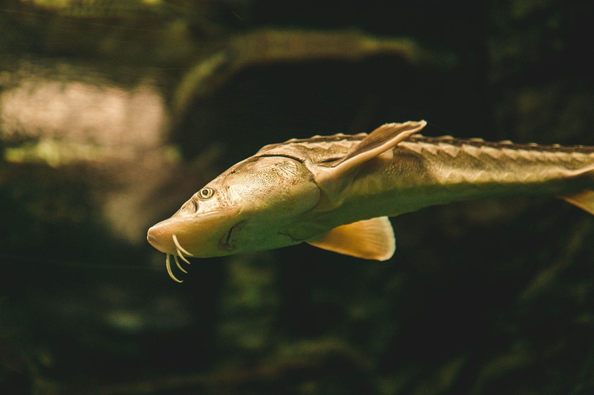
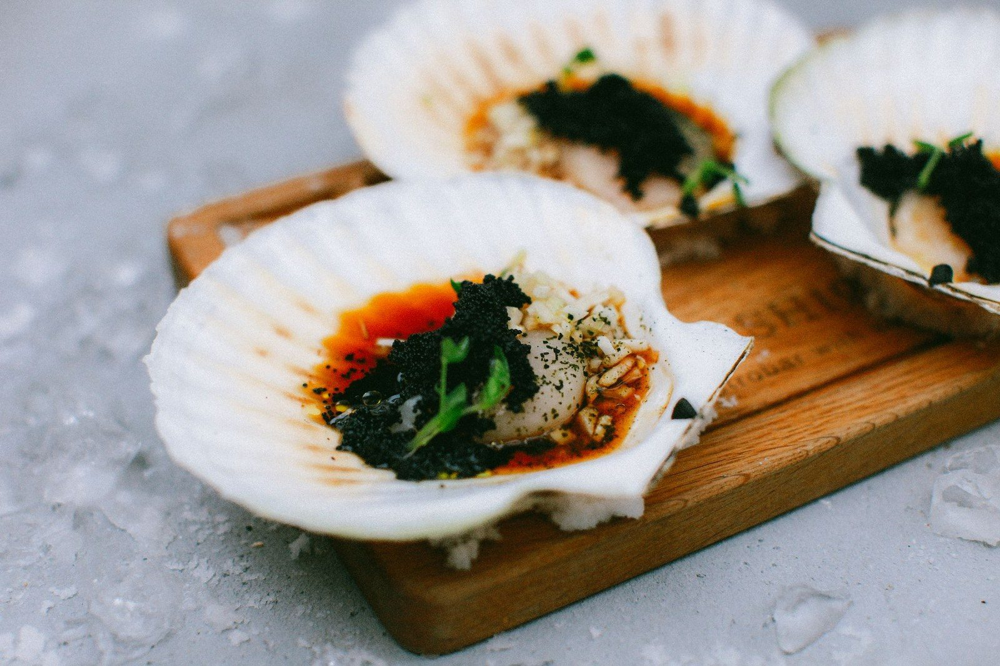
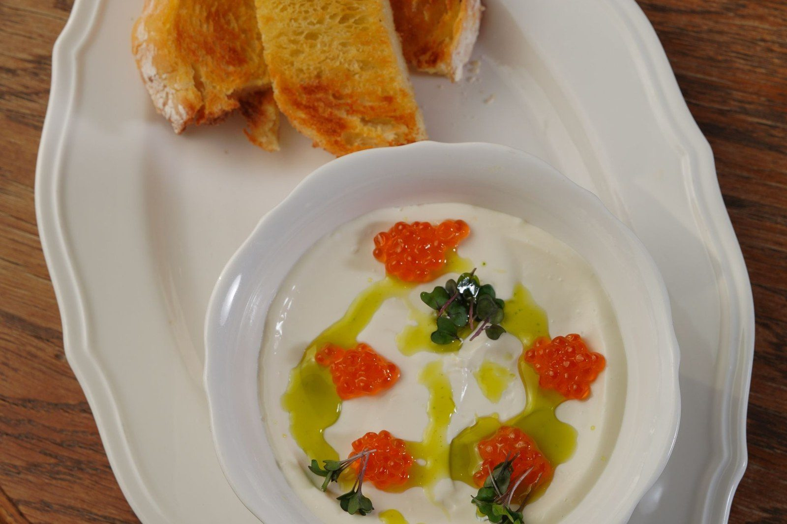
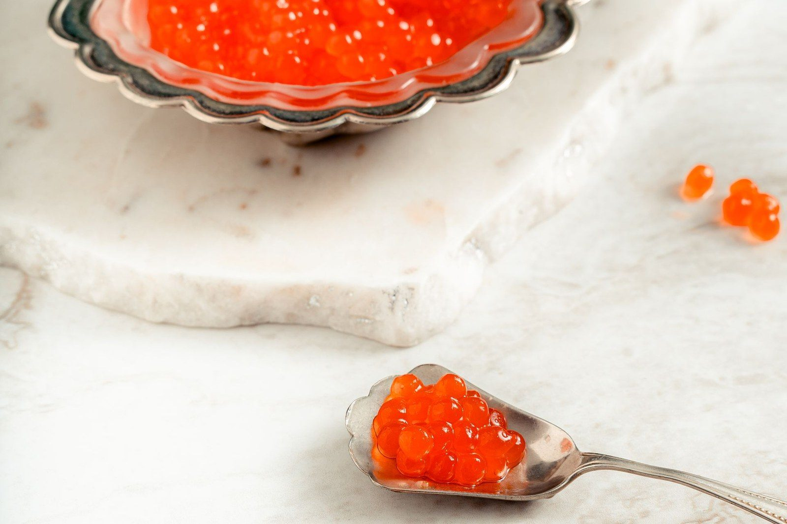
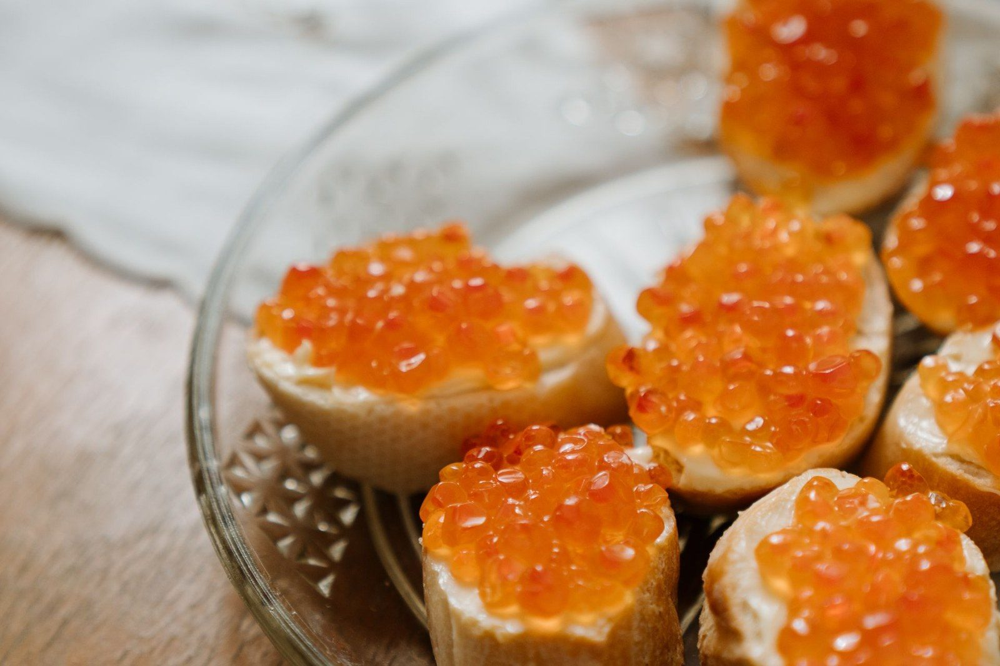
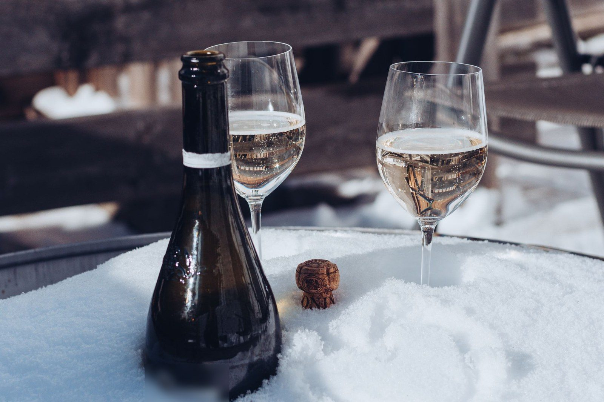

**İyi havyar seçmenin sırrı üç soruda gizli: Hangi mersin balığından geliyor, nasıl tuzlanmış ve sofraya gelene kadar ne kadar soğuk tutulmuş?** Kutunun üzerindeki bilimsel türü okuyun, "Imperial" ya da "Royal" gibi pazarlama kelimelerine fazla takılmayın, içinde mersin balığı yumurtası ve tuzdan başka bir şey olmayan az tuzlu (malossol) havyarı tercih edin, kutuyu buz dolu bir kasede sunun ve metal olmayan bir kaşıkla, yanında soğuk bir şampanya ya da buz gibi votkayla servis edin. Bu havyar rehberi, her adımı güvenilir Türk kaynaklarıyla açıklıyor: HORECA TREND'in kapsamlı havyar dosyası, Anadolu Ajansı ve Milliyet'in "Türk havyarı" haberleri, Lezzet'in servis önerileri ve Türkiye'de havyar satan uzman firmaların ürün bilgileri.

Aralık, havyar ayıdır. Yılbaşı sofrası, iş yemekleri ve özel davetler, bir erkeğin bir kutu havyar açma ihtimalinin en yüksek olduğu dönemdir. Ne aldığınızı bilmek ve doğru servis etmek, pahalı bir ürünü unutulmaz bir akşama dönüştürür. Üstelik bu yıl konuşacak yeni bir konu da var: Türkiye, kendi yetiştirdiği mersin balıklarından elde edilen havyarı "Türk havyarı" markasıyla dünyaya satmaya hazırlanıyor.

**Kısa özet**

- **Havyar, mersin balığının tuzla işlenmiş yumurtasıdır.** Somon, alabalık ya da lompa yumurtası "balık yumurtası"dır; gerçek havyar değildir.
- **Önce tür:** Beluga (*Huso huso*) en iri taneli, Osetra (*Acipenser gueldenstaedtii*) cevizli ve kompleks, Sterlet ise altın renkli ve nadirdir.
- **Malossol "az tuzlu" demektir;** uluslararası Codex standardına göre havyarda 100 gramda 3–5 gram tuz bulunur. Bu bir kalite sınıfı değil, tuzlama yöntemidir.
- **Türkiye'de mersin balığı avı yasaktır;** piyasadaki mersin balığı havyarı yetiştiricilikten ya da ithalattan gelir.
- **"Türk havyarı" markasıyla ihracatın 2027 sonunda başlaması hedefleniyor;** Keban Baraj Gölü'ndeki tesis 2029'da 150 ton siyah havyar hedefliyor.
- **Servis:** Buz dolu kasede, 0 °C civarında; sedef, kemik veya cam kaşıkla; açılan kutu 2–3 gün içinde tüketilmeli.

## Havyar nedir ve hangi türler en değerlisidir?

**Havyar, mersin balıklarının (Acipenseridae) tuzla işlenmiş yumurtasıdır.** HORECA TREND'in Kasım 2026'da yayımladığı kapsamlı dosyaya göre Türk Dil Kurumu havyarı "genellikle mersin balığının salamura edilmiş yumurtası; balık yumurtası" olarak tanımlar. Uluslararası tanım daha da kesindir: FAO ve Dünya Sağlık Örgütü'nün ortak gıda standartları komisyonu Codex Alimentarius'a göre mersin balığı havyarı yalnızca gıdaya uygun tuzla hazırlanır ve son üründe 100 gramda 3 ile 5 gram arasında tuz bulunur.

### Havyar kelimesi nereden geliyor?

HORECA TREND, kelimenin hikâyesini iki kaynakla anlatır: Florida Üniversitesi yayınına göre İngilizce "caviar" kelimesi Türkçe "havyar"dan türemiştir. Nişanyan Sözlük ise Türkçe kelimeyi "yumurtacık" anlamındaki Orta Yunanca *avgiári(on)* kelimesine bağlar. Yani kelime Batı dillerine Türkçe üzerinden geçmiş, Türkçeye ise Yunancadan girmiştir. Bir yılbaşı sofrasında anlatmak için güzel bir bilgi.

### Beluga: efsanevi iri taneler

**Beluga, *Huso huso* yani mersin morinasından elde edilir ve en iri taneli havyardır.** Britannica'nın sınıflandırmasına göre taneleri siyah ya da gri renktedir. Yabani stoklar tükendiği için gerçek Beluga bugün hem çok nadir hem de çok sıkı denetlenen bir üründür.

### Osetra (Ossetra): uzmanların tercihi

Osetra, Codex standardına göre *Acipenser gueldenstaedtii* (Rus mersini) ve *Acipenser persicus* (İran mersini) türlerinden gelir. Taneleri Beluga'dan küçüktür; renkleri grimsi, gri-yeşil ya da kahverengiden kehribar tonlarına kadar uzanır. Lezzeti cevizli, tereyağımsı ve uzun bitişlidir. Tek bir havyar deneyecekseniz, iyi bir Osetra seçin.

### Sevruga ve Sterlet

Sevruga en küçük taneli, yeşilimsi siyah ve yoğun aromalı havyardır. Sterlet (*Acipenser ruthenus*) ise altın rengi yumurtalarıyla tarihte en nadir havyar olarak anılır. Günümüzde piyasada sıkça karşılaşılan Kaluga hibritleri (*Huso dauricus* kökenli) ise iri, parlak ve kremamsı taneleriyle öne çıkar.

### Kırmızı havyar gerçek havyar mıdır?

**Kısaca hayır.** HORECA TREND'in aktardığına göre kırmızı havyar genellikle somon balığının yumurtasıdır ve Codex standardına göre yalnızca mersin balığı yumurtası tek başına "havyar" adını taşıyabilir. Diğerleri "somon havyarı" gibi balığın adıyla anılmalıdır. Lompa balığı yumurtası ise mersin havyarına benzesin diye çoğu zaman siyaha boyanır. Etikette hangi balığın yumurtası olduğunu mutlaka kontrol edin.

### Türk mutfağında balık yumurtası: tarama ve lakerda

Türkiye'nin balık yumurtası kültürü mersin balığıyla sınırlı değildir. TDK taramayı "balık yumurtası ile yapılan bir meze türü" olarak tanımlar; lakerda ise palamut ve torikten yapılan bir salamuradır. Piyasada "havyar macunu" ya da "havyar ezmesi" adıyla satılan ürünler genellikle mersin dışı balıkların yumurtasından yapılır. Bunlar sofranın değerli mezeleridir, ama gerçek havyarla karıştırılmamalıdır.

*Photo: Parviz Hajizada / Pexels, [Pexels License](https://www.pexels.com/license/)*

Kaynak: [HORECA TREND – Havyar Nedir? Çeşitleri, Üretimi ve Servis Kuralları](https://www.horecatrend.com/2026/11/26/havyar-nedir/)

## Türkiye'de mersin balığı avı neden yasak?

**Türkiye'de mersin balığı avı 1997'den bu yana yasaktır ve tür 1998'de CITES kapsamına alınarak koruma altına girmiştir.** Milliyet'in Haziran 2026 tarihli haberine göre Tarım ve Orman Bakanlığı, nesli koruma altındaki mersin balığının doğal stoklarını korumak, balıklandırma ile stokları takviye etmek ve ticari yetiştiriciliği geliştirmek için çok sayıda proje yürütüyor.

### Bir zamanlar Türkiye'nin de havyarı vardı

HORECA TREND'in aktardığı akademik çalışmaya göre Türkiye'de 1970'lere kadar Kızılırmak, Yeşilırmak ve Sakarya nehirleriyle deltalarında kayda değer mersin balığı avı yapılıyor ve yılda yaklaşık 8 ton havyar üretiliyordu. Cumhuriyetin 1936 tarihli İkinci Sanayi Planı, havyar sanayisini desteklenmesi gereken sektörler arasında sayıyordu. Aşırı avcılık ve nehirlerdeki değişimler bu geleneği neredeyse yok etti.

### Bugünkü yasak ne diyor?

Tarım ve Orman Bakanlığı'nın 2024/20 sayılı tebliğine göre mersin balıkları (*Acipenser spp.*) ve mersin morinası (*Huso huso*), içsular dahil bütün sularda avlanması, bulundurulması, nakledilmesi ve satılması yasak türler arasındadır. Bu nedenle Türkiye'de satılan mersin balığı havyarı yabani avdan değil, yetiştiricilikten ya da belgeli ithalattan gelir. "Yerli yabani havyar" iddiası taşıyan bir ürüne temkinli yaklaşmak gerekir.

### Nehirlere geri dönen mersin balıkları

Milliyet'e göre Amasya-Yedikır ve Bolu-Gölköy Su Ürünleri Üretim istasyonlarında 2022–2025 yıllarında Karaca mersin balığı ve Sivri burun mersin balığından yaklaşık 100 bin adet yavru üretildi. Bunların bir kısmı özel etiketlerle işaretlenerek Yeşilırmak, Sakarya Nehri ve Karadeniz'e bırakıldı; bir kısmı araştırma enstitülerine, bir kısmı da üretimi teşvik etmek için özel sektöre verildi.

### Kaç tesis, kaç tür?

Aynı habere göre Türkiye'de onaylı proje kapasitesi toplamı yılda 3.204 ton olan 12 mersin balığı yetiştiriciliği tesisi bulunuyor ve bu tesislerde 7 tür mersin balığı yetiştiriliyor. Keban Baraj Gölü (Elazığ ve Tunceli) ile Şanlıurfa'daki Karkamış Baraj Gölü'nde ağ kafeslerde üretim artarak sürüyor.

*Photo: ROMAN ODINTSOV / Pexels, [Pexels License](https://www.pexels.com/license/)*

Kaynak: [Milliyet – Türk havyarı markalaşıyor](https://www.milliyet.com.tr/ekonomi/turk-havyari-markalasiyor-7597347)

## "Türk havyarı" ne zaman geliyor?

**Tarım ve Orman Bakanlığı, Türkiye'de yetiştirilen mersin balıklarından elde edilen havyarın 2027'nin sonunda "Türk havyarı" markasıyla ihraç edilmesini hedefliyor.** Anadolu Ajansı'na konuşan Balıkçılık ve Su Ürünleri Genel Müdürü Turgay Türkyılmaz, bu yolla yaklaşık 100–150 milyon dolar ihracat geliri beklediklerini söyledi ve "Siyah havyar konusunda da çok iddialıyız" diye ekledi.

### Keban Baraj Gölü: Türkiye'nin havyar üssü adayı

Anadolu Ajansı'nın Aralık 2025 tarihli haberine göre Elazığ'da Keban Baraj Gölü'nün Muratcık köyü mevkisinde kurulan 2.500 ton kapasiteli özel tesiste dört tür mersin balığı yetiştiriliyor: *Huso huso* (mersin morinası), *Acipenser gueldenstaedtii* (Rus mersini), *Acipenser persicus* (İran mersini) ve *Acipenser ruthenus* (sterlet). Tesis 2028'de 50 ton, 2029'da tam kapasiteyle 150 ton siyah havyar hedefliyor.

### Havyar nasıl takip ediliyor?

Tesis yetkilisi Sinan Radsin'in AA'ya anlattığına göre balıkların cinsiyeti altı yaşında ultrasonla belirleniyor, dişiler ayrı kafeslere alınıyor ve her balığın yüzgecine takip çipi takılıyor. Yumurtaların olgunluğu her yıl ultrason ve "biopsy cannula" denen yöntemle, ince bir iğneyle alınan örnekle kontrol ediliyor. Radsin, dişi huso huso balıklarının normalde 11–12 yaşında havyar aşamasına geldiğini, ancak Keban'ın oksijen bakımından zengin, soğuk-sıcak dengesi iyi suyu sayesinde gelişimin daha erken tamamlandığını söylüyor.

### Dünya pazarında nerede duruyoruz?

Radsin'in verdiği bilgiye göre dünyada yılda yaklaşık 750 ton havyar üretiliyor ve bunun yalnızca 50 ton civarı huso huso'ya ait. Milliyet'in haberine göre Bakanlık, 2028'e kadar mersin morinası havyarı üretimini yılda 100 tona çıkarmayı ve yıllık 100 milyon doların üzerinde döviz girdisi sağlamayı amaçlıyor. Kısacası, birkaç yıl içinde bir beyefendinin yılbaşı sofrasında Türk menşeli bir Beluga görmesi hayal değil.

### Tüketici için ne anlama geliyor?

Şimdilik Türkiye'de satılan premium havyarın büyük kısmı ithal ve yetiştiricilikten geliyor. Yerli üretim olgunlaştıkça hem tazelik hem de soğuk zincir avantajı artacak. Ama kural değişmiyor: Hangi menşeden olursa olsun, tür adı, menşe ülke ve CITES kodu etikette açıkça yazmalı.

*Photo: Nadin Sh / Pexels, [Pexels License](https://www.pexels.com/license/)*

Kaynak: [Anadolu Ajansı – Yerli üretim mersin balığından elde edilen havyar 'Türk havyarı' markasıyla 2027'de ihraç edilecek](https://www.aa.com.tr/tr/ekonomi/yerli-uretim-mersin-baligindan-elde-edilen-havyar-turk-havyari-markasiyla-2027de-ihrac-edilecek/3929812) ve [Anadolu Ajansı – Elazığ'daki tesis mersin balığı yetiştiriciliğiyle havyarda üretim üssü olmak için çalışıyor](https://www.aa.com.tr/tr/ekonomi/elazigdaki-tesis-mersin-baligi-yetistiriciligiyle-havyarda-uretim-ussu-olmak-icin-calisiyor/3779536)

## Havyar etiketi nasıl okunur? Malossol, preslenmiş ve pastörize havyar

**İyi bir havyar etiketi size türü, menşe ülkeyi, hasat yılını ve işleme tesisini açıkça söyler.** HORECA TREND'in aktardığına göre AB'nin CITES uygulama tüzüğü, her havyar kabının yeniden kullanılamayan bir etiketle işaretlenmesini şart koşar. ABD mevzuatı da etiketteki kodun standart tür kodunu, kaynak kodunu, menşe ülkenin iki harfli ISO kodunu, hasat yılını, işleme tesisinin kodunu ve parti (lot) numarasını içermesini ister.

### Malossol ne demek?

**Malossol, Rusçada "az tuzlu" anlamına gelir ve en iyi havyarlar için kullanılan tuzlama yöntemidir.** HORECA TREND'in derlediği kaynaklara göre Codex standardı son üründe 100 gramda 3–5 gram tuz öngörür; Florida Üniversitesi yayını malossol için yüzde 3–4 tuz oranı verir. Uzun raf ömrü için hazırlanan tuzlu havyarda ise bu oran yüzde 10–12'ye kadar çıkabilir. Az tuz, taze ve iyi işlenmiş yumurtanın işaretidir; çünkü tuz hem korur hem de lezzeti örter.

### Preslenmiş havyar (payusnaya)

Britannica'ya göre preslenmiş havyar, kırık ya da olgunlaşmamış yumurtalardan yapılan, daha fazla tuzlanıp sıkıştırılan bir üründür. Yoğun, reçel kıvamında bir tadı vardır. Sofranın baş tacı olmasa da şefler onu sıcak patatesin, tereyağının ya da yumurtanın yanında severek kullanır.

### Pastörize ya da taze?

Pastörizasyon, havyarın raf ömrünü uzatan kontrollü bir ısıl işlemdir; ancak yumurta zarını sertleştirebilir ve tadı değiştirebilir. Bir yılbaşı akşamının yıldızı olacak kutu için taze, pastörize edilmemiş malossol havyarı tercih edin. Pastörize ürünler ise daha uzun saklanabildiği için hediye ya da yedek olarak mantıklıdır.

### Havyar fiyatını ne belirler?

**Havyarın fiyatını önce tür, sonra tanelerin büyüklüğü, rengi, sertliği ve bütünlüğü belirler.** HORECA TREND'in aktardığı Florida Üniversitesi yayınına göre kaliteyi yumurtanın olgunluğu, büyüklüğü, rengi, dokusu ve sertliği belirler; olgun yumurtalar tipik olarak 2,8–4,2 milimetre çapa ulaşır. Aynı türden iki kutu arasında fiyat farkı varsa, sebep genellikle taneleri daha iri, daha düzgün ve daha az kırık olan partinin seçilmiş olmasıdır.

Tarihsel bir perspektif de fiyatları anlamaya yardım eder. Ustaoğlu Tırıl ve Memiş'in 2016 tarihli makalesine göre 1980'lerden önce dünya mersin balığı avının yaklaşık yüzde 90'ı Hazar Denizi'nden geliyordu ve doğal havyarın kilogramı 10.000 dolara kadar satılıyordu. Britannica ise havyarın 19. yüzyılın sonlarına kadar görece ucuz ve yaygın olduğunu, stoklar azaldıkça nadir ve pahalı bir ürüne dönüştüğünü yazar. Bugün piyasaya büyük ölçüde yetiştiricilik hâkim; bu da kaliteyi daha öngörülebilir, fiyatları ise kademeli hale getiriyor.

### Satın almadan önce sorulacak sorular

- **Hangi tür?** Bilimsel adı isteyin; hibritlerde her iki ebeveyn türünü sorun.
- **Menşe ve üretim yöntemi?** Yetiştiricilik mi, hangi ülke?
- **CITES etiketi ve parti numarası var mı?**
- **İçindekiler:** Mersin balığı yumurtası ve tuzdan başka bir şey olmamalı.
- **Son tüketim tarihi ve soğuk zincir:** Kargo ne kadar sürüyor, nasıl paketleniyor?

Kişisel kullanım için bir not: HORECA TREND'e göre AB tüzüğü, kişisel eşya kapsamında kişi başına en fazla 250 gram mersin balığı havyarının belge aranmadan getirilebileceğini düzenler. Seyahat edecekseniz varış ülkesinin kurallarını ayrıca kontrol edin.

*Photo: Antoni Shkraba / Pexels, [Pexels License](https://www.pexels.com/license/)*

Kaynak: [HORECA TREND – Havyar etiketi nasıl okunur? CITES ve mersin balıkları](https://www.horecatrend.com/2026/11/26/havyar-nedir/)

## Havyar nasıl servis edilir ve nasıl saklanır?

**Havyar, buzdolabından çıktıktan sonra da soğuk kalmalı; bu yüzden kutusu buz dolu bir kasenin içine oturtularak servis edilir.** Lezzet'in havyar rehberi, havyarın metallerden etkilenip tadının kısa sürede değiştiğini, bu nedenle ucu cam, plastik ya da sedeften yapılmış özel havyar kaşıklarının kullanılması gerektiğini vurgular. Sunum için kızarmış ekmek, mini krep (blini) ve tereyağı hazır edilmelidir.

### İdeal servis sıcaklığı kaç derece?

Uzman üreticiler havyarı yaklaşık −2 ile +2 °C arasında saklamayı önerir; Türkiye'de havyar satan Imperial Food da açılmamış kutular için −2 ile +2 °C arası saklama koşulunu belirtir. HORECA TREND'in aktardığına göre Britannica, taze havyarın 0–7 °C arasında saklanmazsa hızla bozulduğunu yazar. Pratikte bu, buzdolabının en soğuk bölümü (genellikle alt raf, arka taraf) ve masada buz dolu bir kase demektir.

### Neden metal kaşık kullanılmaz?

Gümüş ve bazı metaller havyarla tepkimeye girerek hafif metalik bir tat bırakabilir. Bu yüzden havyarın kendine özgü kaşıkları vardır: sedef, kemik, boynuz, cam ve hatta altın. Bir çift sedef kaşık, misafirlerinize ne yaptığınızı bildiğinizi gösteren küçük ama etkili bir detaydır.

### Havyar adım adım nasıl sunulur?

1. Kapalı kutuyu misafirler masaya oturana kadar buzdolabının en soğuk bölümünde bekletin.
2. Küçük bir kaseyi kırılmış buzla doldurun ve kutuyu içine yerleştirin.
3. Kutuyu masada, zorlamadan açın.
4. Havyarı üstten kaşıkla alın; asla karıştırmayın ya da ezmeyin.
5. Küçük porsiyonlar halinde servis edin, gerekirse tazeleyin.

### Kişi başı ne kadar havyar?

Tadım için kişi başı 15–30 gram yeterlidir; havyar akşamın yıldızıysa 50 gram civarı cömert bir porsiyondur. Türkiye'deki satıcılar havyarı genellikle 10, 30, 50, 125 ve 250 gramlık kutularda sunar. 125 gramlık bir kutu, dört kişilik bir başlangıç için oldukça cömerttir.

### Açılan havyar ne kadar dayanır?

Lezzet'e göre havyar derin dondurucuda saklanmaya uygun değildir; dondurulup çözüldüğünde görünümü ve tadı değişir. Kutusu açıldıktan sonra buzdolabında saklanmalı ve 2–3 gün içinde tüketilmelidir. Bazı üreticiler daha da kısa süre önerir: Aleta Smokehouse, açılan kutunun 24 saat içinde tüketilmesini tavsiye eder. En iyi kural: Bir akşamda bitireceğiniz kadar alın.

*Photo: cottonbro studio / Pexels, [Pexels License](https://www.pexels.com/license/)*

Kaynak: [Lezzet – Denizin En Pahalısı Havyar Nedir, Nasıl Yenir?](https://www.lezzet.com.tr/lezzetten-haberler/havyar-nedir-nasil-yenir)

## Havyar yanında ne içilir, ne yenir?

**Havyarın iki klasik eşlikçisi kuru (brut) şampanya ve buz gibi sade votkadır.** Türkiye'de havyar satan Imperial Food, Osetra için tereyağlı tost, bıldırcın yumurtası, fırınlanmış patates ve blininin yanı sıra buzlu votkayı "harika birer eşlikçi" olarak önerir. Kaçınılması gereken ise tatlı, meşe aromalı ya da tanenli içeceklerdir; güçlü kırmızı şaraplar havyarın tuzlu deniz tadıyla çatışır.

### Şampanya: brut, extra brut ve blanc de blancs

Şampanyada brut ya da daha da kuru olan extra brut seçin. Düşük şeker, şarabın asiditesinin ve mineralitesinin havyarın yağlı dokusunu dengelemesini ve her lokma arasında damağı tazelemesini sağlar. Tamamen Chardonnay'den yapılan blanc de blancs, ince ve tebeşirimsi yapısıyla havyarın klasik eşidir. Bir kutu havyarı hediye olarak götürüyorsanız, yanına iyi soğutulmuş bir şişe blanc de blancs eklemek zarif bir dokunuştur.

### Votka: dondurucudan, sade ve küçük kadehlerde

Rus usulünde votka dondurucudan çıkarılır, küçük ve soğutulmuş kadehlere dökülür ve kaşıklar arasında yudumlanır. Aromasız, temiz bir votka seçin. Soğuk alkol damağı sıfırlar; her kaşık ilk kaşık gibi gelir.

### Peki rakı?

Türk sofrasında rakı her şeyin yanına yakışır gibi görünse de anasonun güçlü aroması ince bir Osetra'nın nüanslarını kolayca bastırır. Rakıyı tarama, lakerda ve balık mezeleriyle değerlendirin; gerçek mersin havyarına ise şampanya ya da votka eşlik etsin.

### Blini, ekşi krema ve klasik eşlikçiler

HORECA TREND'in aktardığına göre Escoffier, 1907 tarihli kitabında havyarı kendi kutusunda, etrafı buzla çevrili ve yanında sıcak blinilerle servis eder. Bugün de kural aynı: Bliniler ılık olmalı, sıcak değil; üzerine önce ince bir kat ekşi krema (crème fraîche) sürülmeli, havyar en son ve masada eklenmeli. Tereyağlı ince kızarmış ekmek, haşlanmış küçük patates ve yumuşak çırpılmış yumurta da klasik eşlikçilerdir.

### Nelerden kaçınılmalı?

Doğranmış soğan, limon ve maydanoz gibi güçlü garnitürler tuzlu ya da ucuz balık yumurtalarıyla hoş durabilir, ama kaliteli bir Osetra'yı örter. Limonu doğrudan havyarın üzerine sıkmayın; asit yumurtaları "pişirir" ve lezzeti düzleştirir.

### Dört kişilik bir yılbaşı havyar servisi

Masanın ortasına buz dolu kasede havyar kutusu, her misafir için birer sedef kaşık, peçeteye sarılı ılık bliniler, küçük bir kasede ekşi krema, tereyağlı ince kızarmış ekmekler ve iki şişe: buz kovasında bir extra brut ya da blanc de blancs şampanya ve dondurucudan yeni çıkmış bir votka. Hepsi bu.

*Photo: Bruno Kraler / Pexels, [Pexels License](https://www.pexels.com/license/)*

Kaynak: [Imperial Food – Ossetra Selection](https://imperialfood.com.tr/product/ossetra-selection/)

## 2026 yılbaşı için havyar önerilerimiz

Aşağıdaki ürünler, Türkiye'de premium mersin balığı havyarı sunan uzman satıcılardan seçildi. Fiyatlar yalnızca ürün sayfasında gösterildiği şekilde verilmiştir ve değişebilir.

### Imperial Food Ossetra Selection

*Acipenser gueldenstaedtii* (Rus mersini) türünden, kültür balıkçılığıyla üretilmiş, menşei Çin olan bir Osetra. Ürün sayfasına göre renkleri kehribardan siyaha, yeşilimsi tonlardan koyu kahverengiye kadar değişebiliyor ve cevizli tadıyla öne çıkıyor. Açılmadan −2 ile +2 °C arasında yaklaşık 12 hafta saklanabiliyor; açıldıktan sonra 3 gün içinde tüketilmesi öneriliyor. 10 gramdan 1.800 grama kadar boyut seçenekleri var.
[Imperial Food – Ossetra Selection](https://imperialfood.com.tr/product/ossetra-selection/)

### Aleta Smokehouse Royal Ossetra Rus Havyarı (50 g)

Aleta Smokehouse'un Royal Ossetra havyarı, katkı maddesi içermeyen taze bir ürün olarak vakumlu teneke kutu ya da cam kavanozda sunuluyor. Ürün sayfasında 50 gramlık kutu 19.250 TL olarak listeleniyor. Firma, açılan kutunun 24 saat içinde tüketilmesini öneriyor.
[Aleta Smokehouse – Royal Ossetra Rus Havyarı](https://www.aleta.com.tr/royal-ossetra-rus-havyari)

## Sıkça sorulan sorular

### Havyar nedir?

Havyar, mersin balıklarının tuzla işlenmiş yumurtasıdır. Codex standardına göre yalnızca tuzla hazırlanır ve son üründe 100 gramda 3–5 gram tuz bulunur.

### En değerli havyar hangisidir?

Geleneksel olarak en değerli havyar, en iri taneli olan Beluga'dır (*Huso huso*). Osetra cevizli ve kompleks tadıyla uzmanların favorisidir; altın renkli Sterlet ise nadirliğiyle bilinir.

### Kırmızı havyar gerçek havyar mı?

Hayır. Kırmızı havyar genellikle somon yumurtasıdır. Codex standardına göre yalnızca mersin balığı yumurtası tek başına "havyar" diye adlandırılabilir.

### Türkiye'de mersin balığı avlamak yasak mı?

Evet. Mersin balığı avı Türkiye'de 1997'den beri yasaktır; 2024/20 sayılı tebliğ de mersin balıklarını ve mersin morinasını avlanması, bulundurulması ve satılması yasak türler arasında sayar. Piyasadaki havyar yetiştiricilikten veya belgeli ithalattan gelir.

### Havyar hangi kaşıkla yenir?

Sedef, kemik, boynuz, cam ya da altın kaşıkla. Gümüş ve bazı metaller havyara metalik bir tat verebilir.

### Açılan havyar kaç gün dayanır?

Açılan kutu buzdolabında saklanmalı ve genellikle 2–3 gün içinde tüketilmelidir. Bazı üreticiler 24 saat önerir; her zaman etiketteki talimata uyun ve havyarı asla dondurmayın.
